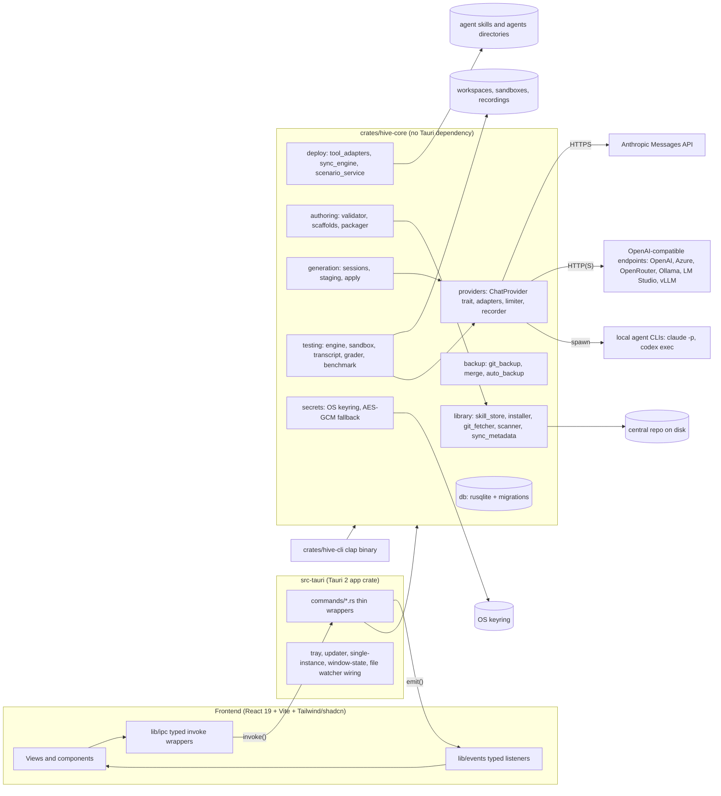
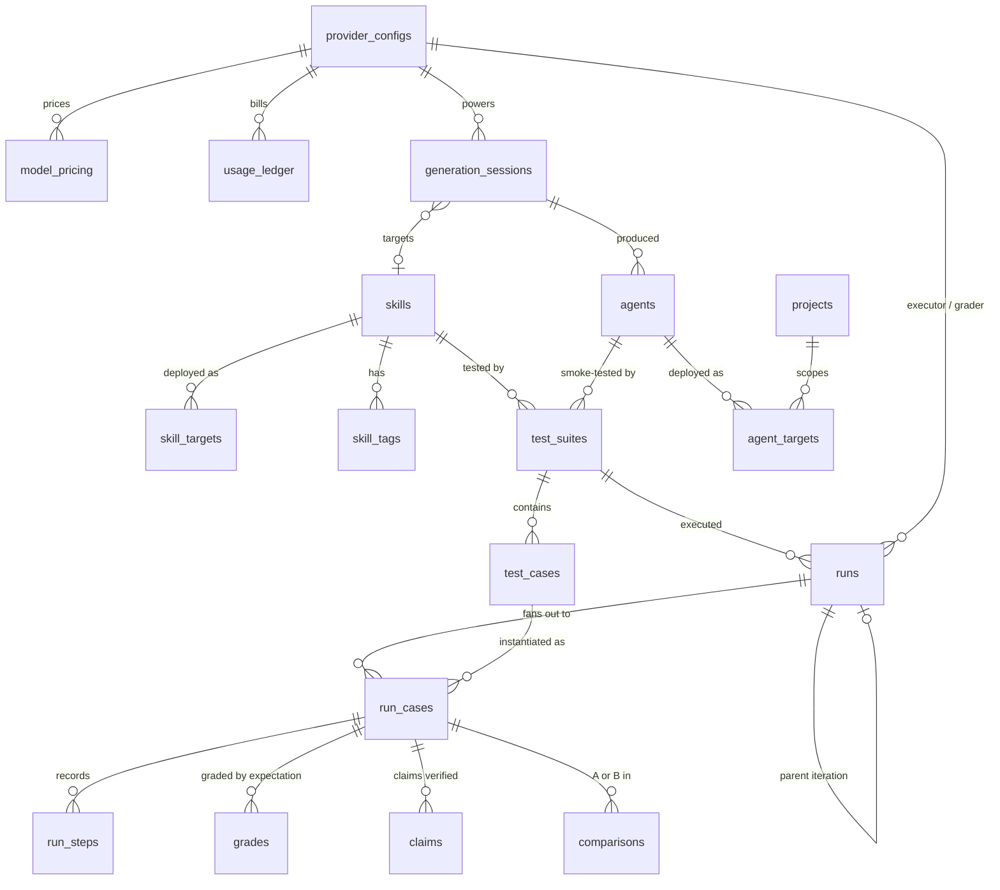
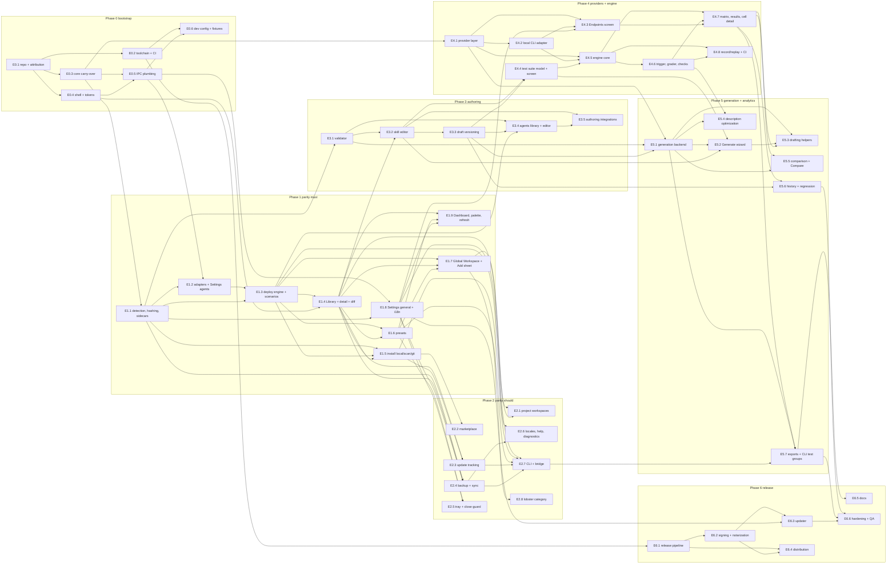

# Skill Hive: Implementation Plan

A cross-platform desktop app (Windows, macOS, Linux) for creating, generating and testing agent skills and agents, starting from feature parity with [Skills Manager](https://github.com/xingkongliang/skills-manager) (reference version 1.41.0, commit `73d6b8f77b`).

Plan date: 2026-10-12. Working title: Skill Hive (placeholder; rename freely).

How this plan was produced: the request was run as a graph of bounded nodes (`automations/skills-studio-plan/graph.md`). A deterministic inventory of the reference repository anchors two reference analyses (Appendix A and B); the format/testing model, architecture, product design, UI/UX specification and roadmap were each written by a separate bounded step and gated by checks recorded in `automations/skills-studio-plan/checks.md`.

## Contents

- [Executive summary](#executive-summary)
- [Requirements and traceability](#requirements-and-traceability)
- [Part 1: Architecture and technology stack](#part-1-architecture-and-technology-stack)
  - [1. Desktop framework: Tauri 2 versus Electron](#1-desktop-framework-tauri-2-versus-electron)
  - [2. Repository layout and module map](#2-repository-layout-and-module-map)
  - [3. Data model](#3-data-model)
  - [4. LLM provider layer](#4-llm-provider-layer)
  - [5. Test execution engine](#5-test-execution-engine)
  - [6. Security](#6-security)
  - [7. Packaging and CI](#7-packaging-and-ci)
  - [8. Development environment and test tooling](#8-development-environment-and-test-tooling)
- [Part 2: Skill and agent formats, and how they are tested](#part-2-skill-and-agent-formats-and-how-they-are-tested)
  - [1. The Agent Skills format](#1-the-agent-skills-format)
  - [2. Agent definition formats](#2-agent-definition-formats)
  - [3. The skill-creator testing model](#3-the-skill-creator-testing-model)
  - [Format validation rules](#format-validation-rules)
  - [Testing taxonomy](#testing-taxonomy)
- [Part 3: Creating, generating and testing skills and agents](#part-3-creating-generating-and-testing-skills-and-agents)
  - [Shared foundations](#shared-foundations)
  - [Part A — Authoring](#part-a-authoring)
  - [Part B — Generation](#part-b-generation)
  - [Part C — Testing](#part-c-testing)
  - [Part D — Workflows](#part-d-workflows)
  - [Sources relied on](#sources-relied-on)
- [Part 4: UI/UX design system and screen specifications](#part-4-uiux-design-system-and-screen-specifications)
  - [Research record: every ui-ux-pro-max search and what it returned](#research-record-every-ui-ux-pro-max-search-and-what-it-returned)
  - [Decisions taken from the search results, and why](#decisions-taken-from-the-search-results-and-why)
  - [Component set and theming approach (from ui-styling)](#component-set-and-theming-approach-from-ui-styling)
  - [1. Design principles for this product](#1-design-principles-for-this-product)
  - [2. Design tokens](#2-design-tokens)
  - [3. Layout](#3-layout)
  - [4. Component inventory](#4-component-inventory)
  - [5. Screen specifications](#5-screen-specifications)
  - [6. Accessibility checklist](#6-accessibility-checklist)
  - [7. Icon set](#7-icon-set)
  - [Sources](#sources)
- [Part 5: Delivery roadmap, work breakdown and risks](#part-5-delivery-roadmap-work-breakdown-and-risks)
  - [1. Conventions used in this roadmap](#1-conventions-used-in-this-roadmap)
  - [2. Phases, goals, exit criteria and work breakdown](#2-phases-goals-exit-criteria-and-work-breakdown)
  - [3. Epic dependency graph](#3-epic-dependency-graph)
  - [4. Milestones and demo scripts](#4-milestones-and-demo-scripts)
  - [5. Team, roles and cadence](#5-team-roles-and-cadence)
  - [6. Risks and mitigations](#6-risks-and-mitigations)
  - [7. Definition of done for v1.0 and the test strategy](#7-definition-of-done-for-v10-and-the-test-strategy)
  - [8. First two weeks: the first 15 tasks in order](#8-first-two-weeks-the-first-15-tasks-in-order)
  - [9. Deferred items and how the ledger records them](#9-deferred-items-and-how-the-ledger-records-them)
- [Appendix A: Reference app: screens and features](#appendix-a-reference-app-screens-and-features)
  - [Application shell, context and global shortcuts](#application-shell-context-and-global-shortcuts)
  - [Dashboard (`/`)](#dashboard)
  - [Library — My Skills (`/my-skills`)](#library-my-skills-my-skills)
  - [Install Skills (`/install`)](#install-skills-install)
  - [Global Workspace (`/global-workspace`, `/global-workspace/:agentKey`)](#global-workspace-global-workspace-global-workspaceagentkey)
  - [Lobster Workspace (`/lobster-workspace`, `/lobster-workspace/:agentKey`)](#lobster-workspace-lobster-workspace-lobster-workspaceagentkey)
  - [Project Workspace detail (`/project/:id`)](#project-workspace-detail-projectid)
  - [Backup (`/backup`)](#backup-backup)
  - [Settings (`/settings`)](#settings-settings)
  - [Global component: Sidebar](#global-component-sidebar)
  - [Global component: Command Palette](#global-component-command-palette)
  - [Global component: Add Skills sheet](#global-component-add-skills-sheet)
  - [Global component: Skill detail panel (library)](#global-component-skill-detail-panel-library)
  - [Global components: document and source diff viewers](#global-components-document-and-source-diff-viewers)
  - [Global components: batch toolbar and batch dialogs](#global-components-batch-toolbar-and-batch-dialogs)
  - [Global components: preset dialogs and preset bar](#global-components-preset-dialogs-and-preset-bar)
  - [Global components: git setup, recovery and first-run dialogs](#global-components-git-setup-recovery-and-first-run-dialogs)
  - [Global components: toasts, status banner, close guard, help dialog](#global-components-toasts-status-banner-close-guard-help-dialog)
  - [Global component: system tray menu (`src-tauri/src/lib.rs`)](#global-component-system-tray-menu-src-taurisrclibrs)
  - [Small shared widgets](#small-shared-widgets)
  - [Observed i18n and IPC gaps (facts about the reference, not proposals)](#observed-i18n-and-ipc-gaps-facts-about-the-reference-not-proposals)
  - [Parity checklist](#parity-checklist)
- [Appendix B: Reference app: domain model, core services and CLI](#appendix-b-reference-app-domain-model-core-services-and-cli)
  - [1. Data model](#1-data-model)
  - [2. Skill detection and metadata](#2-skill-detection-and-metadata)
  - [3. Agents](#3-agents)
  - [4. Install sources and flows](#4-install-sources-and-flows)
  - [5. Deployment](#5-deployment)
  - [6. Git backup and multi-device sync](#6-git-backup-and-multi-device-sync)
  - [7. Cross-cutting services](#7-cross-cutting-services)
  - [8. The CLI surface](#8-the-cli-surface)
  - [Core capabilities for parity](#core-capabilities-for-parity)
- [Appendix C: Reference inventory facts](#appendix-c-reference-inventory-facts)

## Executive summary

**What is being built.** Skill Hive is a cross-platform desktop application (Windows, macOS, Linux) for managing, authoring, generating and testing agent skills and Claude Code subagents. Its first release reproduces the feature set of Skills Manager v1.41.0 (commit `73d6b8f`, MIT; inventoried in `n1_ref_ui.md` and `n2_ref_core.md`): a central skill library with tags and presets, install sources (local folders and archives, scanning of agent folders, git repositories with preview, the skills.sh marketplace), deployment by symlink or copy into the global directories of 54 coding and "lobster" agents, global and project workspaces, update tracking with held-back removals, git backup with snapshots, a system tray, three locales and a `--json` CLI that coding agents drive. On top of that parity base it adds what the reference does not have: a skill editor and an agent editor with the validation rules S-01 to S-34, A-01 to A-19 and C-01 to C-02 from the formats section, a provider layer for Anthropic, OpenAI-compatible (OpenAI, Azure, OpenRouter, Ollama, LM Studio, vLLM) and local agent CLI endpoints with secrets in the OS keyring, a test engine that runs trigger tests, expectation tests graded by an LLM with cited evidence, deterministic checks and blind A/B comparisons in isolated sandboxes with recorded fixtures for replay, a generation wizard that turns a plain-language goal into a validated draft with evals, and results analytics with baselines, regression detection and exports in the skill-creator schemas.

**Recommended stack.** Tauri 2 with a Rust workspace of three crates (`hive-core` without a Tauri dependency, `hive-cli`, and the `src-tauri` app crate), reusing the reference's MIT-licensed Rust core (46.6k lines: deployment engine, scenario service, metadata sidecars, git fetcher, backup, file watcher, repo lock) under its attribution obligations; a React 19 + Vite 7 + TypeScript 5.9 frontend built on shadcn/ui ("new-york") with Tailwind v4, the design tokens, dense layout and keyboard model of the UI specification (`n6_ui_design.md`, produced with the ui-ux-pro-max and ui-styling skills), TanStack Query over typed IPC wrappers, CodeMirror 6 for editors, SQLite (`hive.db`, reference migrations v1 to v8 carried over, v9 to v12 new) and the OS keyring for provider secrets. The decision and its reasoning are in `n4_architecture.md` §1; the alternative (Electron with a TypeScript rewrite of the core) was rejected because it forfeits the tested safety core.

**Phases.** Seven phases, 49 epics, 645 ideal engineer-days, scheduled over 44 weeks for a team of five engineering FTE plus part-time design and product (capacity 770 ideal days at a 0.7 focus factor, a 16 percent buffer):

| Phase | Goal | Weeks | Ideal engineer-days |
|---|---|---|---|
| 0 Project bootstrap | repo, toolchain, CI matrix on three OSes, app shell, design tokens, core carry-over | 1 to 4 | 42 |
| 1 Parity must-haves | library, install sources, agent catalog, deploy and undeploy, presets, global workspaces, settings | 5 to 14 | 128 |
| 2 Parity should-haves | project workspaces, marketplace, update tracking, backup and sync, tray, i18n, CLI | 15 to 22 | 118 |
| 3 Authoring | skill and agent editors, draft versioning, validation | 23 to 29 | 78 |
| 4 Providers and test engine | endpoints, sandboxes, executors, trigger and expectation tests, grader, results views, replay fixtures | 23 to 35 | 140 |
| 5 Generation and analytics | generation wizard, description optimization, A/B comparison, history and regression, exports | 36 to 40 | 86 |
| 6 Packaging and release | release pipeline, signing and notarization, updater, distribution, docs, hardening | 38 to 44 | 53 |

Phases 3 and 4 run in parallel because one is frontend-heavy and the other Rust-heavy; Phase 6 overlaps the end of Phase 5 because the release pipeline is exercised from the first beta.

**First milestone.** M0 at the end of week 4, "an empty app that ships": the Tauri window opens on all three operating systems with the sidebar, header, status bar, command palette shell and both themes; `hive.db` migrates to schema v8 in a development base directory; the file watcher refreshes the UI; `cargo test` and `npm test` are green on ubuntu, macos and windows runners; the release workflow attaches unsigned bundles for all five targets to a draft release; the MIT attribution files are in place. The first user-visible milestone, M1 at week 14, is "library parity": install a skill from a folder or a git URL, see it in the Library, deploy it to Claude Code and Codex with a click, create a preset, apply it from the Global Workspace, and import what already sits in the agent folders.

**Main risks.** (1) Three different webviews (WKWebView, WebView2, WebKitGTK) render the same CSS differently, mitigated by WebKit-first visual checks from Phase 0; (2) symlinks on Windows require privileges, mitigated by the carried-over symlink-to-junction-to-copy fallback and Windows CI for the sync engine; (3) Linux sessions without a Secret Service break the keyring, mitigated by the labelled AES-256-GCM fallback and the environment-variable auth mode; (4) LLM spend, mitigated by per-run budgets, pre-run estimates, a usage ledger and zero-cost replay in CI; (5) LLM-judged tests are noisy, mitigated by repetitions, deterministic checks, a burden-of-proof grader, the R6 flakiness rule and recorded fixtures; (6) reuse of MIT code carries attribution duties and forbids reuse of the upstream name, identifier, icons and updater key; (7) macOS notarization and Windows signing need certificates with lead time, procured in week 1 and verified in CI from the first beta. The full register with owners and early-warning signals is in section 6 below.

## Requirements and traceability

The plan answers the six requirements given in the request. Each row names the parts of this document that cover it.

| # | Requirement | Covered in |
|---|---|---|
| R1 | Create a desktop app that can run on Windows, macOS and Linux | Part 1, Part 5 |
| R2 | The desktop app will be used for creating and testing skills | Part 2, Part 3, Part 5 |
| R3 | Initial functionality should match https://github.com/xingkongliang/skills-manager | Appendix A, Appendix B, Part 5 |
| R4 | Then add the ability to generate skills and agents as well as test them | Part 3, Part 5 |
| R5 | Use the ui-ux-pro-max and ui-styling skills to build the UI | Part 4 |
| R6 | Use an LLM endpoint to test the skills and agents | Part 1, Part 3 |

## Part 1: Architecture and technology stack

This section fixes the technical architecture of Skill Hive, the cross-platform desktop app that first reproduces skills-manager v1.41.0 (commit `73d6b8f`, MIT; `n0_inventory.json` key `reference`) and then adds skill and agent authoring, LLM-driven generation, and testing against a configurable endpoint. Every parity claim cites the inventory JSON (`automations/skills-studio-plan/out/n0_inventory.json`, referenced below by key path) or a reference file under `automations/skills-studio-plan/sources/skills-manager/`; the domain description of the reference core is in `n2_ref_core.md`, the screen inventory in `n1_ref_ui.md`, and the file formats and testing model in `n3_formats.md`. Decisions are stated as decisions; where a choice depends on something not yet verified, the subsection says what must be verified before the code is written.

### 1. Desktop framework: Tauri 2 versus Electron

The reference is a Tauri 2 application: `tauri = { version = "2.10.0", features = ["tray-icon"] }` with `tauri-build 2.5.4`, the plugins `log`, `dialog`, `shell`, `opener`, `clipboard-manager`, `updater`, `single-instance` and `window-state`, `rusqlite 0.31` with the bundled SQLite, `git2 0.19` with vendored OpenSSL, `reqwest 0.12`, `keyring 3`, `notify 6.1.1` and `clap 4.5` (`src-tauri/Cargo.toml`; `n0_inventory.json` key `dependencies.cargo`). The frontend is React 19.2, Vite 7.3, TypeScript 5.9 and Tailwind 3.4 with `react-router-dom 7`, `i18next`, `lucide-react`, `react-markdown`, `sonner` and two drag-and-drop libraries (`package.json`; keys `dependencies.npm` and `dependencies.npm_dev`). The Rust crate is built as `staticlib`, `cdylib` and `rlib` under the name `app_lib` and is linked by both the desktop binary and the second `[[bin]]`, `skills-manager-cli` (`src-tauri/Cargo.toml` `[lib]`; `n2_ref_core.md` §8.1). The code split is 46,638 lines of Rust in 61 files against 19,193 lines of TypeScript in 66 files (`totals.rust_loc`, `totals.rust_files`, `totals.ts_tsx_loc`, `totals.ts_tsx_files`).

The comparison that matters is therefore not "Tauri versus Electron in the abstract" but "keep the reference's Rust core or rewrite it". The table weighs the five criteria named in the brief.

| criterion | Tauri 2 (reference stack) | Electron |
|---|---|---|
| bundle size | The binary embeds only the app code and the Rust dependencies; the webview is the operating system's. A release build of the reference ships as a single `.app`, `.msi`/`.exe`, `.AppImage`, `.deb` and `.rpm` from one `tauri build` (`tauri.conf.json` `bundle.targets: "all"`), in the low tens of megabytes, dominated by vendored OpenSSL, libgit2 and SQLite. | Every build ships a full Chromium plus Node.js runtime, typically 150-250 MB installed per platform before application code. |
| memory | One process for the Rust core plus the platform webview; the reference keeps the whole library, file watcher, git backup and auto-updater loops inside that one process. Idle footprint is that of a system webview page. | Main process plus a renderer per window plus GPU and utility processes; idle footprint of several hundred megabytes is normal. |
| webview per OS | macOS: WKWebView (WebKit, follows the OS version; the reference sets `minimumSystemVersion 10.15`, `tauri.conf.json` `bundle.macOS`). Windows: WebView2 (Chromium-based Edge runtime, evergreen, installed by the bundler's bootstrapper when absent). Linux: WebKitGTK 4.1 (`libwebkit2gtk-4.1-dev` in the release workflow's apt list, `.github/workflows/release.yml` step "Install Linux system dependencies"). Rendering therefore differs between WebKit (macOS, Linux) and Chromium (Windows), which the frontend must absorb with feature-tested CSS and no Chromium-only APIs. | Identical Chromium everywhere, pinned by the Electron version; no per-OS rendering differences, at the cost of shipping and patching that Chromium yourself. |
| Rust skill requirement | Mandatory. Everything below the IPC boundary is Rust, and the new provider, testing and generation layers are Rust too. The team must be comfortable with `tokio`, `rusqlite`, `reqwest` and the Tauri command model. | Optional. The core could be TypeScript on Node, but the reference core would then have to be rewritten or bound through N-API/Neon or driven as a sidecar process. |
| reuse of the MIT reference code | Direct. The `src-tauri/src/core/*` modules (central repo, metadata sidecars, scanner, installer, git fetcher, sync engine, scenario service, merge engine, file watcher, repo lock, CLI bridge; `n2_ref_core.md` §1-§8) compile as-is into a Tauri 2 app and the `commands/*.rs` wrappers are the parity IPC surface. | Only the TypeScript views would carry over; 46.6k lines of Rust would be rewritten or wrapped, and the parity bar in `n2_ref_core.md` ("Core capabilities for parity") would have to be re-earned from scratch in a second implementation. |

**Decision: Tauri 2, pinned to the reference's major versions (`tauri 2.x`, `tauri-build 2.x`, the eight plugins listed above) and upgraded within the 2.x line at project start.** The deciding factor is the last row: the reference's safety core (target classification and replace policies in `sync_engine.rs`, the held-back-removal guard in `removals.rs`, the metadata reindex in `sync_metadata.rs`, the merge pipeline in `core/merge/`) represents the bulk of the engineering risk of a skill manager, it is already tested (`core/merge/integration_tests.rs` alone is 1,062 lines, `n0_inventory.json` key `rust_modules`), and it is licensed for reuse. The webview inconsistency is the real cost of Tauri and it is paid in the frontend: the design system in the UI section must be verified on WebKitGTK and WKWebView, not only in a Chromium dev browser, and the end-to-end suite in §8 runs on Linux (WebKitGTK) for exactly that reason. The Rust skill requirement is accepted because the new layers (an HTTP provider abstraction, a process executor, an SQLite-backed run store) are the kind of code Rust does well and because the CLI parity story depends on a single core.

**Attribution obligations.** The reference is MIT-licensed (`reference.license`; `package.json` `"license": "MIT"`; `src-tauri/Cargo.toml` `license = "MIT"`). The MIT licence permits use, copying, modification and redistribution on one condition: the copyright notice and the permission notice must be included in all copies or substantial portions of the software. Concretely, Skill Hive must (1) keep the upstream `LICENSE` text with its copyright line (author `tianliang`, `src-tauri/Cargo.toml` `authors`) in the repository as `THIRD_PARTY_LICENSES/skills-manager.MIT.txt`; (2) add a header comment to every Rust and TypeScript file copied or derived from the reference naming the origin repository, commit `73d6b8f77bba6719924885c1f3be56b828d5a192` (`reference.commit`) and the MIT licence; (3) list the reference in the About screen's open-source acknowledgements alongside the Cargo and npm licence inventory generated at build time; (4) not reuse the product name "Skills Manager", the bundle identifier `com.agentskills.desktop`, the icons, the updater public key or the updater endpoint (`tauri.conf.json` `identifier`, `bundle.icon`, `plugins.updater.pubkey`, `plugins.updater.endpoints`), because those are the upstream project's identity and signing material, not licensed code; and (5) not present derived work as endorsed by the upstream author. MIT imposes no copyleft, so Skill Hive's own additions may carry a different licence, but the mixed-origin files keep the MIT notice.

### 2. Repository layout and module map

Skill Hive is one repository with an npm project at the root for the frontend and a Cargo workspace for the Rust side. The reference puts everything Rust into one crate with a library and two binaries; Skill Hive splits that into a core crate with no Tauri dependency, a Tauri app crate and a CLI crate, so the CLI never links the Tauri runtime and the core can be unit-tested without a window. The reference already contains the seam: its CLI imports `app_lib::commands::{presets, skills, tools}` plus the `core::*` modules (`n2_ref_core.md` §8.1), and its progress and cancellation plumbing is a `ProgressCallback` plus an `Arc<AtomicBool>` rather than a Tauri handle (`n2_ref_core.md` §4.2, §4.4). The split moves the Tauri-specific parts of `commands/*.rs` (the `AppHandle` emits, the tray refreshes) behind a `Notifier` trait that the app implements with `AppHandle::emit` and the CLI implements with JSON lines on stderr.

```text
skill-hive/
├── package.json                  # frontend scripts (dev, build, lint, test, tauri, cli) - mirrors package.json of the reference
├── Cargo.toml                    # workspace: members = ["crates/hive-core", "crates/hive-cli", "src-tauri"]
├── src/                          # React 19 + Vite 7 + TypeScript 5.9 frontend
│   ├── app/                      # router (routes carried over from n0 `routes` plus /authoring, /testing, /providers, /generate)
│   ├── views/                    # Dashboard, Library, Install, GlobalWorkspace, LobsterWorkspace, ProjectDetail, Backup, Settings (parity)
│   │                             # + SkillEditor, AgentEditor, TestSuite, RunDetail, Providers, GenerationSession (new)
│   ├── components/ui/            # shadcn/ui primitives (Radix + Tailwind), per the ui-styling skill
│   ├── components/               # feature components (Sidebar, CommandPalette, AddSkillsSheet, SyncDots, ... carried over)
│   ├── lib/ipc/                  # typed invoke() wrappers, one module per command area (replaces the 859-line src/lib/tauri.ts)
│   ├── lib/events/               # typed listen() wrappers for app-files-changed, test-run-progress, generation-delta, ...
│   ├── i18n/                     # en.json carried over (21 namespaces, n0 `i18n_namespaces`) + studio namespaces
│   └── context/                  # AppContext (library state) + QueryClient (TanStack Query) for IPC caching
├── src-tauri/                    # Tauri app crate "skill-hive"
│   ├── tauri.conf.json           # window, CSP, updater, bundle (see §6, §7)
│   ├── capabilities/default.json # main-window capability (see §6)
│   ├── src/commands/             # thin #[tauri::command] wrappers grouped by area (parity files + authoring.rs, generation.rs, testing.rs, providers.rs)
│   └── src/lib.rs, main.rs       # setup: single-instance, window-state, tray, updater, file watcher, auto-backup, cli bridge
├── crates/hive-core/           # library crate, no tauri dependency
│   └── src/
│       ├── library/              # central_repo, skill_store, sync_metadata, skill_metadata, content_hash, installer, git_fetcher, scanner, project_scanner, skillssh_api, well_known, removals, skill_auto_updater, install_cancel
│       ├── deploy/               # tool_adapters, tool_service, sync_engine, scenario_service
│       ├── backup/               # git_backup, git_credentials, github_api, git2_engine, auto_backup, merge/*
│       ├── authoring/            # frontmatter, skill_scaffold, agent_scaffold, validator (rules S-*, A-*, C-* from n3_formats.md), packager
│       ├── generation/           # session, prompts, staging (proposed file sets), apply
│       ├── providers/            # traits, anthropic, openai_compat, local_cli, secrets, pricing, limiter, recorder
│       ├── testing/              # engine, scheduler, sandbox, transcript, metrics, grader, benchmark, trigger_eval, comparator, analyzer, history
│       ├── db/                   # migrations (reference v1-v8 carried over, v9+ new), row structs
│       └── util/                 # error, path_guard, repo_lock, file_watcher, audit_log, log_sanitize, panic_log, timing, cli_bridge, crypto
├── crates/hive-cli/            # clap binary "skill-hive-cli": the reference command tree + `validate`, `test`, `providers`, `agents def` groups
├── scripts/                      # run-rust-cli.mjs (carried over), prepare-release.mjs, gen-ipc-types.mjs
└── .github/workflows/            # test.yml, frontend.yml, release.yml, prepare-release.yml (n0 `ci.workflows`, minus claude.yml)
```

The frontend stack stays what the reference proved on all three webviews, React 19 + Vite + Tailwind, with two changes. First, components are built on shadcn/ui (Radix primitives plus Tailwind) so that dialogs, sheets, dropdowns, tables and command palettes are accessible by construction; the reference's hand-rolled `DetailSheet`, `ConfirmDialog`, `CommandPalette` and `ToggleSwitch` (`n0_inventory.json` key `components`) map onto `Sheet`, `AlertDialog`, `Command` and `Switch`. Second, IPC reads go through TanStack Query keyed by command name and arguments, invalidated by the `app-files-changed` event the reference already emits from its file watcher (`n2_ref_core.md` §7), instead of the single 477-line `AppContext.tsx` that reloads everything on every change. Routing keeps every reference route (`n0_inventory.json` key `routes`: `/`, `/my-skills`, `/global-workspace`, `/global-workspace/:agentKey`, `/lobster-workspace`, `/lobster-workspace/:agentKey`, `/install`, `/backup`, `/project/:id`, `/settings`) and adds `/skills/:id/edit`, `/agents`, `/agents/:id/edit`, `/testing`, `/testing/suites/:id`, `/testing/runs/:id`, `/providers` and `/generate/:sessionId`.



#### 2.1 IPC command catalog: parity baseline

The parity baseline is the 123 backend commands in `n0_inventory.json` key `ipc.backend_commands` (`ipc.backend_count` = 123), grouped by the reference file that implements them. Every name is kept verbatim so that the reference's `src/lib/tauri.ts` wrappers and its i18n strings port without renaming. The table was produced from the inventory by `automations/skills-studio-plan/code/group_ipc_commands.py`.

| reference file | count | commands (parity baseline) |
|---|---|---|
| `src-tauri/src/commands/agent_workspace.rs` | 5 | `get_global_local_skills`, `get_global_local_skill_document`, `import_global_local_skill_to_center`, `update_global_local_skill_from_center`, `delete_global_local_skill` |
| `src-tauri/src/commands/browse.rs` | 2 | `fetch_leaderboard`, `search_skillssh` |
| `src-tauri/src/commands/git_backup.rs` | 24 | `git_backup_fetch`, `git_backup_status`, `git_backup_init`, `github_backup_connect`, `github_device_flow_start`, `github_device_flow_poll`, `git_backup_sanitize_remote_url`, `git_backup_set_remote`, `git_backup_remove_remote`, `git_backup_commit`, `git_backup_push`, `git_backup_pull`, `git_backup_sync`, `git_backup_pending_conflicts`, `git_backup_resolve_conflict`, `git_backup_clone`, `git_backup_reclone`, `git_backup_create_snapshot`, `git_backup_list_versions`, `git_backup_restore_version`, `backup_device_name`, `backup_set_device_name`, `git_backup_size_report`, `git_backup_migrate_credentials` |
| `src-tauri/src/commands/presets.rs` | 13 | `get_presets`, `get_active_preset`, `create_preset`, `update_preset`, `delete_preset`, `apply_preset_to_default`, `switch_preset`, `add_skill_to_preset`, `remove_skill_from_preset`, `reorder_presets`, `get_preset_skill_order`, `reorder_preset_skills`, `apply_preset_to_coding_agents` |
| `src-tauri/src/commands/projects.rs` | 17 | `get_projects`, `add_project`, `add_linked_workspace`, `remove_project`, `reveal_project_folder`, `reorder_projects`, `scan_projects`, `get_project_agent_targets`, `get_project_skills`, `get_project_skill_document`, `import_project_skill_to_center`, `update_project_skill_to_center`, `slugify_skill_names`, `export_skill_to_project`, `update_project_skill_from_center`, `toggle_project_skill`, `delete_project_skill` |
| `src-tauri/src/commands/scan.rs` | 3 | `scan_local_skills`, `import_existing_skill`, `import_all_discovered` |
| `src-tauri/src/commands/settings.rs` | 19 | `get_settings`, `log_startup_event`, `set_settings`, `get_central_repo_path`, `get_central_repo_path_override`, `get_central_repo_pending_path`, `get_central_repo_warnings`, `set_central_repo_path`, `open_central_repo_folder`, `check_app_update`, `get_diagnostic_info`, `check_last_panic`, `clear_last_panic`, `get_recent_log_excerpt`, `export_logs_zip`, `app_exit`, `restart_app`, `update_install_blocker`, `hide_to_tray` |
| `src-tauri/src/commands/skills.rs` | 25 | `get_managed_skills`, `get_skills_for_preset`, `get_skill_document`, `get_source_skill_document`, `get_skill_source_diff`, `delete_managed_skill`, `delete_managed_skills`, `install_local`, `install_git`, `install_from_skillssh`, `preview_git_install`, `confirm_git_install`, `cancel_git_preview`, `check_skill_update`, `check_all_skill_updates`, `update_skill`, `reimport_local_skill`, `batch_update_skills`, `detach_local_skill_source`, `get_all_tags`, `set_skill_tags`, `rename_tag`, `delete_tag`, `cancel_install`, `batch_import_folder` |
| `src-tauri/src/commands/sync.rs` | 4 | `sync_skill_to_tool`, `unsync_skill_from_tool`, `get_skill_tool_toggles`, `set_skill_tool_toggle` |
| `src-tauri/src/commands/tools.rs` | 11 | `get_tool_status`, `set_tool_enabled`, `set_all_tools_enabled`, `get_tool_order_cmd`, `set_tool_order_cmd`, `set_custom_tool_path`, `reset_custom_tool_path`, `set_custom_tool_project_path`, `reset_custom_tool_project_path`, `add_custom_tool`, `remove_custom_tool` |

Two cross-check facts from the inventory shape the baseline. `apply_preset_to_coding_agents` is backend-only (`ipc.backend_only`): it is reachable only from the tray preset submenu (`n1_ref_ui.md`, "Observed i18n and IPC gaps"), and Skill Hive keeps it for the tray. `relink_local_skill_source` is frontend-only (`ipc.frontend_only`): the reference's Library calls a wrapper with no backend handler, so Skill Hive implements it as a real command (`relink_local_skill_source(skill_id, new_source_path)`) that validates the path, rehashes it and updates `source_ref`, which closes the reference's gap rather than carrying it over. The events the reference emits are also part of the baseline: `app-files-changed` (debounced 500 ms from the file watcher), `skills-auto-updated` and `backup-auto-completed` (`n2_ref_core.md` §4.5, §6.4, §7).

#### 2.2 IPC command catalog: new areas

Every new command is named here; the UI section and the roadmap refer to these names. Commands are grouped by the new `commands/*.rs` file that hosts them. All take and return `serde` structs, errors are the reference's `AppError { kind, message, details }` contract (`n2_ref_core.md` §7, "Error contract") extended with three kinds, `provider`, `validation` and `budget_exceeded`, and long-running commands return an id immediately and report through events.

**`commands/authoring.rs`** (skills, agents and command files as editable documents):

| command | purpose |
|---|---|
| `create_skill_scaffold(name, description, template, destination)` | writes a new skill directory (`SKILL.md` plus optional `scripts/`, `references/`, `assets/`, `evals/`) into the library or a project path; the name passes `sanitize_skill_name` and rules S-10 to S-14 |
| `get_skill_tree(skill_id)` | file tree with sizes, types and the content scope flags used by hashing (`n2_ref_core.md` §2.4) |
| `read_skill_file(skill_id, rel_path)` / `write_skill_file(skill_id, rel_path, content)` / `rename_skill_file(skill_id, from, to)` / `delete_skill_file(skill_id, rel_path)` / `create_skill_dir(skill_id, rel_path)` | editor file operations, all path-guarded to the skill root and all followed by a rehash and a copy-target resync (`resync_copy_targets`, `n2_ref_core.md` §4.2) |
| `validate_skill(skill_id_or_path, profile)` | runs every rule S-01 to S-34 from `n3_formats.md` ("Format validation rules") and returns all findings with severity, rule id, path and line; `profile` is `portable` or `claude_code` |
| `package_skill(skill_id, dest_path)` | produces a `.skill` zip whose extracted hash equals the directory hash (`n2_ref_core.md` §4.1) |
| `get_agents()` / `get_agent_document(agent_id)` / `create_agent(definition)` / `update_agent(agent_id, definition)` / `delete_agent(agent_id)` | the agent library (table `agents`, §3.2); a definition is frontmatter fields plus the Markdown body per `n3_formats.md` §2.1 |
| `validate_agent(agent_id_or_path)` | rules A-01 to A-19; `validate_command_file(path)` runs C-01 and C-02 |
| `scan_agent_definitions(scope, project_id?)` / `import_agent_definition(path)` | discovers existing files under `~/.claude/agents/` or `<project>/.claude/agents/` (recursive, identity by `name`, `n3_formats.md` §2.1) and imports them |
| `deploy_agent(agent_id, scope, project_id?, mode)` / `undeploy_agent(agent_id, target_id)` / `get_agent_targets(agent_id)` | writes or removes the agent file through the same `sync_engine` policies as skills, recorded in `agent_targets` |
| `export_agent_json(agent_ids)` | the `--agents` JSON form (`claude --agents '{"name": {"description", "prompt", "tools", "model"}}'`, `n3_formats.md` §2.1) used by the smoke test |
| `get_eval_set(skill_id)` / `save_eval_set(skill_id, evals_json)` / `get_trigger_set(skill_id)` / `save_trigger_set(skill_id, queries)` | reads and writes `evals/evals.json` (schema in `n3_formats.md` §3.2, validated by S-33) and the trigger query set (`[{query, should_trigger}]`, §3.5) |

**`commands/generation.rs`** (LLM-assisted authoring; every session is a row in `generation_sessions` and a JSONL transcript on disk):

| command | purpose |
|---|---|
| `start_generation_session(kind, brief, provider_config_id, model, effort, context)` | `kind` is `skill`, `agent`, `eval_set`, `trigger_set`, `description_opt` or `improve`; `context` names the skill, agent, suite or run to work from; returns `session_id` and streams `generation-delta` events |
| `send_generation_message(session_id, content)` | the user's next turn in the session |
| `cancel_generation_session(session_id)` | cancels the in-flight request through the provider's cancellation token |
| `get_generation_session(session_id)` / `list_generation_sessions(filter)` / `delete_generation_session(session_id)` | bookkeeping |
| `preview_generation_result(session_id)` | the staged file set as a per-file diff against the target skill or agent (reusing `DocumentDiffViewer`) |
| `apply_generation_result(session_id, mode)` | `mode` is `new_skill`, `overwrite`, or `new_iteration` (snapshot first, as the improve loop requires, `n3_formats.md` §3.1); runs `validate_skill` before writing and refuses on errors |
| `generate_eval_cases(skill_id, count, provider_config_id)` / `generate_trigger_queries(skill_id, provider_config_id)` | draft test cases and trigger queries in the exact `evals.json` and trigger-set shapes for the user to edit |
| `optimize_description(skill_id, trigger_set_id, provider_config_id, runner_provider_id, max_iterations)` | the 60/40 train/test loop of `n3_formats.md` §3.5 with the local CLI as the runner; emits `optimization-progress`, returns `best_description` with before/after scores |
| `suggest_improvements(run_id, provider_config_id)` | the post-hoc analysis (`analysis.json` shape, `n3_formats.md` §3.6) over a run's transcripts and grades |

**`commands/testing.rs`** (suites, cases, runs, artifacts):

| command | purpose |
|---|---|
| `get_test_suites(filter)` / `create_test_suite(spec)` / `update_test_suite(suite_id, spec)` / `delete_test_suite(suite_id)` | suite CRUD; `import_evals_json(skill_id)` and `export_evals_json(suite_id)` keep a suite and the skill's `evals/evals.json` in step |
| `get_test_cases(suite_id)` / `create_test_case(suite_id, case)` / `update_test_case(case_id, case)` / `delete_test_case(case_id)` / `reorder_test_cases(suite_id, ids)` | case CRUD |
| `start_test_run(suite_id, config)` | `config` = executor provider, grader provider, configurations (`with_skill`, `without_skill` or `old_skill`), `runs_per_case`, `concurrency`, `mode` (`live`, `record`, `replay`), `seed`, `budget_usd`, per-case timeout; returns `run_id`; emits `test-run-progress` and `test-step` |
| `cancel_test_run(run_id)` / `cancel_run_case(run_case_id)` | cooperative cancellation; partial results are kept and marked |
| `get_test_run(run_id)` / `list_test_runs(filter)` / `get_run_cases(run_id)` / `get_run_steps(run_case_id, page)` / `get_run_transcript(run_case_id, format)` / `get_run_outputs(run_case_id)` / `read_run_output_file(run_case_id, rel_path)` | result browsing; `format` is `jsonl` or `markdown` |
| `grade_run_case(run_case_id, grader_provider_id)` / `grade_test_run(run_id, grader_provider_id)` | (re)grading; writes `grading.json` and `grades` rows |
| `aggregate_benchmark(run_id)` | writes `benchmark.json` and `benchmark.md` in the `n3_formats.md` §3.4 shape |
| `compare_run_cases(run_case_a, run_case_b, provider_config_id)` / `analyze_comparison(comparison_id, provider_config_id)` | blind comparison and unblinded analysis (§3.6) |
| `start_trigger_eval(skill_id, trigger_set_id, runner_provider_id, runs_per_query, threshold, timeout_s, workers, description_override?)` | the `run_eval.py` measurement (`n3_formats.md` §3.5) as a run of kind `trigger` |
| `run_agent_smoke_test(agent_id, prompt, provider_config_id)` | load check (rules A-02 to A-14) then one executor run with the agent body as the system prompt |
| `submit_run_feedback(run_id, reviews)` / `get_run_history(skill_id)` | `feedback.json` and `history.json` (§3.7) |
| `delete_test_run(run_id, delete_artifacts)` / `export_test_run(run_id, dest_zip)` / `open_run_folder(run_id)` | artifact lifecycle; export passes through the log sanitiser (§6) |
| `get_usage_summary(filter)` | cost and token totals from `usage_ledger` by provider, model, purpose and period |

**`commands/providers.rs`** (endpoint configuration and secrets):

| command | purpose |
|---|---|
| `get_provider_configs()` / `create_provider_config(spec)` / `update_provider_config(id, spec)` / `delete_provider_config(id)` | configuration rows without secrets |
| `set_provider_secret(id, secret)` / `clear_provider_secret(id)` / `has_provider_secret(id)` | the only commands that touch the keyring; the secret value never appears in a return payload |
| `test_provider_connection(id)` | the "test connection" flow (§4.6); emits `provider-test-progress`, returns a structured report |
| `list_provider_models(id)` | model ids from the endpoint's models route, cached per config |
| `set_provider_role(id, role, enabled)` | `role` is `executor`, `grader` or `generator`; the default for each role |
| `estimate_request_cost(id, model, system, messages)` | token count (Anthropic `count_tokens` where available, local estimate otherwise) times the pricing row |
| `get_pricing_table()` / `set_model_pricing(id, model, prices)` | built-in prices plus user overrides |
| `detect_local_agent_clis()` | locates `claude` and `codex` on `PATH` (and the reference's `~/.skills-manager/bin` convention for its own CLI), returns versions |

New events: `test-run-progress { run_id, status, done, total, cost_usd }`, `test-step { run_case_id, step }`, `generation-delta { session_id, delta }`, `provider-test-progress { id, stage, ok, detail }` and `optimization-progress { session_id, iteration, train_score, test_score }`.

The CLI (`crates/hive-cli`) keeps the reference's five groups and every subcommand (`n0_inventory.json` key `cli.groups`: `repo`, `agents`, `skills`, `presets`, `git`; the full tree with handlers in `n2_ref_core.md` §8.3), the `--json`/`--skills-root` global flags and the `{"ok": false, "code": ...}` error envelope with exit codes 0, 1 and 2 (`n2_ref_core.md` §8.2), and adds `skills validate <REF>`, `agents def list|show|validate|deploy|undeploy`, `test suites|run|status|results|export`, `providers list|test|models` and `generate skill|agent|evals` so that coding agents can drive the testing loop through the published bridge binary exactly as they drive installs today (`n2_ref_core.md` §7, "CLI bridge"). `scripts/run-rust-cli.mjs` is carried over unchanged in behaviour: it resolves `cargo` from `CARGO`, `PATH` or `rustup which rustc`, and runs, builds or installs the CLI binary (`scripts/run-rust-cli.mjs`), with the manifest path and bin name updated.

### 3. Data model

#### 3.1 Reference tables carried over

Skill Hive opens its own database, `hive.db`, under its own base directory (`~/.skill-hive` by default, relocatable through the same `repo-config.json` mechanism, `n2_ref_core.md` §1.2), with WAL, foreign keys and the 5-second busy timeout, versioned by `PRAGMA user_version`. Migrations v1 to v8 are the reference's (`src-tauri/src/core/migrations.rs`, `LATEST_VERSION` 8, `n2_ref_core.md` §1.1), carried over verbatim so that the thirteen reference tables exist with the same columns and keys; Skill Hive's additions start at v9. An existing `~/.skills-manager` library is not opened in place; it is imported through the metadata sidecars (`skills/.skills-manager/schema.json`, `skills/<id>.json`, `scenarios/<id>.json`, `n2_ref_core.md` §1.2) using the reference's own `reindex_from_metadata`, which is the designed path for rebuilding a database from files.

The thirteen tables, with columns as the inventory extracted them from `migrations.rs` (`n0_inventory.json` key `sqlite_tables`). Three entries in the extracted column lists, `tool)` on `skill_targets`, `skill_id)` on `scenario_skills` and `skill_id`, `tool)` on `scenario_skill_tools`, and `tag)` on `skill_tags`, are not columns: they are the tails of the composite `UNIQUE`/`PRIMARY KEY` clauses that the extractor split on commas, and they are shown here as the keys they are.

| table | columns | keys and relationships |
|---|---|---|
| `skills` | `id`, `name`, `description`, `source_type`, `source_ref`, `source_ref_resolved`, `source_subpath`, `source_branch`, `source_revision`, `remote_revision`, `central_path`, `content_hash`, `enabled`, `created_at`, `updated_at`, `status`, `update_status`, `last_checked_at`, `last_check_error` | PK `id` (UUID v4); `central_path` UNIQUE |
| `skill_targets` | `id`, `skill_id`, `tool`, `target_path`, `mode`, `status`, `synced_at`, `last_error`, `source_hash` | PK `id`; FK `skill_id` → `skills`; UNIQUE `(skill_id, tool)` |
| `discovered_skills` | `id`, `tool`, `found_path`, `name_guess`, `fingerprint`, `found_at`, `imported_skill_id` | PK `id`; `imported_skill_id` → `skills` |
| `settings` | `key`, `value` | PK `key`; `proxy_url` and `git_backup_remote_url` AES-256-GCM encrypted (`n2_ref_core.md` §1.1) |
| `skillssh_cache` | `cache_key`, `data`, `fetched_at` | PK `cache_key` |
| `scenarios` | `id`, `name`, `description`, `icon`, `sort_order`, `created_at`, `updated_at` | PK `id`; `name` UNIQUE (a scenario is a preset) |
| `scenario_skills` | `scenario_id`, `skill_id`, `added_at`, `sort_order` (v3) | PK `(scenario_id, skill_id)` |
| `scenario_skill_tools` | `scenario_id`, `skill_id`, `tool`, `enabled`, `updated_at` | PK `(scenario_id, skill_id, tool)` |
| `active_scenario` | `key`, `scenario_id` | PK `key` (`current`); `scenario_id` → `scenarios` ON DELETE SET NULL |
| `projects` | `id`, `name`, `path`, `workspace_type`, `linked_agent_key`, `linked_agent_name`, `disabled_path`, `sort_order`, `created_at`, `updated_at` | PK `id` |
| `skill_tags` | `skill_id`, `tag` | PK `(skill_id, tag)`; index on `tag` |
| `audit_log` | `id`, `ts`, `action`, `skill_id`, `skill_name`, `tool`, `success`, `detail` | PK `id`; pruned to 10,000 rows |
| `pending_conflicts` | `skill_id`, `theirs_commit`, `theirs_path`, `detected_at` | PK `skill_id`; rebuildable projection of merge state |

`audit_log.action` gains the values `validate`, `generate`, `test_run`, `grade`, `provider_test` and `agent_deploy`; the `settings` table gains the keys `default_executor_provider`, `default_grader_provider`, `default_generator_provider`, `test_default_concurrency`, `test_keep_sandboxes`, `test_run_budget_usd` and `recording_mode`.

#### 3.2 New tables

Columns are typed as the reference types them: TEXT ids (UUID v4, or v7 where insertion order matters), INTEGER epoch milliseconds for timestamps, INTEGER 0/1 for booleans, and JSON stored as TEXT only for lists the app never queries by element.

```sql
-- v9: agents and their deployments (mirrors skills / skill_targets)
CREATE TABLE agents (
  id TEXT PRIMARY KEY,
  name TEXT NOT NULL UNIQUE,                 -- frontmatter name, rules A-02..A-04
  description TEXT NOT NULL,
  kind TEXT NOT NULL DEFAULT 'claude_subagent', -- claude_subagent | claude_command
  central_path TEXT NOT NULL UNIQUE,         -- <base>/agents/<name>.md
  frontmatter_json TEXT NOT NULL,            -- tools, model, permissionMode, maxTurns, skills, ... (n3_formats.md §2.1)
  content_hash TEXT NOT NULL,
  source_type TEXT NOT NULL DEFAULT 'authored', -- authored | import | generated
  source_ref TEXT,                           -- import path when source_type = import
  generation_session_id TEXT REFERENCES generation_sessions(id) ON DELETE SET NULL,
  validation_status TEXT NOT NULL DEFAULT 'unknown', -- ok | warnings | errors | unknown
  created_at INTEGER NOT NULL,
  updated_at INTEGER NOT NULL
);
CREATE TABLE agent_targets (
  id TEXT PRIMARY KEY,
  agent_id TEXT NOT NULL REFERENCES agents(id) ON DELETE CASCADE,
  scope TEXT NOT NULL,                       -- user | project
  project_id TEXT REFERENCES projects(id) ON DELETE CASCADE,
  target_path TEXT NOT NULL,                 -- ~/.claude/agents/<name>.md or <project>/.claude/agents/<name>.md
  mode TEXT NOT NULL,                        -- symlink | copy (as achieved, see sync_engine)
  status TEXT NOT NULL,
  synced_at INTEGER,
  last_error TEXT,
  source_hash TEXT,
  UNIQUE (agent_id, target_path)
);

-- v10: provider configuration and pricing (secrets live in the OS keyring, never here)
CREATE TABLE provider_configs (
  id TEXT PRIMARY KEY,
  name TEXT NOT NULL UNIQUE,
  kind TEXT NOT NULL,                        -- anthropic | openai_compat | local_cli
  flavor TEXT,                               -- openai | azure | openrouter | ollama | lmstudio | vllm | custom | claude_cli | codex_cli
  base_url TEXT,                             -- https://api.anthropic.com, http://localhost:11434/v1, ...
  default_model TEXT,
  api_version TEXT,                          -- anthropic-version header value, or Azure api-version query value
  auth_mode TEXT NOT NULL DEFAULT 'keyring', -- keyring | env | none
  auth_env_var TEXT,                         -- e.g. ANTHROPIC_API_KEY when auth_mode = env
  keyring_account TEXT,                      -- keyring account name when auth_mode = keyring
  extra_headers_json TEXT NOT NULL DEFAULT '{}', -- non-secret headers only (anthropic-beta, HTTP-Referer, X-Title)
  cli_program TEXT,                          -- local_cli: claude | codex | absolute path
  cli_args_json TEXT NOT NULL DEFAULT '[]',  -- local_cli: extra arguments
  timeout_ms INTEGER NOT NULL DEFAULT 600000,
  max_retries INTEGER NOT NULL DEFAULT 3,
  max_concurrency INTEGER NOT NULL DEFAULT 4,
  rpm_limit INTEGER,                         -- NULL = unlimited (client-side bucket)
  tpm_limit INTEGER,
  default_effort TEXT,                       -- low | medium | high | xhigh | max (Anthropic output_config.effort)
  default_max_tokens INTEGER NOT NULL DEFAULT 16000,
  supports_tools INTEGER NOT NULL DEFAULT 1,
  supports_streaming INTEGER NOT NULL DEFAULT 1,
  proxy_mode TEXT NOT NULL DEFAULT 'inherit',-- inherit the proxy_url setting | none
  role_executor INTEGER NOT NULL DEFAULT 0,
  role_grader INTEGER NOT NULL DEFAULT 0,
  role_generator INTEGER NOT NULL DEFAULT 0,
  last_test_at INTEGER,
  last_test_ok INTEGER,
  last_test_latency_ms INTEGER,
  last_test_error TEXT,
  created_at INTEGER NOT NULL,
  updated_at INTEGER NOT NULL
);
CREATE TABLE model_pricing (
  id TEXT PRIMARY KEY,
  provider_config_id TEXT NOT NULL DEFAULT '*', -- '*' = built-in default row
  model TEXT NOT NULL,
  input_per_mtok REAL NOT NULL,
  output_per_mtok REAL NOT NULL,
  cache_read_per_mtok REAL,
  cache_write_per_mtok REAL,
  source TEXT NOT NULL,                      -- builtin | user
  updated_at INTEGER NOT NULL,
  UNIQUE (provider_config_id, model)
);
CREATE TABLE usage_ledger (
  id INTEGER PRIMARY KEY AUTOINCREMENT,
  ts INTEGER NOT NULL,
  provider_config_id TEXT REFERENCES provider_configs(id) ON DELETE SET NULL,
  model TEXT NOT NULL,
  purpose TEXT NOT NULL,                     -- executor | grader | comparator | analyzer | generator | trigger | test_connection | count_tokens
  ref_kind TEXT,                             -- run_case | generation_session | provider_config
  ref_id TEXT,
  input_tokens INTEGER NOT NULL DEFAULT 0,
  output_tokens INTEGER NOT NULL DEFAULT 0,
  cache_read_tokens INTEGER NOT NULL DEFAULT 0,
  cache_write_tokens INTEGER NOT NULL DEFAULT 0,
  cost_usd REAL,
  latency_ms INTEGER,
  status TEXT NOT NULL,                      -- ok | error | cancelled | replayed
  request_id TEXT,
  error_kind TEXT
);

-- v11: test suites, cases, runs, steps, grades
CREATE TABLE test_suites (
  id TEXT PRIMARY KEY,
  name TEXT NOT NULL,
  kind TEXT NOT NULL,                        -- task_eval | trigger_eval | agent_smoke
  skill_id TEXT REFERENCES skills(id) ON DELETE CASCADE,
  agent_id TEXT REFERENCES agents(id) ON DELETE CASCADE,
  source TEXT NOT NULL DEFAULT 'db',         -- db | evals_json (mirrored to <skill>/evals/evals.json)
  baseline TEXT NOT NULL DEFAULT 'without_skill', -- without_skill | old_skill
  workspace_dir TEXT,                        -- <base>/workspaces/<skill-name>-workspace
  created_at INTEGER NOT NULL,
  updated_at INTEGER NOT NULL,
  CHECK (skill_id IS NOT NULL OR agent_id IS NOT NULL)
);
CREATE TABLE test_cases (
  id TEXT PRIMARY KEY,
  suite_id TEXT NOT NULL REFERENCES test_suites(id) ON DELETE CASCADE,
  eval_id INTEGER NOT NULL,                  -- evals[].id, unique per suite (rule S-33)
  name TEXT NOT NULL,                        -- eval_name, also the directory slug
  prompt TEXT NOT NULL,
  expected_output TEXT,
  files_json TEXT NOT NULL DEFAULT '[]',     -- paths relative to the skill root
  expectations_json TEXT NOT NULL DEFAULT '[]',
  should_trigger INTEGER,                    -- trigger_eval suites only
  enabled INTEGER NOT NULL DEFAULT 1,
  sort_order INTEGER NOT NULL DEFAULT 0,
  created_at INTEGER NOT NULL,
  updated_at INTEGER NOT NULL,
  UNIQUE (suite_id, eval_id)
);
CREATE TABLE runs (
  id TEXT PRIMARY KEY,                       -- UUID v7 so ORDER BY id is chronological
  suite_id TEXT NOT NULL REFERENCES test_suites(id) ON DELETE CASCADE,
  iteration INTEGER NOT NULL,                -- iteration-N directory
  version_label TEXT,                        -- v0, v1, ... (history.json)
  parent_run_id TEXT REFERENCES runs(id) ON DELETE SET NULL,
  skill_content_hash TEXT,                   -- the skill exactly as tested
  executor_provider_id TEXT REFERENCES provider_configs(id) ON DELETE SET NULL,
  executor_model TEXT,
  grader_provider_id TEXT REFERENCES provider_configs(id) ON DELETE SET NULL,
  grader_model TEXT,
  configurations_json TEXT NOT NULL,         -- ["with_skill","without_skill"]
  runs_per_case INTEGER NOT NULL DEFAULT 1,
  concurrency INTEGER NOT NULL DEFAULT 2,
  mode TEXT NOT NULL DEFAULT 'live',         -- live | record | replay
  seed INTEGER,
  budget_usd REAL,
  status TEXT NOT NULL,                      -- queued | preparing | running | grading | aggregating | done | failed | cancelled
  workspace_dir TEXT NOT NULL,
  benchmark_path TEXT,
  grading_result TEXT,                       -- baseline | won | lost | tie
  is_current_best INTEGER NOT NULL DEFAULT 0,
  pass_rate_mean REAL,
  total_tokens INTEGER,
  total_cost_usd REAL,
  error TEXT,
  queued_at INTEGER NOT NULL,
  started_at INTEGER,
  finished_at INTEGER
);
CREATE TABLE run_cases (
  id TEXT PRIMARY KEY,
  run_id TEXT NOT NULL REFERENCES runs(id) ON DELETE CASCADE,
  test_case_id TEXT NOT NULL REFERENCES test_cases(id) ON DELETE CASCADE,
  configuration TEXT NOT NULL,               -- with_skill | without_skill | old_skill | trigger
  run_number INTEGER NOT NULL,
  status TEXT NOT NULL,                      -- queued | running | executed | graded | failed | cancelled | timeout
  sandbox_dir TEXT,
  outputs_dir TEXT,
  transcript_path TEXT,
  command_line TEXT,                         -- sanitized, for display
  exit_code INTEGER,
  started_at INTEGER,
  finished_at INTEGER,
  duration_ms INTEGER,
  input_tokens INTEGER, output_tokens INTEGER,
  cache_read_tokens INTEGER, cache_write_tokens INTEGER,
  cost_usd REAL,
  total_tool_calls INTEGER, total_steps INTEGER, errors_encountered INTEGER,
  output_chars INTEGER, transcript_chars INTEGER,
  tool_calls_json TEXT,                      -- {"Read": 5, "Write": 2, ...} (metrics.json)
  files_created_json TEXT,
  triggered INTEGER,                         -- trigger runs: did the description fire
  pass_count INTEGER, fail_count INTEGER, pass_rate REAL,
  recording_key TEXT,                        -- sha256 of the canonical request sequence (replay)
  error TEXT,
  UNIQUE (run_id, test_case_id, configuration, run_number)
);
CREATE TABLE run_steps (
  id INTEGER PRIMARY KEY AUTOINCREMENT,
  run_case_id TEXT NOT NULL REFERENCES run_cases(id) ON DELETE CASCADE,
  seq INTEGER NOT NULL,
  kind TEXT NOT NULL,                        -- system | user | assistant_text | thinking | tool_use | tool_result | error | usage
  tool_name TEXT,
  tool_use_id TEXT,
  is_error INTEGER NOT NULL DEFAULT 0,
  ts INTEGER NOT NULL,
  duration_ms INTEGER,
  input_tokens INTEGER, output_tokens INTEGER,
  preview TEXT,                              -- first 512 chars after sanitisation
  payload_offset INTEGER NOT NULL,           -- byte range of the full record in transcript.jsonl
  payload_len INTEGER NOT NULL,
  UNIQUE (run_case_id, seq)
);
CREATE INDEX run_steps_tool ON run_steps(run_case_id, tool_name);
CREATE TABLE grades (
  id TEXT PRIMARY KEY,
  run_case_id TEXT NOT NULL REFERENCES run_cases(id) ON DELETE CASCADE,
  expectation_index INTEGER NOT NULL,
  text TEXT NOT NULL,                        -- exact field names of grading.json: text, passed, evidence
  passed INTEGER NOT NULL,
  evidence TEXT NOT NULL,
  method TEXT NOT NULL DEFAULT 'llm',        -- llm | script | human
  grader_provider_id TEXT REFERENCES provider_configs(id) ON DELETE SET NULL,
  grader_model TEXT,
  grader_duration_ms INTEGER,
  grader_cost_usd REAL,
  graded_at INTEGER NOT NULL,
  UNIQUE (run_case_id, expectation_index, method)
);
CREATE TABLE claims (
  id TEXT PRIMARY KEY,
  run_case_id TEXT NOT NULL REFERENCES run_cases(id) ON DELETE CASCADE,
  claim TEXT NOT NULL,
  type TEXT NOT NULL,                        -- factual | process | quality
  verified INTEGER NOT NULL,
  evidence TEXT NOT NULL
);
CREATE TABLE comparisons (
  id TEXT PRIMARY KEY,
  run_case_a TEXT NOT NULL REFERENCES run_cases(id) ON DELETE CASCADE,
  run_case_b TEXT NOT NULL REFERENCES run_cases(id) ON DELETE CASCADE,
  winner TEXT,                               -- A | B | TIE
  comparison_path TEXT NOT NULL,             -- comparison.json
  analysis_path TEXT,                        -- analysis.json
  provider_config_id TEXT REFERENCES provider_configs(id) ON DELETE SET NULL,
  model TEXT,
  created_at INTEGER NOT NULL
);

-- v12: generation sessions
CREATE TABLE generation_sessions (
  id TEXT PRIMARY KEY,
  kind TEXT NOT NULL,                        -- skill | agent | eval_set | trigger_set | description_opt | improve
  status TEXT NOT NULL,                      -- active | completed | applied | cancelled | failed
  title TEXT,
  brief TEXT NOT NULL,                       -- the user's intent, first message
  skill_id TEXT REFERENCES skills(id) ON DELETE SET NULL,
  agent_id TEXT REFERENCES agents(id) ON DELETE SET NULL,
  suite_id TEXT REFERENCES test_suites(id) ON DELETE SET NULL,
  run_id TEXT REFERENCES runs(id) ON DELETE SET NULL,
  provider_config_id TEXT REFERENCES provider_configs(id) ON DELETE SET NULL,
  model TEXT,
  effort TEXT,
  transcript_path TEXT NOT NULL,             -- JSONL of the full message history (append-only)
  result_dir TEXT,                           -- staged file set awaiting apply
  result_summary_json TEXT,
  input_tokens INTEGER NOT NULL DEFAULT 0,
  output_tokens INTEGER NOT NULL DEFAULT 0,
  cost_usd REAL NOT NULL DEFAULT 0,
  applied_at INTEGER,
  created_at INTEGER NOT NULL,
  updated_at INTEGER NOT NULL
);
```



The relationships follow the reference's own pattern of one evidence row per real side effect: `skill_targets` is what the reference consults before it may delete anything in an agent directory (`n2_ref_core.md` §1.1, §5.1), and `agent_targets` plays the same role for `.claude/agents` files. `run_cases` is the unit of execution (one test case, one configuration, one repetition), `runs` is the unit the user starts and the unit that corresponds to an `iteration-N` directory, and `run_steps` is an index into the transcript file rather than a copy of it, which keeps the database small while making "all `Bash` calls in this run" a query. `grades` uses the exact `text`, `passed`, `evidence` names because the viewer and the benchmark aggregator depend on them (`n3_formats.md` §3.3, rule S-34).

#### 3.3 On-disk layout for test artifacts

The base directory keeps the reference layout for the library (`skills/`, sidecars, `cache/repos/`, `logs/`, the lock file, `bin/`, `n2_ref_core.md` §1.2) and adds the Studio directories. The workspace layout is deliberately the skill-creator layout (`n3_formats.md` §3.1) so that the existing `eval-viewer/generate_review.py` and `aggregate_benchmark` tooling can read what Skill Hive writes.

```text
~/.skill-hive/
├── hive.db, .secret.key, .skill-hive.lock, repo-config.json (via <config_dir>/skill-hive/)
├── skills/<name>/                         # library, unchanged from the reference
├── skills/.skill-hive/                  # metadata sidecars (schema.json, skills/<id>.json, scenarios/, agents/<id>.json)
├── agents/<name>.md                       # agent library (central_path of the agents table)
├── workspaces/<skill-name>-workspace/     # one per task_eval suite (test_suites.workspace_dir)
│   ├── skill-snapshot/                    # copy of the previous version when baseline = old_skill
│   ├── history.json                       # version progression (n3_formats.md §3.7)
│   ├── feedback.json                      # human reviews (submit_run_feedback)
│   ├── trigger/<run-id>/results.json      # trigger-eval runs (run_eval.py output shape, §3.5)
│   └── iteration-<N>/                     # one per runs row (runs.workspace_dir)
│       ├── run.json                       # the runs row plus the resolved config, sanitised
│       ├── benchmark.json, benchmark.md   # aggregate_benchmark output (§3.4)
│       └── eval-<id>-<slug>/              # one per test case
│           ├── eval_metadata.json         # {eval_id, eval_name, prompt, assertions}
│           ├── with_skill/                # run 1; repeats are with_skill-r2/, with_skill-r3/ ...
│           │   ├── outputs/               # files the executor produced + metrics.json + user_notes.md
│           │   ├── transcript.jsonl       # one JSON record per step (run_steps points into this file)
│           │   ├── transcript.md          # rendered for humans
│           │   ├── timing.json            # total_tokens, duration_ms, executor_* and grader_* stamps
│           │   ├── grading.json           # grader output, exact field names
│           │   ├── command.txt            # the sanitised command line (local CLI) or request summary (API)
│           │   ├── env.json               # the sanitised environment the executor saw
│           │   └── stdout.log, stderr.log # raw process streams (local CLI) or HTTP trace summary (API)
│           └── without_skill/ (or old_skill/)
├── sandboxes/<run_case_id>/               # ephemeral working directories; deleted after outputs are copied unless test_keep_sandboxes
├── recordings/<provider_kind>/<sha256>.json  # recorded responses for replay mode (§5.6)
├── fixtures/<fixture-set>/                # seeded input fixture pools referenced by evals[].files
├── generations/<session_id>/{transcript.jsonl, staged/}   # generation_sessions.transcript_path and result_dir
└── logs/                                  # app and CLI logs, panic log
```

Sidecar metadata is extended with `agents/<agent_id>.json` (`agent_id`, `path`, `path_key`, `source`) so the agent library is as portable and mergeable as the skill library, and the sidecar directory is renamed from `.skills-manager` to `.skill-hive`; the importer reads either name. Workspaces, sandboxes, recordings and generations are excluded from the git backup tree and from the content scope of hashing, because they are large, regenerable and may contain copied project files.

### 4. LLM provider layer

Everything that talks to a model goes through one Rust trait in `hive-core::providers`, so the generation, grading, comparison and API-executor code never names a vendor. The adapters are three: Anthropic Messages API, OpenAI-compatible chat completions, and a local agent CLI executor. Rust has no official Anthropic SDK, and the claude-api skill's language guidance for unsupported languages is to use the raw HTTP shapes from its `curl/examples.md`, which is what the Anthropic adapter does with `reqwest` (already a dependency of the reference, `src-tauri/Cargo.toml`). The model ids, pricing, request fields and streaming event names in §4.2 are taken from the claude-api skill loaded for this section (`SKILL.md`, "Current Models" table cached 2026-10-06; `curl/examples.md`, "Basic Message Request", "Streaming (SSE)", "Tool Use", "Required Headers"; `shared/error-codes.md`, "Error Code Summary" and "429 Rate Limited"), and the subsection says where each value came from.

#### 4.1 The provider-agnostic interface

```rust
pub trait ChatProvider: Send + Sync {
    fn id(&self) -> &str;
    fn capabilities(&self) -> Capabilities;            // tools, streaming, system prompt, cache usage, effort
    async fn complete(&self, req: ChatRequest, sink: &mut dyn StreamSink, cancel: CancellationToken)
        -> Result<ChatResponse, ProviderError>;
    async fn list_models(&self) -> Result<Vec<ModelInfo>, ProviderError>;
    async fn count_tokens(&self, req: &ChatRequest) -> Result<Option<u64>, ProviderError>; // None when unsupported
    async fn probe(&self, sink: &mut dyn StreamSink) -> Result<ProbeReport, ProviderError>; // test connection
}

pub struct ChatRequest {
    pub model: String,
    pub system: Option<String>,
    pub messages: Vec<Message>,               // role: user | assistant; content: Vec<ContentBlock>
    pub tools: Vec<ToolDef>,                  // name, description, input_schema (JSON Schema), strict
    pub max_tokens: u32,
    pub effort: Option<Effort>,               // low | medium | high | xhigh | max
    pub thinking: ThinkingMode,               // Adaptive | Off (adapter decides how to express it)
    pub stop_sequences: Vec<String>,
    pub stream: bool,
    pub metadata: RequestMetadata,            // purpose, ref ids for the usage ledger
}
pub enum ContentBlock { Text(String), ToolUse { id, name, input: Value }, ToolResult { tool_use_id, content, is_error }, Thinking { summary: String } }
pub enum StreamEvent { MessageStart { id }, TextDelta(String), ThinkingDelta(String), ToolUseStart { id, name }, ToolInputDelta { id, partial_json }, ToolUseEnd { id }, Usage(Usage), MessageEnd { stop_reason } }
pub struct Usage { input_tokens: u64, output_tokens: u64, cache_read_input_tokens: u64, cache_creation_input_tokens: u64 }
pub enum StopReason { EndTurn, ToolUse, MaxTokens, StopSequence, Refusal { category: Option<String> }, PauseTurn, Other(String) }
```

Cancellation is a `tokio_util::sync::CancellationToken` passed into every call; the HTTP adapters drop the response body stream when it fires, the CLI adapter kills the process tree. Token usage is normalised into `Usage` and written to `usage_ledger` by a wrapper that every adapter is composed with, together with the cost computed from `model_pricing`. Streaming is mandatory for the executor and generator paths (both can produce long outputs) and optional for grading. Retries, rate limiting and recording are middleware around the trait, not inside the adapters (§4.5, §5.6).

#### 4.2 Anthropic Messages API adapter

The adapter posts to `{base_url}/v1/messages` with the headers `Content-Type: application/json`, `x-api-key: <secret>`, `anthropic-version: 2023-06-01` and, when a feature needs it, `anthropic-beta` (claude-api skill, `curl/examples.md` "Required Headers"). The request body carries `model`, `max_tokens`, `system`, `messages` (alternating `user`/`assistant` with content blocks `text`, `tool_use`, `tool_result`), `tools` as `{name, description, input_schema}` with optional `strict: true`, `stream: true`, `thinking: {"type": "adaptive"}` and `output_config: {"effort": ...}` (skill `SKILL.md`, "Thinking & Effort (Quick Reference)" and "Tool Use Patterns"). With `stream: true` the response is server-sent events named `message_start`, `content_block_start`, `content_block_delta` (deltas of type `text_delta`, `input_json_delta` for tool input, `thinking_delta`), `content_block_stop`, `message_delta` (carrying `stop_reason` and `usage`) and `message_stop` (`curl/examples.md`, "Streaming (SSE)"), which map one-to-one onto `StreamEvent`. Usage is read from `usage.input_tokens`, `usage.output_tokens` and `usage.cache_read_input_tokens`. The adapter checks `stop_reason` before reading content and maps `refusal` with its `stop_details.category` to `StopReason::Refusal`, because the current models return refusals as HTTP 200 (skill `SKILL.md`, "Stop details"). Tool inputs are parsed with a JSON parser, never matched as strings (skill "Common Pitfalls", tool call JSON parsing), and when a streamed tool input arrives incomplete because `max_tokens` was hit, the step is recorded as an error step rather than executed.

Model ids and prices, from the skill's "Current Models" table (cached 2026-10-06; first-party API rates per million tokens):

| role in Skill Hive | default model id | input / output $ per MTok | why |
|---|---|---|---|
| generator (skill and agent drafting, improvement suggestions) | `claude-opus-5-5` | $4.00 / $20.00 | the skill's stated default model; 1M context, adaptive thinking, effort control |
| grader, comparator, analyzer | `claude-opus-5-5` | $4.00 / $20.00 | grading needs the burden-of-proof rigour of `agents/grader.md` (`n3_formats.md` §3.3) |
| API executor for bulk `with_skill`/`without_skill` runs | `claude-sonnet-5-5` | $2.00 / $10.00 | the skill's current Sonnet; the user picks per run and the benchmark records `executor_model` |
| cheap trigger and smoke probes | `claude-haiku-5-5` | $0.10 / $0.50 | the skill's current Haiku |
| opt-in most capable | `claude-fable-5-1` | $10.00 / $50.00 | only when the user selects it; different API behaviour (thinking always on, no forced tool choice) |

These are seeded into `model_pricing` with `source = 'builtin'` and a `pricing_as_of` setting of `2026-10-06`; the user can override any row, and `list_provider_models` refreshes the id list from `GET /v1/models`, which the skill names as the live source for which models an organisation can use (`shared/error-codes.md`, "404 Not Found"). Three rules from the skill are enforced by the adapter rather than left to the user: `temperature`, `top_p` and `top_k` are never sent to the Opus 5.5, Opus 5, Fable or Sonnet 5.5 generations (they return 400); `tool_choice` `any`/`tool` is never sent to Opus 5.5, Sonnet 5.5 or Fable 5.1 (400), so the API executor steers tool use through the prompt and `strict: true`; and `thinking` is expressed as `{type: "adaptive"}` or omitted, never as `budget_tokens` (skill "Warning: API Drift" table). `max_tokens` defaults to 16,000 for non-streaming and 64,000 for streaming requests, per the skill's "max_tokens defaults" pitfall. The `count_tokens` method posts to `/v1/messages/count_tokens` so the cost estimate shown before a run uses the server's count rather than a heuristic. Prompt caching is used for the grader and generator system prompts with a `cache_control: {type: "ephemeral"}` breakpoint after the frozen prefix, and the test-connection report shows `cache_read_input_tokens` so a silently invalidated cache is visible (skill "Prompt Caching (Quick Reference)").

#### 4.3 OpenAI-compatible adapter

One adapter targets the Chat Completions wire format and a `flavor` enum isolates the known differences between endpoints that advertise compatibility with it. The request is `POST {base_url}/chat/completions` with `model`, `messages` (system, user, assistant and `tool` roles; assistant messages carry `tool_calls[]`, tool results are `{role: "tool", tool_call_id, content}`), `tools: [{type: "function", function: {name, description, parameters}}]`, `stream: true` and `stream_options: {include_usage: true}` so the final chunk carries `usage.prompt_tokens`, `usage.completion_tokens` and, where the server reports it, `prompt_tokens_details.cached_tokens`. Streaming chunks are `data:` lines whose `choices[0].delta` carries `content` text or `tool_calls[]` fragments (`index`, `id`, `function.name`, `function.arguments` appended across chunks) and whose `finish_reason` (`stop`, `tool_calls`, `length`, `content_filter`) maps onto `StopReason`. Models are listed from `GET {base_url}/models`.

| flavor | base URL default | auth | flavor-specific handling |
|---|---|---|---|
| `openai` | `https://api.openai.com/v1` | `Authorization: Bearer` | none |
| `azure` | `https://{resource}.openai.azure.com/openai/deployments/{deployment}` | `api-key` header | `api-version` query parameter from `provider_configs.api_version`; the deployment name is the model; models route is per resource |
| `openrouter` | `https://openrouter.ai/api/v1` | `Authorization: Bearer` | optional `HTTP-Referer` and `X-Title` headers from `extra_headers_json`; model ids are `vendor/model` |
| `ollama` | `http://localhost:11434/v1` | none | model list falls back to the native `GET /api/tags` when `/v1/models` is empty; tool support depends on the model, so `supports_tools` is probed per model |
| `lmstudio` | `http://localhost:1234/v1` | none | same probing as Ollama; the server must have a model loaded, which the test-connection flow reports in plain words |
| `vllm` | `http://localhost:8000/v1` | optional Bearer | tool calling requires the server to be started with a tool-call parser; the probe records whether a tool call round-trips |
| `custom` | user-supplied | user-chosen | no assumptions beyond the wire format |

Because these servers differ in details that change between releases, the adapter treats every flavor-specific claim above as a default to be confirmed by the probe at configuration time rather than as a hard-coded truth: the probe sends a tiny request with one tool and records in `ProbeReport` whether streaming worked, whether usage was reported, and whether the tool call came back well-formed. The executor then refuses to use a configuration whose probe found no tool support for a run that needs tools, instead of failing twenty cases in.

#### 4.4 Local agent CLI executor

The third adapter does not call an API at all; it runs the user's installed coding agent as a subprocess, which is the only way to reproduce the skill-creator testing model faithfully, because that model's trigger evaluation, subagent runs and description optimisation are defined in terms of `claude -p` (`n3_formats.md` §3.5, §3.9; `run_eval.py` as read there). For `flavor = claude_cli` the command is `claude -p <prompt> --output-format stream-json --verbose --include-partial-messages`, with `--model <id>` when the run specifies one, with the `CLAUDECODE` environment variable removed so the child can run inside a Claude Code session, and with `cwd` set to the sandbox directory (`n3_formats.md` §3.5, the exact invocation `run_eval.py` uses). The executor parses the JSON lines as they arrive: `content_block_start` events whose block is `tool_use` become `ToolUseStart` steps (and the per-tool counters in `metrics.json`), `input_json_delta` fragments accumulate the tool input, `assistant` messages become text steps, and the terminal `result` event closes the run; the usage and duration fields that event carries are saved to `timing.json` immediately, because the skill-creator model warns that this information arrives only once and is not persisted elsewhere (`n3_formats.md` §3.1). For `flavor = codex_cli` the command is `codex exec <prompt>` in its JSON-lines output mode with the sandbox as the working directory; because Codex's flags and event names were not fetched by the formats node (`n3_formats.md` §2.3 marks Codex agent definitions unverified), the adapter probes `codex exec --help` at configuration time, records the detected flag set in `ProbeReport`, and the implementation task that wires it cites the Codex documentation before the event mapping is finalised.

Skill injection is what makes the configurations mean something. For `with_skill` the engine copies the skill directory into `<sandbox>/.claude/skills/<name>/` so Claude Code discovers it as a project skill (`n3_formats.md` §1.6); for `old_skill` it copies `skill-snapshot/`; for `without_skill` it copies nothing. For the trigger evaluation it writes the temporary `<sandbox>/.claude/commands/<skill_name>-skill-<8-hex>.md` file whose frontmatter is only the candidate description and whose body is a stub, exactly as `run_eval.py` does, and decides "triggered" by watching for the first tool call: a `Skill` or `Read` whose input names the unique command file is a trigger, any other first tool is not, with the `--timeout` (default 30 s) and `--runs-per-query` (default 3) semantics and the pass rule `trigger_rate >= threshold` for positives and `< threshold` for negatives (`n3_formats.md` §3.5). For agent smoke tests the executor passes the agent through `--agents '<json>'` (`n3_formats.md` §2.1) so no file has to be deployed to run it. An API-based emulation of triggering (presenting the description as a tool and watching for the call) is implemented as a second, clearly labelled judge and never reported as the reference measurement, following the formats node's recommendation.

#### 4.5 Endpoint configuration, secrets, retries, rate limits and cost

The configuration fields are the columns of `provider_configs` (§3.2): `name`, `kind`, `flavor`, `base_url`, `default_model`, `api_version`, `auth_mode` with `auth_env_var` or `keyring_account`, `extra_headers_json` (non-secret headers only), `cli_program` and `cli_args_json`, `timeout_ms`, `max_retries`, `max_concurrency`, `rpm_limit`, `tpm_limit`, `default_effort`, `default_max_tokens`, `supports_tools`, `supports_streaming`, `proxy_mode` and the three role flags. The form in the Providers view groups them as Identity, Endpoint, Authentication, Limits and Defaults, and the Advanced group is collapsed by default.

Secrets go into the OS keyring through the `keyring` crate, exactly as the reference stores git credentials: the reference uses `keyring 3` with the `apple-native`, `windows-native`, `sync-secret-service`, `crypto-rust` and `vendored` features (`src-tauri/Cargo.toml`) and stores the token under service `skills-manager-git-backup` with the host as account (`n2_ref_core.md` §6.2). Skill Hive uses service `skill-hive-provider` with `provider_configs.id` as the account, which on macOS is the login Keychain, on Windows the Credential Manager and on Linux the Secret Service (GNOME Keyring or KWallet over D-Bus). Three facts follow. The secret is read at request time and held only for the duration of the request. On a Linux session without a Secret Service the keyring call fails; the app then offers the reference's AES-256-GCM-at-rest path (`settings` row encrypted with the key in `.secret.key`, mode 0600, `n2_ref_core.md` §1.1) as an explicit, labelled fallback that the Providers view marks as "encrypted on disk, not in a keyring". And `auth_mode = env` never stores anything: the request reads the named environment variable, which is how a developer who already exports `ANTHROPIC_API_KEY` for the Anthropic CLI uses the same credential without typing it into the app.

Retries follow the skill's error table (`shared/error-codes.md`, "Error Code Summary"): 429 `rate_limit_error`, 500 `api_error`, 529 `overloaded_error` and connection errors are retryable; 400, 401, 402, 403, 404 and 413 are not and are surfaced immediately with the server's message. Retries use exponential backoff with full jitter starting at 1 s, capped at 60 s, at most `max_retries` attempts, and honour the `retry-after` header when present (`shared/error-codes.md`, "429 Rate Limited"). Rate limiting is a per-configuration token bucket on requests per minute and tokens per minute (estimated from the request and corrected from reported usage) plus a `max_concurrency` semaphore; the test engine takes a permit per run case so that a suite with concurrency 8 against a provider with `max_concurrency` 4 queues rather than hammers. Streaming requests that fail mid-stream are retried only when no content has been delivered to the sink, so the transcript never contains a duplicated partial answer.

Cost tracking has one source of truth, `usage_ledger`: every request writes a row with the normalised usage, the `model_pricing` rate at the time and the computed `cost_usd`, including cache read and write tokens at their own prices. The Providers view shows totals per provider and per period, every run detail shows cost per case and per configuration, and `runs.budget_usd` is a hard stop: when the ledger total attributed to a run crosses it, the engine cancels the remaining cases with the `budget_exceeded` error kind and keeps what has completed. Replayed responses (§5.6) write ledger rows with `status = 'replayed'` and zero cost so that CI runs never show up as spend.

#### 4.6 Test connection flow

`test_provider_connection(id)` runs a fixed sequence and emits `provider-test-progress` after each stage so the UI can show a stepper rather than a spinner: (1) resolve the credential (keyring, environment variable or none) without revealing it; (2) resolve the proxy from the `proxy_url` setting when `proxy_mode = inherit`; (3) list models (`GET /v1/models` for Anthropic and OpenAI-compatible endpoints, `GET /api/tags` fallback for Ollama, `claude --version` and `codex --version` for local CLIs) and check that `default_model` is present; (4) send a minimal completion ("Reply with the single word OK", `max_tokens` 16) and measure latency; (5) send the same with one trivial tool to confirm tool-call round-tripping when `supports_tools` is set; (6) for local CLIs run `claude -p "Reply OK" --output-format json` in an empty temporary directory with a 60-second timeout; and (7) write `last_test_at`, `last_test_ok`, `last_test_latency_ms` and `last_test_error`. Failures are classified into plain-language categories the UI maps to i18n strings: authentication (401, 403), billing (402), unknown model (404 with the `model:` prefix the skill documents), network or proxy, rate limited, no model loaded (LM Studio and Ollama), no tool support, and timeout.

### 5. Test execution engine

#### 5.1 Components and run lifecycle

The engine lives in `hive-core::testing` and is used identically by the app (`start_test_run`) and the CLI (`test run`). A run moves through `queued`, `preparing`, `running`, `grading`, `aggregating` and then `done`, `failed` or `cancelled`, and each transition is written to `runs.status` and emitted as `test-run-progress`. The scheduler is a `tokio` task per run holding a global semaphore (`test_default_concurrency`) and acquiring the provider's own permit per case (§4.5); it expands the suite into `run_cases` rows (cases × configurations × `runs_per_case`) in `preparing`, then executes them as permits allow, in an order that interleaves `with_skill` and the baseline for the same case so that a cancelled run still yields paired results.

#### 5.2 Isolated working directories

Each run case gets a fresh sandbox under `sandboxes/<run_case_id>/`, created with the seeded fixture set (§5.6), the case's `files[]` copied from the skill root, the skill or snapshot injected as §4.4 describes, and nothing else. The child process (local CLI) or the API executor's tool implementations (§5.3) are confined to that directory by the path guard (§6): every path a tool touches is canonicalised and must stay inside the sandbox. The environment passed to child processes is minimal, a copy of `PATH`, `HOME`, locale and the agent's own configuration variables, with `CLAUDECODE` removed and with no provider secrets, because `claude -p` and `codex exec` authenticate through their own stored credentials. After the executor finishes, `outputs/` is copied into the workspace directory of the case, `metrics.json` is written beside it, and the sandbox is deleted unless `test_keep_sandboxes` is on or the case failed, in which case it is kept for inspection and listed in the run detail with a "clean up" action.

#### 5.3 Executors

Two executors implement one `Executor` trait (`run(case, sandbox, sink, cancel) -> ExecutionResult`). The `LocalCliExecutor` wraps the §4.4 adapter. The `ApiAgentExecutor` runs its own tool loop against any `ChatProvider` with a fixed sandbox tool set (`read_file`, `write_file`, `edit_file`, `list_dir`, `glob`, `grep`, `bash` with a per-call timeout and the sandbox as cwd) whose names mirror the counters `metrics.json` expects (`Read`, `Write`, `Edit`, `Glob`, `Grep`, `Bash`, `n3_formats.md` §3.3). It injects `SKILL.md` as a system-prompt section for `with_skill` and lets the model read the rest of the skill directory through its tools, executes parallel tool calls concurrently and returns all results in a single user message (claude-api skill, "Parallel tool use"), stops at `max_turns` or at a non-`ToolUse` stop reason, and records a `Refusal` stop as an error step with its category. The run detail labels results from this executor "API emulation" and results from the local CLI "agent CLI", because the formats node is explicit that only the CLI is the reference measurement for triggering, and the same caution applies to task evals.

#### 5.4 Transcript capture and tool-call metrics

Every step is appended to `transcript.jsonl` as one record `{seq, ts, kind, tool_name?, tool_use_id?, is_error?, usage?, payload}` as it happens, through a writer that flushes after each record so a crash loses at most one step. The `run_steps` row stores the byte offset and length of the record, a sanitised 512-character preview and the aggregates, which lets the run detail page list and filter steps from SQLite and fetch a full payload with one `seek`. The metrics are computed from the step stream when the case ends: `tool_calls` by name, `total_tool_calls`, `total_steps` (assistant turns), `errors_encountered` (tool results with `is_error` plus process errors), `output_chars` (bytes of text output), `transcript_chars` and `files_created` (a diff of the sandbox listing before and after), in the exact `metrics.json` shape of `n3_formats.md` §3.3. `timing.json` carries `total_tokens`, `duration_ms`, the executor start and end stamps and, after grading, the grader stamps. The Markdown rendering collapses tool inputs and results longer than 40 lines and never includes the raw environment.

#### 5.5 Grading, aggregation, cancellation and persistence

Grading runs as its own stage with its own provider so that a cheap executor can be graded by a stronger model. The grader prompt is the `agents/grader.md` process (read the transcript, inspect every output, PASS only with cited evidence, no partial credit, extract and verify claims, critique the evals; `n3_formats.md` §3.3) and the grader's answer is parsed into `grading.json` and the `grades` and `claims` rows; expectations the user marked as script-checkable are evaluated by the stored script first and the model only grades the rest. Aggregation computes, per configuration, mean, standard deviation, minimum and maximum of pass rate, seconds and tokens, the `delta` strings (`"+0.50"`) and the analyst notes, and writes `benchmark.json` with `configuration` restricted to `with_skill` and `without_skill` and `pass_rate` under `result`, as the viewer requires (`n3_formats.md` §3.4). `history.json` is updated with the iteration's `version`, `parent`, `expectation_pass_rate` and `grading_result`, and exactly one iteration carries `is_current_best` (§3.7).

Cancellation is cooperative at every level: `cancel_test_run` fires the run's `CancellationToken`, which cancels queued cases immediately, drops the HTTP streams of API cases, kills the process tree of CLI cases (on Windows through a job object so grandchildren die too), waits up to 5 seconds for sandboxes to settle, and marks each case `cancelled` with whatever transcript and outputs exist. Persistence is transactional per case: the `run_cases` update, the `run_steps` inserts since the last flush and the `usage_ledger` rows for the case are committed together, so a crash mid-run leaves a consistent database and a run that can be resumed (queued cases re-run, finished cases kept) by `start_test_run` with `resume_run_id`.

#### 5.6 Reproducibility: seeded fixtures and recorded responses

Two mechanisms make a run repeatable. Seeded fixtures: `runs.seed` drives a deterministic PRNG used for every choice the engine makes that is not the model's, which is the selection and ordering of fixture files from `fixtures/<set>/`, the names of temporary files and the interleaving order of cases, so two runs with the same seed and the same recorded responses produce the same workspace byte for byte. Recorded responses: in `record` mode the provider middleware writes every request and its full event stream to `recordings/<provider_kind>/<sha256>.json`, keyed by a canonical serialisation of the request (model, system, messages, tools, effort) with volatile fields removed; in `replay` mode the same key is looked up and the stored stream is replayed into the sink with zero cost, and a miss fails the case with a `recording_missing` error rather than silently going live. For the local CLI executor the recording is the raw JSON-lines stream of the process, replayed through the same parser. CI runs the suite in `replay` mode against committed recordings, which turns an LLM test into a deterministic regression test of the engine, the grader parser and the aggregator; a scheduled job re-records against the live endpoint and opens a review when the graded outcome changes.

```mermaid
sequenceDiagram
    autonumber
    participant UI as Testing view (React)
    participant CMD as start_test_run (Tauri command)
    participant ENG as testing::engine
    participant SB as sandbox
    participant EX as executor (claude -p or API loop)
    participant PR as ChatProvider middleware (limiter, retry, recorder, ledger)
    participant GR as grader
    participant DB as SQLite hive.db
    UI->>CMD: start_test_run(suite_id, config)
    CMD->>ENG: enqueue(run)
    ENG->>DB: INSERT runs (queued), run_cases (cases x configurations x repetitions)
    ENG-->>UI: test-run-progress {status: preparing}
    loop each run_case, bounded by global and provider semaphores
        ENG->>SB: create sandboxes/<id>, copy seeded fixtures and files[], inject skill or snapshot
        ENG->>EX: run(case, sandbox, sink, cancel)
        EX->>PR: complete(request, stream) or spawn claude -p --output-format stream-json
        PR-->>EX: StreamEvent deltas (text, tool_use, usage)
        EX-->>ENG: step records
        ENG->>DB: INSERT run_steps (offset into transcript.jsonl)
        ENG-->>UI: test-step {run_case_id, step}
        EX-->>ENG: ExecutionResult (stop reason, usage, exit code)
        ENG->>SB: collect outputs/, write metrics.json, timing.json
        ENG->>GR: grade(expectations, transcript, outputs)
        GR->>PR: complete(grader request)
        PR-->>GR: grading answer
        GR-->>ENG: grading.json (text, passed, evidence)
        ENG->>DB: INSERT grades, claims; UPDATE run_cases; INSERT usage_ledger
        ENG-->>UI: test-run-progress {done, total, cost_usd}
    end
    ENG->>ENG: aggregate benchmark.json, update history.json
    ENG->>DB: UPDATE runs (done, pass_rate_mean, total_cost_usd)
    ENG-->>UI: test-run-progress {status: done}
    UI->>CMD: get_test_run(run_id)
    CMD-->>UI: run, cases, benchmark
```

### 6. Security

**Tauri capabilities.** The reference's single capability file grants the main window `core:default`, `core:window:allow-start-dragging`, `dialog:default`, `dialog:allow-open`, `opener:default`, `updater:default` and `clipboard-manager:allow-write-text` (`src-tauri/capabilities/default.json`; `n0_inventory.json` key `tauri.capabilities`). Skill Hive keeps that set, adds `dialog:allow-save` for exports and `clipboard-manager:allow-read-text` only for the paste-into-editor action, and deliberately grants nothing from the `shell` plugin to the webview: `tauri-plugin-shell` stays a Rust dependency for opening URLs, but process spawning (`claude -p`, `codex exec`, git) happens in Rust commands behind typed arguments, so the frontend can never compose a command line. Remote content is never loaded into the window, `app.withGlobalTauri` stays false, and there is one capability file per window if a second window (the transcript viewer) is added.

**Content Security Policy.** The reference CSP is `default-src 'self'; script-src 'self'; style-src 'self' 'unsafe-inline'; img-src 'self' asset: https://asset.localhost data: blob: https:; font-src 'self' data:; connect-src ipc: http://ipc.localhost https:` (`src-tauri/tauri.conf.json` `app.security.csp`; `n0_inventory.json` key `tauri.csp`). Skill Hive tightens it in two places: `connect-src` drops `https:` because every network call goes through Rust (the reference needs it only because its frontend never fetches directly either, so nothing breaks), and `img-src` drops `https:` in favour of the `asset:` protocol for marketplace icons cached by Rust. `style-src 'unsafe-inline'` stays because Radix positions popovers with inline styles; `script-src` stays `'self'` and Tauri adds nonces for its own injected scripts. Markdown from skills is rendered with `react-markdown` without raw HTML (the reference already does this, `SkillMarkdown.tsx`), and link clicks go through the opener plugin with an `https`/`http`/`mailto` allow-list.

**Path guard.** The reference's `path_guard.rs` (`sanitize_name`: no separators, no forbidden or control characters, 200-byte cap; `is_path_safe`: canonicalise both sides and require containment, `n2_ref_core.md` §7) and the project-relative path validation in `commands/projects.rs` are applied to every new command that accepts a path or a name: editor file operations are confined to the skill root, agent files to `~/.claude/agents` or the project's `.claude/agents`, sandbox tools to the sandbox, run artifact reads to the run's workspace directory, and user-chosen paths must come from the dialog plugin. The sandbox tool implementations resolve symlinks before the containment check so a link planted by a fixture cannot escape.

**No secrets in logs or exports.** Provider secrets never enter a log line, a transcript, a command line or an export: the keyring is read into a `SecretString` that is zeroised on drop, headers are added at the last moment, and the HTTP trace written to `stdout.log` for API runs lists header names only. The reference's log sanitiser already rewrites home paths, `https://user:token@` URLs, SSH user-host forms, GitHub, OpenAI and Slack-style tokens and e-mail addresses before export (`n2_ref_core.md` §7, "Log sanitiser"); Skill Hive extends the pattern list with Anthropic (`sk-ant-`), OpenRouter (`sk-or-`), Azure and generic `Bearer` shapes, and additionally scrubs the literal values of every configured secret (looked up at export time) from logs, transcripts and run exports, because a model that reads a `.env` file inside a sandbox will echo it into the transcript. `export_test_run` and `export_logs_zip` both pass through this sanitiser, and provider configuration export omits `keyring_account`, `auth_env_var` values and `extra_headers_json` entries whose names look like credentials.

**Process and updater hygiene.** Child processes get the minimal environment of §5.2 and are started with explicit argument vectors, never a shell string. The updater is the reference's signed-updater design (`createUpdaterArtifacts: true`, minisign public key and endpoint in `tauri.conf.json` `plugins.updater`) with Skill Hive's own key pair generated at project start and the private key held only in CI secrets (`TAURI_SIGNING_PRIVATE_KEY`, `release.yml`). Dependencies are pinned: GitHub Actions by commit SHA as the reference does, `Cargo.lock` and `package-lock.json` committed, `cargo audit`, `cargo deny` and `npm audit` in the test workflow.

### 7. Packaging and CI

The build matrix is mirrored from the reference release workflow (`.github/workflows/release.yml`, `strategy.matrix.include`; `n0_inventory.json` key `ci.release_targets`):

| runner | target | label | installers |
|---|---|---|---|
| `macos-latest` | `aarch64-apple-darwin` | macOS-arm64 | `.app`, `.dmg`, `.app.tar.gz` (updater) |
| `macos-latest` | `x86_64-apple-darwin` | macOS-x64 | same |
| `ubuntu-22.04` | `x86_64-unknown-linux-gnu` | Linux-x64 | `.AppImage`, `.deb`, `.rpm` |
| `ubuntu-24.04-arm` | `aarch64-unknown-linux-gnu` | Linux-arm64 | `.AppImage`, `.deb`, `.rpm` |
| `windows-latest` | `x86_64-pc-windows-msvc` | Windows-x64 | `.msi`, `-setup.exe` (NSIS) |

Each leg checks out with full history, installs Node 22 with npm caching, the stable Rust toolchain with the matrix target, a restore-only Rust cache on Windows (the reference documents why: a lingering `vctip.exe` locks `target/` during cache save), the Linux WebKitGTK, appindicator, rsvg, patchelf and xdg-utils packages, runs `npm ci`, builds the CLI binary with `cargo build --release --bin skill-hive-cli --target <t>`, and then runs `tauri-apps/tauri-action` with `releaseDraft: true` so no asset becomes public before every leg has finished, exactly the lesson the reference records from its v1.29.0 release (`release.yml`, comments on `releaseDraft` and `timeout-minutes: 60`). The job timeout of 60 minutes is kept for the same reason: Apple's notary service can leave a submission in progress indefinitely.

**Signing and notarization.** macOS legs require the six Apple secrets up front and fail loudly if any is missing, because `tauri-action` would otherwise fall back to an ad-hoc signature that fails `codesign --verify` (`release.yml`, "Prepare macOS signing credentials"). The app is signed with a Developer ID Application certificate with the hardened runtime and notarized through `notarytool` with an App Store Connect API key; the verification step asserts `Authority=Developer ID Application`, the `runtime` flag, a stapled ticket (`xcrun stapler validate`) and a passing `spctl --assess`, and repeats the assertion on the `.app` extracted from the `.app.tar.gz`, because that archive is what the updater installs (`release.yml`, "Verify macOS signature and notarization"). The CLI binary is signed and notarized separately in a step-local keychain, and since a bare executable cannot carry a stapled ticket the gate is the verified signature plus Apple's `Accepted` status (`release.yml`, "Sign and notarize macOS CLI binary"). Windows is the one place Skill Hive goes beyond the reference, which does not sign Windows builds: the `.msi` and `.exe` are signed with Azure Trusted Signing (or an OV/EV certificate) through the bundler's `signCommand` hook, because an unsigned installer triggers SmartScreen and the updater will not install an unsigned replacement cleanly. Linux artifacts are not signed by a platform mechanism; the updater signature covers them.

**Updater.** `createUpdaterArtifacts: true` produces `.sig` files and a `latest.json`, published as release assets and fetched from the endpoint in `tauri.conf.json`. The reference's `verify-updater-assets` job locates the draft release through the API, requires `latest.json`, `.sig` files, the four CLI assets and signed updater entries for `darwin-aarch64`, `darwin-x86_64`, `windows-x86_64` and `linux-x86_64`, and the macOS `.dmg` and `.app.tar.gz` (`release.yml`, "Verify updater assets"); Skill Hive adds `linux-aarch64` to that list because the reference builds the target but does not verify it. Only after that job passes does `publish-release` flip the draft to public (`release.yml`, "Publish the verified draft"). In-app behaviour stays the reference's: checking only notifies, installing and restarting each take a click (`n0_inventory.json` key `readme_features`, "In-app updates").

**Distribution channels.** Homebrew: a tap repository with a cask that points at the notarized `.dmg` per architecture, updated by a job in `publish-release` that bumps the version and SHA-256 (`brew install --cask skill-hive`), plus a formula for the CLI. winget: a manifest in `microsoft/winget-pkgs` for the signed `.msi`, submitted by `wingetcreate update` from the same job. AppImage, `.deb` and `.rpm` come from the Tauri bundler on both Linux legs; the `.deb` and `.rpm` declare the WebKitGTK 4.1 and appindicator runtime dependencies, and the AppImage is the channel the updater serves on Linux. Versions have one source: `package.json` `version`, propagated to `tauri.conf.json` and the three `Cargo.toml` files by `scripts/prepare-release.mjs` (carried over from the reference's `release:prepare` script) and tagged `v*` to trigger the workflow.

### 8. Development environment and test tooling

**Toolchain.** Node 22 (the version `release.yml` installs) with npm (the reference's lockfile and `npm ci` flow; a workspace-aware package manager is not needed for a single frontend package), Rust stable with `rust-version` raised from the reference's 1.77.2 to the current stable at project start and a documented MSRV policy of "stable minus two", the Tauri CLI 2.x (`@tauri-apps/cli`), and the platform prerequisites: Xcode command line tools on macOS, the Visual Studio C++ build tools and the WebView2 runtime on Windows, and the apt list from `release.yml` on Linux. `scripts/run-rust-cli.mjs` is reused for `npm run cli`, `npm run cli:build` and `npm run cli:install` (`package.json` `scripts`); `npm run tauri:dev` uses a `tauri.dev.conf.json` overlay as the reference does, pointing at a development base directory so a developer's real library is never touched.

**Frontend quality gates.** TypeScript 5.9 strict mode with `tsc -b` in the build (`package.json` `build`), ESLint 9 flat config with `typescript-eslint`, `eslint-plugin-react-hooks` and `eslint-plugin-react-refresh` (`package.json` `devDependencies`), Prettier, and `vitest` with `@testing-library/react` and `jsdom` for component and hook tests. IPC is mocked with `mockIPC` and `mockWindows` from `@tauri-apps/api/mocks`, and a generated `ipc.d.ts` (from the Rust command signatures via `scripts/gen-ipc-types.mjs`, using `specta`-style derives on the command structs) keeps the wrappers in `src/lib/ipc` typed against the backend. The i18n table is linted for unused and missing keys, which the reference lacks (its three missing keys render as key paths, `n1_ref_ui.md`, "Observed i18n and IPC gaps").

**Rust quality gates.** `cargo fmt --check`, `cargo clippy --all-targets -D warnings`, `cargo test` across the workspace on all three operating systems in `test.yml` (the reference's `test.yml` is the model, `n0_inventory.json` key `ci.workflows`), `cargo audit` and `cargo deny check licenses` (which also produces the licence inventory the About screen shows). The core crate's tests follow the reference's shape: unit tests beside the code and integration tests under `tests/` that build a temporary base directory, run migrations, install a fixture skill and exercise the sync engine against a temporary agent directory, as `core/merge/integration_tests.rs` does for the merge engine. Provider adapters are tested against `wiremock` HTTP mocks that replay captured Anthropic and OpenAI-compatible SSE streams, so the stream parsers are covered without a network, and the testing engine's own regression suite runs a small fixture skill in `replay` mode against committed recordings (§5.6).

**UI end-to-end.** WebDriver through `tauri-driver` with WebdriverIO, which drives the real WebKitGTK and WebView2 webviews; it is unsupported on macOS, so the end-to-end job runs on Linux and Windows and macOS coverage comes from the unit and integration layers plus a manual smoke checklist before release. The suite covers the parity flows the UI section marks as must (install a local skill, deploy it to an agent, create a preset, apply it, scan and import) and the new flows (validate a skill, configure a provider in replay mode, run a suite, read a transcript). Visual checks of the shadcn-based design system use Playwright against `vite dev` with mocked IPC in light and dark themes at the reference's minimum window size of 1100 by 640 (`tauri.conf.json` `app.windows`), which catches WebKit-specific layout differences before they reach a release.

**Local development loop.** `npm run tauri:dev` starts Vite on `127.0.0.1:1420` (the reference's `build.devUrl`) and the app with hot reload for the frontend; `cargo watch -x 'test -p hive-core'` runs the core tests on save; the CLI is exercised with `npm run cli -- skills list --json`; and a `fixtures/` directory in the repository holds three small skills (one valid, one with every warning class, one with every error class) and a recorded run so a fresh clone can open the Testing view and see a complete, graded result without any provider configured.

## Part 2: Skill and agent formats, and how they are tested

This section fixes the file formats Skill Hive must read, author and validate, and the testing model it must reproduce. It draws on four kinds of evidence, and every claim below names the file or URL it came from. Where a source could not be fetched, the affected field is marked **unverified** rather than filled in from memory.

**Fetch record (2026-10-12).** The scope asked for three official pages. `https://agentskills.io/specification` was fetched directly and in full. `https://docs.anthropic.com/en/docs/claude-code/skills` and `https://docs.anthropic.com/en/docs/claude-code/sub-agents` both answered `301 Moved Permanently`; the redirect targets `https://code.claude.com/docs/en/skills` and `https://code.claude.com/docs/en/sub-agents` were then fetched and are the pages cited below. Both Claude Code pages are long (about 107,000 and 108,500 characters) and the fetch tool read the first 100,000 characters of each; the final few thousand characters of each page were not read, so anything that would only appear there is absent here rather than guessed. No documentation for Codex or Cursor agent definitions was fetched, so section 2.3 reports only what the local inventory documents about those tools and marks the rest unverified.

**Local sources.** The skill-creator skill installed at `~/.claude/skills/synced/.../skill-creator/` (its `SKILL.md`, `references/schemas.md`, `agents/grader.md`, `agents/comparator.md`, `agents/analyzer.md`, `scripts/run_eval.py`, `scripts/quick_validate.py`, `scripts/utils.py`); the skills-manager reference implementation (`docs/skill-format-detection-spec.md` and `src-tauri/src/core/skill_metadata.rs`); three skills from the user's central library (`~/.skills-manager/skills/manage-skills/SKILL.md`, `ui-ux-pro-max/SKILL.md`, `ui-styling/SKILL.md`) used as format examples; and the agents catalog captured by node n0 in `automations/skills-studio-plan/out/n0_inventory.json` (55 agents, source `skills-manager-cli --json agents list`).

**Two validation profiles.** The sources disagree on one point that the app must model explicitly. The Agent Skills specification and `quick_validate.py` allow exactly six frontmatter keys (`name`, `description`, `license`, `compatibility`, `metadata`, `allowed-tools`), and the Claude Code skills page states that outside Claude Code (claude.ai uploads, the Skills API, `package_skill.py`) "other keys cause a hard error". Claude Code itself accepts a much larger set (`argument-hint`, `context`, `paths`, and so on) and ignores unknown keys silently. One of the user's own skills, `ui-styling/SKILL.md`, carries `argument-hint: "[component or layout]"` and would therefore fail `quick_validate.py` while being perfectly valid for Claude Code. Skill Hive should therefore validate against a selectable profile: **portable** (spec plus `quick_validate.py`) and **claude-code** (the code.claude.com field set). The rules table at the end marks which profile each rule belongs to.

### 1. The Agent Skills format

#### 1.1 SKILL.md: the one required file

A skill is a directory whose only mandatory content is a file named `SKILL.md` containing YAML frontmatter followed by Markdown instructions (https://agentskills.io/specification, "Directory structure"). The skill-creator skill describes the same anatomy: `SKILL.md (required)` with "YAML frontmatter (name, description required)" and "Markdown instructions", plus optional bundled resources (skill-creator `SKILL.md`, "Anatomy of a Skill"). The skills-manager implementation treats a directory as a skill only when it contains a marker file whose name matches one of `SKILL_DIR_MARKERS = &["SKILL.md", "skill.md"]` exactly (`src-tauri/src/core/skill_metadata.rs`, `is_valid_skill_dir`), and reads metadata by trying the candidates in that order (`parse_skill_md_with_candidates(dir, &["SKILL.md", "skill.md"])`). The comparison is a byte-exact file-name match performed by iterating the directory (`read_named_file_exact`), so it behaves identically on case-sensitive and case-insensitive file systems.

The frontmatter is delimited by `---` lines. `quick_validate.py` requires the content to start with `---` and extracts the block with the regex `^---\n(.*?)\n---` (DOTALL), then parses it with `yaml.safe_load` and rejects anything that is not a dictionary. `skill_metadata.rs` is more lenient: it trims the file, requires a leading `---`, takes everything up to the next `---`, and on any YAML failure returns a `SkillMeta` with `name: None, description: None` instead of an error; its tests show that extra fields such as `author` and `version` are ignored, and that a `CLAUDE.md` with frontmatter is never read as a skill. The Claude Code skills page adds that "the opening `---` must be the file's first line" (https://code.claude.com/docs/en/skills). The skill-creator helper `scripts/utils.py` (`parse_skill_md`) raises `ValueError` when either delimiter is missing and understands YAML block scalars (`>`, `|`, `>-`, `|-`) for a multi-line `description`, which the app's parser must also handle because long "pushy" descriptions are commonly written that way.

#### 1.2 Frontmatter fields

The table merges the three sources. "Spec" is https://agentskills.io/specification; "CC" is https://code.claude.com/docs/en/skills; "QV" is `scripts/quick_validate.py`.

| Field | Required | Constraint and meaning | Source | Seen in local examples |
|---|---|---|---|---|
| `name` | yes (spec, QV); defaults to directory name in CC | 1–64 chars; lowercase `a-z`, `0-9` and `-` only; no leading or trailing hyphen; no `--`; must match the parent directory name | Spec, QV | all three skills |
| `description` | yes (spec, QV); "recommended" in CC, falls back to first non-empty content line | 1–1024 chars, non-empty; "what the skill does and when to use it"; QV additionally rejects `<` and `>` | Spec, QV, CC | all three skills |
| `license` | no | license name or reference to a bundled license file; CC accepts but does not act on it | Spec, CC | `ui-styling` (`MIT`) |
| `compatibility` | no | 1–500 chars if present; environment requirements; QV enforces string and length; CC caps at 500 | Spec, QV, CC | none |
| `metadata` | no | map from string keys to string values; CC: "free-form YAML map, ignored by Claude Code" | Spec, CC | `ui-styling` (`author: claudekit`, `version: "1.0.0"`) |
| `allowed-tools` | no | spec: space-separated string of pre-approved tools, marked experimental; CC: "space/comma string or list", grant lasts for the invoking turn; example `allowed-tools: Bash(git:*) Bash(jq:*) Read` | Spec, CC | none |
| `argument-hint` | no (CC only) | autocomplete hint such as `[issue-number]` | CC | `ui-styling` (`"[component or layout]"`) |
| `when_to_use` | no (CC only) | extra trigger text appended to `description`; the pair is truncated at 1,536 characters in the listing | CC | none |
| `arguments` | no (CC only) | named positional arguments for `$name` substitution; space-separated string or list | CC | none |
| `disable-model-invocation` | no (CC only) | `true` stops Claude auto-loading the skill; default `false` | CC | none |
| `user-invocable` | no (CC only) | `false` hides the skill from the `/` menu; default `true` | CC | none |
| `disallowed-tools` | no (CC only) | tools removed from the pool while the skill is active | CC | none |
| `model` | no (CC only) | model override for the turn; `/model` values or `inherit` | CC | none |
| `effort` | no (CC only) | `low`, `medium`, `high`, `xhigh`, `max` | CC | none |
| `context` | no (CC only) | `fork` runs the skill in a forked subagent | CC | none |
| `agent` | no (CC only) | subagent type used with `context: fork`: `Explore`, `Plan`, `general-purpose` (default) or a custom subagent | CC | none |
| `background` | no (CC only) | with `context: fork`, `false` waits for the result; default `true` | CC | none |
| `hooks` | no (CC only) | hooks registered when the skill is invoked | CC | none |
| `paths` | no (CC only) | glob patterns limiting automatic activation to matching files | CC | none |
| `shell` | no (CC only) | `bash` (default) or `powershell` for `` !`cmd` `` injection | CC | none |

Boolean fields in Claude Code accept `true`/`false` plus `yes`/`no`/`on`/`off`/`1`/`0`; field names must match exactly and unknown fields are ignored silently (https://code.claude.com/docs/en/skills). The skill-creator `SKILL.md` mentions one more optional key, `compatibility`, described as "Required tools, dependencies (optional, rarely needed)", consistent with the spec.

Of the three local examples, `manage-skills/SKILL.md` and `ui-ux-pro-max/SKILL.md` use only `name` and `description` (the latter with a double-quoted description because it contains colons and parentheses), while `ui-styling/SKILL.md` exercises `argument-hint`, `license` and a nested `metadata` map. All three descriptions are long, keyword-rich single paragraphs that say both what the skill does and when to use it, matching the spec's "good example" pattern and the skill-creator advice to make descriptions "a little bit pushy" because Claude tends to under-trigger skills (skill-creator `SKILL.md`, "Write the SKILL.md").

#### 1.3 Name and description rules

The spec's rules for `name` are precise: 1–64 characters, only lowercase alphanumerics and hyphens, no leading or trailing hyphen, no consecutive hyphens, and "Must match the parent directory name" (https://agentskills.io/specification, "`name` field"; invalid examples given there are `PDF-Processing`, `-pdf`, `pdf--processing`). `quick_validate.py` enforces the regex `^[a-z0-9-]+$`, the hyphen rules and the 64-character cap, but does **not** check the directory-name match, so the app must add that check itself. Claude Code reserves two names: a skill folder must not be called `synced`, and `anthropic-skills` plus anything under the `anthropic-skills:` prefix is reserved (https://code.claude.com/docs/en/skills). The Claude Code page as fetched does not state a character limit or character set for skill names beyond the examples, so any Claude Code-specific limit is **unverified**; the app should apply the spec's limits in both profiles.

skills-manager adds a file-system safety layer that the app should keep because it will write skill directories on Windows, macOS and Linux. `sanitize_skill_name` in `skill_metadata.rs` takes only the last path component (so `../../../../.bashrc` becomes `.bashrc`), rejects bare `.` and `..`, replaces control characters and the Windows-reserved characters `<>:"/\|?*` with `_` (replacement rather than removal keeps distinct inputs distinct, as the test `sanitize_distinct_inputs_produce_distinct_outputs` demonstrates for `a b` versus `a-b`), trims surrounding whitespace and trailing dots, returns `None` when nothing remains, and prefixes `_` to Windows device names (`CON`, `PRN`, `AUX`, `NUL`, `COM1`–`COM9`, `LPT1`–`LPT9`, matched case-insensitively on the part before the first dot, so `nul.txt` becomes `_nul.txt`). `infer_skill_name` uses the sanitized frontmatter `name` when present and otherwise the directory name, falling back to `unknown-skill`. Note that this sanitizer deliberately preserves spaces and non-ASCII characters (`技能-测试` passes unchanged) because it protects the file system, not the spec; spec conformance is a separate, stricter check.

For `description`, the spec requires 1–1024 characters and recommends "specific keywords that help agents identify relevant tasks"; its "poor example" is `Helps with PDFs.` `quick_validate.py` additionally rejects any `<` or `>` in the description. Claude Code truncates `description` plus `when_to_use` at 1,536 characters in the listing and warns at startup when the combined subagent descriptions exceed 15,000 tokens (https://code.claude.com/docs/en/sub-agents), which is a useful budget check for a library-wide view.

#### 1.4 Directory convention

Beyond `SKILL.md`, the spec names three conventional optional directories and allows "Any additional files or directories" (https://agentskills.io/specification, "Optional directories"):

- `scripts/` — executable code the agent can run; self-contained or with documented dependencies, helpful error messages, graceful edge-case handling. Supported languages depend on the agent; Python, Bash and JavaScript are the common ones.
- `references/` — documentation loaded on demand (`REFERENCE.md`, `FORMS.md`, domain files such as `finance.md`); keep each file focused because smaller files cost less context.
- `assets/` — static resources: templates, images, data files such as lookup tables and schemas.

The skill-creator `SKILL.md` uses the same three names with the same roles ("Executable code for deterministic/repetitive tasks", "Docs loaded into context as needed", "Files used in output") and adds a fourth, `evals/`, holding `evals/evals.json` (test prompts and assertions) and `evals/files/` (input fixtures referenced by relative path). `quick_validate.py` confirms the packaging rule: `__pycache__` and `node_modules` are excluded at any depth and `evals` is excluded only at the skill root (`EXCLUDED_DIR_PARTS`, `ROOT_EXCLUDED_DIR_PARTS`), so an eval suite ships with the source but not with a packaged `.skill`. The Claude Code page shows a flatter variant (`reference.md`, `examples.md` next to `SKILL.md`, plus `scripts/helper.py`) and, as fetched, does not mention `references/` or `assets/` by name; the app should treat the spec layout as the default scaffold and accept flat layouts on import.

A skill must contain exactly one `SKILL.md`. `quick_validate.py` walks the tree, discounts files inside the excluded directories, and fails with a detailed message when more than one remains, because "the Skills API and claude.ai accept exactly one per skill — only Claude Code's filesystem loads nested ones". Its suggested remedies are the ones the app should offer in its fix-it UI: package each nested skill on its own, build a plugin (`skills/<name>/SKILL.md`), or rename supporting documents to non-`SKILL.md` names such as `references/<topic>.md`.

The spec also fixes how files are referenced: relative paths from the skill root (`references/REFERENCE.md`, `scripts/extract.py`), kept "one level deep from `SKILL.md`" with no deep reference chains (https://agentskills.io/specification, "File references"). Claude Code substitutes `${CLAUDE_SKILL_DIR}` for the directory containing `SKILL.md`, also inside `allowed-tools` rules such as `Bash(${CLAUDE_SKILL_DIR}/scripts/render.sh *)`, which is the idiom for letting a bundled script run without a permission prompt (https://code.claude.com/docs/en/skills). The `ui-styling/SKILL.md` example documents the same idea in prose ("Script paths in this skill ... are relative to the directory that contains this SKILL.md, not to the project").

#### 1.5 Size guidance and progressive disclosure

All three sources describe the same three-level loading model. The spec: metadata (`name` and `description`, about 100 tokens) is loaded at startup for every skill; instructions (the full `SKILL.md` body, under 5,000 tokens recommended) are loaded when the skill is activated; resources are loaded only when required; "Keep your main `SKILL.md` under 500 lines" (https://agentskills.io/specification, "Progressive disclosure"). The skill-creator `SKILL.md` gives the same numbers (metadata "~100 words", body "<500 lines ideal", resources "unlimited, scripts can execute without loading") and adds two practical rules: when approaching 500 lines, add another layer of hierarchy with clear pointers to where the model should go next, and give reference files longer than 300 lines a table of contents. It also recommends organizing multi-domain skills by variant (`references/aws.md`, `gcp.md`, `azure.md`) so the agent reads only the relevant one. Claude Code adds hard budgets that make the guidance measurable: after context compaction each invoked skill keeps its first 5,000 tokens, and all re-attached skills share a 25,000-token budget filled from the most recently invoked skill (https://code.claude.com/docs/en/skills). Skill Hive should therefore show a live line count and token estimate for the body and warn at 500 lines and 5,000 tokens.

Claude Code also supports dynamic context injection in the body: an inline `` !`command` `` (which must start a line or follow whitespace) or a fenced block opened with ```` ```! ```` runs before Claude sees the content and its output replaces the placeholder; a non-zero exit aborts the invocation except for exit code 1 from search and comparison commands; the output is inserted as plain text and not re-scanned; and `"disableSkillShellExecution": true` in settings replaces each command with a placeholder. Substitutions available in the body are `$ARGUMENTS`, `$ARGUMENTS[N]` / `$N`, `$name`, `${CLAUDE_SESSION_ID}`, `${CLAUDE_EFFORT}`, `${CLAUDE_SKILL_DIR}`, `${CLAUDE_PROJECT_DIR}` and, for plugin skills, `${CLAUDE_PLUGIN_ROOT}` / `${CLAUDE_PLUGIN_DATA}`; a literal dollar sign is escaped as `\$` (https://code.claude.com/docs/en/skills). These are Claude Code extensions; a skill that relies on them is not portable, and the app's portable profile should flag them as informational.

#### 1.6 Where each agent discovers skills

**Claude Code** discovers skills in these locations (https://code.claude.com/docs/en/skills): enterprise (`.claude/skills/<skill-name>/SKILL.md` in the managed settings directory); personal (`~/.claude/skills/<skill-name>/SKILL.md`); project (`.claude/skills/<skill-name>/SKILL.md`, loaded from the start directory and each parent up to the repository root); nested (`<subdir>/.claude/skills/...`, loaded when Claude first works on files there); additional directories passed with `--add-dir`; plugins (`<plugin>/skills/<skill-name>/SKILL.md`, exposed as `/plugin-name:skill-name`); and skills enabled on the claude.ai account for Cowork, cloud and synced terminal sessions. Symlinked skill folders are followed and a skill loads once even when several locations point at the same target, which is what makes skills-manager's symlink deployment mode work. Precedence when names conflict: enterprise beats personal, personal beats project; a user skill replaces a bundled skill of the same name but not its aliases; a skill beats a `.claude/commands/` file of the same name; plugin skills never conflict because they are namespaced.

**Detection policy for every agent.** `docs/skill-format-detection-spec.md` records the convention skills-manager verified against skills.sh and the Vercel `skills` and `agent-skills` repositories: `SKILL.md` is the canonical marker; `skill.md` is accepted as a legacy-compatible marker "across normal detection paths" (central repository scanning, project workspace scanning, local import validation, git discovery); and `README.md`, `readme.md` and `CLAUDE.md` are never skill markers because they are repository or category docs and agent memory files that cause false positives on namespace folders such as `skills/research/` and false negatives when recursion short-circuits on a wrongly classified parent. `skill_metadata.rs` implements exactly that policy, and its tests pin it down (`is_valid_skill_dir_ignores_readme_only_dirs`, `is_valid_skill_dir_ignores_claude_only_dirs`, `parse_skill_md_prefers_skill_md_when_claude_md_is_present`). Skill Hive must keep this policy, show `skill.md` skills with a "legacy file name" badge, and offer a rename to `SKILL.md`.

**Per-agent directories.** The table below is transcribed from the agents catalog in `automations/skills-studio-plan/out/n0_inventory.json` (`skills-manager-cli --json agents list`, 55 entries, categories `coding` and `lobster`). The global directory is where the agent reads skills for every project; the project-relative directory is the folder the agent reads inside a repository. The last row is a custom agent defined on this machine, included to show the shape custom entries take (`agents add-custom --path ... --project-path ...` in the inventory's CLI section). Note the three shared roots (`~/.agents/skills` for Cline and Warp, `~/.config/agents/skills` for Amp and Replit, `.agents/skills` as the project folder for Cline, Warp and GitLab Duo): a deployment to one of these is visible to every agent that shares it.

| Agent key | Display name | Global skills directory | Project-relative skills directory | Category | Installed on this machine |
|---|---|---|---|---|---|
| `claude_code` | Claude Code | `~/.claude/skills` | `.claude/skills` | coding | yes |
| `codex` | Codex | `~/.codex/skills` | `.codex/skills` | coding | yes |
| `cursor` | Cursor | `~/.cursor/skills` | `.cursor/skills` | coding | yes |
| `github_copilot` | GitHub Copilot | `~/.copilot/skills` | `.copilot/skills` | coding | no |
| `gemini_cli` | Gemini CLI | `~/.gemini/skills` | `.gemini/skills` | coding | yes |
| `opencode` | OpenCode | `~/.config/opencode/skills` | `.opencode/skills` | coding | no |
| `openclaw` | OpenClaw | `~/.openclaw/skills` | `.openclaw/skills` | lobster | no |
| `hermes` | Hermes Agent | `~/.hermes/skills` | `.hermes/skills` | lobster | no |
| `openhands` | OpenHands | `~/.openhands/skills` | `.openhands/skills` | coding | no |
| `cline` | Cline | `~/.agents/skills` | `.agents/skills` | coding | no |
| `goose` | Goose | `~/.config/goose/skills` | `.config/goose/skills` | coding | no |
| `windsurf` | Windsurf | `~/.codeium/windsurf/skills` | `.codeium/windsurf/skills` | coding | no |
| `continue` | Continue | `~/.continue/skills` | `.continue/skills` | coding | no |
| `grok` | Grok | `~/.grok/skills` | `.grok/skills` | coding | yes |
| `antigravity` | Antigravity | `~/.gemini/antigravity/skills` | `.gemini/antigravity/skills` | coding | no |
| `qwen_code` | Qwen Code | `~/.qwen/skills` | `.qwen/skills` | coding | no |
| `crush` | Crush | `~/.config/crush/skills` | `.config/crush/skills` | coding | no |
| `kilo_code` | Kilo Code | `~/.kilocode/skills` | `.kilocode/skills` | coding | no |
| `roo_code` | Roo Code | `~/.roo/skills` | `.roo/skills` | coding | no |
| `deepagents` | Deep Agents | `~/.deepagents/agent/skills` | `.deepagents/agent/skills` | coding | no |
| `amp` | Amp | `~/.config/agents/skills` | `.config/agents/skills` | coding | no |
| `kiro` | Kiro CLI | `~/.kiro/skills` | `.kiro/skills` | coding | no |
| `omp_agent` | OMP Agent | `~/.omp/agent/skills` | `.omp/skills` | coding | no |
| `droid` | Droid | `~/.factory/skills` | `.factory/skills` | coding | no |
| `trae` | TRAE IDE | `~/.trae/skills` | `.trae/skills` | coding | no |
| `firebender` | Firebender | `~/.firebender/skills` | `.firebender/skills` | coding | no |
| `kimi` | Kimi Code CLI | `~/.kimi-code/skills` | `.kimi-code/skills` | coding | no |
| `replit` | Replit | `~/.config/agents/skills` | `.config/agents/skills` | coding | no |
| `warp` | Warp | `~/.agents/skills` | `.agents/skills` | coding | no |
| `augment` | Augment | `~/.augment/skills` | `.augment/skills` | coding | no |
| `bob` | IBM Bob | `~/.bob/skills` | `.bob/skills` | coding | no |
| `codebuddy` | CodeBuddy | `~/.codebuddy/skills` | `.codebuddy/skills` | coding | no |
| `command_code` | Command Code | `~/.commandcode/skills` | `.commandcode/skills` | coding | no |
| `cortex` | Cortex Code | `~/.snowflake/cortex/skills` | `.snowflake/cortex/skills` | coding | no |
| `iflow` | iFlow CLI | `~/.iflow/skills` | `.iflow/skills` | coding | no |
| `junie` | Junie | `~/.junie/skills` | `.junie/skills` | coding | yes |
| `kode` | Kode | `~/.kode/skills` | `.kode/skills` | coding | no |
| `mcpjam` | MCPJam | `~/.mcpjam/skills` | `.mcpjam/skills` | coding | no |
| `mistral_vibe` | Mistral Vibe | `~/.vibe/skills` | `.vibe/skills` | coding | no |
| `mux` | Mux | `~/.mux/skills` | `.mux/skills` | coding | no |
| `neovate` | Neovate | `~/.neovate/skills` | `.neovate/skills` | coding | no |
| `pi` | Pi | `~/.pi/agent/skills` | `.pi/skills` | coding | no |
| `pochi` | Pochi | `~/.pochi/skills` | `.pochi/skills` | coding | no |
| `qoder` | Qoder | `~/.qoder/skills` | `.qoder/skills` | coding | no |
| `trae_cn` | TRAE CN | `~/.trae-cn/skills` | `.trae-cn/skills` | coding | no |
| `zencoder` | Zencoder | `~/.zencoder/skills` | `.zencoder/skills` | coding | no |
| `zcode` | ZCode | `~/.zcode/skills` | `.zcode/skills` | coding | no |
| `adal` | AdaL | `~/.adal/skills` | `.adal/skills` | coding | no |
| `qclaw` | QClaw | `~/.qclaw/skills` | `.qclaw/skills` | lobster | no |
| `easyclaw` | EasyClaw | `~/.easyclaw/skills` | `.easyclaw/skills` | lobster | no |
| `autoclaw` | AutoClaw | `~/.openclaw-autoclaw/skills` | `.openclaw-autoclaw/skills` | lobster | no |
| `workbuddy` | WorkBuddy | `~/.workbuddy/skills` | `.workbuddy/skills` | lobster | no |
| `deepseek_harness` | DeepSeek Harness | `~/.dsh/skills` | `.dsh/skills` | coding | no |
| `gitlab_duo` | GitLab Duo | `~/.gitlab/duo/skills` | `.agents/skills` | coding | no |
| `test (custom)` | Test | `~/code/skills` | `.my-agent/skills` | coding | yes |

Each agent in this table reads the same `SKILL.md` format; what differs is only the directory. The `manage-skills/SKILL.md` instructions confirm the deployment model the new app inherits: one central library at `~/.skills-manager/skills/` and `skills deploy <skill> --agent claude_code --agent codex` placing a copy or symlink into the agent's global directory, with library membership, preset membership and deployment tracked as three separate states.

### 2. Agent definition formats

#### 2.1 Claude Code subagents

A Claude Code subagent is a Markdown file with YAML frontmatter whose body is the system prompt (https://code.claude.com/docs/en/sub-agents, page title "Create custom subagents"). The documented locations and their priority when names collide are:

| Priority | Location | Scope |
|---|---|---|
| 1 (highest) | Managed settings | organization-wide |
| 2 | `--agents` CLI flag (JSON) | current session only |
| 3 | `.claude/agents/` | current project; discovered by walking up from the working directory, closest definition wins |
| 4 | `~/.claude/agents/` | all projects |
| 5 (lowest) | a plugin's `agents/` directory | wherever the plugin is enabled |

Both directories are scanned recursively and identity comes only from the `name` field, never the file name or subfolder; Claude Code watches both directories and picks up changes within seconds, needing a restart only for a newly created `agents` directory. Plugin subagents are namespaced by path: `agents/review/security.md` in plugin `my-plugin` registers as `my-plugin:review:security`, and for security plugin subagents ignore `hooks`, `mcpServers` and `permissionMode`. The `--agents` flag takes JSON keyed by agent name whose values carry `prompt` plus the frontmatter fields (`claude --agents '{"code-reviewer": {"description": "...", "prompt": "...", "tools": [...], "model": "sonnet"}}'`), which is a convenient serialization for Skill Hive's test runner because it needs no files on disk.

Only `name` and `description` are required; field names are case-sensitive camelCase; unrecognized fields are ignored silently. The documented fields:

| Field | Required | Allowed values and meaning |
|---|---|---|
| `name` | yes | unique identifier, max 256 characters; cannot start with `-`; cannot contain `:` (reserved for plugin-scoped names) |
| `description` | yes | when Claude should delegate to this subagent; phrases such as "use proactively" encourage automatic delegation |
| `tools` | no | comma-separated string or YAML list, e.g. `Read, Grep, Bash`; omitted means inherit all tools available to subagents; use `skills` to preload skills rather than listing `Skill` here |
| `disallowedTools` | no | tools to deny, same format; removed from the inherited or specified list |
| `model` | no | `sonnet`, `opus`, `haiku`, `fable`, a full model ID, or `inherit` |
| `permissionMode` | no | `default`, `acceptEdits`, `auto`, `dontAsk`, `bypassPermissions`, `plan`, or `manual` (alias of `default`); ignored for plugin subagents |
| `maxTurns` | no | maximum agentic turns; output is marked partial and the agent can be resumed |
| `skills` | no | skills preloaded into context at startup (full content injected) |
| `mcpServers` | no | server name references or inline definitions keyed by name; ignored for plugin subagents |
| `hooks` | no | lifecycle hooks scoped to the subagent (`PreToolUse`, `PostToolUse`, `Stop`); ignored for plugin subagents |
| `memory` | no | `user`, `project`, or `local` |
| `color` | no | `red`, `blue`, `green`, `yellow`, `purple`, `orange`, `pink`, or `cyan` |
| `background` | no | `true` keeps the subagent in the background |
| `omitClaudeMd` | no | `true` skips user, project and local CLAUDE.md files |
| `effort` | no | `low`, `medium`, `high`, `xhigh`, or `max` |
| `isolation` | no | `worktree` runs the subagent in a temporary git worktree |
| `initialPrompt` | no | auto-submitted first user turn when run as the main session agent; ignored for plugin subagents |
| `experimental` | no | map; its `cacheTtl` key accepts `5m` or `1h` and must be nested, not top-level |

The documented example is the shape the app's "new agent" scaffold should produce:

```markdown
---
name: code-reviewer
description: Reviews code for quality and best practices
tools: Read, Glob, Grep
model: sonnet
---

You are a code reviewer. When invoked, analyze the code and provide
specific, actionable feedback on quality, security, and best practices.
```

Files that are skipped without any in-session report (errors go to the debug log, visible with `--debug`): no `name`, an opening `---` that is not the first line, an invalid `name`, a `name` without `description`, or unparseable YAML. Within one directory tree duplicate names load in file-system read order and `/doctor` flags them. Subagents receive only the body plus basic environment details such as the working directory, not the Claude Code system prompt. Invocation happens by automatic delegation (based on the task and the `description`), by natural language ("Use the test-runner subagent to fix failing tests"), by `@`-mention (`@agent-<name>`), or session-wide with `claude --agent <name>` or `"agent": "<name>"` in `.claude/settings.json`. Built-in subagents the app should treat as reserved names are `Explore`, `Plan`, `general-purpose`, `claude`, `statusline-setup` and `claude-code-guide`; they can be disabled with `Agent(name)` in `permissions.deny` (https://code.claude.com/docs/en/sub-agents).

#### 2.2 Claude Code slash commands and plugin skills

Slash commands are the older sibling of skills. `.claude/commands/deploy.md` and `.claude/skills/deploy/SKILL.md` both create `/deploy`; command files accept the same frontmatter as skills **except** `name` and `paths`; subdirectories of `commands/` become namespaces (`.claude/commands/frontend/component.md` is `/frontend:component`); a skill beats a command file of the same name; and the documentation recommends skills for new work because they add a supporting-files directory, auto-loading and invocation control (https://code.claude.com/docs/en/skills). The invocation matrix is: default — user and Claude can both invoke and the description is always in context; `disable-model-invocation: true` — only the user can invoke and the description is not in context; `user-invocable: false` — only Claude can invoke, description always in context. Plugin skills live at `<plugin>/skills/<skill-name>/SKILL.md` and are exposed as `/plugin-name:skill-name`; in a plugin the `name` field replaces only the last segment and is not prefixed twice. The command-file mechanism matters to the testing model directly: `scripts/run_eval.py` creates a temporary `.claude/commands/<name>-skill-<id>.md` file to inject a candidate description into Claude's `available_skills` list, so the app's trigger runner depends on exactly this format (see 3.5).

#### 2.3 Codex and Cursor equivalents

The inventory documents where Codex and Cursor read skills: Codex uses `~/.codex/skills` globally and `.codex/skills` in a project; Cursor uses `~/.cursor/skills` and `.cursor/skills` (`automations/skills-studio-plan/out/n0_inventory.json`, agents `codex` and `cursor`, both installed on this machine). Both are deployed to by skills-manager with the same `SKILL.md` directories as Claude Code, and `manage-skills/SKILL.md` names them as first-class deploy targets. Whether Codex or Cursor define an agent-definition file comparable to `.claude/agents/<name>.md` (frontmatter plus system prompt), what fields such a file would have, and whether either supports a `tools:` restriction or model selection, was **not fetched** in this node and is therefore **unverified**; the app should ship Codex and Cursor support as skill deployment targets first and add agent authoring for them only once their documentation has been read and cited.

### 3. The skill-creator testing model

This section reproduces the testing model of the skill-creator skill as the app must implement it. The loop is described in its `SKILL.md`: decide what the skill should do, draft it, write 2–3 realistic test prompts, run "claude-with-access-to-the-skill" on them alongside a baseline, help the user evaluate qualitatively (viewer) and quantitatively (assertions and benchmark), rewrite, repeat, then expand the test set and finally optimize the description for triggering.

#### 3.1 Workspace layout

Results live in `<skill-name>-workspace/` as a sibling of the skill directory, organized by iteration and test case (skill-creator `SKILL.md`, "Running and evaluating test cases"):

```text
<skill-name>-workspace/
├── skill-snapshot/                 # copy of the old skill when improving (baseline)
├── history.json                    # version progression in Improve mode (schemas.md)
├── feedback.json                   # written by the viewer's "Submit All Reviews"
└── iteration-1/
    ├── benchmark.json / benchmark.md   # from scripts.aggregate_benchmark
    └── eval-0/                     # named after what it tests, not just "eval-0"
        ├── eval_metadata.json
        ├── with_skill/
        │   ├── outputs/            # files the user cares about, plus metrics.json
        │   ├── timing.json
        │   └── grading.json
        └── without_skill/          # or old_skill/ when improving an existing skill
            └── ...
```

Each test case spawns two subagents in the same turn: one with the skill, one baseline. When creating a new skill the baseline is `without_skill` (no skill at all); when improving an existing one the skill is snapshotted first (`cp -r <skill-path> <workspace>/skill-snapshot/`) and the baseline runs against the snapshot into `old_skill/outputs/`. The executor prompt specifies the skill path, the task, the input files, the output directory and which outputs to save. `eval_metadata.json` is written per test case before grading:

```json
{
  "eval_id": 0,
  "eval_name": "descriptive-name-here",
  "prompt": "The user's task prompt",
  "assertions": []
}
```

When each run completes, the task notification carries `total_tokens` and `duration_ms`; these must be saved immediately to `timing.json` because "it comes through the task notification and isn't persisted elsewhere" (skill-creator `SKILL.md`, Step 3; `references/schemas.md`, timing.json).

#### 3.2 evals.json

Test cases are stored in `evals/evals.json` inside the skill. The schema from `references/schemas.md`, verbatim:

```json
{
  "skill_name": "example-skill",
  "evals": [
    {
      "id": 1,
      "prompt": "User's example prompt",
      "expected_output": "Description of expected result",
      "files": ["evals/files/sample1.pdf"],
      "expectations": [
        "The output includes X",
        "The skill used script Y"
      ]
    }
  ]
}
```

Fields (`references/schemas.md`): `skill_name` matches the frontmatter name; `evals[].id` is a unique integer; `evals[].prompt` is the task; `evals[].expected_output` is a human-readable description of success; `evals[].files` is an optional list of input paths relative to the skill root; `evals[].expectations` is a list of verifiable statements. The `SKILL.md` adds the authoring discipline: write the prompts first, then draft assertions while runs are in progress; good assertions are objectively verifiable, have descriptive names that read clearly in the viewer, and are not forced onto subjective skills (writing style, design) that need human judgment.

#### 3.3 Grading and grading.json

The grader role is defined in `agents/grader.md`. It receives `expectations`, `transcript_path` and `outputs_dir`, and has two jobs: grade the outputs and critique the evals, because "a passing grade on a weak assertion is worse than useless". Its process is eight steps: read the transcript completely; examine every output file (using inspection tools for non-text outputs rather than trusting the transcript); evaluate each expectation by searching for evidence and recording PASS or FAIL with a cited quote; extract and verify implicit claims from the output, typed `factual`, `process` or `quality`; read `{outputs_dir}/user_notes.md` if present; critique the evals (assertions that would also pass for a clearly wrong output, important outcomes no assertion covers, assertions that cannot be verified); write `grading.json` as a sibling of `outputs_dir`; and fold in `metrics.json` and `timing.json`. The grading criteria are strict: PASS requires clear, citable evidence reflecting "genuine substance, not just surface compliance"; FAIL covers no evidence, contradicting evidence, unverifiable expectations, superficial satisfaction and coincidental success; "When uncertain: the burden of proof to pass is on the expectation"; and there is no partial credit. The `SKILL.md` adds that programmatically checkable assertions should be checked by a script that can be reused across iterations, and that the viewer depends on the exact field names `text`, `passed` and `evidence`.

The `grading.json` schema from `references/schemas.md`, verbatim:

```json
{
  "expectations": [
    {
      "text": "The output includes the name 'John Smith'",
      "passed": true,
      "evidence": "Found in transcript Step 3: 'Extracted names: John Smith, Sarah Johnson'"
    },
    {
      "text": "The spreadsheet has a SUM formula in cell B10",
      "passed": false,
      "evidence": "No spreadsheet was created. The output was a text file."
    }
  ],
  "summary": {
    "passed": 2,
    "failed": 1,
    "total": 3,
    "pass_rate": 0.67
  },
  "execution_metrics": {
    "tool_calls": {
      "Read": 5,
      "Write": 2,
      "Bash": 8
    },
    "total_tool_calls": 15,
    "total_steps": 6,
    "errors_encountered": 0,
    "output_chars": 12450,
    "transcript_chars": 3200
  },
  "timing": {
    "executor_duration_seconds": 165.0,
    "grader_duration_seconds": 26.0,
    "total_duration_seconds": 191.0
  },
  "claims": [
    {
      "claim": "The form has 12 fillable fields",
      "type": "factual",
      "verified": true,
      "evidence": "Counted 12 fields in field_info.json"
    }
  ],
  "user_notes_summary": {
    "uncertainties": ["Used 2023 data, may be stale"],
    "needs_review": [],
    "workarounds": ["Fell back to text overlay for non-fillable fields"]
  },
  "eval_feedback": {
    "suggestions": [
      {
        "assertion": "The output includes the name 'John Smith'",
        "reason": "A hallucinated document that mentions the name would also pass"
      }
    ],
    "overall": "Assertions check presence but not correctness."
  }
}
```

`eval_feedback` is optional and present only when the grader has something worth raising. The executor's `metrics.json` (at `<run-dir>/outputs/metrics.json`) and the run's `timing.json`, verbatim from `references/schemas.md`:

```json
{
  "tool_calls": {
    "Read": 5,
    "Write": 2,
    "Bash": 8,
    "Edit": 1,
    "Glob": 2,
    "Grep": 0
  },
  "total_tool_calls": 18,
  "total_steps": 6,
  "files_created": ["filled_form.pdf", "field_values.json"],
  "errors_encountered": 0,
  "output_chars": 12450,
  "transcript_chars": 3200
}
```

```json
{
  "total_tokens": 84852,
  "duration_ms": 23332,
  "total_duration_seconds": 23.3,
  "executor_start": "2026-01-15T10:30:00Z",
  "executor_end": "2026-01-15T10:32:45Z",
  "executor_duration_seconds": 165.0,
  "grader_start": "2026-01-15T10:32:46Z",
  "grader_end": "2026-01-15T10:33:12Z",
  "grader_duration_seconds": 26.0
}
```

#### 3.4 Benchmark: with_skill versus without_skill

Once every run is graded, `python -m scripts.aggregate_benchmark <workspace>/iteration-N --skill-name <name>` produces `benchmark.json` and `benchmark.md` "with pass_rate, time, and tokens for each configuration, with mean ± stddev and the delta", listing each `with_skill` run before its baseline counterpart (skill-creator `SKILL.md`, Step 4). The analyst pass then reads the benchmark and surfaces what aggregates hide; `agents/analyzer.md` ("Analyzing Benchmark Results") lists the patterns to look for per assertion — always passes in both configurations (does not differentiate skill value), always fails in both (broken or beyond capability), passes only with the skill (clear value), passes only without it (the skill may be hurting), highly variable (flaky) — plus cross-eval patterns, outliers in time, tokens and tool calls, and writes freeform notes as a JSON array of strings without suggesting skill improvements or making subjective quality judgments. The `benchmark.json` schema from `references/schemas.md`, verbatim:

```json
{
  "metadata": {
    "skill_name": "pdf",
    "skill_path": "/path/to/pdf",
    "executor_model": "claude-sonnet-4-20250514",
    "analyzer_model": "most-capable-model",
    "timestamp": "2026-01-15T10:30:00Z",
    "evals_run": [1, 2, 3],
    "runs_per_configuration": 3
  },

  "runs": [
    {
      "eval_id": 1,
      "eval_name": "Ocean",
      "configuration": "with_skill",
      "run_number": 1,
      "result": {
        "pass_rate": 0.85,
        "passed": 6,
        "failed": 1,
        "total": 7,
        "time_seconds": 42.5,
        "tokens": 3800,
        "tool_calls": 18,
        "errors": 0
      },
      "expectations": [
        {"text": "...", "passed": true, "evidence": "..."}
      ],
      "notes": [
        "Used 2023 data, may be stale",
        "Fell back to text overlay for non-fillable fields"
      ]
    }
  ],

  "run_summary": {
    "with_skill": {
      "pass_rate": {"mean": 0.85, "stddev": 0.05, "min": 0.80, "max": 0.90},
      "time_seconds": {"mean": 45.0, "stddev": 12.0, "min": 32.0, "max": 58.0},
      "tokens": {"mean": 3800, "stddev": 400, "min": 3200, "max": 4100}
    },
    "without_skill": {
      "pass_rate": {"mean": 0.35, "stddev": 0.08, "min": 0.28, "max": 0.45},
      "time_seconds": {"mean": 32.0, "stddev": 8.0, "min": 24.0, "max": 42.0},
      "tokens": {"mean": 2100, "stddev": 300, "min": 1800, "max": 2500}
    },
    "delta": {
      "pass_rate": "+0.50",
      "time_seconds": "+13.0",
      "tokens": "+1700"
    }
  },

  "notes": [
    "Assertion 'Output is a PDF file' passes 100% in both configurations - may not differentiate skill value",
    "Eval 3 shows high variance (50% ± 40%) - may be flaky or model-dependent",
    "Without-skill runs consistently fail on table extraction expectations",
    "Skill adds 13s average execution time but improves pass rate by 50%"
  ]
}
```

`references/schemas.md` is emphatic that the viewer reads these names exactly: `configuration` must be the string `with_skill` or `without_skill` (used for grouping and color coding), `pass_rate` must be nested under `result`, and `delta` values are strings such as `"+0.50"`. Skill Hive should validate its own benchmark output against these names so that the existing `eval-viewer/generate_review.py` remains usable alongside the app's native views.

#### 3.5 Trigger evaluation: does the description fire?

Description quality is tested separately from task quality, because "the description field in SKILL.md frontmatter is the primary mechanism that determines whether Claude invokes a skill" (skill-creator `SKILL.md`, "Description Optimization"). The eval set is a JSON array of `{"query": ..., "should_trigger": true|false}` objects — about 20 queries, 8–10 positive and 8–10 negative, written as realistic, specific, detailed requests (file names, column names, company names, casual phrasing, typos), with negatives that are near-misses sharing keywords with the skill rather than obviously irrelevant prompts. Queries must be substantive, because Claude "only consults skills for tasks it can't easily handle on its own", so a one-step "read this PDF" will not trigger regardless of description quality.

`scripts/run_eval.py` implements the measurement. Reading the code:

- It parses `SKILL.md` with `scripts/utils.py` (`parse_skill_md`) to obtain `name` and `description`, allowing `--description` to override the description under test.
- `find_project_root()` walks up from the current directory looking for a `.claude/` directory, mimicking how Claude Code finds its project root.
- For each query (and each of `--runs-per-query`, default 3), `run_single_query` writes a temporary command file `<project_root>/.claude/commands/<skill_name>-skill-<8-hex-uuid>.md` whose frontmatter is `description: |` followed by the indented description and whose body is just `# <skill_name>` and `This skill handles: <description>`. The body is deliberately empty of real instructions: the test measures the description alone.
- It then runs `claude -p <query> --output-format stream-json --verbose --include-partial-messages`, adding `--model <id>` when given, with the `CLAUDECODE` environment variable removed so that `claude -p` can be nested inside a Claude Code session, and `cwd` set to the project root.
- It reads the stream line by line with a `select` loop bounded by `--timeout` (default 30 s). On a `stream_event` of type `content_block_start` whose block is a `tool_use`: if the tool is `Skill` or `Read` it starts accumulating `input_json_delta` fragments and returns `True` as soon as the unique command name appears in the accumulated JSON; if the first tool is anything else it returns `False` immediately. On `content_block_stop` or `message_stop` it decides from the accumulated JSON. As a fallback it inspects full `assistant` messages for a `Skill` tool call whose `skill` contains the name or a `Read` whose `file_path` contains it, and returns on the `result` event. The process is killed on any exit path and the command file is deleted in a `finally` block.
- `run_eval` fans the work out over a `ProcessPoolExecutor` (`--num-workers`, default 10), collects per-query trigger lists, computes `trigger_rate = triggers / runs`, and marks a query as passing when `trigger_rate >= --trigger-threshold` (default 0.5) for `should_trigger: true` queries and `trigger_rate < threshold` for negatives. Failed subprocesses count as not triggered.
- Output is JSON: `{"skill_name", "description", "results": [{"query", "should_trigger", "trigger_rate", "triggers", "runs", "pass"}], "summary": {"total", "passed", "failed"}}`.

The optimization loop wraps this: `python -m scripts.run_loop --eval-set <json> --skill-path <skill> --model <model-id> --max-iterations 5 --verbose` splits the set 60 % train / 40 % held-out test, evaluates the current description three times per query, asks Claude to propose a better description from the failures, re-evaluates on both splits for up to five iterations, and returns `best_description` chosen by **test** score to avoid overfitting; the user reviews the query set first in `assets/eval_review.html` and the result is applied to the frontmatter with a before/after and the scores (skill-creator `SKILL.md`, Steps 2–4). The `SKILL.md` notes that this path requires the `claude` CLI and is skipped on claude.ai. For Skill Hive, whose brief includes a configurable LLM endpoint, the faithful reproduction is to keep `claude -p` as the reference runner and treat any API-based emulation (presenting the candidate description in a tool list and watching for the tool call) as a second, clearly labelled judge.

#### 3.6 Blind comparison and post-hoc analysis

For "is the new version actually better?" the `SKILL.md` points to an optional, subagent-only blind comparison. `agents/comparator.md` defines the comparator: it receives `output_a_path`, `output_b_path`, `eval_prompt` and optional `expectations`, must not try to infer which skill produced which output, derives a task-specific rubric with a content dimension (correctness, completeness, accuracy) and a structure dimension (organization, formatting, usability) each scored 1–5, averages them into `content_score` and `structure_score`, scales the combination to an `overall_score` out of 10, uses expectation pass rates only as secondary evidence, and picks a winner with the priority order rubric score, then assertions, then `TIE` ("ties should be rare"). The `comparison.json` schema from `references/schemas.md`, verbatim:

```json
{
  "winner": "A",
  "reasoning": "Output A provides a complete solution with proper formatting and all required fields. Output B is missing the date field and has formatting inconsistencies.",
  "rubric": {
    "A": {
      "content": {
        "correctness": 5,
        "completeness": 5,
        "accuracy": 4
      },
      "structure": {
        "organization": 4,
        "formatting": 5,
        "usability": 4
      },
      "content_score": 4.7,
      "structure_score": 4.3,
      "overall_score": 9.0
    },
    "B": {
      "content": {
        "correctness": 3,
        "completeness": 2,
        "accuracy": 3
      },
      "structure": {
        "organization": 3,
        "formatting": 2,
        "usability": 3
      },
      "content_score": 2.7,
      "structure_score": 2.7,
      "overall_score": 5.4
    }
  },
  "output_quality": {
    "A": {
      "score": 9,
      "strengths": ["Complete solution", "Well-formatted", "All fields present"],
      "weaknesses": ["Minor style inconsistency in header"]
    },
    "B": {
      "score": 5,
      "strengths": ["Readable output", "Correct basic structure"],
      "weaknesses": ["Missing date field", "Formatting inconsistencies", "Partial data extraction"]
    }
  },
  "expectation_results": {
    "A": {
      "passed": 4,
      "total": 5,
      "pass_rate": 0.80,
      "details": [
        {"text": "Output includes name", "passed": true}
      ]
    },
    "B": {
      "passed": 3,
      "total": 5,
      "pass_rate": 0.60,
      "details": [
        {"text": "Output includes name", "passed": true}
      ]
    }
  }
}
```

`expectation_results` is omitted entirely when no expectations were provided (`agents/comparator.md`). The analyzer then "unblinds" the result: `agents/analyzer.md` gives it the winner, both skill paths, both transcripts, the comparison file and an output path; it reads both skills and transcripts, scores instruction following 1–10 for each side, identifies winner strengths and loser weaknesses with quotes, and produces prioritized suggestions (`high` would likely change the outcome, `medium` improves quality, `low` is marginal) in the categories `instructions`, `tools`, `examples`, `error_handling`, `structure` and `references`. The `analysis.json` schema from `references/schemas.md`, verbatim:

```json
{
  "comparison_summary": {
    "winner": "A",
    "winner_skill": "path/to/winner/skill",
    "loser_skill": "path/to/loser/skill",
    "comparator_reasoning": "Brief summary of why comparator chose winner"
  },
  "winner_strengths": [
    "Clear step-by-step instructions for handling multi-page documents",
    "Included validation script that caught formatting errors"
  ],
  "loser_weaknesses": [
    "Vague instruction 'process the document appropriately' led to inconsistent behavior",
    "No script for validation, agent had to improvise"
  ],
  "instruction_following": {
    "winner": {
      "score": 9,
      "issues": ["Minor: skipped optional logging step"]
    },
    "loser": {
      "score": 6,
      "issues": [
        "Did not use the skill's formatting template",
        "Invented own approach instead of following step 3"
      ]
    }
  },
  "improvement_suggestions": [
    {
      "priority": "high",
      "category": "instructions",
      "suggestion": "Replace 'process the document appropriately' with explicit steps",
      "expected_impact": "Would eliminate ambiguity that caused inconsistent behavior"
    }
  ],
  "transcript_insights": {
    "winner_execution_pattern": "Read skill -> Followed 5-step process -> Used validation script",
    "loser_execution_pattern": "Read skill -> Unclear on approach -> Tried 3 different methods"
  }
}
```

#### 3.7 The improve loop and history.json

After the user reviews the viewer and the app reads `feedback.json` (`{"reviews": [{"run_id": "eval-0-with_skill", "feedback": "...", "timestamp": "..."}], "status": "complete"}`; empty feedback means the user was satisfied), the improvement guidance in the `SKILL.md` is to generalize from the feedback rather than overfit to the few examples, keep the prompt lean by reading transcripts for wasted effort, explain the why instead of writing capitalized MUSTs, and bundle a script when several test runs independently wrote the same helper. The loop then applies the improvements, reruns every test case including baselines into `iteration-<N+1>/`, launches the viewer with `--previous-workspace`, waits for the user, and repeats until the user is happy, all feedback is empty, or progress stalls. Version progression is recorded in `history.json` at the workspace root; the schema from `references/schemas.md`, verbatim:

```json
{
  "started_at": "2026-01-15T10:30:00Z",
  "skill_name": "pdf",
  "current_best": "v2",
  "iterations": [
    {
      "version": "v0",
      "parent": null,
      "expectation_pass_rate": 0.65,
      "grading_result": "baseline",
      "is_current_best": false
    },
    {
      "version": "v1",
      "parent": "v0",
      "expectation_pass_rate": 0.75,
      "grading_result": "won",
      "is_current_best": false
    },
    {
      "version": "v2",
      "parent": "v1",
      "expectation_pass_rate": 0.85,
      "grading_result": "won",
      "is_current_best": true
    }
  ]
}
```

`grading_result` is one of `"baseline"`, `"won"`, `"lost"` or `"tie"`, and exactly one iteration should carry `is_current_best: true` matching `current_best` (`references/schemas.md`).

#### 3.8 quick_validate.py

`scripts/quick_validate.py` is the deterministic pre-flight the app should run on every save and before packaging. In order it checks: `SKILL.md` exists; exactly one packaged `SKILL.md` (see 1.4); content starts with `---`; the frontmatter regex matches; YAML parses to a dictionary; no keys outside `{'name', 'description', 'license', 'allowed-tools', 'metadata', 'compatibility'}`; `name` and `description` present; `name` is a string, matches `^[a-z0-9-]+$`, has no leading/trailing or doubled hyphens, and is at most 64 characters; `description` is a string, contains no `<` or `>`, and is at most 1024 characters; `compatibility`, if present, is a string of at most 500 characters. It returns `(False, message)` on the first failure and `(True, "Skill is valid!")` otherwise, exiting 1 or 0. Because it stops at the first problem, the app's validator should run all rules and report them together while keeping each rule's exact semantics.

#### 3.9 Environment variants the app must reproduce

The `SKILL.md` documents three environments and the app must support the equivalent modes. In Claude Code with subagents, the full loop runs in parallel. In claude.ai there are no subagents, so test cases are run one at a time by the same model that wrote the skill, baselines and quantitative benchmarking are skipped, results are presented inline, and description optimization is unavailable because it needs `claude -p`. In Cowork, subagents exist but there is no display, so the viewer is generated with `--static <output_path>` and `feedback.json` arrives as a download; the `SKILL.md` insists the viewer is generated before the model evaluates results itself. Skill Hive, being a desktop app, has a display and can shell out, so it should implement the Claude Code mode as its default and expose "sequential" and "static viewer" as fallbacks for endpoints without subagent support.

### Format validation rules

Rules the app can implement deterministically. "Applies to" is `skill` (a `SKILL.md` directory), `agent` (a Claude Code subagent file) or `command` (a `.claude/commands/*.md` file). Profile `P` = portable (spec plus `quick_validate.py`), `C` = Claude Code, `B` = both. Severity: **error** blocks packaging or deployment, **warning** is shown but does not block, **info** is advisory.

| Rule | Applies to | Check | Severity |
|---|---|---|---|
| S-01 marker file present | skill | directory contains a file named exactly `SKILL.md`; `skill.md` is accepted as a legacy marker and flagged for rename (`skill_metadata.rs` `SKILL_DIR_MARKERS`; `docs/skill-format-detection-spec.md`) | error if absent; warning for `skill.md` |
| S-02 non-markers ignored | skill | a directory with only `README.md`, `readme.md` or `CLAUDE.md` is not a skill and must not be listed or imported (`docs/skill-format-detection-spec.md`; `skill_metadata.rs` tests) | error (not detected) |
| S-03 single SKILL.md | skill | after excluding `__pycache__` and `node_modules` at any depth and `evals/` at the root, exactly one `SKILL.md` remains (`quick_validate.py`) | error (P); warning (C, nested skills load) |
| S-04 frontmatter opens on line 1 | skill, agent, command | first line is `---` (`quick_validate.py`; https://code.claude.com/docs/en/skills; subagent files with a late `---` are skipped per https://code.claude.com/docs/en/sub-agents) | error |
| S-05 frontmatter closes | skill, agent, command | a second `---` line exists; regex `^---\n(.*?)\n---` matches (`quick_validate.py`; `scripts/utils.py` raises otherwise) | error |
| S-06 YAML is a mapping | skill, agent, command | `yaml.safe_load` succeeds and yields a dictionary (`quick_validate.py`; `skill_metadata.rs` returns empty meta on failure; subagents with unparseable YAML are skipped) | error |
| S-07 `name` present | skill | key exists (https://agentskills.io/specification; `quick_validate.py`); Claude Code defaults to the directory name | error (P); warning (C) |
| S-08 `description` present | skill | key exists (spec; `quick_validate.py`); Claude Code falls back to the first content line | error (P); warning (C) |
| S-09 `name` is a string | skill | type check (`quick_validate.py`) | error |
| S-10 `name` character set | skill | matches `^[a-z0-9-]+$` (spec; `quick_validate.py`) | error |
| S-11 `name` hyphen placement | skill | no leading or trailing `-`, no `--` (spec; `quick_validate.py`) | error |
| S-12 `name` length | skill | 1–64 characters (spec; `quick_validate.py`) | error |
| S-13 `name` matches directory | skill | `name` equals the parent directory's base name (https://agentskills.io/specification); not checked by `quick_validate.py`; `skill_metadata.rs` `infer_skill_name` prefers frontmatter over directory | warning |
| S-14 directory name file-system safe | skill | `sanitize_skill_name` returns the input unchanged: no path separators, control characters, `<>:"/\|?*`, trailing dots or whitespace, and not a Windows device name (`skill_metadata.rs`) | error |
| S-15 reserved names | skill | folder is not `synced`; `name` is not `anthropic-skills` and does not start with `anthropic-skills:` (https://code.claude.com/docs/en/skills) | error (C) |
| S-16 `description` is a non-empty string | skill | type and emptiness (spec; `quick_validate.py`) | error |
| S-17 `description` length | skill | at most 1024 characters (spec; `quick_validate.py`) | error |
| S-18 `description` has no angle brackets | skill | no `<` or `>` (`quick_validate.py`) | error (P); info (C) |
| S-19 listing budget | skill | `description` plus `when_to_use` at most 1,536 characters (https://code.claude.com/docs/en/skills) | warning (C) |
| S-20 `compatibility` well-formed | skill | string, 1–500 characters when present (spec; `quick_validate.py`; https://code.claude.com/docs/en/skills) | error |
| S-21 `metadata` is a string map | skill | mapping whose keys and values are strings (https://agentskills.io/specification) | warning |
| S-22 `allowed-tools` format | skill | P: a single space-separated string (spec); C: space/comma string or list (https://code.claude.com/docs/en/skills) | error (P) if a list; info (C) |
| S-23 allowed keys | skill | P: keys ⊆ `{name, description, license, compatibility, metadata, allowed-tools}` (`quick_validate.py`; "other keys cause a hard error" outside Claude Code per https://code.claude.com/docs/en/skills); C: keys ⊆ the Claude Code field set in 1.2, unknown keys reported as likely typos | error (P); warning (C) |
| S-24 boolean fields | skill | `disable-model-invocation`, `user-invocable`, `background` ∈ `true/false/yes/no/on/off/1/0` (https://code.claude.com/docs/en/skills) | error (C) |
| S-25 enumerated fields | skill | `context` ∈ `{fork}`; `effort` ∈ `{low, medium, high, xhigh, max}`; `shell` ∈ `{bash, powershell}`; `agent` ∈ `{Explore, Plan, general-purpose}` or a known custom subagent name (https://code.claude.com/docs/en/skills) | error (C) |
| S-26 `agent`/`background` need `context: fork` | skill | present only when `context: fork` (https://code.claude.com/docs/en/skills) | warning (C) |
| S-27 body line count | skill | `SKILL.md` body at most 500 lines (spec; skill-creator `SKILL.md`; https://code.claude.com/docs/en/skills) | warning |
| S-28 body token estimate | skill | body under 5,000 tokens (spec; Claude Code retains 5,000 tokens per skill after compaction) | warning |
| S-29 reference file table of contents | skill | any Markdown file under the skill longer than 300 lines starts with a table of contents (skill-creator `SKILL.md`) | info |
| S-30 file references resolve | skill | every relative path mentioned in `SKILL.md` exists under the skill root and is at most one directory deep (https://agentskills.io/specification) | warning |
| S-31 Claude Code-only syntax | skill | body uses `` !`cmd` ``, ```` ```! ```` blocks or `${CLAUDE_*}` substitutions (https://code.claude.com/docs/en/skills) | info (P: "not portable") |
| S-32 scripts executable | skill | files in `scripts/` have an interpreter line or known extension and, on POSIX, the execute bit (https://agentskills.io/specification, `scripts/` guidance) | warning |
| S-33 `evals/evals.json` schema | skill | `skill_name` equals frontmatter `name`; `evals[].id` unique integers; `prompt` non-empty; `files[]` exist relative to the skill root; `expectations[]` strings (`references/schemas.md`) | error for eval runs |
| S-34 grading field names | skill test artifacts | `grading.json` expectations use exactly `text`, `passed`, `evidence`; `benchmark.json` uses `configuration` ∈ `{with_skill, without_skill}` with `pass_rate` under `result` (`references/schemas.md`; `agents/grader.md`) | error |
| A-01 location | agent | file is under `.claude/agents/` or `~/.claude/agents/` (recursive), or a plugin `agents/` folder; identity is the `name` field, not the path (https://code.claude.com/docs/en/sub-agents) | info |
| A-02 `name` present | agent | required; files without it are skipped silently (https://code.claude.com/docs/en/sub-agents) | error |
| A-03 `description` present | agent | required; "a `name` without `description`" is skipped (https://code.claude.com/docs/en/sub-agents) | error |
| A-04 `name` constraints | agent | at most 256 characters; does not start with `-`; contains no `:` (https://code.claude.com/docs/en/sub-agents) | error |
| A-05 field spelling | agent | keys are case-sensitive camelCase: `disallowedTools`, `permissionMode`, `maxTurns`, `mcpServers`, `omitClaudeMd`, `initialPrompt`; unknown keys are ignored silently, so report near-misses such as `disallowed_tools` (https://code.claude.com/docs/en/sub-agents) | warning |
| A-06 `tools:` format | agent | comma-separated string or YAML list; `Skill` should not be listed (use `skills`) (https://code.claude.com/docs/en/sub-agents) | warning |
| A-07 `model` enum | agent | `sonnet`, `opus`, `haiku`, `fable`, a full model ID, or `inherit` (https://code.claude.com/docs/en/sub-agents) | error |
| A-08 `permissionMode` enum | agent | `default`, `acceptEdits`, `auto`, `dontAsk`, `bypassPermissions`, `plan`, `manual` (https://code.claude.com/docs/en/sub-agents) | error |
| A-09 `memory` enum | agent | `user`, `project`, `local` (https://code.claude.com/docs/en/sub-agents) | error |
| A-10 `color` enum | agent | `red`, `blue`, `green`, `yellow`, `purple`, `orange`, `pink`, `cyan` (https://code.claude.com/docs/en/sub-agents) | error |
| A-11 `effort` enum | agent | `low`, `medium`, `high`, `xhigh`, `max` (https://code.claude.com/docs/en/sub-agents) | error |
| A-12 `isolation` enum | agent | `worktree` (https://code.claude.com/docs/en/sub-agents) | error |
| A-13 `maxTurns` | agent | positive integer (https://code.claude.com/docs/en/sub-agents) | error |
| A-14 `experimental.cacheTtl` | agent | nested under `experimental`, value `5m` or `1h`; a top-level `cacheTtl` is a mistake (https://code.claude.com/docs/en/sub-agents) | error |
| A-15 plugin-ignored fields | agent (plugin) | `hooks`, `mcpServers`, `permissionMode`, `initialPrompt` present in a plugin agent have no effect (https://code.claude.com/docs/en/sub-agents) | warning |
| A-16 body present | agent | Markdown body (the system prompt) is non-empty; the docs describe the body as the system prompt but do not state that an empty body is rejected, so this is a house rule | warning |
| A-17 reserved names | agent | `name` is not one of the built-ins `Explore`, `Plan`, `general-purpose`, `claude`, `statusline-setup`, `claude-code-guide` (https://code.claude.com/docs/en/sub-agents) | warning |
| A-18 duplicate names | agent set | no two files in one tree share a `name` (loaded in read order, flagged by `/doctor`) (https://code.claude.com/docs/en/sub-agents) | warning |
| A-19 description budget | agent set | combined descriptions under 15,000 tokens (https://code.claude.com/docs/en/sub-agents) | warning |
| C-01 command frontmatter | command | same keys as skills except `name` and `paths`, which are not allowed (https://code.claude.com/docs/en/skills) | error |
| C-02 namespace | command | a file at `.claude/commands/<dir>/<file>.md` is invoked as `/<dir>:<file>` and must not collide with a skill of the same name, which wins (https://code.claude.com/docs/en/skills) | info |

### Testing taxonomy

| Test type | What it proves | Input | Judge | Reference |
|---|---|---|---|---|
| Static format validation | the skill or agent file is well-formed and will not be rejected on upload or silently skipped on load | skill directory or agent file | deterministic (rules S-01–S-34, A-01–A-19, C-01–C-02) | `scripts/quick_validate.py`; https://agentskills.io/specification; https://code.claude.com/docs/en/sub-agents; `skill_metadata.rs` |
| Discovery test | the deployed skill is found by the target agent at its global or project path, and non-marker folders are not mistaken for skills | agent key, deployment path | deterministic (scan with the marker policy, compare against the catalog path) | `docs/skill-format-detection-spec.md`; `skill_metadata.rs`; `n0_inventory.json` agents catalog |
| Trigger evaluation | the `description` fires for should-trigger queries and stays quiet for near-miss negatives | trigger eval set `[{query, should_trigger}]`, `SKILL.md` | LLM in the loop (`claude -p` observed through `stream-json`), deterministic pass rule on `trigger_rate` versus `--trigger-threshold` over `--runs-per-query` runs | `scripts/run_eval.py`; skill-creator `SKILL.md` ("How skill triggering works") |
| Description optimization | an improved description generalizes beyond the queries it was tuned on | same eval set, split 60/40 train/test | LLM proposes candidates; `run_eval.py` scores; best chosen by held-out test score | skill-creator `SKILL.md` (`scripts/run_loop.py`, `improve_description.py`) |
| Task eval, `with_skill` versus `without_skill` | the skill changes what the model produces on realistic prompts, compared with no skill (new skill) or the previous version (`old_skill`) | `evals/evals.json` prompts and `files[]` | executor LLM produces outputs; see grading row for the verdict | skill-creator `SKILL.md` (Step 1); `references/schemas.md` (evals.json) |
| Assertion grading | each expectation holds with cited evidence of genuine, not superficial, completion | transcript, `outputs/`, expectations | LLM grader with burden of proof on the expectation and no partial credit; deterministic scripts for programmatically checkable assertions | `agents/grader.md`; `references/schemas.md` (grading.json) |
| Claim verification | statements the executor made about its own output are true | transcript and outputs | LLM grader (`factual`, `process`, `quality` claims) | `agents/grader.md` (Step 4) |
| Eval critique | the assertions themselves are discriminating and complete | grading context | LLM grader (`eval_feedback`) | `agents/grader.md` (Step 6); `references/schemas.md` |
| Benchmark aggregation | effect size and variance of the skill across runs (mean ± stddev of pass rate, time, tokens, and the delta) | all `grading.json` and `timing.json` files of an iteration | deterministic (`scripts/aggregate_benchmark.py`) | skill-creator `SKILL.md` (Step 4); `references/schemas.md` (benchmark.json) |
| Analyst pass | non-discriminating assertions, flaky evals, time/token trade-offs that aggregates hide | `benchmark.json` | LLM analyzer writing a JSON array of observation strings, no quality judgments | `agents/analyzer.md` ("Analyzing Benchmark Results") |
| Human review | qualitative acceptance of each output; drives the next iteration | viewer (`eval-viewer/generate_review.py`, server or `--static`) | human, recorded in `feedback.json` | skill-creator `SKILL.md` (Steps 4–5) |
| Blind comparison | one version's output is better than another's without the judge knowing which is which | two outputs, the eval prompt, optional expectations | LLM comparator with a content/structure rubric (1–5 per criterion, overall out of 10), assertions secondary, `A`/`B`/`TIE` | `agents/comparator.md`; `references/schemas.md` (comparison.json) |
| Post-hoc analysis | why the winner won and what concrete, prioritized changes would fix the loser | both skills, both transcripts, `comparison.json` | LLM analyzer (instruction-following scores, categorized suggestions) | `agents/analyzer.md`; `references/schemas.md` (analysis.json) |
| Improve-loop regression | `current_best` only advances when a version wins; the parent chain is intact | `history.json` | deterministic (`grading_result` ∈ `{baseline, won, lost, tie}`, exactly one `is_current_best`) | `references/schemas.md` (history.json); skill-creator `SKILL.md` ("The iteration loop") |
| Cost and timing budget | the skill's overhead in tokens and seconds is known and acceptable | `timing.json`, `metrics.json` | deterministic (captured from task notifications; compared against a user-set budget) | `references/schemas.md` (timing.json, metrics.json) |
| Subagent load and smoke test | the agent file loads (not silently skipped) and the body behaves as a system prompt on a sample task against the configured endpoint | `.claude/agents/<name>.md` or `--agents` JSON, a sample prompt | deterministic load check (rules A-02–A-14); LLM endpoint for the smoke run, graded like a task eval | https://code.claude.com/docs/en/sub-agents; `agents/grader.md` |

## Part 3: Creating, generating and testing skills and agents

This section designs the three capabilities that take Skill Hive beyond the reference app: authoring skills and agents in a real editor, generating them from a plain-language goal with an LLM, and proving they work with repeatable tests against configurable endpoints. It builds directly on two earlier sections. The **formats section** (`n3_formats.md`) fixes the file formats, the validation rules S-01 to S-34, A-01 to A-19 and C-01 to C-02, the two validation profiles (portable and claude-code), the `evals.json`, `grading.json`, `benchmark.json`, `comparison.json`, `analysis.json`, `history.json`, `metrics.json` and `timing.json` schemas, and the per-agent directory catalog; nothing in those schemas is changed here, and where this section adds a file it adds a sibling rather than extending a schema the skill-creator viewer depends on. The **reference inventory** (`n1_ref_ui.md`) supplies the UI vocabulary this section reuses on purpose: library cards with status dots and `SyncDots`, the `DetailSheet` detail panel with tabs, the ⌘K command palette, presets and the `PresetBar`, the `MultiSelectToolbar`, `ConfirmDialog` with detail chips, `StatusBanner`, the `DocumentDiffViewer` and `SkillSourceDiffViewer`, loading toasts updated in place, and the `install-progress` style of backend events.

The testing model is a faithful port of the skill-creator skill. The files relied on are `skill-creator/SKILL.md` (the create, test, review, improve loop; test-case and assertion discipline; the description-optimization procedure and its guidance on realistic trigger queries; the improvement principles "generalize", "keep it lean", "explain the why", "look for repeated work"), `skill-creator/agents/grader.md` (the grading process, the burden-of-proof rule, claim extraction, eval critique and the exact `text`/`passed`/`evidence` field names), `skill-creator/agents/comparator.md` (blind A/B rubric and winner rules), `skill-creator/agents/analyzer.md` (post-hoc analysis and the "Analyzing Benchmark Results" note-writing rules) and `skill-creator/references/schemas.md` (every JSON structure quoted or reused below). Where this section writes its own prompt because the skill-creator ships a script rather than a prompt (description improvement, repeated-work detection), that is said explicitly.

### Shared foundations

**Subjects.** A *subject* is the thing being authored, generated or tested: a **Skill** (a `SKILL.md` directory in the central library, exactly as the reference app manages it) or an **Agent** (a Claude Code subagent definition, stored in the library as `agents/<name>/agent.md` with an optional `evals/` sibling so that agents get the same test tooling as skills without changing the exported single-file format). Everything in Parts A to C is written once against the subject abstraction and specialized only where the formats differ.

**Drafts and versions.** A subject has one working **Draft** (the files as the editor currently holds them) and a chain of immutable **DraftVersions** (content snapshots). Test runs always reference a version, never the live draft, so a result can be reproduced after further edits. Publishing copies a version into the library skill directory, from which the reference app's existing sync, update and `Pull`/`Upload` machinery takes over.

**Endpoints and runners.** The endpoint catalog (kinds, base URLs, secrets in the OS keychain, model lists, per-model prices) is owned by the Settings section; this section consumes `Endpoint` and `ModelProfile` by id and needs only three facts about an endpoint: its kind, whether it supports tool calling, and the price table for cost estimates. Two **runners** execute test cells. The `claude-cli` runner shells out to `claude -p` with `--output-format stream-json --verbose`, exactly as `scripts/run_eval.py` does, and is the reference judge for trigger tests because it exercises the real `available_skills` mechanism. The `api` runner talks to an Anthropic Messages or OpenAI-compatible chat endpoint with a small sandboxed tool set (`read_file`, `write_file`, `list_dir`, `run_command`, all jailed to the cell's working directory) and is what makes "test against a configurable LLM endpoint" possible; for trigger tests it is an *emulated* judge and is labelled as such in every results view, following the formats section's recommendation to keep `claude -p` as the reference and treat API emulation as a second, clearly labelled judge.

**The workspace on disk.** Every subject gets a `<name>-workspace/` directory beside its library directory, the same sibling convention the skill-creator uses, so the skill-creator's own `eval-viewer/generate_review.py` and `scripts/aggregate_benchmark.py` can be pointed at exported slices of it. The app adds two subfolders of its own: `versions/<version-id>/` (snapshots) and `runs/<run-id>/` (one folder per matrix cell, described in Part C). `history.json`, `feedback.json` and `benchmark.json` are written in their schema-exact forms at the places the skill-creator expects them.

**Reused UI concepts.** Library cards gain three badges: **Draft** (the draft is newer than the published version), **Tested** with a pass-rate chip such as "92% · 3 runs", and an amber **Regressed** badge that behaves like the reference's "Needs attention" badge and deep-links to the History screen. The detail panel gains three tabs beside Local/Diff/Source: **Edit**, **Tests** and **History**, plus a "Last run" summary block under the description. The command palette gains the actions "New skill", "New agent", "Generate skill…", "Generate agent…", "Run tests for…", "Open last run" and "Compare versions…". Presets keep their meaning (deployment sets) and gain a sibling, the **Run preset**, a saved run matrix. The `DetailSheet`, `ConfirmDialog`, `StatusBanner`, `MultiSelectToolbar` and toast patterns are used unchanged.

**Naming conventions.** IPC commands follow the reference's `invoke("verb_noun")` style. Entities are named in PascalCase and are the things written to disk or the app database; they are entities, not tables, and the persistence section decides how they are stored. Backend progress is reported through Tauri events in the `install-progress` style: `generation-progress`, `validation-progress`, `test-run-progress`, `test-cell-completed`, `optimization-progress`.

### Part A — Authoring

#### A.1 Skill editor

**User stories.**

- As a skill author, I want to edit the frontmatter in a form that knows the allowed fields for my validation profile, so that I do not learn about an unknown key or an over-long description only when an upload fails.
- As a skill author, I want to write the Markdown body with a live line and token gauge, so that I stay inside the 500-line and 5,000-token guidance without counting by hand.
- As a skill author, I want a file tree for `scripts/`, `references/`, `assets/` and `evals/`, with an executable-bit toggle and a "referenced from SKILL.md" indicator, so that the bundled resources I mention actually exist and are runnable.
- As a skill author, I want every validation rule from the formats section checked as I type and listed in one place with a fix action, so that an error never blocks publishing at the last moment.
- As a skill author, I want to start from a template that already follows progressive disclosure, so that my first draft has the right shape.
- As a skill author, I want to see the skill exactly as the agent will see it at each loading level, so that I can judge whether the description triggers and whether the body is lean.
- As a library owner, I want publishing a draft to go through the same sync machinery as an update, so that deployed copies show "Center changed" and I can pull them deliberately.

**UI surfaces.** The **Skill Editor** screen (route `/skills/:id/edit`, opened from the detail panel's Edit tab, from the card "…" menu's new "Edit" item, or from the command palette) is a three-column workspace: the **File Tree panel** on the left, the active editor in the middle, and a right column that switches between the **Problems panel**, the **Preview panel** and the **Versions panel**. The middle column shows the **Frontmatter panel** (a form) above the **Body panel** (a Markdown editor with outline) when `SKILL.md` is selected, and the **File panel** (a code editor with language detection) for any other file. The **Template picker** is a dialog shown when a skill is created. The editor's header reuses the detail panel header: name, description clamp, `SyncDots` for current deployments, tags, central path, and the primary actions "Save", "Snapshot version", "Publish" and a "…" menu with "Package .skill", "Run tests", "Open in file manager" and "Discard draft".

**Frontmatter panel.** A profile switch (Portable / Claude Code) at the top sets which rules apply. The six portable fields are always visible: `name` (locked to the directory name; a "Rename skill" action renames both so rule S-13 cannot be violated by typing), `description` (multi-line with a live `n / 1024` counter, a token estimate, a `<`/`>` guard for S-18 and a one-line "listing preview" rendered as `name: description` the way `available_skills` shows it), `license`, `compatibility` (`n / 500`), `metadata` (key/value rows, strings only, S-21) and `allowed-tools` (token input with a helper that inserts the `Bash(${CLAUDE_SKILL_DIR}/scripts/<file> *)` idiom for any script in the tree). A collapsible "Claude Code options" group holds `argument-hint`, `when_to_use` (with the combined 1,536-character budget S-19), `arguments`, `disable-model-invocation`, `user-invocable`, `disallowed-tools`, `model`, `effort`, `context`, `agent`, `background`, `hooks`, `paths` and `shell`, each with the enumerations from the formats section (S-24 to S-26). Switching to Portable does not delete Claude Code keys; it marks them with the S-23 error so the author decides. The form round-trips through the file: the app parses the YAML block with the same block-scalar handling as `scripts/utils.py` and writes it back preserving key order and the author's quoting style, so a diff after a form edit touches only the changed key.

**Body panel.** A Markdown editor with an outline sidebar, a status line showing `lines / 500` and `tokens / 5,000` (S-27, S-28), underlines on relative paths that do not resolve or go deeper than one directory (S-30), highlighting of `` !`cmd` ``, ```` ```! ```` blocks and `${CLAUDE_*}` substitutions with an informational marker in the Portable profile (S-31), and a "Insert reference" action that links a file from the tree with a one-line "read this when…" sentence, which is the pattern the skill-creator asks for ("Reference files clearly from SKILL.md with guidance on when to read them", `skill-creator/SKILL.md`, Progressive Disclosure).

**File Tree panel.** Shows the skill root with the four conventional folders pre-created but empty (an empty folder is not written to disk until it has a file). Per-file actions: new file, rename, delete, duplicate, reveal, toggle executable (S-32; the Permission `0644 → 0755` chip from the reference's `SkillSourceDiffViewer` is reused), and "Add table of contents" for Markdown files over 300 lines (S-29). Files referenced from `SKILL.md` carry a link icon; unreferenced files under `references/` carry a faint "not referenced" hint. `evals/` is shown with a flask icon and a note that it ships with the source but is excluded from packaging (the `quick_validate.py` root exclusion documented in the formats section). Dropping files from the OS onto a folder copies them in; archives are not expanded.

**Problems panel.** The live result of `validate_skill` over the draft, grouped by severity (error, warning, info) and showing rule id, path, line, message and, where possible, a "Fix" button: rename `skill.md` to `SKILL.md` (S-01), remove or move an unknown key (S-23), add a table of contents (S-29), create a missing referenced file (S-30), set the execute bit (S-32), regenerate `evals.json` `skill_name` (S-33). Validation runs on every keystroke with a 300 ms debounce in the frontend for the cheap syntactic rules and in the backend on save for the file-system rules (S-03, S-14, S-30, S-32). Save is never blocked (it is a draft), but **Publish**, **Package** and **Deploy** are disabled while any error exists in the selected profile, matching the severity semantics in the formats section.

**Preview panel ("As the agent sees it").** Three sub-views mirror the three loading levels described by the spec and the skill-creator. *Listing* shows the single line the agent sees before triggering, `name: description`, plus `when_to_use` when present, with the truncation point at 1,536 characters drawn as a hard stop; it also shows the estimated metadata tokens for this skill and for the whole library so the author sees how much of the always-loaded budget this skill costs. *Loaded* renders the body as Claude Code would inject it: frontmatter stripped, `$ARGUMENTS`, `$N` and `$name` replaced from a sample-arguments box, `${CLAUDE_SKILL_DIR}` and `${CLAUDE_PROJECT_DIR}` resolved, and every `` !`cmd` `` shown as a placeholder with a per-command "Run now" button whose output replaces the placeholder (never run automatically; disabled entirely when the app setting "Allow skill shell execution in previews" is off). *Resources* lists every bundled file with size, line count, token estimate and whether `SKILL.md` references it, so the author can see what the level-3 budget looks like. A "Portable view" toggle greys out everything a non-Claude-Code agent would not understand.

**Templates.** The Template picker offers built-in templates stored as real skill directories in the app bundle: *Blank* (frontmatter and an empty body), *Workflow* (numbered procedure with an "Output format" template block in the imperative style shown in `skill-creator/SKILL.md`), *Reference-heavy* (short body plus `references/overview.md` with a table-of-contents stub), *Script-backed* (a `scripts/run.py` with argument parsing and non-zero exit on failure, referenced from the body with its usage line), *Multi-variant* (`references/<variant>.md` per provider, the "Domain organization" pattern from `skill-creator/SKILL.md`), and *Document producer* (an output template with an examples section). Any draft can be saved as a user template ("Save as template…"), stored under the central repository's `.studio/templates/`. Templates are instantiated by copying and rewriting `name`.

**Entities written.** Skill (library record; unchanged from the reference), SkillDraft (working files, dirty flag, selected profile), DraftVersion (see A.3), SkillFile (path, size, executable, referenced-from-body), ValidationFinding (rule, severity, path, line, message, fix id; transient, cached per draft hash), Template (id, kind, name, description, source path, built-in or user), PreviewRender (transient).

**IPC commands.** `create_skill_draft(name, template_id?)`, `get_skill_draft(skill_id)`, `save_skill_draft(skill_id, changed_files[], deleted_paths[])` (atomic write of the whole change set), `discard_skill_draft(skill_id)`, `list_skill_files(skill_id)`, `read_skill_file(skill_id, path)`, `write_skill_file(skill_id, path, content)`, `rename_skill_file(skill_id, from, to)`, `delete_skill_file(skill_id, path)`, `set_skill_file_executable(skill_id, path, executable)`, `import_files_into_skill(skill_id, os_paths[], target_dir)`, `validate_skill(skill_id | path, profile)`, `render_skill_preview(skill_id, level, sample_arguments?, project_id?)`, `run_preview_command(skill_id, command, shell)`, `estimate_tokens(text, model_hint?)`, `list_templates(kind)`, `instantiate_template(template_id, name)`, `save_user_template(skill_id, name, description)`, `delete_user_template(template_id)`, `publish_skill_draft(skill_id, version_id)`, `package_skill(skill_id, version_id, out_path)`, `rename_skill(skill_id, new_name)`. Publishing reuses the reference's `get_managed_skills`, `sync_skill_to_tool` and workspace status commands; it does not duplicate them.

**Acceptance criteria.**

1. Every rule S-01 to S-34 in the formats section is implemented in `validate_skill`, each finding carries its rule id and severity for the selected profile, and the Problems panel shows all findings at once rather than stopping at the first, while a run of `quick_validate.py` on the same directory agrees with the Portable profile's error set on a fixture suite of at least 20 skills (including `ui-styling`, which must fail Portable on `argument-hint` and pass Claude Code).
2. Editing `description` in the form and saving produces a file diff that changes only the `description` key; block-scalar descriptions (`>`, `|`, `>-`, `|-`) survive a round trip unchanged when not edited.
3. The `name` field cannot be edited to a value that differs from the directory name; "Rename skill" renames the directory, updates `name` and `evals.json` `skill_name`, and refuses names that `sanitize_skill_name` would alter (S-14) or that are reserved (S-15).
4. The body gauge turns amber at 500 lines or 5,000 tokens and the corresponding S-27 or S-28 warning appears in the Problems panel within one second of crossing the threshold.
5. Preview *Loaded* renders `${CLAUDE_SKILL_DIR}` to the draft's absolute directory and never executes a `` !`cmd` `` without an explicit click; with the shell-execution setting off the buttons are absent and a placeholder reads "command output not shown".
6. Publish, Package and Deploy are disabled while an error exists in the selected profile and enabled when only warnings and infos remain; the disabled state shows the count of blocking errors in a tooltip.
7. Publishing a draft of a skill deployed by symlink shows a `ConfirmDialog` listing the affected agents (from `SyncDots` data) before writing; publishing a skill deployed by copy results in each copy showing "Center changed" in the Global Workspace within the file watcher's debounce window.
8. Instantiating any built-in template yields a draft with zero errors in both profiles.
9. All editor file operations are confined to the skill directory; a rename or import whose target resolves outside it is rejected with an `invalid_input` error.

#### A.2 Agent editor

**User stories.**

- As an agent author, I want to define a Claude Code subagent with a form for `name`, `description`, `tools`, `model` and the other documented fields, so that a typo such as `disallowed_tools` is caught instead of silently ignored.
- As an agent author, I want to write the system prompt body in a Markdown editor and see exactly what the subagent will receive, so that I remember it does not get the main system prompt.
- As an agent author, I want to export the agent to the project or user agents directory, or copy the `--agents` JSON, so that I can use it immediately in Claude Code or in a test run.
- As a project owner, I want to see which agents are exported where and whether the exported file is stale, so that an edit does not silently diverge from what the project runs.
- As a library owner, I want to import agent files that already exist on disk, so that hand-written agents get the same testing and versioning.

**UI surfaces.** The **Agents** screen (route `/agents`, a new sidebar entry under "Library") lists agent definitions as library cards with the same status dots, tags, "Draft"/"Tested"/"Regressed" badges, search, tag pills and multi-select as the skill Library, plus a row of **AgentDots** (the `SyncDots` component with export locations instead of agents: "User", one dot per linked project, "Plugin"). The **Agent Editor** screen (route `/agents/:id/edit`) has the **Frontmatter panel**, the **System Prompt panel**, and a right column with the **Problems panel**, **Preview panel**, **Export panel** and **Versions panel**. An **Import agents** sheet (opened from the Agents screen toolbar) reuses the "Scan Local Skills" layout from the Install screen: it lists agent files found under `~/.claude/agents/` and each linked project's `.claude/agents/`, grouped by `name` (identity is the `name` field, not the file name, as the formats section records), with "Import" and "Import all".

**Frontmatter panel.** Fields from the formats section's subagent table: `name` (max 256, no leading `-`, no `:`; A-04; reserved built-ins refused, A-17), `description` (with a "use proactively" toggle that appends the documented phrase), `tools` (token input from the known tool list plus free text; listing `Skill` triggers A-06 with a one-click move to `skills`), `disallowedTools`, `model` (`sonnet`, `opus`, `haiku`, `fable`, `inherit`, or a full id), `permissionMode`, `maxTurns`, `skills` (picker over the library; preloaded skill content is counted in the Preview's token estimate because the full content is injected), `mcpServers`, `hooks`, `memory`, `color`, `background`, `omitClaudeMd`, `effort`, `isolation`, `initialPrompt`, `experimental.cacheTtl`. Keys are written in the exact camelCase spelling; A-05 flags near-misses with a rename fix. A "Plugin agent" toggle shows A-15 warnings for `hooks`, `mcpServers`, `permissionMode` and `initialPrompt`.

**System Prompt panel.** The Markdown body, with the A-16 warning when empty and a token gauge. Templates: *Reviewer* (read-only tools, structured findings output), *Researcher* (Read, Grep, Glob, WebFetch; report contract), *Worker in worktree* (`isolation: worktree`, Edit and Bash), *Grader* (the grading contract from `agents/grader.md`, useful when a user wants their own grader agent). Templates are agent directories under the same `.studio/templates/` root as skill templates.

**Preview panel.** Shows the agent as it is received: the body alone, followed by the environment line ("working directory: …") and nothing else, with a banner "Subagents do not receive the Claude Code system prompt or CLAUDE.md unless `omitClaudeMd` is false and the file exists" derived from the formats section; a second tab shows the `--agents` JSON serialization keyed by name with `prompt` plus the frontmatter fields, ready to copy; a third tab shows the delegation line the main agent sees (`name: description`) and the library-wide subagent description budget (A-19, 15,000 tokens).

**Export panel.** Targets are the Claude Code locations from the formats section: user (`~/.claude/agents/<name>.md`), project (`.claude/agents/<name>.md` in a project chosen from the Project Workspaces list), plugin (`<plugin-root>/agents/<path>.md`, path editable to allow the `review/security.md` namespacing), and the session-only `--agents` JSON (clipboard). Copy or symlink follows the Settings "Default Sync Mode", exactly like skill deployment. Codex and Cursor are listed greyed with the note "agent format unverified" because the formats section could not confirm an equivalent file; they stay deploy targets for skills only. Each export shows its state: current, stale (version newer than the exported file), modified on disk (exported file changed outside the app, with a Diff action using `DocumentDiffViewer`), or missing. A hint explains that Claude Code picks up changed files within seconds but needs a restart when the `agents` directory itself was just created.

**Entities written.** AgentDefinition (library record: name, description, tags, library path), AgentDraft, DraftVersion, AgentExport (agent id, version id, target kind, resolved path, mode copy/symlink, exported hash, state), ValidationFinding, Template.

**IPC commands.** `list_agents()`, `create_agent_draft(name, template_id?)`, `get_agent_draft(agent_id)`, `save_agent_draft(agent_id, frontmatter, body)`, `discard_agent_draft(agent_id)`, `delete_agent(agent_id)`, `validate_agent(agent_id | path, plugin_mode)`, `render_agent_preview(agent_id, view)`, `render_agent_cli_json(agent_id, version_id)`, `list_agent_export_targets(agent_id)`, `export_agent(agent_id, version_id, target)`, `unexport_agent(export_id)`, `get_agent_export_status(agent_id)`, `diff_agent_export(export_id)`, `scan_agent_files(project_ids[])`, `import_agent_file(path, name_override?)`, `set_agent_tags(agent_id, tags[])`, `get_agent_description_budget()`.

**Acceptance criteria.**

1. Rules A-01 to A-19 are implemented in `validate_agent` with rule ids; a file that Claude Code would skip silently (no `name`, late `---`, invalid `name`, `name` without `description`, unparseable YAML) is reported as an error naming the reason, so no agent authored in the app can be silently skipped.
2. Saving writes keys in the documented camelCase; a draft that contains `disallowed_tools` shows the A-05 warning and the fix rewrites it to `disallowedTools` without changing the value.
3. Export to the user and project targets produces a file byte-identical to the Preview's file view, and the AgentDots row shows the export as current; editing the body and saving flips the export to stale within one second without touching disk until the user re-exports.
4. The `--agents` JSON tab produces JSON that `claude --agents '<json>'` accepts for an agent with `tools` and `model` set (verified by the test runner's smoke run in Part C).
5. Importing an agent file whose `name` collides with an existing library agent offers "Replace draft", "Import as copy" (renaming with a suffix) or "Cancel", mirroring the Git Install preview's rename-and-select behaviour.
6. The description budget indicator sums all library agents' descriptions and turns amber above 15,000 tokens.

#### A.3 Draft versioning

**User stories.**

- As an author, I want every save to be recoverable and every tested state to be frozen, so that a result in the History screen always points at the exact files that produced it.
- As an author, I want to label a version ("v2 — added CSV script"), diff any two versions and restore one into the draft, so that iterating is safe.
- As a reviewer, I want the version chain exported as `history.json`, so that the skill-creator viewer's version progression view works.

**Behaviour.** Saving the draft creates an *autosave* DraftVersion when the content hash differs from the latest version (deduplicated, so repeated saves of identical content create nothing). "Snapshot version" creates a *labelled* version. Generation (Part B) and description optimization (Part C) create versions tagged with their source so the History screen can show who made the change. Versions are full copies under `<name>-workspace/versions/<id>/` because skills are small and copies keep `generate_review.py` and `aggregate_benchmark.py` usable without a custom object store; an app setting caps autosave retention (default 50 per subject; labelled and tested versions are never pruned). A test run pins the version it ran against; a version that has runs cannot be deleted, only hidden. Restoring a version copies it into the draft and creates a new autosave version whose parent is the restored one, keeping the chain acyclic.

**UI surfaces.** The **Versions panel** in both editors lists versions newest first with label, source (manual, autosave, generated, optimized, restored), time, size delta and a test chip (best pass rate from runs against it); actions "Label", "Diff with draft", "Diff with…", "Restore into draft", "Run tests on this version". Diffs use `SkillSourceDiffViewer` (per file, with the permission chip). The **History** tab of the detail panel shows the same chain as a vertical timeline interleaved with runs.

**Entities written.** DraftVersion (id, subject id, parent id, label, source, created at, content hash, file manifest with per-file hashes, pinned-by-runs count), HistoryExport (transient `history.json` projection: `version` labels `v0`…, `parent`, `expectation_pass_rate` from the latest run on that version, `grading_result` from the latest comparison with the parent in `{baseline, won, lost, tie}`, exactly one `is_current_best`).

**IPC commands.** `list_draft_versions(subject_id)`, `snapshot_draft_version(subject_id, label?)`, `label_draft_version(version_id, label)`, `diff_draft_versions(subject_id, a_version_id, b_version_id | "draft")`, `restore_draft_version(subject_id, version_id)`, `hide_draft_version(version_id)`, `export_history_json(subject_id, out_path)`, `set_current_best(subject_id, version_id)`.

**Acceptance criteria.**

1. Two consecutive saves with identical content create exactly one version; a save after any byte change creates a new one whose parent is the previous latest.
2. A version referenced by a run cannot be deleted; the attempt returns `invalid_input` with the run ids.
3. `export_history_json` validates against the `history.json` schema in `references/schemas.md`: `grading_result` values are restricted to the four allowed strings and exactly one iteration has `is_current_best: true` matching `current_best`.
4. Restoring a version never loses the current draft: the draft's state before restore exists as a version afterwards.

### Part B — Generation

#### B.1 The Generate wizard

**User stories.**

- As someone who knows what they want but not how skills are structured, I want to type a goal in plain language and be asked only the questions that matter, so that I get a well-formed draft without reading the specification.
- As an experienced author, I want to accept sensible defaults for every interview question with one click, so that the wizard is fast when I am in a hurry.
- As an author, I want the generated draft to follow progressive disclosure, put deterministic steps in scripts and include evals from the start, so that the draft is testable the moment it is saved.
- As an author, I want to see the draft as a diff against a template or against my existing skill, iterate with feedback in plain language, and only then save, so that nothing lands in the library that I have not read.
- As an author, I want to generate an agent the same way, with least-privilege tools and a clear delegation description, so that the agent is safe to export immediately.
- As a careful user, I want every prompt the wizard sends to be visible, so that I can audit and adjust how my goals are turned into files.

**UI surfaces.** The **Generate Wizard** is a full-height sheet (the `DetailSheet` component) with five steps shown as a stepper: **Goal step** (kind switch Skill/Agent, goal text area, endpoint and model pickers defaulting to the endpoint marked "generation default" in Settings, a "Base on existing" picker that preloads an existing subject so the wizard revises instead of creating, and a cost note), **Interview step** (one card per question with the question, why it matters, the default as a selectable chip and a free-text field; "Accept all defaults" at the top; skipped questions shown collapsed with the answer taken from the goal), **Drafting step** (a loading toast updated in place through "Asking…", "Drafting files…", "Validating…", "Drafting evals…", with a Cancel button; progress comes from `generation-progress` events), **Review step** (left: the **Draft Diff panel** using `SkillSourceDiffViewer` against the base — empty template or the existing subject; right: the **Problems panel** with live validation of the draft, an **Evals preview panel** listing the drafted test prompts, expectations and the trigger set with inline editing, and a **Feedback box** with "Revise" that reruns generation with the revision prompt), and **Save step** (name confirmation with S-14/S-15 checks, "Save as new draft" or "Replace draft of <existing>", a checkbox "Snapshot as version 'generated'", and "Open in editor" / "Open Tests"). The command palette's "Generate skill…" and "Generate agent…" open the wizard at the Goal step; the Library card "…" menu's "Generate variant…" opens it with "Base on existing" preselected. A **Prompt inspector** disclosure at the bottom of every step shows the exact rendered prompt that will be or was sent, read-only, with a "Copy" action.

**Flow.** Goal → interview questions (prompt P1) → answers → draft (P2 for skills, P3 for agents) → the app parses the file envelope, writes the files to a temporary draft directory, runs `validate_skill` or `validate_agent` in the selected profile, and, if the draft has errors, runs one automatic revision pass (P6 with the findings as evidence) before showing the Review step; the trigger set (P4) and expectations (P5) are drafted in the same pass when the model did not already include them, so a saved draft always has `evals/evals.json` and `evals/trigger.json`. Review → "Revise" (P6 with the user's feedback) as many times as wanted; each revision is kept so the user can go back. Save → files written to the library draft, a DraftVersion with source `generated` created, and the wizard offers to continue to the Test Suite screen.

**Design rules the prompts enforce.** They are the rules from `skill-creator/SKILL.md`: the description is the primary trigger and must say both what the skill does and when to use it, with keywords, and be "a little bit pushy" because Claude under-triggers; progressive disclosure across metadata, body and bundled resources with the body under 500 lines and references clearly pointed to; scripts for deterministic or repetitive work; imperative instructions that explain the why rather than capitalized MUSTs; output-format and example patterns; and evals drafted alongside the skill with realistic prompts and objectively verifiable expectations, written before assertions when the user has not yet seen runs. For agents the rules come from the formats section's subagent table and the least-privilege practice of the documented example (`tools: Read, Glob, Grep` for a reviewer).

**Parsing and safety.** The model returns files in a plain envelope (`===== FILE: <path> =====` … `===== END =====`) rather than JSON, because long Markdown and scripts inside JSON strings fail more often with weaker endpoints; the parser rejects absolute paths, `..`, paths deeper than two levels, binary content and any path outside the subject directory, and refuses an envelope with no `SKILL.md` (or `agent.md`). Generated scripts are written without the execute bit and marked "generated, not yet run" in the file tree; the Principle of Lack of Surprise from `skill-creator/SKILL.md` is restated in P2 and P3, and the app shows a `StatusBanner` on the Review step whenever a generated script contains network calls, `rm -rf`, `sudo`, `curl | sh` or writes outside its own directory, listing the lines.

#### B.2 Prompt templates

Templates use Handlebars-style placeholders (`{{name}}`, `{{#if}}`, `{{#each}}`). Every template is a system message unless marked otherwise; the user turn carries only the data block the template names. All prompts ask for a strict output shape and the app validates it before use; a malformed reply is retried once with the parse error appended, then surfaced in the Drafting step with "Retry" and "Open raw reply".

**P1 — Interview questions.** Used by the Interview step. Written from the "Capture Intent" and "Interview and Research" guidance in `skill-creator/SKILL.md`.

```text
You are helping a user design a {{kind}}. A "skill" is a SKILL.md directory that an AI coding
agent loads on demand; an "agent" is a Claude Code subagent file whose Markdown body is its
system prompt. The user has written a plain-language goal. In this step your only job is to ask
the questions whose answers would change what you write. Do not draft anything yet.

Goal:
<<<
{{goal}}
>>>

Context the app already knows (may be empty):
- Skills already in the user's library (name: description): {{library_listing}}
- Agents the user deploys skills to: {{agent_targets}}
- Validation profile: {{profile}} ("portable" allows only name, description, license,
  compatibility, metadata and allowed-tools in the frontmatter; "claude-code" allows the
  Claude Code field set)
{{#if base_subject}}
- The user wants to revise an existing {{kind}} rather than start fresh. Its current files:
{{base_files_envelope}}
{{/if}}

Ask between 3 and 7 questions, most important first, covering:
1. What the {{kind}} must enable the model to do, and what it must not do.
2. When it should trigger: phrases, file types and situations where it applies, and the
   near-miss situations where it should stay quiet.
3. Inputs and outputs: formats, example files, where results go.
4. Steps that are deterministic enough to become a script instead of prose (conversions,
   validations, lookups, counting, fixed transformations).
5. How the user will know it worked: objectively checkable outcomes, or a subjective judgment
   that needs a human.
6. Dependencies and environment constraints (tools, languages, operating systems, network).

For every question offer a sensible default the user can accept with one click. Skip any
question the goal already answers and list what you skipped with the answer you took from the
goal. Use plain language; assume the user may not know words like "assertion" or "JSON".

Return JSON only, no prose before or after:
{
  "assumed_name": "lowercase-hyphenated-name",
  "one_line_summary": "what the {{kind}} will do, in one sentence",
  "questions": [
    {"id": "q1", "topic": "capability|trigger|io|scripts|success|environment",
     "question": "...", "default": "...", "why_it_matters": "one sentence"}
  ],
  "skipped": [{"topic": "...", "answer_from_goal": "..."}]
}
```

**P2 — Skill draft.** Used by the Drafting step for skills. Written from "Write the SKILL.md", "Skill Writing Guide", "Writing Patterns", "Writing Style" and "Test Cases" in `skill-creator/SKILL.md`, the `evals.json` schema in `references/schemas.md`, and the trigger-query guidance in "Description Optimization".

```text
You are writing a complete first draft of an agent skill. A skill is a directory containing
SKILL.md (YAML frontmatter followed by Markdown instructions) and optional scripts/, references/,
assets/ and evals/ directories. The model that will use the skill is capable: explain why
things matter instead of issuing capitalized commands, and keep the instructions general
rather than tied to the examples you include.

Goal: {{goal}}
Interview answers:
{{answers_block}}
Skill name (fixed; it must equal the directory name): {{name}}
Validation profile: {{profile}}

Rules the app checks deterministically; a draft that breaks them is sent back to you:
- The file starts with "---" on line 1. Frontmatter has name: {{name}} and a description of
  1 to 1024 characters containing no "<" or ">". {{allowed_keys_rule}}
- The SKILL.md body is under 500 lines. Any Markdown file over 300 lines starts with a table
  of contents.
- Every relative path mentioned in SKILL.md is a file you include in this draft, at most one
  directory below the skill root (references/x.md, scripts/y.py).
- Scripts are self-contained (standard library, or dependencies declared at the top), print
  a helpful error and exit non-zero on failure, and accept their inputs as arguments.
- The skill must not surprise the user: no hidden behaviour, no data exfiltration, nothing
  that would be described differently from what it does.

Design guidance:
1. Description. It is the primary trigger and the only thing the model sees before deciding
   to use the skill. Say what the skill does AND when to use it, with the concrete keywords,
   file types and situations from the interview. Be a little pushy, because models tend to
   under-trigger skills: include wording like "use this whenever the user mentions X, Y or Z,
   even if they do not say W". Put all "when to use" information in the description, none in
   the body.
2. Progressive disclosure. Level 1 is the description (always in context). Level 2 is the
   SKILL.md body (loaded when the skill triggers; keep it lean and procedural). Level 3 is
   scripts, references and assets (loaded only when needed). Move long material to
   references/ and tell the model in SKILL.md when to read each file. If the skill spans
   several variants (providers, frameworks, formats), write one reference file per variant
   and a short selection step in SKILL.md.
3. Scripts for deterministic steps. Every step that is a conversion, validation, lookup,
   count or fixed transformation becomes a script in scripts/ with a usage line in SKILL.md.
   Prose is for judgment; scripts are for determinism.
4. Output contract and examples. If the skill produces a document or structured output,
   define the exact template ("ALWAYS use this structure" is acceptable here) and add one or
   two short input/output examples in the imperative style.
5. Evals alongside the skill. Write evals/evals.json with 2 or 3 realistic test prompts (the
   kind of thing a real user types, with file names and context), each with expected_output,
   files (paths relative to the skill root; include any small text fixture you reference under
   evals/files/) and 2 to 5 expectations that are objectively verifiable and would fail for a
   clearly wrong output. Write evals/trigger.json with 8 to 10 should-trigger queries and 8 to
   10 should-not-trigger near-misses that share keywords with the skill.

Output format. Emit the files in this envelope and nothing else. Each file begins with a line
"===== FILE: <relative path> =====" and ends at the next marker or at "===== END =====".
Text files only.

===== FILE: SKILL.md =====
---
name: {{name}}
description: ...
---
...
===== FILE: evals/evals.json =====
{"skill_name": "{{name}}", "evals": [{"id": 1, "prompt": "...", "expected_output": "...",
 "files": [], "expectations": ["...", "..."]}]}
===== FILE: evals/trigger.json =====
[{"query": "...", "should_trigger": true}, {"query": "...", "should_trigger": false}]
===== END =====
```

**P3 — Agent draft.** Used by the Drafting step for agents. Written from the subagent field table and the documented `code-reviewer` example in the formats section, and the evals discipline of `skill-creator/SKILL.md`.

```text
You are writing a Claude Code subagent definition: a Markdown file whose YAML frontmatter
identifies the agent and whose body is its system prompt. The subagent receives only this body
plus basic environment details such as the working directory; it does not receive the main
Claude Code system prompt, so the body must stand on its own.

Goal: {{goal}}
Interview answers:
{{answers_block}}
Agent name (fixed): {{name}}
Tools available in the target environment: {{tool_catalog}}
Skills in the user's library that the agent may preload (name: description):
{{library_listing}}

Rules the app checks deterministically:
- Frontmatter keys are case-sensitive camelCase. Required: name, description. Optional:
  tools, disallowedTools, model (sonnet | opus | haiku | fable | inherit | a full model id),
  permissionMode, maxTurns, skills, memory, color, background, omitClaudeMd, effort,
  isolation, initialPrompt.
- name is at most 256 characters, does not start with "-", contains no ":" and is not one of
  Explore, Plan, general-purpose, claude, statusline-setup, claude-code-guide.
- tools is a comma-separated list. Never list Skill in tools; name skills to preload in the
  skills field instead.
- The body is non-empty Markdown.

Design guidance:
1. The description decides delegation. Write when the main agent should hand work to this
   subagent: the task shapes and phrases that should route here. Add "use proactively" only
   if the interview asked for automatic delegation.
2. Least privilege. Grant only the tools the job needs (a reviewer gets Read, Grep and Glob,
   not Write or Bash). State in the body what the agent must not do and why.
3. The body is a system prompt. Open with the role in one sentence; then the procedure as
   numbered steps; then the output contract (what the final message contains and in what
   structure, since the caller only sees that message); then the boundaries, each with its
   reason so the model can generalize.
4. Deterministic steps belong in a preloaded skill's script, not in prose; if the goal needs
   one, name the skill in the skills field and say in the body which script to run.
5. Evals alongside the agent. Write evals/evals.json with 2 or 3 realistic delegation prompts
   and 2 to 5 objectively verifiable expectations each, using the agent name as skill_name.

Output exactly in this envelope and nothing else:

===== FILE: agent.md =====
---
name: {{name}}
description: ...
tools: ...
model: ...
---
<system prompt body>
===== FILE: evals/evals.json =====
{"skill_name": "{{name}}", "evals": [...]}
===== END =====
```

**P4 — Trigger set.** Used by the wizard when P2 omitted `evals/trigger.json`, and by the Test Suite screen's "Draft trigger set" action. Written from "Step 1: Generate trigger eval queries" and "How skill triggering works" in `skill-creator/SKILL.md`.

```text
Generate a trigger evaluation set for the skill below. The set measures whether the skill's
description makes the model invoke the skill for the right requests and leave it alone for
the wrong ones.

Skill name: {{name}}
Current description:
<<<
{{description}}
>>>
SKILL.md body (so you know what the skill really does):
<<<
{{body}}
>>>
Other skills in the user's library that compete for similar requests (name: description):
{{neighbors}}

Write {{positives}} should-trigger queries and {{negatives}} should-not-trigger queries.
- Every query is something a real Claude Code or claude.ai user would type: concrete and
  specific, with file names, paths, column names, company or product names, a little
  backstory, varied length; some casual, some with abbreviations or typos.
- Every query is substantive enough that a model would benefit from consulting a skill.
  One-step requests such as "read this PDF" do not trigger skills regardless of the
  description and are useless as tests.
- Should-trigger: different phrasings of the same intent, formal and casual; cases where the
  user names neither the skill nor the file type but clearly needs it; uncommon uses; cases
  where this skill competes with a neighbor and should win.
- Should-not-trigger: near-misses only. Share keywords or concepts with the skill but need
  something different: adjacent domains, ambiguous phrasing where a naive keyword match would
  fire, situations where a neighbor skill or a plain tool is the right choice. Do not write
  obviously irrelevant queries; "write a fibonacci function" tests nothing.

Return a JSON array only:
[
  {"query": "...", "should_trigger": true, "rationale": "one sentence"},
  {"query": "...", "should_trigger": false, "rationale": "one sentence"}
]
```

**P5 — Expectations.** Used when P2/P3 left `expectations` empty, by the Test Suite screen's "Draft expectations" action, and after a first run with transcript excerpts attached. Written from "Step 2: While runs are in progress, draft assertions" in `skill-creator/SKILL.md` and the discriminating-assertion criteria in `agents/grader.md` (Step 6).

```text
Draft expectations for the test prompts of this {{kind}}. An expectation is one verifiable
statement about the transcript or the output files of a single run, written so that a grader
can cite evidence for PASS or FAIL. There is no partial credit.

{{kind}} name: {{name}}
What it is supposed to do (description, then body):
<<<
{{description}}

{{body}}
>>>
Test prompts from evals/evals.json (expectations may be empty):
{{evals_block}}
{{#if transcript_excerpts}}
Excerpts from runs that already happened (use them to see what real outputs look like, not to
write expectations that only the observed output would pass):
{{transcript_excerpts}}
{{/if}}

For each eval write 2 to 5 expectations that:
- are objectively checkable from the transcript or the outputs: a file exists and contains a
  specific thing, a script was run, a value equals X, a section is present with correct
  content;
- would fail for a clearly wrong output: not "a file was produced" but "the CSV has the
  columns vendor, date and total and twelve data rows";
- read clearly as one sentence in a results table;
- do not force assertions onto subjective qualities (style, taste). If the eval is
  subjective, write one expectation about the structural contract and leave the rest to
  human review.
Mark expectations that a script could check as deterministic and propose the command, using
${SKILL_DIR} for the skill directory and ${OUTPUT_DIR} for the run's output directory.

Return JSON only:
{
  "evals": [
    {"id": 1,
     "expectations": ["...", "..."],
     "deterministic_candidates": [
       {"expectation": "...", "command": "python3 ${SKILL_DIR}/scripts/check.py ${OUTPUT_DIR}/out.csv",
        "pass_when": "exit code 0"}
     ]}
  ]
}
```

**P6 — Revision.** Used by the Review step's "Revise", by the automatic fix pass after validation, and by the "Improve from results" action on the Run Results screen. Written from "Improving the skill: How to think about improvements" in `skill-creator/SKILL.md`.

```text
Revise the {{kind}} draft below based on the feedback. Change only what the feedback requires
or what is needed to keep the files consistent; preserve the name and the file layout unless
the feedback asks otherwise.

Current files:
{{current_files_envelope}}

Feedback from the user (may be empty):
<<<
{{user_feedback}}
>>>
Validation findings the app produced (rule id, severity, path, line, message; may be empty):
{{validation_findings}}
Evidence from test runs (may be empty): failing expectations with the grader's evidence,
analyst notes, and repeated work observed across transcripts:
{{run_evidence}}

Rules for revising:
1. Generalize from the feedback. The {{kind}} will be used on many prompts you have not seen;
   fix the cause, not the example. Do not add fiddly special cases or capitalized MUSTs;
   explain why instead, so the model can apply the reasoning to new situations.
2. Keep it lean. Remove instructions that are not pulling their weight, especially ones the
   transcripts show caused wasted effort.
3. Bundle repeated work. If several runs independently wrote the same helper, add it as a
   script under scripts/ and tell the model to use it.
4. Keep the evals in step. If behaviour changes, update evals/evals.json expectations and
   evals/trigger.json so they still describe the intended behaviour; add a case for any bug
   the feedback revealed.
5. Do not change validation-relevant facts (name, allowed keys, path depth) except to fix a
   finding listed above.

Output the complete set of files in the envelope format ("===== FILE: path =====" ...
"===== END ====="), including unchanged files so the result is self-contained. Add one extra
file, ".studio/changes.md", that lists each change and which feedback or finding it answers;
the app shows it in the review and does not save it into the {{kind}}.
```

**P7 — Repeated-work detection.** Used by the Run Results screen's "Find repeated work" action, whose output is fed into P6 as `run_evidence`. The skill-creator describes this as a reading task ("Look for repeated work across test cases", `skill-creator/SKILL.md`) and ships no prompt; this one is app-authored.

```text
Read the transcripts of these runs of the same {{kind}} and find work the executor did more
than once across runs that could become a bundled script: helper scripts it wrote, multi-step
shell sequences it repeated, conversions or validations it re-derived, lookups it performed
by hand.

{{kind}}: {{name}}
Transcripts (one per run, Markdown; each tool call shows the command or file written):
{{transcripts}}

Return JSON only:
{
  "candidates": [
    {"what": "one sentence describing the repeated work",
     "seen_in_runs": ["cell ids"],
     "proposed_script": {"path": "scripts/<name>.py", "usage": "python3 scripts/<name>.py <args>",
                         "content": "complete script text"},
     "skill_md_change": "the sentence to add to SKILL.md telling the model when to run it"}
  ]
}
Return an empty candidates array when nothing repeats. Do not propose a script for work that
needed judgment rather than a fixed procedure.
```

**P8 — Description improvement.** Used by the trigger-optimization loop in Part C. `skill-creator/SKILL.md` runs this through `scripts/run_loop.py` and `improve_description.py`, which were not read; this prompt is app-authored from the SKILL.md guidance on pushy, keyword-rich descriptions and on choosing by held-out score to avoid overfitting.

```text
You are improving the description of a skill so that it triggers for the right requests and
not for the wrong ones. The description is the only thing the model sees when deciding
whether to consult the skill.

Skill name: {{name}}
Current description:
<<<
{{description}}
>>>
What the skill actually does (SKILL.md body; do not claim capabilities it does not have):
<<<
{{body}}
>>>
Trigger results on the training split with the current description
(query, should_trigger, trigger_rate over {{runs_per_query}} runs, pass):
{{train_results}}
Previous candidates and their train and test scores, oldest first (may be empty):
{{history}}

Write a new description that:
- states what the skill does and when to use it, with the concrete keywords, file types and
  situations from the queries that failed to trigger;
- is a little pushy ("use this whenever ..., even if the user does not say ..."), because
  models under-trigger skills;
- names the near-miss situations where the skill should not be used, when negatives fired;
- stays within 1024 characters, uses no "<" or ">", and is a single YAML-safe string;
- generalizes to the intent behind the training queries rather than quoting their wording.

Return JSON only: {"description": "...", "changes": ["what changed and which failures it targets"]}
```

#### B.3 Entities, IPC and acceptance criteria for generation

**Entities written.** GenerationSession (id, kind, goal, base subject and version, endpoint id, model, profile, status, created at, cost so far), InterviewQuestion (session id, id, topic, text, default, why), InterviewAnswer (question id, text, accepted default flag), GenerationDraft (session id, revision number, file manifest with contents, parse status, validation findings, changes note, prompt and raw reply for the Prompt inspector, usage and cost), the resulting SkillDraft or AgentDraft and a DraftVersion with source `generated`.

**IPC commands.** `start_generation_session(kind, goal, endpoint_id, model, profile, base_subject_id?, base_version_id?)`, `get_generation_session(session_id)`, `list_generation_sessions(subject_id?)`, `generate_interview(session_id)`, `answer_interview(session_id, answers[])`, `generate_draft(session_id)`, `revise_generation_draft(session_id, feedback, include_run_evidence_from_run_id?)`, `get_generation_draft(session_id, revision)`, `render_generation_prompt(session_id, step)`, `accept_generation(session_id, revision, target: new | replace_subject_id, snapshot_label?)`, `discard_generation_session(session_id)`, `cancel_generation(session_id)`. Events: `generation-progress` with phases `interview`, `draft`, `validate`, `evals`, `revise`, each carrying tokens so far and the running cost.

**Acceptance criteria.**

1. A session started from a one-sentence goal reaches the Review step with a draft that has zero validation errors in the chosen profile in at least nine of ten attempts on the default endpoint; the tenth shows the findings and a Retry, never a silently saved broken draft.
2. Every saved generated skill contains `SKILL.md`, `evals/evals.json` with at least two evals, and `evals/trigger.json` with at least sixteen queries, and `evals.json` passes rule S-33.
3. The envelope parser rejects any path containing `..`, a leading `/`, more than two segments, or non-text content, and the session reports which path was rejected.
4. The Review step always shows a diff, even for a new skill (diffed against the empty template), and "Save" is disabled until the user has opened the diff at least once.
5. "Revise" with the feedback "make the description mention CSV exports" changes `description` and leaves every other file byte-identical unless `.studio/changes.md` names it.
6. The Prompt inspector shows the rendered text of P1, P2/P3, P4, P5 and P6 exactly as sent, including the user's data, and nothing is sent to an endpoint that the inspector did not show.
7. Cancel at any step stops the in-flight request, removes the temporary draft directory and leaves the library untouched.
8. A generated script never has the execute bit set until the author toggles it, and the safety `StatusBanner` lists each flagged line with its file and line number.

### Part C — Testing

#### C.1 Test suites and their files

A **TestSuite** is everything stored under the subject's `evals/` directory plus the app's run records. It has three files, so that the file the skill-creator viewer and scripts read keeps its exact schema:

- `evals/evals.json` — expectation tests, in the `evals.json` schema from `references/schemas.md` verbatim (`skill_name`, `evals[].id`, `prompt`, `expected_output`, `files`, `expectations`). For agents `skill_name` holds the agent name; the app records the subject kind in its own database rather than adding a field.
- `evals/trigger.json` — trigger tests, the skill-creator's eval-set format, a JSON array of `{"query", "should_trigger"}`; the app tolerates and preserves an extra `rationale` string per entry.
- `evals/checks.json` — deterministic checks, an app-defined file, because the skill-creator leaves programmatic assertions to ad-hoc scripts ("write and run a script rather than eyeballing it", `skill-creator/SKILL.md`, Step 4) and the app needs them declared to rerun them across iterations.

A/B comparisons are not stored cases; they are run configurations over the same evals (Part C.2, fourth kind). All three files live in `evals/`, which `quick_validate.py` excludes from packaging at the skill root, so a suite ships with the source and never inside a `.skill` file.

```json
{
  "skill_name": "invoice-extractor",
  "checks": [
    {
      "id": "csv-columns",
      "name": "Output CSV has the vendor, date and total columns",
      "applies_to": [1, 2],
      "command": "python3 ${SKILL_DIR}/scripts/check_csv.py ${OUTPUT_DIR}/invoices.csv --columns vendor,date,total",
      "timeout_seconds": 30,
      "pass_when": {"exit_code": 0},
      "capture": "stdout",
      "runs_in": "cell_workdir"
    },
    {
      "id": "no-network",
      "name": "The transcript contains no outbound network command",
      "applies_to": "*",
      "command": "python3 ${STUDIO_CHECKS}/grep_transcript.py ${TRANSCRIPT} --forbid 'curl ' 'wget ' 'pip install'",
      "timeout_seconds": 10,
      "pass_when": {"exit_code": 0}
    }
  ]
}
```

`applies_to` is a list of eval ids or `"*"`. Substitutions available to a check: `${SKILL_DIR}` (the immutable version snapshot), `${OUTPUT_DIR}`, `${TRANSCRIPT}` (the Markdown transcript), `${TRANSCRIPT_JSONL}`, `${CELL_DIR}`, `${STUDIO_CHECKS}` (a bundled directory of generic checkers: file exists, file matches regex, JSON path equals, CSV columns, transcript forbids, tool-call count below). `pass_when` supports `exit_code`, `stdout_matches` (regex) and `stdout_json_path_equals`.

**UI surfaces.** The **Test Suite** screen (route `/skills/:id/tests` or `/agents/:id/tests`, also the Tests tab of the detail panel) has four panels and a toolbar. **Cases panel**: one row per eval with id, name (derived from the prompt or set explicitly, used as the `eval_name` and directory name as the skill-creator asks), prompt, fixtures (with a drop target that copies files into `evals/files/`), expectations as an editable list with a "deterministic" chip when a check is bound to the expectation; actions "Add case", "Draft cases" (P2's evals rules applied to an existing skill), "Draft expectations" (P5), "Import evals.json". **Trigger Set panel**: the query list with should-trigger toggles, rationale, and the per-query last trigger rate as a tiny bar; actions "Draft trigger set" (P4), "Add query", and the review affordances the skill-creator gives its HTML template (edit, toggle, add, remove). **Checks panel**: the `checks.json` editor with a command field, a "Try now on last run" button that executes the check against the most recent cell, and templates from `${STUDIO_CHECKS}`. **Run Matrix panel** (C.3). The **Runs panel** at the bottom lists past runs with status, matrix size, pass rate, cost and a "Set as baseline" action.

#### C.2 The four test kinds

**1. Trigger tests.** A trigger test proves that the description fires for the should-trigger queries and stays quiet for the near-miss negatives. The reference implementation is the `claude-cli` runner, which reproduces `scripts/run_eval.py` step by step as the formats section describes it: for each query and repetition it writes a temporary command file `<project>/.claude/commands/<name>-skill-<8-hex>.md` whose frontmatter is the candidate description and whose body is only `# <name>` and `This skill handles: <description>`, runs `claude -p <query> --output-format stream-json --verbose --include-partial-messages [--model <id>]` with `CLAUDECODE` removed from the environment and `cwd` at the project root, reads the stream with a timeout (default 30 s), and decides "triggered" when the first `tool_use` block is `Skill` or `Read` and the accumulated input JSON contains the unique command name, "not triggered" when the first tool is anything else or no tool call arrives, killing the process and deleting the file on every exit path. The project root is a temporary directory the app creates per run containing only `.claude/`, so the user's real commands and skills never leak into the measurement; the distractor skills shown to the model are therefore only what the installed Claude Code already lists globally, which the results view states. The `api` runner emulates the mechanism: a system prompt lists the candidate description among `{{distractor_count}}` library descriptions in the `available_skills` shape and exposes a `Skill` tool plus stub `Read`, `Bash`, `Write`, `Glob` and `Grep` tools that return "unavailable in trigger test" so the run ends after the first tool call; the decision rule is the same as the CLI's. Both runners compute `trigger_rate = triggers / runs` per query and pass a query when `trigger_rate >= threshold` for positives and `< threshold` for negatives (defaults 3 runs and 0.5, the `run_eval.py` defaults), and write the same result JSON:

```json
{
  "skill_name": "invoice-extractor",
  "description": "Extract line items ...",
  "judge": "claude-cli",
  "model": "<model-id>",
  "results": [
    {"query": "ok so accounting sent me 40 pdf invoices in ~/Downloads/oct ...", "should_trigger": true,
     "trigger_rate": 1.0, "triggers": 3, "runs": 3, "pass": true},
    {"query": "convert this invoice.pdf to a png so I can paste it in slack", "should_trigger": false,
     "trigger_rate": 0.33, "triggers": 1, "runs": 3, "pass": true}
  ],
  "summary": {"total": 20, "passed": 18, "failed": 2}
}
```

The emulated judge's system prompt, **P9**, is the only prompt a trigger test sends:

```text
You are Claude Code. Besides your normal tools you can invoke skills. Before doing anything
else, decide whether one of the available skills applies to the user's request. If one does,
call the Skill tool with that skill's name as your very first action. If none applies, begin
the task with your ordinary tools or answer directly, without calling Skill. Skills are worth
invoking for multi-step or specialized work; do not invoke one for a trivial request you can
handle directly.

Available skills:
{{#each skills}}
- {{name}}: {{description}}
{{/each}}
```

**Description optimization** wraps the trigger test the way `scripts/run_loop.py` does: the set is split 60/40 into train and held-out test, the current description is scored on both, P8 proposes a new description from the training failures, each candidate is scored on both splits, up to five iterations run, and the winner is chosen by the **test** score. The app shows a before/after with scores and writes the result as a DraftVersion with source `optimized`, applied to the draft only when the user clicks "Apply".

**2. Expectation tests.** An expectation test runs the eval prompt with the subject loaded and asks a grader to check each expectation with evidence. Each cell runs in a fresh working directory containing the fixtures from `evals[].files`. With the `claude-cli` runner the working directory is a temporary project with `.claude/skills/<name>/` holding the version snapshot for `with_skill`, the parent or chosen version for `old_skill`, and nothing for `without_skill`; the prompt is passed to `claude -p` with `--output-format stream-json --verbose`, a `--max-turns` from the run plan and the `--model` from the matrix, and the stream is persisted as `transcript.jsonl`. Because a personal skill in `~/.claude/skills/<name>` would take precedence over the project copy (the precedence rule in the formats section), the runner checks for that collision before starting and, when found, installs the snapshot under an aliased name `<name>-studio-<id>` (rewriting `name`) and tells the grader the alias; the results view shows an "aliased" chip. Agents run through the `--agents` JSON produced by `render_agent_cli_json`, which needs no files on disk, with the prompt phrased as a delegation ("Use the <name> subagent to …") or, when the plan selects "as main agent", with `--agent <name>`; the exact flag combination is verified against `claude --help` at runner start and the run refuses to begin if either flag is absent, reporting the CLI version. With the `api` runner the executor prompt is **P10**, the skill body is injected as the agent would see it (the Preview panel's *Loaded* rendering), and the sandbox tools are jailed to the working directory with a per-command timeout, an output cap, and network disabled unless the endpoint's policy allows it.

```text
You are an AI coding agent working in the directory {{workdir}}. You have the tools listed in
this request. Complete the user's task and save every output file the user cares about under
{{output_dir}}. When you finish, reply with a short summary of what you produced and where.
{{#if with_skill}}

A skill has been loaded for this task because it matches the request. Follow it. Its
directory is {{skill_dir}}; scripts there can be run with run_command.

--- BEGIN SKILL {{skill_name}} ---
{{skill_body_rendered}}
--- END SKILL ---
{{/if}}
{{#if agent_body}}

{{agent_body}}
{{/if}}

If something in the task was ambiguous, or you had to work around a problem, write a short
note to {{output_dir}}/user_notes.md with the headings Uncertainties, Needs review and
Workarounds. Do not describe files you did not actually write.
```

Every cell writes the skill-creator run layout: `outputs/` (files the executor saved, plus a `metrics.json` the app derives from the transcript in the `metrics.json` schema: per-tool counts, `total_tool_calls`, `total_steps`, `files_created`, `errors_encountered`, `output_chars`, `transcript_chars`), `timing.json` (with `total_tokens` and `duration_ms` captured the moment the run finishes, since the skill-creator warns this data is otherwise lost, plus the executor and grader start/end times), `transcript.jsonl` and `transcript.md`. Grading then runs **P11**, the grader prompt, against the configured grader endpoint (which may differ from the executor's; the default is the most capable model on the generation-default endpoint). P11 is `agents/grader.md` turned into a single-call prompt: the eight-step process, the PASS and FAIL criteria, the burden-of-proof rule, no partial credit, claim extraction, user-notes summary and eval critique, with the exact `text`, `passed`, `evidence` names the viewer depends on.

```text
You are the grader for one test run. You have two jobs: grade each expectation against the
transcript and the output files, and critique the expectations themselves. A passing grade
on a weak expectation is worse than useless, because it creates false confidence.

Inputs
- Eval prompt: {{prompt}}
- Expectations, one per line:
{{expectations}}
- Transcript (every message, tool call and tool result, in order, with step numbers):
<<<
{{transcript_md}}
>>>
- Output files under {{output_dir}} (path, size, full text for text files; for other files,
  the inspection summary the app produced, e.g. page text for PDFs, sheet dumps for
  spreadsheets, image dimensions and OCR text for images):
{{outputs_block}}
- Executor notes ({{output_dir}}/user_notes.md), if any:
{{user_notes}}
- Deterministic check results already computed by scripts (treat as facts and cite them):
{{check_results}}

Process
1. Read the transcript completely. Note the task, the steps taken, the final result and any
   errors.
2. Examine every output file relevant to an expectation. Do not trust the transcript's
   description of a file over the file's own contents.
3. For each expectation, search for evidence and decide PASS or FAIL. PASS needs clear,
   citable evidence that reflects genuine completion, not surface compliance: a file with the
   right name but wrong or empty content fails. FAIL when there is no evidence, the evidence
   contradicts the expectation, the expectation cannot be verified from what you have, the
   satisfaction is superficial, or success looks coincidental rather than earned. When
   uncertain, the burden of proof is on the expectation. No partial credit.
4. Extract implicit claims the executor made about its own output (factual, process and
   quality claims) and verify each one against the outputs and transcript.
5. Summarize the executor notes: uncertainties, items needing review, workarounds.
6. Critique the evals: an expectation that passed but would also pass for a clearly wrong
   output; an important outcome you observed that no expectation covers; an expectation that
   cannot be verified from the available outputs. Keep the bar high: raise only what the eval
   author would call a good catch.

Return JSON only, with exactly these field names:
{
  "expectations": [{"text": "<the expectation verbatim>", "passed": true,
                    "evidence": "quote or precise description, with the step number or file path"}],
  "summary": {"passed": 0, "failed": 0, "total": 0, "pass_rate": 0.0},
  "claims": [{"claim": "...", "type": "factual|process|quality", "verified": true, "evidence": "..."}],
  "user_notes_summary": {"uncertainties": [], "needs_review": [], "workarounds": []},
  "eval_feedback": {"suggestions": [{"assertion": "...", "reason": "..."}], "overall": "..."}
}
Omit eval_feedback entirely when there is nothing worth raising.
```

The app merges the grader's reply with `metrics.json` and `timing.json` into `grading.json` in the schema from `references/schemas.md`, with `execution_metrics` and `timing` filled by the app, not the model, so that numbers are never hallucinated. Expectations bound to a deterministic check are graded by the check (C.2, third kind) and passed to the grader as facts; the grader may not overturn them.

**3. Deterministic checks.** A check is a command from `evals/checks.json` run after the executor finishes, in the cell working directory, with the substitutions listed in C.1, a timeout and no network. Its result is recorded as `checks.json` beside `grading.json`:

```json
{
  "results": [
    {"id": "csv-columns", "name": "Output CSV has the vendor, date and total columns",
     "passed": true, "exit_code": 0, "duration_ms": 412,
     "stdout": "ok: 3/3 columns present, 12 rows", "stderr": "",
     "bound_expectation": "The CSV has the columns vendor, date and total and twelve data rows"}
  ],
  "summary": {"passed": 1, "failed": 0, "total": 1}
}
```

Checks run for every configuration, including `without_skill`, because a check that passes in both configurations is exactly the non-discriminating assertion the analyzer is told to flag (`agents/analyzer.md`, "Analyzing Benchmark Results"). The Checks panel's "Try now on last run" runs a single check against an existing cell so authors can develop checks without re-running the model. Check scripts that live inside the skill's own `scripts/` are run from the immutable version snapshot, so editing the draft cannot change an already-recorded result.

**4. A/B comparison.** Two forms. *With versus without* is the skill-creator's benchmark: the `with_skill` and `without_skill` (or `old_skill`) configurations run side by side in the same matrix, and the aggregate (mean ± stddev of pass rate, time and tokens, with the delta) is written as `benchmark.json` in the schema the viewer reads, listing each `with_skill` run before its baseline counterpart. *Version versus version* (or endpoint versus endpoint, model versus model) uses the blind comparator: for each eval the outputs of the two sides are presented as A and B in a random order to **P12**, the comparator prompt built from `agents/comparator.md` (task-specific content and structure rubric scored 1 to 5, averages, overall out of 10, expectations as secondary evidence, winner by rubric then expectations then TIE, ties rare), the result is written as `comparison-<eval>.json` in the `comparison.json` schema, and the app unblinds it for display. The post-hoc analyzer (`agents/analyzer.md`, first half) then receives both sides' subject files and transcripts and the comparison file and writes `analysis.json` (winner strengths, loser weaknesses, instruction-following scores, prioritized suggestions in the six categories, transcript insights); the Compare screen shows the suggestions with an "Apply through revision" button that feeds them into P6.

```text
You are a blind comparator. Two outputs, A and B, were produced for the same task by two
configurations. You must not try to work out which configuration produced which; judge
purely on output quality and task completion.

Task prompt: {{prompt}}
Expectations (optional; secondary evidence only):
{{expectations}}
Output A (files with contents or inspection summaries):
{{outputs_a}}
Output B:
{{outputs_b}}

1. Understand what the task requires and what would distinguish a good output from a poor
   one.
2. Build a rubric with a content dimension (correctness, completeness, accuracy) and a
   structure dimension (organization, formatting, usability). Adapt the criterion names to
   the task: for a filled form, field alignment, readability and data placement; for data,
   schema correctness, data types and completeness. Score every criterion 1 to 5 for A and
   for B.
3. content_score and structure_score are the averages of their criteria (1 to 5);
   overall_score is the mean of the two scaled to 1 to 10.
4. If expectations are given, check each against A and against B and report pass rates.
5. Choose the winner by overall rubric score first, expectation pass rate second, and declare
   TIE only when they are genuinely equal; ties should be rare. If both fail, pick the one
   that fails less badly. Cite specific examples in your reasoning.

Return JSON only in this structure: winner ("A" | "B" | "TIE"), reasoning, rubric {A, B: each
with content {...}, structure {...}, content_score, structure_score, overall_score},
output_quality {A, B: each with score, strengths[], weaknesses[]}, and expectation_results
{A, B: each with passed, total, pass_rate, details[{text, passed}]} only when expectations
were provided; omit expectation_results otherwise.
```

The benchmark analyst, **P13**, is run once per completed run to produce the `notes` array of `benchmark.json`; it is `agents/analyzer.md` ("Analyzing Benchmark Results") extended with the matrix dimensions:

```text
You are analysing a benchmark of a {{kind}} across several runs. Your purpose is to surface
patterns and anomalies that the aggregate numbers hide. Do not suggest improvements and do
not make subjective quality judgments.

benchmark.json (every run with per-expectation results, timing, tokens and tool calls, plus
run_summary):
<<<
{{benchmark_json}}
>>>
Matrix dimensions of this run: configurations {{configurations}}; endpoints and models
{{endpoint_models}}; repetitions {{repetitions}}.

Look for, per expectation across all runs: always passes in every configuration (does not
differentiate value), always fails everywhere (broken or beyond capability), passes only with
the skill (clear value), passes only without it (the skill may be hurting), highly variable
(flaky expectation or non-deterministic behaviour). Across evals: consistently harder or
easier evals; high variance versus stable; surprising results. Across the matrix: an endpoint
or model that behaves differently from the others on the same configuration. In metrics:
time, token and tool-call overhead of the skill; variance; outlier runs that skew the means.

Return a JSON array of strings only. Each note states one specific observation grounded in
the data, names the evals, expectations, runs, endpoints or models it refers to, and does not
repeat what run_summary already states.
```

#### C.3 The run matrix

A **RunPlan** is the product of three axes and a few knobs: *configurations* (any subset of `with_skill`, `without_skill`, `old_skill:<version>`; for agents `with_agent` and `without_agent`, the latter meaning the same prompt sent to the plain model so the agent's value can be measured the same way), *endpoints × models* (each endpoint contributes the models the user ticks; the `claude-cli` endpoint contributes the models the installed CLI accepts), and *repetitions* (1 to 10, default 3, the skill-creator's `runs_per_configuration`). A **cell** is one (eval, configuration, endpoint, model, repetition) and is identified as `e<eval>/<configuration>/<endpoint>__<model>/rep-<n>`, which is also its directory under `runs/<run-id>/`. Trigger tests are a separate axis-free block in the plan ("include trigger tests" with runs per query and threshold); checks run inside every cell. The plan also sets the grader endpoint and model, `max_turns` (default 30), per-cell timeout (default 10 minutes), concurrency per endpoint (default 4, capped by the endpoint's limit), and a **budget**: a maximum cost in the endpoint currency and a maximum wall time; the run pauses when either is reached and offers "Continue", "Stop and grade what finished" or "Cancel".

```json
{
  "subject": {"kind": "skill", "id": "invoice-extractor", "version_id": "v3-2f9a"},
  "suite": {"eval_ids": [1, 2, 3], "trigger": {"enabled": true, "runs_per_query": 3, "threshold": 0.5}, "checks": true},
  "configurations": ["with_skill", "without_skill"],
  "endpoints": [
    {"endpoint_id": "claude-cli", "models": ["<cli-model-id>"]},
    {"endpoint_id": "local-openai-compatible", "models": ["<local-model-id>"]}
  ],
  "repetitions": 3,
  "grader": {"endpoint_id": "anthropic", "model": "<grader-model-id>"},
  "limits": {"max_turns": 30, "cell_timeout_seconds": 600, "concurrency_per_endpoint": 4},
  "budget": {"max_cost": 5.00, "currency": "USD", "max_minutes": 30}
}
```

**UI surfaces.** The **Run Matrix panel** on the Test Suite screen shows the three axes as chip groups, the knobs in a collapsible "Limits and budget" group, a live **estimate line** ("36 cells · 60 trigger runs · est. 1.2M tokens · est. $3.40 · ~12 min at concurrency 4"; the estimate multiplies the version's measured prompt size and the last run's mean output tokens by the price table, and shows "cost unknown" for models without a `ModelProfile`), a "Save as run preset" action that stores the matrix as a **RunPreset** (reusing the preset idea and the `PresetBar` look: pills such as "Quick smoke", "Full benchmark", "Two endpoints"), and the primary "Start run". While running, the panel becomes the **Progress panel**: a cell grid coloured by state (queued, running, graded, failed, skipped), counters, cost so far against the budget, per-endpoint throughput, "Pause" and "Cancel". Progress arrives through `test-run-progress` and `test-cell-completed` events, which also drive a loading toast in the reference's install-toast style so the user can navigate away.

#### C.4 Results views

The **Run Results** screen (route `/runs/:runId`, opened from the Runs panel, the "Open last run" palette action or the toast's "View") has five panels. The **Summary panel** shows, per configuration and per endpoint-model, pass rate as mean ± stddev with min and max, trigger pass count, check pass count, mean tokens (input and output separately), mean cost, mean time, mean tool calls, errors, and the **delta** row between `with_skill` and its baseline in the `+0.50` string form the viewer expects; variance is drawn as error bars so a 50% ± 40% eval reads as flaky at a glance. The **Matrix panel** is a heatmap with evals as rows and (configuration × endpoint × model) as columns, each cell showing the pass rate over repetitions and a tiny sparkline of the repetitions; clicking a cell opens the Cells panel filtered to it. The **Cells panel** is a table (eval, configuration, endpoint, model, repetition, pass rate, checks, tokens, cost, time, status) with the `MultiSelectToolbar` for "Re-grade", "Re-run", "Compare selected two" and "Export selected". The **Analyst Notes panel** lists P13's notes and the grader's `eval_feedback` suggestions across cells, grouped by expectation, with "Edit expectation" jumping to the Cases panel. The **Trigger panel** (when trigger tests ran) lists each query with its trigger rate bar, pass/fail, and the judge label ("claude-cli" or "emulated: <endpoint>").

Clicking a cell opens the **Cell Detail sheet** (a `DetailSheet`) with six tabs. **Transcript**: the conversation rendered from `transcript.jsonl`, assistant text, tool calls (name, input, collapsed by default), tool results (collapsed, with size), errors highlighted, step numbers matching the ones the grader cites. **Timeline**: a horizontal tool-call timeline, one lane per tool name, blocks sized by duration and coloured by tool, with turn boundaries, the first-token and final-token marks, and hover showing the command or file; clicking a block scrolls the Transcript tab to that step. **Outputs**: the `outputs/` tree with inline rendering (Markdown through `SkillMarkdown`, text, JSON, CSV as a table, images; other binaries with the inspection summary used for grading), plus `user_notes.md` and `metrics.json`. **Grading**: the grader evidence view, one card per expectation with PASS or FAIL, the evidence text, a "Jump to evidence" link that scrolls the Transcript to the cited step or opens the cited output file, the claims list with verified flags, the user-notes summary, and the eval critique; expectations graded by a check show the check's stdout instead and a "deterministic" chip. **Checks**: every check with exit code, duration, stdout and stderr. **Feedback**: a free-text box that autosaves, mirroring the skill-creator viewer's Outputs tab, stored in `feedback.json` as `{"run_id": "<eval-name>-<configuration>", "feedback": "...", "timestamp": "..."}` so the "Improve from results" action and the skill-creator's own loop read the same file; a "Previous feedback" block shows the comments left on the same eval in the previous run of the same subject.

The **Compare** screen (route `/compare/:comparisonId`, from "Compare selected two", "Compare versions…" or the History screen) shows the **Pair picker** (two sides, each a version or a run slice), the **Side-by-side Outputs panel** (the two outputs through `DocumentDiffViewer` when both are text, otherwise two renderers), the **Verdict panel** (the unblinded comparator result with the rubric table, strengths and weaknesses, expectation pass rates when provided) and the **Analysis panel** (the post-hoc analysis with suggestions grouped by priority and category, the instruction-following scores, and the two execution patterns).

#### C.5 History and regression detection

The **History** screen (route `/skills/:id/history` or `/agents/:id/history`, also the History tab of the detail panel) shows the subject's versions and runs on one timeline. The **Trend panel** plots pass rate per run over time, one line per (configuration, endpoint, model), with error bars from the repetitions and version labels on the x-axis; secondary toggles plot tokens, cost and time. The **Versions panel** is the chain from A.3 with each version's best run. The **Baseline panel** names the pinned **Baseline** run (per subject and per endpoint-model, since a local model and a hosted model should not be compared with one another) and its numbers. The **Regression Alerts panel** lists alerts from the latest run against the baseline.

Regression detection runs automatically when a run completes and a baseline exists for the same endpoint-model, producing a **RegressionReport** with these rules:

- **R1 pass-rate drop**: the `with_skill` (or `with_agent`) mean pass rate is lower than the baseline's by more than `max(0.10, 1.5 × baseline stddev)`. Severity error.
- **R2 newly failing expectation**: an expectation that passed in every baseline repetition fails in every new repetition. Severity error; the alert names the expectation and links to the cells.
- **R3 trigger regression**: a should-trigger query that passed with rate 1.0 in the baseline now fails, or a should-not-trigger query that passed now fires at or above the threshold. Severity error.
- **R4 check regression**: a deterministic check that passed in every baseline cell now fails in any cell. Severity error.
- **R5 budget regression**: mean tokens, cost or time exceed the baseline by more than the user's tolerance (default 25%). Severity warning.
- **R6 flakiness**: an expectation whose pass rate across repetitions is strictly between 0 and 1 in both baseline and new run is reported as flaky, not regressed, so that noise does not masquerade as a regression; the alert suggests raising repetitions.

An error-severity alert sets the **Regressed** badge on the Library card and the detail panel, like the reference's "Needs attention" badge, and clears when a later run passes or the user re-pins the baseline. `history.json` is kept current: each tested version gets an iteration entry with `expectation_pass_rate` from its best run and `grading_result` of `won`, `lost` or `tie` from the comparison with its parent on the baseline endpoint-model (`baseline` for the first), and `current_best` moves only when a version wins, which is the improve-loop regression rule in the formats section's testing taxonomy.

```json
{
  "run_id": "r-2026-10-12-0931",
  "baseline_run_id": "r-2026-10-08-1704",
  "endpoint_model": "claude-cli/<cli-model-id>",
  "alerts": [
    {"rule": "R2", "severity": "error",
     "message": "Expectation 'The CSV has the columns vendor, date and total and twelve data rows' passed 3/3 in baseline and 0/3 now",
     "eval_id": 1, "cells": ["e1/with_skill/claude-cli__<cli-model-id>/rep-1", "…/rep-2", "…/rep-3"]},
    {"rule": "R5", "severity": "warning",
     "message": "Mean output tokens 4,900 vs baseline 3,800 (+29%, tolerance 25%)"}
  ],
  "flaky": [{"eval_id": 3, "expectation": "The summary names the vendor", "baseline_rate": 0.67, "new_rate": 0.33}]
}
```

#### C.6 Export of results

Export lives on the Run Results screen ("…" menu → Export) and in the Cells panel's multi-select. Formats: **benchmark.json and benchmark.md** (schema-exact; one pair per endpoint-model slice because the viewer knows only `with_skill` and `without_skill`); a **skill-creator workspace** (an `iteration-N/` directory in the layout from `skill-creator/SKILL.md` for one endpoint-model slice, with `eval_metadata.json`, `with_skill/`, `without_skill/` or `old_skill/`, `outputs/`, `timing.json`, `grading.json`, plus `benchmark.json`, `history.json` and `feedback.json`, so that `eval-viewer/generate_review.py` and `aggregate_benchmark.py` work on it unchanged); a **static HTML report** (produced by the bundled `generate_review.py --static` when a Python interpreter is found, otherwise by the app's own static renderer of the same data); **CSV** (one row per cell with every number in the Cells table, and a second file with one row per expectation verdict); **JUnit XML** (one `testcase` per expectation and per check per cell, so CI systems can consume a run); the **run folder as a zip**; and **"Copy summary as Markdown"** (the Summary panel as a table) to the clipboard with the reference's `toast.message` fallback. Exports never include endpoint secrets; the plan's endpoint ids are replaced by their display names.

#### C.7 Entities, IPC and acceptance criteria for testing

**Entities written.** TestSuite (subject id, paths of the three files, last validation), EvalCase (the `evals.json` entry plus name and bound check ids), TriggerCase, DeterministicCheck, RunPreset (name, icon, matrix), RunPlan, TestRun (id, subject, version id, plan, status, started, finished, totals, cost, budget state), RunCell (id, eval, configuration, endpoint, model, repetition, status, timing, usage, cost, aliased flag), Transcript (`transcript.jsonl` and `transcript.md`), ToolCallEvent (step, tool, start, end, input summary, result size, error), CellOutput (path, type, inspection summary), Grading (`grading.json`), CheckResult (`checks.json`), TriggerResult, OptimizationSession (train/test split, candidates with scores, best), Comparison (`comparison-<eval>.json`), Analysis (`analysis.json`), Benchmark (`benchmark.json` per slice), Baseline (subject, endpoint-model, run id), RegressionReport, ReviewFeedback (`feedback.json`), ResultExport (format, path, created at).

**IPC commands.** Suite: `get_test_suite(subject_id)`, `save_test_suite(subject_id, evals, trigger, checks)`, `validate_test_suite(subject_id)` (rule S-33 plus the `checks.json` shape), `import_evals_json(subject_id, path)`, `draft_test_cases(subject_id, endpoint_id, model)`, `draft_expectations(subject_id, endpoint_id, model, from_run_id?)`, `draft_trigger_set(subject_id, endpoint_id, model, positives, negatives)`, `try_check(subject_id, check_id, cell_id)`. Runs: `list_run_presets(subject_kind)`, `save_run_preset(name, icon, plan)`, `delete_run_preset(preset_id)`, `estimate_run_plan(plan)`, `start_test_run(plan)`, `pause_test_run(run_id)`, `resume_test_run(run_id, raise_budget?)`, `cancel_test_run(run_id)`, `list_test_runs(subject_id)`, `get_test_run(run_id)`, `get_run_cells(run_id, filter)`, `get_run_cell(cell_id)`, `read_transcript(cell_id, format)`, `list_cell_outputs(cell_id)`, `read_cell_output(cell_id, path)`, `rerun_cells(run_id, cell_ids[])`, `grade_cells(run_id, cell_ids[], grader_endpoint_id?, grader_model?)`, `run_checks(cell_id)`, `run_trigger_tests(subject_id, version_id, endpoint_id, model, runs_per_query, threshold)`, `start_description_optimization(subject_id, version_id, trigger_endpoint_id, model, proposer_endpoint_id, proposer_model, max_iterations)`, `get_optimization_session(session_id)`, `apply_optimized_description(session_id)`, `start_comparison(side_a, side_b, eval_ids[], comparator_endpoint_id, model)`, `get_comparison(comparison_id)`, `start_analysis(comparison_id)`, `get_analysis(comparison_id)`, `find_repeated_work(run_id, endpoint_id, model)`, `analyze_benchmark(run_id, endpoint_id, model)`. History: `set_baseline(subject_id, endpoint_model, run_id)`, `clear_baseline(subject_id, endpoint_model)`, `get_regression_report(run_id)`, `get_history(subject_id)`, `save_run_feedback(cell_id, feedback)`, `get_run_feedback(run_id)`. Export: `export_test_run(run_id, format, slice?, out_path)`, `export_cells(cell_ids[], format, out_path)`, `reveal_run_folder(run_id)`. Endpoint facts consumed, defined elsewhere: `list_endpoints`, `list_endpoint_models`, `get_model_profile`, `probe_claude_cli` (version, accepted flags, default model). Events: `test-run-progress` (counts, cost, budget state), `test-cell-completed` (cell id, status, pass rate), `optimization-progress` (iteration, train and test scores), `comparison-completed`.

**Acceptance criteria.**

1. `save_test_suite` writes `evals/evals.json` in the schema from `references/schemas.md` with no additional keys, `evals/trigger.json` as a JSON array of `{query, should_trigger[, rationale]}`, and `evals/checks.json` as specified; reloading the suite from disk reproduces the saved model exactly.
2. A trigger test run on the `claude-cli` endpoint with the skill-creator's own `run_eval.py` on the same set, description, model, runs-per-query and threshold yields the same per-query pass verdicts in at least 18 of 20 queries across three independent runs (the residual is model non-determinism); the command file written is deleted after every query, including on timeout and cancel.
3. Every cell produces `transcript.jsonl`, `transcript.md`, `outputs/metrics.json`, `timing.json` with non-zero `total_tokens` and `duration_ms`, and, after grading, `grading.json` whose `expectations[]` use exactly `text`, `passed`, `evidence`; `execution_metrics` and `timing` in `grading.json` equal the app-derived files, never the model's reply.
4. An expectation bound to a check is never graded by the LLM: its verdict equals the check's, and the Grading tab shows the check's stdout as evidence.
5. The `without_skill` configuration contains no skill text anywhere in the transcript, and with the `claude-cli` runner the temporary project's `.claude/skills/` is empty; a personal-skill name collision is detected before the first cell starts and surfaces the alias chip.
6. The Summary panel's `with_skill` versus `without_skill` numbers for one endpoint-model slice are identical to those produced by `scripts/aggregate_benchmark.py` over the exported workspace of the same slice (mean, stddev, min, max, delta strings).
7. Starting a run whose estimate exceeds the budget shows a `ConfirmDialog` with the estimate; a run that reaches the budget pauses within one cell completion, grades nothing further until resumed, and reports the paused state in `test-run-progress`.
8. The Timeline tab shows one block per tool call with a duration equal to the difference between the tool-use and tool-result timestamps in `transcript.jsonl`, and clicking a block scrolls the Transcript tab to the matching step number.
9. "Jump to evidence" resolves for every evidence string that contains a step number or an output path present in the cell; unresolvable evidence shows a neutral "no anchor" marker rather than a broken link.
10. The blind comparator never receives side labels, version names, endpoint names or file paths that reveal which side is which; the randomized A/B assignment is stored and the Compare screen unblinds it only after the verdict is written.
11. Regression rules R1 to R6 are evaluated on every completed run with a baseline for the same endpoint-model; an R2 alert names the expectation and the cells; a run with no baseline produces no alerts and offers "Set as baseline".
12. `history.json` after three tested versions has three iterations with a valid parent chain, exactly one `is_current_best`, and `grading_result` values only from `{baseline, won, lost, tie}`.
13. The exported skill-creator workspace of any slice can be opened with `eval-viewer/generate_review.py --static` without errors and shows every eval with its outputs, grades and benchmark.
14. JUnit export has one `testcase` per expectation per cell and per check per cell, with `failure` elements carrying the grader's evidence or the check's stderr; CSV export row counts equal the number of cells and the number of expectation verdicts respectively.
15. Description optimization reports train and test scores per iteration, picks the best by test score, never applies a candidate without the user's click, and the applied version is recorded with source `optimized` and the before/after descriptions.

### Part D — Workflows

#### D.1 Create a skill from scratch and prove it works

1. **Start.** Press ⌘K, choose "New skill" (Template picker opens) or "Generate skill…" (Generate Wizard opens). The user takes the wizard: goal "Extract line items from supplier invoice PDFs into a CSV our bookkeeper can import", endpoint and model left at the generation default, profile Portable.
2. **Interview.** P1 returns five questions (capability, trigger, output format, deterministic steps, success criteria) and skips environment because the goal implied PDFs. The user accepts three defaults and answers two (the CSV columns; "should not trigger for scanning receipts for expense reports — that is the `expense-report` skill"). `answer_interview` stores the answers.
3. **Draft.** P2 produces `SKILL.md`, `scripts/extract_items.py`, `scripts/check_csv.py`, `references/column-mapping.md`, `evals/evals.json` with three cases and `evals/trigger.json` with twenty queries. `validate_skill` runs; one S-30 warning (a referenced fixture missing) triggers the automatic P6 pass, which adds `evals/files/sample-invoice.txt`. The Drafting toast shows "Drafting files… Validating… Drafting evals…" with the running cost.
4. **Review.** The Draft Diff panel shows every file against the empty template; the Problems panel is clean; the Evals preview lists the cases, expectations and the trigger set. The safety banner flags nothing. The user types "the CSV must use semicolons, our bookkeeper is in Germany" and clicks Revise; P6 changes the script, the body's output contract and one expectation, and `.studio/changes.md` lists the three edits. The user saves as a new draft named `invoice-extractor`, snapshotting version "generated".
5. **Author.** The Skill Editor opens. The user tightens the description in the Frontmatter panel (watching the `n / 1024` counter and the listing preview), toggles the execute bit on the two scripts in the File Tree panel, and runs the Preview panel's *Loaded* view with sample arguments to confirm `${CLAUDE_SKILL_DIR}` resolves. Save creates an autosave version; "Snapshot version" labels it "v1".
6. **Bind checks.** On the Test Suite screen's Cases panel, "Draft expectations" (P5) is not needed because P2 already wrote them, but the user marks the expectation "The CSV has the columns vendor, date and total and twelve data rows" as deterministic; the Checks panel receives a check calling `scripts/check_csv.py` and the user clicks "Try now" (no run exists yet, so it runs against the fixture only and reports "ok").
7. **Run.** In the Run Matrix panel the user picks the "Full benchmark" run preset (configurations `with_skill` and `without_skill`, the `claude-cli` endpoint with its default model, three repetitions, trigger tests on, checks on, grader on the default hosted endpoint) and reads the estimate line. "Start run" launches; the Progress panel fills; the user navigates to the Library while the toast shows progress.
8. **Read the results.** The Run Results screen shows `with_skill` 0.92 ± 0.06 versus `without_skill` 0.39 ± 0.11, delta `+0.53`, tokens `+1,900`, time `+14.0 s`; the Trigger panel shows 19 of 20 queries passing with the one failure a near-miss negative that fired twice in three runs. The Analyst Notes panel says the expectation "A CSV file exists" passes in every configuration and does not differentiate. The user opens a `without_skill` cell, reads the Transcript and the Timeline (eleven `Bash` calls where the `with_skill` cells have three), and leaves feedback on one `with_skill` cell: "date column is in US format".
9. **Iterate.** "Improve from results" opens the wizard's Review step with P6 fed by the feedback, the failing expectations with evidence, the analyst notes and P7's repeated-work findings (none). The revision fixes the date format in the script and removes the non-discriminating expectation. The user accepts into the draft; "v2" is snapshotted; "Run tests on this version" reuses the same run preset.
10. **Optimize the description.** From the Trigger panel, "Optimize description" starts the loop (five iterations max, 60/40 split, `claude-cli` judge). The `optimization-progress` toast reports iteration scores; the result shows test score 0.95 → 1.0 and the before/after; the user clicks Apply, producing version "v2-optimized".
11. **Prove it.** The History screen shows v1 → v2 → v2-optimized with pass rates 0.92, 0.97, 0.97, `history.json` with `current_best: v2-optimized`, and the user pins the v2-optimized run as the Baseline for `claude-cli/<model>`. "Proven" means: zero validation errors in Portable, trigger tests 20 of 20, every deterministic check passing in all `with_skill` cells, the `with_skill` versus `without_skill` delta positive beyond one baseline stddev, and a pinned baseline so that any later edit is checked by R1 to R6.
12. **Ship.** "Publish" copies v2-optimized into the library skill directory (the `ConfirmDialog` lists the two agents it is symlinked to); the Library card shows "Tested · 97% · 3 runs"; the user deploys it with `SyncDots` or by adding it to a preset, exactly as in the reference app.

#### D.2 Import an existing skill and benchmark it

1. **Import.** On the Install screen the user chooses "Local Install → Select folder" (or Git Install) for an existing skill; it lands in the Library with its source metadata as in the reference app. Its card shows no Tested badge.
2. **Inspect.** The detail panel's Tests tab reads "No test suite yet" with three buttons: "Import evals.json" (if the folder already has `evals/evals.json`, this is preselected and validated against S-33; a `skill_name` mismatch is offered a one-click fix), "Draft suite from skill" and "Open editor". The Edit tab runs `validate_skill` in both profiles and shows, for example, that the skill carries `argument-hint` and is therefore Claude Code-only.
3. **Draft the suite.** "Draft suite from skill" runs P2's evals rules and P4 against the existing files (no interview; the body is the source of truth) and opens the Test Suite screen with three drafted cases, expectations and a twenty-query trigger set, all editable. The user removes a case that assumes a fixture they do not have and adds a real file by dropping it onto the Cases panel.
4. **Baseline run.** The Run Matrix panel: `with_skill` and `without_skill`, two endpoints (the `claude-cli` endpoint and a local OpenAI-compatible endpoint whose model supports tools), three repetitions, trigger tests on for the `claude-cli` endpoint only (the local endpoint is an emulated judge, which the user leaves off), grader on the hosted endpoint, a budget of five dollars. The estimate line shows "cost unknown" for the local model because no `ModelProfile` is set; the user proceeds.
5. **Read the benchmark.** The Matrix panel shows the hosted model at 0.88 `with_skill` versus 0.41 without, and the local model at 0.55 versus 0.30; the Analyst Notes panel observes that the local model fails every expectation involving the skill's second reference file, and the Transcript of one local cell shows it never read that file. The user exports the `claude-cli` slice as a skill-creator workspace and opens it with the bundled static viewer to share with a colleague, and copies the summary as Markdown for a chat message.
6. **Pin and watch.** "Set as baseline" for both endpoint-models. From now on every run of this skill, including runs triggered after "Update" or "Reimport" from the card menu (the app offers "Run baseline matrix now?" when an update changes the skill's files), produces a RegressionReport; an R2 alert would put the amber Regressed badge on the card.

#### D.3 Generate an agent and test it against two endpoints

1. **Generate.** ⌘K → "Generate agent…". Goal: "A subagent that reviews a pull request diff for security problems and reports findings with file and line, without editing anything". P1 asks about tool scope, report format, what counts as a finding, and whether to preload a skill; the user accepts defaults except for choosing the library's `security-checklist` skill to preload.
2. **Draft and review.** P3 returns `agent.md` with `name: security-reviewer`, a delegation-oriented description, `tools: Read, Grep, Glob`, `model: inherit`, `skills: security-checklist`, a body with role, procedure, output contract (a findings list with severity, file, line, explanation, suggested fix) and boundaries, plus `evals/evals.json` with three delegation prompts over small fixture diffs. `validate_agent` is clean. The Review step's Problems panel is empty; the user saves as a new agent draft and snapshots "generated".
3. **Export.** In the Agent Editor the Export panel offers User, the linked projects and the `--agents` JSON. The user exports to the project they are reviewing in copy mode; AgentDots shows that location as current. The Preview panel's `--agents` tab shows the JSON the test runner will use.
4. **Run against two endpoints.** On the Test Suite screen the user creates the run preset "Two endpoints": configurations `with_agent` and `without_agent`, endpoint A (`claude-cli`, default model) and endpoint B (an Anthropic Messages endpoint configured in Settings with a different model), three repetitions, trigger tests off (agents have no trigger set; the delegation line is tested by the main agent, not here), checks on (`${STUDIO_CHECKS}/json_path_equals.py` verifying the findings file parses and has at least one entry for the seeded vulnerability), grader on endpoint B's most capable model.
5. **Compare endpoints.** The Summary panel shows endpoint A at 0.94 ± 0.05 and endpoint B at 0.78 ± 0.12 for `with_agent`; both beat their `without_agent` baselines. In the Cells panel the user selects the `rep-1` cells of eval 2 on A and B and clicks "Compare selected two"; the blind comparator (P12) judges, the Compare screen unblinds the result (A wins 8.6 to 6.9 on the rubric) and the post-hoc analysis reports that B's transcript never used the preloaded skill's checklist and suggests, at high priority in the `instructions` category, an explicit step "read the checklist before scanning the diff".
6. **Revise and re-export.** "Apply through revision" feeds the suggestion into P6; the body gains the step; version "v2" is snapshotted; the Export panel now shows the project export as stale, and the user re-exports. Re-running "Two endpoints" moves endpoint B to 0.91 ± 0.06. The user pins both runs as baselines, and the History screen's Trend panel shows two lines rising from v1 to v2.
7. **Hand-off.** "Export → JUnit XML" of the latest run is attached to the team's CI as a reference, and "Copy summary as Markdown" goes into the pull request description.

### Sources relied on

`skill-creator/SKILL.md` (process loop; Capture Intent and Interview; Write the SKILL.md; Anatomy, Progressive Disclosure, Domain organization, Principle of Lack of Surprise, Writing Patterns, Writing Style; Test Cases and `evals/evals.json`; Running and evaluating test cases, Steps 1 to 5 including the workspace layout, `eval_metadata.json`, `timing.json` capture, grading field names, `aggregate_benchmark.py` and the viewer; Improving the skill and the iteration loop; Blind comparison; Description Optimization, Steps 1 to 4 and How skill triggering works; Claude.ai and Cowork variants). `skill-creator/agents/grader.md` (role, inputs, the eight-step process, grading criteria, output format and guidelines, reproduced in P11). `skill-creator/agents/comparator.md` (blind rubric, winner rules, output format, reproduced in P12). `skill-creator/agents/analyzer.md` (post-hoc analysis, categories and priorities used by the Compare screen; "Analyzing Benchmark Results", reproduced in P13). `skill-creator/references/schemas.md` (`evals.json`, `history.json`, `grading.json`, `metrics.json`, `timing.json`, `benchmark.json`, `comparison.json`, `analysis.json`; the viewer's exact-name warning). The formats section `n3_formats.md` (field tables, the two profiles, rules S-01 to S-34, A-01 to A-19, C-01 to C-02, the `run_eval.py` mechanism, subagent locations and the `--agents` JSON, the testing taxonomy). The reference inventory `n1_ref_ui.md` (library cards, `SyncDots`, `DetailSheet`, command palette, presets and `PresetBar`, `MultiSelectToolbar`, `ConfirmDialog`, `StatusBanner`, diff viewers, toast and event patterns, the Install screen's scan and git-preview layouts).

## Part 4: UI/UX design system and screen specifications

This section is the design system and screen-by-screen specification for Skill Hive, the cross-platform (Windows, macOS, Linux) desktop app whose feature set is the reference inventory in `n1_ref_ui.md` (Skills Manager parity) plus the authoring, generation and testing capabilities in `n5_test_gen.md`. It was built with two installed skills: **ui-ux-pro-max** (`/Users/marcsooter/.skills-manager/skills/ui-ux-pro-max/SKILL.md`, its search tool `scripts/search.py`, and `references/quick-reference.md`) for the design direction, UX rules and the pre-delivery checklist, and **ui-styling** (`/Users/marcsooter/.skills-manager/skills/ui-styling/SKILL.md` with `references/shadcn-components.md`, `references/shadcn-theming.md`, `references/shadcn-accessibility.md` and `references/tailwind-customization.md`) for the component set and the theming mechanics. Every search run is recorded below with what it returned and what was taken from it; nothing was persisted with `--persist`, because the design system lives in this plan rather than in a `design-system/` folder of the project.

The product being designed is a dense, keyboard-first developer tool: long lists of skills, agents, runs and cells; three-column editors; diff and transcript viewers; and a run matrix that may hold a hundred cells. The reference app is a Tauri 2 window with a 1440x860 default and a 1100x640 minimum (`n1_ref_ui.md`, application shell), and this design keeps those numbers so parity screens port without re-layout.

### Research record: every ui-ux-pro-max search and what it returned

All commands were run as `python3 /Users/marcsooter/.skills-manager/skills/ui-ux-pro-max/scripts/search.py …` from a scratch directory. The design dials follow the skill's table: `--density 8` selects the "Dense / Dashboard" 8-32 px spacing scale and `--motion 3` the "Subtle" tier.

| # | Query | Mode and flags | Returned | Taken |
|---|---|---|---|---|
| S1 | `developer tool desktop dashboard skills testing` | `--design-system --density 8 --motion 3 -f markdown -p "Skill Hive"` | Pattern "FAQ/Documentation Landing"; style "Dark Mode (OLED)" (light "not-recommended", dark "supported"); the "Developer Tool / IDE" palette (`#0F172A` background, `#1B2336` card, `#22C55E` accent, `#94A3B8` muted foreground, note "Code dark + run green"); typography "Developer Mono" (JetBrains Mono headings, IBM Plex Sans body); effects "minimal glow, high readability, visible focus"; motion "Scroll Reveal (Subtle) 300-400 ms, power1.out" as a GSAP snippet; anti-patterns "Light mode default, Slow performance"; a seven-item pre-delivery checklist | Palette as the dark theme; typography pairing; density tier; the landing pattern and GSAP snippet were ignored (see decisions) |
| S2 | `developer IDE code editor productivity tool dark light mode` | same flags | Identical output to S1 | Confirms S1 is the database's stable answer for this product type |
| S3 | `internal admin console data dense keyboard developer` | `--design-system --density 9 --motion 2 -f markdown -p "Skill Hive"` | Identical style, palette and typography; density 9/10 and motion 2/10 dials only | Nothing new; density 8 kept because 9 shrank gutters below what the editor needs |
| S4 | `minimal productivity workspace developer tool light and dark mode` | `--design-system --density 8 --motion 3 -f markdown -p "Skill Hive"` | Identical output to S1 again; the design-system aggregator does not offer a both-modes style for this product type | Prompted the style and product lookups S5 and S6 |
| S5 | `minimal developer tool light dark mode` | `--domain style -n 5` | 1 result: "Dark Mode (OLED)" (`#000000`, `#121212`, neon accents; implementation checklist "Text contrast 7:1+", "No white background") | Rejected as the base style because it forbids a light theme |
| S6 | `developer tool IDE testing` | `--domain product -n 5` | "Developer Tool / IDE": primary style "Dark Mode (OLED) + Minimalism & Swiss Style", secondary "Flat Design, Bento Box Grid", dashboard style "Real-Time Monitor + Terminal", palette focus "Dark syntax theme colors + Blue focus"; also "Productivity Tool", "API Developer Portal", "Design System/Component Library" rows | The paired style "Minimalism & Swiss Style" became the base style; "Real-Time Monitor + Terminal" shaped the run progress panel |
| S7 | `minimalism swiss` | `--domain style -n 3` | "Minimalism & Swiss Style": light supported, dark supported; "Enterprise apps, dashboards, documentation sites, SaaS platforms, professional tools"; effects "subtle hover (200-250 ms), smooth transitions, sharp shadows if any, clear type hierarchy"; variables `--border-radius: 0px`, `--shadow: none`, single accent | Base style for both themes; radius raised to 6 px (see decisions) |
| S8 | `keyboard focus modal` | `--domain ux -n 5` | Focus States (visible ring on every control incl. modals, High); Focus Not Obscured Minimum (WCAG 2.2 AA, `scroll-padding-top`, High); Focus Not Obscured Enhanced (AAA, not an AA requirement); Keyboard Navigation (tab order = visual order, High); Compact Control Semantics (chips need role, name, state, keyboard, focus; Critical) | Focus ring token and the sticky-toolbar `scroll-padding` rule; chip semantics for filter pills and preset pills |
| S9 | `data table dense filter` | `--domain ux -n 5` | Table Handling (overflow-x wrapper, Medium); Bulk Actions (checkbox column + action bar, Low); Chip Collection Reflow (wrap or operable `+n` disclosure, High); one off-topic Auto-Play Video row | Checkbox column plus a sticky action bar for every table; filter rows wrap and overflow into a `+n` popover |
| S10 | `empty state` | `--domain ux -n 5` | Empty States (helpful message and action, Medium); Active State (nav highlight); Deep Linking (URL reflects state); Cancellable State Transitions (set final state directly, never depend on `transitionend`, High); Compact Label Semantics (badges are static state, chips are values or actions; never color alone, High) | Every empty state has one action; routes carry filters as query params; badge versus chip markup rule |
| S11 | `inline validation` | `--domain ux -n 5` | Inline Validation (validate on blur, Medium); Focusable Error Summary (`role="alert"`, focus moves to it after failed submit, links to fields, High); Error Placement (`aria-describedby`, High); Content Jumping (reserve space for validation text and badges, High) | Form rules in the editors and the Providers screen; reserved message slot under every field |
| S12 | `command palette` | `--domain ux -n 5` | 0 results ("closest known terms: common") | Retried once per the skill's query contract (S13) |
| S13 | `keyboard shortcuts search` | `--domain ux -n 5` | No Results (show suggestions, not "0 results"); Autocomplete (debounced predictions); Keyboard Navigation; Skip Links; Mobile Keyboards (not applicable) | Palette empty state copy and the debounced result groups; the command palette itself is specified from the shadcn `Command` guidance (S18) and the reference's behaviour, and that is stated as a fallback rather than a database match |
| S14 | `developer tool dark light` | `--domain color -n 5` | "Developer Tool / IDE" (the S1 palette); "API Developer Portal" (`#020617` background, `#334155` border, same green); VPN, Drawing and Flashcard palettes (off-topic) | Dark theme surfaces and the green reserved for run and success semantics |
| S15 | `productivity tool light` | `--domain color -n 3` | "Productivity Tool" (teal `#0D9488` on `#F0FDFA`, orange accent); the Developer Tool row again; Flashcard row | Rejected: the teal-and-orange pair clashes with the slate dark theme; the light theme is instead derived from the Swiss monochrome base and the same slate family |
| S16 | `developer monospace` | `--domain typography -n 5` | "Terminal CLI Monospace" (JetBrains Mono only, strict 12/14/16, line height 1.2); "Brutalist Raw" (Space Mono); "Developer Mono" (JetBrains Mono + IBM Plex Sans, "JetBrains for code, IBM Plex for UI"); "Modern Dark Cinema" (Inter); "Tech Startup" (Space Grotesk + DM Sans) | "Developer Mono" kept, because an all-mono UI makes long descriptions and dialogs hard to read while a sans body with mono identifiers gives the dense tables tabular alignment |
| S17 | `icon button accessible label` | `--domain icons -n 5` | Guideline "icon-context-accessibility": decorative icons beside visible text get `aria-hidden="true"`, meaningful icons need a text alternative, icon controls need an accessible name and state, one visual family per surface; library recommendation Phosphor primary + Heroicons fallback; "tag" and "share" rows | The semantics rule is adopted verbatim; the library choice is overridden in favour of Lucide (see section 7), which the icons dataset does not list (S21 returned 0 results) |
| S18 | `dark mode theme tokens data table` | `--stack shadcn -n 6` | "Support dark mode: override semantic OKLCH variables under `.dark`" (High); "Use CSS variables for colors: `:root` and `.dark` plus `@theme inline` mappings" (High); "Use Table for data display"; "Include proper table structure"; "Use DataTable (TanStack Table) for sorting, filtering, pagination"; "Use Chart (Recharts wrapper) for data viz" | The theming approach in the next subsection |
| S19 | `virtualize list rerender memo` | `--stack react -n 6` | "Virtualize long lists over 100 items" (High); "Use keys properly" (High); "Use React Compiler first for memoization" (High); "Use React.memo wisely" (Low); generics for list components | Virtualization threshold for Library, Cells and transcript lists; React Compiler on, manual memo only for measured hotspots |
| S20 | `command dialog sidebar sheet` | `--stack shadcn -n 6` | "Use Sheet for side panels" and "Specify sheet side"; "Maintain focus management: let Dialog and Sheet manage focus" (High); "Use Sidebar for navigation" and "Wrap in SidebarProvider" (High); "Use Command for search and palettes" | Component mapping for the shell, the detail panel and the command palette |
| S21 | `lucide` | `--domain icons -n 3` | 0 results | Recorded; Lucide is still chosen for the reasons in section 7 |

### Decisions taken from the search results, and why

**Style: Minimalism & Swiss Style as the base, with the Dark Mode (OLED) surface ladder for the dark theme.** Every `--design-system` run (S1 to S4) answered with "Dark Mode (OLED)", a style whose own data marks a light theme "not-recommended" and whose checklist says "No white background". The task requires light and dark modes of equal quality, so that style cannot be the base. The product row for Developer Tool / IDE (S6) pairs it with "Minimalism & Swiss Style", and that style's row (S7) supports both modes and lists "dashboards, professional tools" as its best fit. The result is a Swiss-minimal frame (grid, clear hierarchy, almost no decoration, one accent) whose dark theme borrows the OLED style's deep slate surfaces, muted glow-free effects and the "visible focus" requirement, and whose light theme is plain white and slate. The one Swiss rule that is relaxed is `--border-radius: 0px`: the shadcn "new-york" components and the reference app's cards use small radii, and a 6 px radius keeps the sharp feel while letting focus rings and selection highlights read as one shape.

**Color: the Developer Tool / IDE palette for dark, a derived slate palette for light, green reserved for "run".** The S1/S14 palette is the dark theme almost unchanged (`#0F172A`, `#1B2336`, `#272F42`, `#94A3B8`). Its accent `#22C55E` ("run green") is kept for exactly one meaning, running and passing tests, which gives the Test Suite and Run Results screens a signature without putting green on every button. The light theme uses the same slate hue family so that components keep their relative weights across modes (the `dark-mode-pairing` and `color-dark-mode` rules in `quick-reference.md` section 6: desaturated tonal variants, never inverted colors). The "Blue focus" from S6 becomes the focus ring and the info color. The light productivity palette (S15) was rejected because its teal and orange would not survive the dark theme.

**Typography: "Developer Mono".** JetBrains Mono for headings, identifiers, paths, numbers and code; IBM Plex Sans for body, labels, descriptions and dialogs. The all-mono "Terminal CLI" pairing (S16) was considered and rejected: its own notes demand 12/14/16 px only and 1.2 line height, which is fine for a terminal but hurts long skill descriptions, grader evidence and wizard questions.

**Motion: subtle tier, CSS only.** The GSAP "Scroll Reveal" snippet attached to the motion dial is a landing-page pattern (viewport-enter reveals) and is not adopted. The motion tokens in section 2 implement the Swiss style's "subtle hover 200-250 ms" as the upper bound and the `exit-faster-than-enter`, `easing`, `reduced-motion` and `cancellable-state-transitions` rules from `quick-reference.md` section 7.

**Ignored: the "FAQ/Documentation Landing" pattern** returned by every design-system run. It describes a marketing page; this app has no landing page. Its one useful idea, "search bar prominent", is already the command palette.

### Component set and theming approach (from ui-styling)

The component layer is **shadcn/ui** in the "new-york" style (`references/shadcn-theming.md`, "Style Variants": sharper, more contrast, the better fit for a dense tool) on Radix primitives, styled with **Tailwind CSS v4**. The theming mechanism is the one the shadcn stack guidance (S18) now requires and that `references/shadcn-theming.md` describes structurally: semantic CSS variables declared on `:root` and overridden under `.dark`, mapped to Tailwind utilities so that components never contain raw colors (`color-semantic` rule). Two deliberate departures from the reference file are recorded here. First, values are written as `oklch(...)` rather than the file's legacy space-separated HSL triplets, because the stack guidance marks the HSL form as the "Code Bad" example and because OKLCH gives perceptually even light and dark ladders; the variable names stay identical, so the `tailwind.config.ts` mapping shown in the reference file still applies by replacing `hsl(var(--x))` with `var(--x)` inside `@theme inline`. Second, dark mode is not driven by `next-themes` (this is a Vite + Tauri app, not Next.js) but by the reference file's "Vite / Other Frameworks" snippet extended with the Settings theme choice: the Settings "Theme" segmented control (Light / Dark / System, a parity item) writes `set_settings("theme")`, the app toggles the `dark` class on `<html>`, and "System" follows `window.matchMedia("(prefers-color-scheme: dark)")` and the Tauri window theme event so a macOS or Windows appearance change flips the app live. `color-scheme: light dark` is set on `:root` so native scrollbars, form controls and the Tauri webview chrome follow.

Tokens beyond color (spacing, radii, shadows, motion, z-index) are declared with the `@theme` directive described in `references/tailwind-customization.md` ("@theme Directive", "Spacing Customization", "Custom Fonts"), so that `p-3`, `rounded-md`, `shadow-md` and `duration-fast` resolve to the design tokens below and a token change is a one-line CSS edit. Component variants are added with `cva` exactly as `references/shadcn-theming.md` shows under "Customize Variants" (new Badge variants `success`, `warning`, `info`; new Button size `xs`; a `dense` Table variant). Accessibility behaviour (focus trapping in Dialog and Sheet, roving focus in menus and tabs, `aria-live` in toasts, `aria-describedby` from `FormMessage`) is inherited from Radix as `references/shadcn-accessibility.md` documents, and section 6 lists what the app must add on top.

Components used, all installed with `npx shadcn@latest add` as in `references/shadcn-components.md`: `sidebar`, `command`, `table` (with TanStack Table for the DataTable pattern and TanStack Virtual for windowing), `sheet`, `dialog`, `alert-dialog`, `tabs`, `form` (react-hook-form + zod), `input`, `textarea`, `select`, `checkbox`, `radio-group`, `switch`, `toggle-group`, `button`, `badge`, `progress`, `skeleton`, `alert`, `sonner` (toasts; the reference app already uses sonner, so its toast patterns port unchanged), `dropdown-menu`, `context-menu`, `popover`, `tooltip`, `hover-card`, `scroll-area`, `separator`, `resizable`, `collapsible`, `accordion`, `breadcrumb`, `avatar`, `card`, `chart`. Three components are app-authored because shadcn has none: `CodeEditor` (a CodeMirror 6 wrapper), `DiffViewer` (a port of the reference's `DocumentDiffViewer` and `SkillSourceDiffViewer`), and `Stepper` for the wizard; a fourth, `Kbd`, is a ten-line presentational component for shortcut hints.

### 1. Design principles for this product

1. **Density with a grid, not with clutter.** The app is used for hours and shows hundreds of rows. Rows are 28 px, controls 32 px, gutters 8 to 16 px, and alignment comes from a 4 px grid and tabular numerals, not from boxes and shadows (Swiss minimalism, `spacing-scale`, `number-tabular`).
2. **Keyboard first, pointer complete.** Every action has a keyboard path, the command palette reaches every screen and every subject, and nothing depends on hover alone (`keyboard-nav`, `hover-vs-tap`, `dragging-alternative`). Pointer users get the same actions as visible controls; drag and drop (preset order, agent order, file drops) always has an Alt+Arrow or menu alternative.
3. **State is visible and never only colored.** Sync status, test status, validation severity and run cell state each pair a color with an icon or a word (`color-not-only`, `color-not-decorative-only`). A "Regressed" badge is amber *and* says "Regressed" *and* carries the `trending-down` icon.
4. **Light and dark are designed together.** Each token exists in both themes with a measured contrast ratio (section 2.1); no component ships until it has been looked at in both (`dark-mode-pairing`).
5. **Nothing irreversible without a confirmation that names what will happen.** The reference's `ConfirmDialog` with detail chips is kept for every delete, overwrite, publish-over-symlink and budget overrun, and an "Undo" toast is offered where the operation can be reversed cheaply (`confirmation-dialogs`, `undo-support`, WCAG 3.3.4).
6. **Long work is observable and leaves the screen free.** Installs, generation, validation and test runs report progress through a loading toast updated in place and the status bar, so the user may navigate away; the detail arrives in a panel, never only in a toast (`loading-states`, `progressive-loading`).
7. **Show the machine's view.** The editor preview renders the skill as the agent sees it, the prompt inspector shows the exact prompt sent, and the transcript viewer shows every tool call. The UI never summarises away the evidence the grader cites.
8. **One primary action per screen** (`primary-action`). The primary button is slate (light) or white (dark); the green run button exists only where running tests is the point of the screen.
9. **Desktop idioms per platform.** Mod means Cmd on macOS and Ctrl on Windows and Linux; menus, shortcuts and the title bar follow the host (`platform-adaptive`); text size follows the Settings choice and the tokens are in rem so the whole UI scales (`dynamic-type`).

### 2. Design tokens

#### 2.1 Color

Both palettes are declared as semantic variables. Every text-on-surface pair below was measured with the WCAG 2.x relative-luminance formula (helper `automations/skills-studio-plan/code/contrast_table.py`, which also produced the OKLCH conversions); the targets are 4.5:1 for text (WCAG 1.4.3 AA), 3:1 for large text and for the visual boundaries of controls, focus indicators, chart marks and status fills (WCAG 1.4.11). The single pair that does not reach 3:1, `--border` on `--background`, is the decorative divider between regions; it is never the sole boundary of a control (text fields use `--input`, which passes), so 1.4.11 does not apply to it.

**Light theme tokens** (hex, with the measured ratio against the surface they are meant for):

| Token | Value | Used for | Measured contrast |
|---|---|---|---|
| `--background` | `#FFFFFF` | content area | — |
| `--foreground` | `#0F172A` | body text | 17.85:1 on background, 16.30:1 on muted, 17.06:1 on sidebar |
| `--sidebar` | `#F8FAFC` | sidebar and status bar surface | — |
| `--card` / `--popover` | `#FFFFFF` | cards, menus, popovers | foreground 17.85:1 |
| `--muted` | `#F1F5F9` | table header rows, inactive segments, code chips | — |
| `--muted-foreground` | `#475569` | secondary text, placeholders, metadata | 7.58:1 on background, 6.92:1 on muted, 7.24:1 on sidebar |
| `--accent` / `--accent-foreground` | `#EEF2F7` / `#0F172A` | hover and active row backgrounds | 15.88:1 |
| `--primary` / `--primary-foreground` | `#1E293B` / `#F8FAFC` | primary buttons, active nav pill | 13.98:1 |
| `--primary-hover` | `#0F172A` | primary button hover | 17.06:1 with primary-foreground |
| `--secondary` / `--secondary-foreground` | `#F1F5F9` / `#0F172A` | secondary buttons | 16.30:1 |
| `--border` | `#E2E8F0` | dividers, card outlines | 1.23:1 (decorative; see note above) |
| `--input` | `#64748B` | text field and select borders | 4.76:1 on background (passes 3:1 for 1.4.11) |
| `--ring` | `#2563EB` | focus ring, 2 px, 2 px offset | 5.17:1 on background and card |
| `--success` / `--success-foreground` | `#15803D` / `#FFFFFF` | run button, passing fills | 5.02:1 |
| `--success-text` | `#15803D` | "In sync", "PASS", pass rates | 5.02:1 on background |
| `--success-subtle` / `--success-subtle-foreground` | `#DCFCE7` / `#14532D` | Tested badge, pass chips | 8.30:1 |
| `--warning` / `--warning-foreground` | `#B45309` / `#FFFFFF` | warning fills | 5.02:1 |
| `--warning-text` | `#B45309` | "Center newer", "Needs attention", budget warnings | 5.02:1 on background |
| `--warning-subtle` / `--warning-subtle-foreground` | `#FEF3C7` / `#78350F` | Regressed and Draft badges, amber banners | 8.15:1 |
| `--destructive` / `--destructive-foreground` | `#B91C1C` / `#FFFFFF` | danger buttons | 6.47:1 |
| `--destructive-text` | `#B91C1C` | "Diverged", "FAIL", error counts | 6.47:1 on background |
| `--destructive-subtle` / `--destructive-subtle-foreground` | `#FEE2E2` / `#7F1D1D` | error badges, danger banners | 8.20:1 |
| `--info` / `--info-foreground` | `#1D4ED8` / `#FFFFFF` | info fills, link buttons | 6.70:1 |
| `--info-text` | `#1D4ED8` | "Project only", links, "Local only" | 6.70:1 on background |
| `--info-subtle` / `--info-subtle-foreground` | `#DBEAFE` / `#1E3A8A` | info badges, "aliased" chip | 8.49:1 |
| `--code-background` / `--code-foreground` | `#F8FAFC` / `#0F172A` | editor and transcript code | 17.06:1 |
| `--diff-add-bg` / `--diff-add-fg` | `#DCFCE7` / `#14532D` | added lines | 8.30:1 |
| `--diff-del-bg` / `--diff-del-fg` | `#FEE2E2` / `#7F1D1D` | removed lines | 8.20:1 |
| `--diff-hunk-bg` / `--diff-hunk-fg` | `#EFF6FF` / `#1E3A8A` | `@@` hunk headers | 9.52:1 |
| `--selection` | `#BFDBFE` | editor text selection | foreground on it 12.56:1 |
| `--chart-1` … `--chart-5` | `#2563EB`, `#15803D`, `#B45309`, `#7C3AED`, `#0E7490` | trend lines, timeline lanes | 5.17, 5.02, 5.02, 5.70, 5.36:1 on background (all above the 3:1 `contrast-data` rule) |

**Dark theme tokens:**

| Token | Value | Used for | Measured contrast |
|---|---|---|---|
| `--background` | `#0F172A` | content area | — |
| `--foreground` | `#F8FAFC` | body text | 17.06:1 on background, 14.98:1 on card, 12.77:1 on muted, 18.00:1 on sidebar |
| `--sidebar` | `#0B1120` | sidebar and status bar | — |
| `--card` / `--popover` | `#1B2336` | cards, menus, popovers | foreground 14.98:1 |
| `--muted` | `#272F42` | table headers, inactive segments | — |
| `--muted-foreground` | `#94A3B8` | secondary text | 6.96:1 on background, 6.11:1 on card, 5.21:1 on muted, 7.34:1 on sidebar |
| `--accent` / `--accent-foreground` | `#2A3447` / `#F8FAFC` | hover and active rows | 11.94:1 |
| `--primary` / `--primary-foreground` | `#F8FAFC` / `#0F172A` | primary buttons | 17.06:1 |
| `--primary-hover` | `#E2E8F0` | primary hover | 14.48:1 |
| `--secondary` / `--secondary-foreground` | `#272F42` / `#F8FAFC` | secondary buttons | 12.77:1 |
| `--border` | `#334155` | dividers | 1.72:1 (decorative) |
| `--input` | `#64748B` | field borders | 3.75:1 on background, 3.29:1 on card |
| `--ring` | `#60A5FA` | focus ring | 7.02:1 on background, 6.16:1 on card |
| `--success` / `--success-foreground` | `#22C55E` / `#0F172A` | run button, passing fills | 7.83:1 |
| `--success-text` | `#4ADE80` | pass text | 10.25:1 on background, 8.99:1 on card |
| `--success-subtle` / `--success-subtle-foreground` | `#14532D` / `#BBF7D0` | Tested badge | 7.52:1 |
| `--warning` / `--warning-foreground` | `#F59E0B` / `#0F172A` | warning fills | 8.31:1 |
| `--warning-text` | `#FBBF24` | warning text | 10.69:1 on background, 9.39:1 on card |
| `--warning-subtle` / `--warning-subtle-foreground` | `#78350F` / `#FDE68A` | Regressed badge | 7.28:1 |
| `--destructive` / `--destructive-foreground` | `#EF4444` / `#0F172A` | danger buttons (dark text, as the S1 palette's "On Destructive" black suggests) | 4.74:1 |
| `--destructive-text` | `#F87171` | error text | 6.45:1 on background, 5.66:1 on card |
| `--destructive-subtle` / `--destructive-subtle-foreground` | `#7F1D1D` / `#FECACA` | error badges | 6.93:1 |
| `--info` / `--info-foreground` | `#60A5FA` / `#0F172A` | info fills | 7.02:1 |
| `--info-text` | `#60A5FA` | links, "Project only" | 7.02:1 on background, 6.16:1 on card |
| `--info-subtle` / `--info-subtle-foreground` | `#1E3A8A` / `#BFDBFE` | info badges | 7.29:1 |
| `--code-background` / `--code-foreground` | `#0B1120` / `#E2E8F0` | editor and transcript | 15.27:1 |
| `--diff-add-bg` / `--diff-add-fg` | `#0F2E1D` / `#86EFAC` | added lines | 10.47:1 |
| `--diff-del-bg` / `--diff-del-fg` | `#3B1111` / `#FCA5A5` | removed lines | 8.68:1 |
| `--diff-hunk-bg` / `--diff-hunk-fg` | `#172554` / `#BFDBFE` | hunk headers | 10.34:1 |
| `--selection` | `#1E3A8A` | editor selection | foreground on it 9.90:1 |
| `--chart-1` … `--chart-5` | `#60A5FA`, `#4ADE80`, `#FBBF24`, `#C084FC`, `#22D3EE` | chart series | 7.02, 10.25, 10.69, 6.76, 9.88:1 on background |

The CSS that declares them, in the form the shadcn stack guidance asks for (semantic variables on `:root` and `.dark`, exposed to Tailwind with `@theme inline`). Only the core tokens are shown; the status, diff and chart tokens follow the same pattern with the values from the tables.

```css
@import "tailwindcss";

:root {
  color-scheme: light dark;
  --background: oklch(1.000 0.000 0);
  --foreground: oklch(0.208 0.040 265.8);
  --sidebar: oklch(0.984 0.003 247.9);
  --card: oklch(1.000 0.000 0);
  --card-foreground: oklch(0.208 0.040 265.8);
  --popover: oklch(1.000 0.000 0);
  --popover-foreground: oklch(0.208 0.040 265.8);
  --muted: oklch(0.968 0.007 247.9);
  --muted-foreground: oklch(0.446 0.037 257.3);
  --accent: oklch(0.960 0.008 253.9);
  --accent-foreground: oklch(0.208 0.040 265.8);
  --primary: oklch(0.279 0.037 260.0);
  --primary-foreground: oklch(0.984 0.003 247.9);
  --primary-hover: oklch(0.208 0.040 265.8);
  --secondary: oklch(0.968 0.007 247.9);
  --secondary-foreground: oklch(0.208 0.040 265.8);
  --border: oklch(0.929 0.013 255.5);
  --input: oklch(0.554 0.041 257.4);
  --ring: oklch(0.546 0.215 262.9);
  --success: oklch(0.527 0.137 150.1);
  --success-foreground: oklch(1.000 0.000 0);
  --success-text: oklch(0.527 0.137 150.1);
  --success-subtle: oklch(0.962 0.043 156.7);
  --success-subtle-foreground: oklch(0.393 0.090 152.5);
  --warning: oklch(0.555 0.146 49.0);
  --warning-foreground: oklch(1.000 0.000 0);
  --warning-text: oklch(0.555 0.146 49.0);
  --warning-subtle: oklch(0.962 0.058 95.6);
  --warning-subtle-foreground: oklch(0.414 0.105 45.9);
  --destructive: oklch(0.505 0.190 27.5);
  --destructive-foreground: oklch(1.000 0.000 0);
  --destructive-text: oklch(0.505 0.190 27.5);
  --destructive-subtle: oklch(0.936 0.031 17.7);
  --destructive-subtle-foreground: oklch(0.396 0.133 25.7);
  --info: oklch(0.488 0.217 264.4);
  --info-foreground: oklch(1.000 0.000 0);
  --info-text: oklch(0.488 0.217 264.4);
  --info-subtle: oklch(0.932 0.032 255.6);
  --info-subtle-foreground: oklch(0.379 0.138 265.5);
  --code-background: oklch(0.984 0.003 247.9);
  --code-foreground: oklch(0.208 0.040 265.8);
  --diff-add-bg: oklch(0.962 0.043 156.7);
  --diff-add-fg: oklch(0.393 0.090 152.5);
  --diff-del-bg: oklch(0.936 0.031 17.7);
  --diff-del-fg: oklch(0.396 0.133 25.7);
  --diff-hunk-bg: oklch(0.970 0.014 254.6);
  --diff-hunk-fg: oklch(0.379 0.138 265.5);
  --selection: oklch(0.882 0.057 254.1);
  --radius: 0.375rem;
}

.dark {
  --background: oklch(0.208 0.040 265.8);
  --foreground: oklch(0.984 0.003 247.9);
  --sidebar: oklch(0.180 0.032 266.6);
  --card: oklch(0.258 0.038 266.3);
  --card-foreground: oklch(0.984 0.003 247.9);
  --popover: oklch(0.258 0.038 266.3);
  --popover-foreground: oklch(0.984 0.003 247.9);
  --muted: oklch(0.306 0.036 266.6);
  --muted-foreground: oklch(0.711 0.035 256.8);
  --accent: oklch(0.324 0.037 262.9);
  --accent-foreground: oklch(0.984 0.003 247.9);
  --primary: oklch(0.984 0.003 247.9);
  --primary-foreground: oklch(0.208 0.040 265.8);
  --primary-hover: oklch(0.929 0.013 255.5);
  --secondary: oklch(0.306 0.036 266.6);
  --secondary-foreground: oklch(0.984 0.003 247.9);
  --border: oklch(0.372 0.039 257.3);
  --input: oklch(0.554 0.041 257.4);
  --ring: oklch(0.714 0.143 254.6);
  --success: oklch(0.723 0.192 149.6);
  --success-foreground: oklch(0.208 0.040 265.8);
  --success-text: oklch(0.800 0.182 151.7);
  --success-subtle: oklch(0.393 0.090 152.5);
  --success-subtle-foreground: oklch(0.925 0.081 156.0);
  --warning: oklch(0.769 0.165 70.1);
  --warning-foreground: oklch(0.208 0.040 265.8);
  --warning-text: oklch(0.837 0.164 84.4);
  --warning-subtle: oklch(0.414 0.105 45.9);
  --warning-subtle-foreground: oklch(0.924 0.115 95.7);
  --destructive: oklch(0.637 0.208 25.3);
  --destructive-foreground: oklch(0.208 0.040 265.8);
  --destructive-text: oklch(0.711 0.166 22.2);
  --destructive-subtle: oklch(0.396 0.133 25.7);
  --destructive-subtle-foreground: oklch(0.885 0.059 18.3);
  --info: oklch(0.714 0.143 254.6);
  --info-foreground: oklch(0.208 0.040 265.8);
  --info-text: oklch(0.714 0.143 254.6);
  --info-subtle: oklch(0.379 0.138 265.5);
  --info-subtle-foreground: oklch(0.882 0.057 254.1);
  --code-background: oklch(0.180 0.032 266.6);
  --code-foreground: oklch(0.929 0.013 255.5);
  --diff-add-bg: oklch(0.272 0.049 156.8);
  --diff-add-fg: oklch(0.871 0.136 154.4);
  --diff-del-bg: oklch(0.247 0.067 23.3);
  --diff-del-fg: oklch(0.808 0.103 19.6);
  --diff-hunk-bg: oklch(0.282 0.087 267.9);
  --diff-hunk-fg: oklch(0.882 0.057 254.1);
  --selection: oklch(0.379 0.138 265.5);
}

@theme inline {
  --color-background: var(--background);
  --color-foreground: var(--foreground);
  --color-sidebar: var(--sidebar);
  --color-card: var(--card);
  --color-card-foreground: var(--card-foreground);
  --color-muted: var(--muted);
  --color-muted-foreground: var(--muted-foreground);
  --color-accent: var(--accent);
  --color-primary: var(--primary);
  --color-primary-foreground: var(--primary-foreground);
  --color-border: var(--border);
  --color-input: var(--input);
  --color-ring: var(--ring);
  --color-success: var(--success);
  --color-success-text: var(--success-text);
  --color-warning: var(--warning);
  --color-destructive: var(--destructive);
  --color-info: var(--info);
  --radius-sm: calc(var(--radius) - 2px);
  --radius-md: var(--radius);
  --radius-lg: calc(var(--radius) + 2px);
}
```

Usage rules: components use only the semantic utilities (`bg-card`, `text-muted-foreground`, `border-input`, `ring-ring`); a raw palette class such as `bg-green-500` is a lint error. The four status hues map to product states as follows and never swap roles: **success** for "In sync", "Installed", "PASS", "Tested", "Backed up", `graded` cells; **warning** for "Center newer", "Project newer", "Local changed", "Needs attention", "Regressed", "Draft", "Unbacked changes", budget pauses; **destructive** for "Diverged", "Conflict", "FAIL", "Source missing", "Backup failed", `failed` cells; **info** for "Project only", "Local only", "aliased", "emulated judge", links.

#### 2.2 Typography

Fonts are bundled with the app (both are OFL) rather than loaded from Google Fonts, because the desktop app must render offline and without a flash of fallback text (`font-loading`); the Google Fonts URL from S1 is kept only as the development source. Stacks: `--font-sans: "IBM Plex Sans", system-ui, "Segoe UI", Roboto, sans-serif` and `--font-mono: "JetBrains Mono", ui-monospace, "SF Mono", "Cascadia Mono", Consolas, "DejaVu Sans Mono", monospace`, declared with `@theme` as `references/tailwind-customization.md` shows under "Custom Fonts".

The root font size follows the Settings "Text Size" control (a parity item): Small 12 px, Default 13 px, Large 14 px, Extra Large 16 px. Every size below is expressed in rem of that root, so the whole interface scales without truncation (`dynamic-type`, WCAG 1.4.4). The scale at the default 13 px root:

| Token | Size / line height | Family and weight | Use |
|---|---|---|---|
| `--text-2xs` | 10 / 14 px | mono 500, tabular | cell grid labels, sparkline axis, `Kbd` hints |
| `--text-xs` | 11 / 16 px | sans 500 or mono 400 | badges, chips, status bar, table meta |
| `--text-sm` | 12 / 16 px | sans 400 | descriptions in cards, helper text, tooltips |
| `--text-base` | 13 / 20 px | sans 400 | body, inputs, menu items, table cells |
| `--text-md` | 14 / 20 px | sans 600 | card titles, dialog titles, h4 |
| `--text-lg` | 16 / 24 px | mono 500 | h3, panel titles ("Problems", "Run Matrix") |
| `--text-xl` | 18 / 28 px | mono 500 | h2, sheet titles |
| `--text-2xl` | 22 / 28 px | mono 600, letter-spacing -0.01em | h1 screen titles |
| `--text-3xl` | 28 / 36 px | mono 600, tabular | dashboard stat numbers, pass-rate headline |
| `--text-code` | 12 / 18 px | mono 400 | CodeEditor, DiffViewer, transcript tool input |

Line heights are 1.45 to 1.55 for body (the quick-reference `line-height` rule asks for 1.5 to 1.75; the dense tool sits at the low end) and tighter for mono display sizes. Weights: headings 500 to 600, body 400, labels 500 (`weight-hierarchy`). All numbers that align in columns (counts, pass rates, tokens, costs, durations) use `font-variant-numeric: tabular-nums` (`number-tabular`). Paths, ids, skill names and command names are always mono, even inside sans sentences, so they are visually quotable. Line length in prose areas (descriptions, grader evidence, wizard questions) is capped at 72 characters with `max-w-prose` (`line-length`). Long tokens (URLs, paths, ids) wrap with `overflow-wrap: anywhere` inside shrinkable flex children (`long-token-wrapping`); truncation with an ellipsis is used only in fixed-width table cells and always with the full text in a tooltip (`truncation-strategy`).

#### 2.3 Spacing and sizing (dense scale)

The density dial 8 gives the 8-32 px scale; a 2 px and 4 px step are added for intra-control spacing. `@theme { --spacing: 0.25rem; }` keeps Tailwind's 4 px base so `p-2` is 8 px.

| Token | px | Use |
|---|---|---|
| `--space-0.5` | 2 | icon-to-label inside badges |
| `--space-1` | 4 | between chips, icon gutters |
| `--space-2` | 8 | control padding, gap between buttons, table cell horizontal padding |
| `--space-3` | 12 | card padding, form row gap |
| `--space-4` | 16 | panel padding, section gap |
| `--space-5` | 20 | dialog padding |
| `--space-6` | 24 | screen padding at 1100 px |
| `--space-8` | 32 | screen padding at 1440 px, gap between dashboard blocks |

Fixed sizes: row height 28 px (`--row-sm`, dense lists, tree items, transcript steps), 32 px (`--row-md`, inputs, buttons, table rows, sidebar items), 36 px (`--row-lg`, toolbars, tab strips); icon-only buttons 28 x 28 px with a 24 x 24 px icon box; badges 20 px tall; switches 34 x 20 (the reference's `ToggleSwitch` size); minimum pointer target 24 x 24 CSS px everywhere, with the hit area extended beyond the visual bounds of 16 px icons (`web-target-size`, WCAG 2.5.8). Gap between adjacent targets is at least 4 px and between unrelated groups 8 px (`touch-spacing` adapted to the pointer).

#### 2.4 Radii

`--radius: 6px` (0.375rem). Derived: `--radius-sm` 4 px (badges, chips, `Kbd`, table row selection), `--radius-md` 6 px (buttons, inputs, cards, menu items), `--radius-lg` 8 px (dialogs, sheets, popovers), `--radius-full` 9999 px (avatars, status dots, switch knobs). The editor, diff viewer and transcript use 0 px on their inner panes so code aligns to the panel edge.

#### 2.5 Shadows and elevation

The Swiss base says "no box-shadow unless necessary"; elevation therefore comes first from the surface ladder (`sidebar` < `background` < `card` < `popover`) and a 1 px `--border`, and shadows are used only for things that float (`elevation-consistent`).

| Token | Light | Dark | Use |
|---|---|---|---|
| `--shadow-none` | none | none | cards, panels, table rows |
| `--shadow-sm` | `0 1px 2px rgb(15 23 42 / 0.06)` | `0 1px 2px rgb(0 0 0 / 0.4)` | raised buttons on hover, drag ghost |
| `--shadow-md` | `0 4px 12px rgb(15 23 42 / 0.10)` | `0 4px 12px rgb(0 0 0 / 0.5)` | popovers, menus, command palette |
| `--shadow-lg` | `0 12px 32px rgb(15 23 42 / 0.18)` | `0 12px 32px rgb(0 0 0 / 0.6)` | dialogs, sheets, toasts |

In dark mode every floating surface also gets a 1 px `--border`, because a shadow on a near-black background is invisible (`color-dark-mode`). Backdrops are `rgb(15 23 42 / 0.4)` light and `rgb(0 0 0 / 0.6)` dark with no blur (`blur-purpose`: blur is reserved for the one case where a sheet overlays an editor with unsaved changes, signalling that the editor is not interactive).

#### 2.6 Motion

| Token | Value | Use |
|---|---|---|
| `--duration-fast` | 100 ms | hover and press color changes, switch knob, checkbox tick |
| `--duration-base` | 160 ms | fades, tab indicator slide, row expand, tooltip |
| `--duration-enter` | 220 ms | dialog, sheet, popover, command palette enter |
| `--duration-exit` | 140 ms | their exit (about 65 percent of enter, `exit-faster-than-enter`) |
| `--duration-progress` | linear, data-driven | progress bars, cell grid fill |
| `--ease-out` | `cubic-bezier(0.2, 0, 0, 1)` | everything arriving (`easing`: decelerate on entry) |
| `--ease-in` | `cubic-bezier(0.4, 0, 1, 1)` | everything leaving |
| `--ease-inout` | `cubic-bezier(0.4, 0, 0.2, 1)` | tab indicator and resizable panel snap |
| `--ease-linear` | `linear` | progress, spinner rotation |

Rules: only `transform` and `opacity` are animated (`transform-performance`); sheets slide 24 px and fade rather than travelling the full width; dialogs scale from 0.98 and fade; list entrance stagger is 20 ms per item and capped at 10 items (`stagger-sequence`, adapted down for density); state changes on chips and badges set the final state immediately and cancel any running transition (`cancellable-state-transitions`); nothing blocks input during an animation (`no-blocking-animation`); spinners appear only after 300 ms of waiting and skeletons replace spinners for anything expected to exceed one second (`loading-states`, `progressive-loading`). Reduced motion: a global `@media (prefers-reduced-motion: reduce)` block sets every duration token to 0.01 ms, stops the skeleton shimmer and the progress stripe, and disables the sheet slide (the sheet simply appears), matching the snippet in `references/shadcn-accessibility.md` ("Motion and Animation") and the `reduced-motion` rule; components also carry `motion-reduce:transition-none` where Tailwind utilities are used directly. A Settings toggle "Reduce motion" overrides the OS setting in either direction.

#### 2.7 Z-index

`--z-base` 0, `--z-sticky` 10 (toolbars, table headers), `--z-detail` 20 (docked detail panel), `--z-overlay` 40 (sheets and their backdrop), `--z-dialog` 50, `--z-palette` 60, `--z-toast` 70, `--z-tooltip` 80 (`z-index-management`). Stacked dialogs (a `ConfirmDialog` over a sheet) use the same `--z-dialog` and rely on DOM order, which is why the reference renders the set-aside dialog last.

### 3. Layout

#### 3.1 App shell

```
┌──────────────────────────────────────────────────────────────────────────────┐
│ drag strip 28 px (macOS overlay title bar; native title bar on Win/Linux)     │
├────────────┬─────────────────────────────────────────────────┬───────────────┤
│ Sidebar    │ Header 44 px: breadcrumb · title · toolbar      │ Detail panel  │
│ 240 px     ├─────────────────────────────────────────────────┤ 480 px        │
│ (56 px     │ Content                                         │ (docked at    │
│  rail when │ min 600 px, max 1280 px, padding 24/32 px       │  >= 1440,     │
│  collapsed)│ scrolls independently                           │  Sheet below) │
│            │                                                 │               │
│ Settings   │                                                 │               │
├────────────┴─────────────────────────────────────────────────┴───────────────┤
│ Status bar 24 px: run progress · endpoint health · problems · version        │
└──────────────────────────────────────────────────────────────────────────────┘
```

- **Drag strip.** On macOS the window uses the overlay title bar with hidden title as the reference does (`useDragWindow`), with a 38 px traffic-light safe zone at the top of the sidebar; on Windows and Linux the native title bar is used (no custom chrome, `system-controls`), the strip is omitted and the sidebar starts at the top.
- **Sidebar** (shadcn `Sidebar`, `collapsible="icon"`): 240 px, collapses to a 56 px icon rail with tooltips on Mod+B; the collapse state persists. Contents in order: app name, the fixed navigation (Dashboard, Library, Agents, Install, Backup), then the collapsible groups Presets, Global Workspace, Lobster Agents (hidden when empty, as in the reference), Project Workspaces, Runs (the five most recent runs with a state dot), and the pinned Settings link with the update dot.
- **Header**: 44 px, sticky, holds the breadcrumb (`Library / invoice-extractor / Tests`), the screen title in `--text-2xl`, and the toolbar (search, segmented filters, view toggle, primary action). It never scrolls away, so `scroll-padding-top: 44px` is set on the content scroller to satisfy "Focus Not Obscured (Minimum)" (S8).
- **Content**: a single vertical scroller; nested scrollers exist only inside the editor, the diff viewer, the transcript and tables with sticky headers (`scroll-behavior`). Width is bounded at 1280 px and centred at wider windows (`container-width`).
- **Detail panel**: the reference's `DetailSheet` becomes a shadcn `Sheet side="right"` of 480 px at narrow widths and a docked `Resizable` panel at 1440 px and above; the same component renders both, only its container changes. Mod+\ toggles it; Escape closes it only when it is the topmost layer (the reference's rule).
- **Status bar**: 24 px, `--sidebar` surface, `--text-xs`; left: the active run ("Run r-0931 · 14/36 cells · $1.20 of $5.00", clickable to open the run), background jobs (install, generation) as one chip each; centre: nothing; right: validation count for the open draft ("2 errors · 3 warnings", clickable to open Problems), the endpoint health dot for the generation default endpoint, and the app version. It is a `role="status"` region updated politely (`contextual-live-badge-updates`).

#### 3.2 Window sizes and responsive behaviour

Minimum window 1100 x 640 (unchanged from the reference). The app has three width tiers, applied with container queries on the content column rather than viewport breakpoints so a docked detail panel narrows the content and triggers the same rules (`breakpoint-consistency`; the `tailwind-responsive.md` container-query section):

| Width | Sidebar | Detail panel | Editors (3 columns) | Tables and grids |
|---|---|---|---|---|
| 1100 to 1279 px | 220 px, auto-collapses to the rail when an editor opens | overlay Sheet 480 px | file tree 200 px, editor fills, right column becomes a tab strip toggled with Mod+J | Library grid 2 columns; run heatmap scrolls horizontally inside its card; Cells table hides tokens and cost columns behind the column picker |
| 1280 to 1439 px | 240 px | overlay Sheet 480 px | file tree 220 px, right column 300 px visible | Library grid 3 columns; heatmap fits up to 8 columns |
| 1440 px and up | 240 px | docked 480 px, resizable 400 to 640 px | file tree 240 px, right column 340 px, editor keeps at least 560 px | Library grid 3 or 4 columns; Run Results shows Summary and Matrix side by side |

At exactly 1100 px with the sidebar at 220 px the content column is 880 px, which is above the 600 px minimum; opening the detail sheet overlays 480 px and leaves 400 px of dimmed content visible so the user keeps orientation. At 1440 px the sidebar (240), content (720) and docked panel (480) sum to the window width and nothing overlays. There is no horizontal page scroll at any size (`horizontal-scroll`); wide content scrolls inside its own card with a visible scrollbar.

#### 3.3 Navigation model and global shortcuts

Routes are the reference's ten plus the new ones: `/agents`, `/skills/:id/edit`, `/agents/:id/edit`, `/skills/:id/tests`, `/agents/:id/tests`, `/skills/:id/history`, `/agents/:id/history`, `/runs/:runId`, `/compare/:comparisonId`, `/settings/endpoints`. Filters, tabs and the detail-panel subject are mirrored into query parameters (`?tab=local`, `?skill=<id>`, `?config=with_skill`) so Back restores the view and the command palette can deep-link (`deep-linking`, `state-preservation`). Back is the browser history of the webview, bound to Mod+[ and the mouse back button; it never resets the stack (`back-stack-integrity`).

| Shortcut (Mod = Cmd on macOS, Ctrl elsewhere) | Action | Scope |
|---|---|---|
| Mod+K | toggle the command palette | global |
| Mod+, | Settings | global |
| Mod+R | reload all data | global |
| Mod+B | collapse or expand the sidebar | global |
| Mod+\ | toggle the detail panel | global |
| Mod+1 … Mod+5 | Dashboard, Library, Agents, Install, Backup | global |
| Mod+N / Mod+Shift+N | new skill / new agent (template picker) | global |
| Mod+G / Mod+Shift+G | generate skill / generate agent | global |
| Mod+F | focus the screen's search field | any list screen |
| Mod+S | save draft | editors |
| Mod+Shift+S | snapshot version | editors |
| Mod+Enter | run tests on the current version | editors, test suite |
| Mod+J | cycle the editor's right column (Problems, Preview, Versions) | editors |
| Mod+Shift+H | open History for the current subject | editors, test suite, results |
| Mod+/ | open the shortcut sheet | global |
| Escape | close the topmost layer, or exit selection mode | global |
| Alt+Up / Alt+Down | move the selected item in a reorderable list | sidebar lists, cases, versions |
| Shift+click, Shift+Space | range select | lists in selection mode |
| F2 | rename the focused item | lists, file tree |

Single-character shortcuts are deliberately absent (WCAG 2.1.4); every shortcut uses a modifier, and the shortcut sheet lets the user remap any of them (stored in Settings).

### 4. Component inventory

Each need from the reference inventory and the testing section is mapped to a shadcn/ui component (`references/shadcn-components.md`) with the variants this product adds.

| Need | shadcn/ui component | Variants and notes |
|---|---|---|
| Sidebar with groups, reorderable rows, badges | `Sidebar` (`SidebarProvider`, `SidebarGroup`, `SidebarMenu`, `SidebarMenuBadge`) | `collapsible="icon"`; rows carry a drag grip and the Alt+Arrow alternative; the preset, agent and project groups are `SidebarGroup`s with a collapsible label |
| Command palette | `Command` inside `CommandDialog` | groups Skills (8), Agents (6), Presets (6), Projects (5), Runs (5), Actions; a `Kbd` on action rows; "emulated" results never shown; empty state copy from S13 |
| Data table (Library list view, Cells, Backup history, Scan results, Install leaderboard, Endpoints) | `Table` + TanStack Table ("DataTable" pattern from S18) | `dense` variant (28 px rows), sticky header, checkbox column plus the `MultiSelectToolbar` action bar (S9), `aria-sort` on sortable headers, column picker in a `DropdownMenu`, TanStack Virtual above 100 rows (S19) |
| Card grid (Library, Agents, workspaces, projects) | `Card` | `interactive` variant (hover `--accent`, focus ring, Enter opens); `selected` variant (2 px ring in selection mode); status dot slot, badge row, `SyncDots` row |
| Detail panel (`DetailSheet`) | `Sheet side="right"` or docked `ResizablePanel` | 480 px; header with title, description clamp, `SyncDots`, tags; `Tabs` for Local / Diff / Source / Edit / Tests / History |
| Add Skills sheet, Generate wizard, Cell detail, Import agents | `Sheet side="right"` | `wide` variant 720 px for the wizard and cell detail |
| Dialogs: create preset, rename, tag edit, batch sync, template picker, help, close guard | `Dialog` | sizes `sm` 400, `md` 560, `lg` 760 px |
| Confirmations (`ConfirmDialog`) | `AlertDialog` | `danger` (destructive button) and `warning` (primary button) tones; detail chip list in a `ScrollArea`; `lockWhileRunning` keeps it open with a spinner |
| Tabs (install tabs, detail tabs, editor right column, results panels) | `Tabs` | `underline` variant for screen-level tabs, `pill` variant inside panels; arrow-key navigation from Radix |
| Segmented filters (All / Enabled / Available, Light / Dark / System) | `ToggleGroup type="single"` | `aria-pressed` state; never a bare div (S8 compact-control rule) |
| Forms (frontmatter, agent fields, endpoints, settings) | `Form` + `Input`, `Textarea`, `Select`, `Checkbox`, `Switch`, `RadioGroup` | validate on blur, `FormMessage` reserved height, error summary `Alert role="alert"` on failed submit (S11) |
| Token inputs (`allowed-tools`, `tools`, tags) | `Input` + `Popover` suggestions + `Badge` chips | chips are removable buttons with an accessible name ("Remove tag docs") |
| Code editor wrapper | app `CodeEditor` over CodeMirror 6 | themed from `--code-*` tokens; modes: markdown, yaml, json, python, shell; gauges in the status line; `aria-label` from the file name |
| Diff viewer | app `DiffViewer` | side-by-side and unified; per-file blocks with Added / Removed / Modified chips and the Permission chip; hunk headers; "No changes" empty state |
| Toasts | `sonner` | bottom-right, theme-aware; loading toasts updated in place; action toasts ("View", "Restart now", "Undo"); persistent toasts for restart prompts; `aria-live="polite"` |
| Inline banner (`StatusBanner`) | `Alert` | `warning` and `destructive` variants with an action button and `role="alert"` for the global data error |
| Badge | `Badge` | `default`, `secondary`, `outline`, `destructive` plus app variants `success`, `warning`, `info`; always icon or text, never color alone |
| Progress | `Progress` | determinate; `indeterminate` variant for unknown lengths; `segmented` variant for the run cell grid summary |
| Skeleton | `Skeleton` | card, row and chart shapes; shown after 300 ms, replaced without layout shift (`content-jumping`) |
| Menus (`CardActionMenu`, column picker, export) | `DropdownMenu` | `destructive` item style; Escape consumed so selection mode survives |
| Right-click tag menu | `ContextMenu` | rename, delete |
| Tooltips and hints | `Tooltip`, `HoverCard` | tooltips on every icon-only button; hover card for the trigger-rate bar and cell summaries; both keyboard-reachable (`tooltip-keyboard`) |
| Collapsible groups (Claude Code options, Limits and budget, More agents) | `Collapsible`, `Accordion` | chevron icon with `aria-expanded` |
| Resizable editor columns | `Resizable` | keyboard-resizable handles |
| Breadcrumb | `Breadcrumb` | in the header for nested routes |
| Charts (Trend panel, Summary error bars, timeline) | `Chart` (Recharts wrapper) | series colors from `--chart-*`; tabular tooltip; table alternative under a "Show as table" toggle (`data-table`) |
| Stepper (wizard) | app `Stepper` | five steps, `aria-current="step"`, clickable completed steps |
| Keyboard hints | app `Kbd` | mono `--text-2xs`, `--muted` background |

### 5. Screen specifications

Every screen below follows the same contract: purpose, wireframe, primary and secondary actions, states (loading, empty, error), keyboard. Wireframes omit the sidebar and status bar unless the screen changes them. "Mod" is Cmd or Ctrl.

#### 5.1 Shell-level components

**Sidebar.** Purpose: primary navigation and the three reorderable lists from the reference plus Agents and Runs.

```
┌──────────────────┐
│ ● Skill Hive   │
│ ▸ Dashboard   ⌘1 │
│ ▸ Library  42 ⌘2 │
│ ▸ Agents    6 ⌘3 │
│ ▸ Install     ⌘4 │
│ ▸ Backup   ●  ⌘5 │
│ PRESETS        + │
│   ⋮ Default   12 │
│   ⋮ Research   5 │
│ GLOBAL WORKSPACE │
│   All agents     │
│   ⋮ Claude Code 9│
│   ⋮ Codex      4 │
│ PROJECTS       + │
│   ● acme-web   7 │
│ RUNS             │
│   ● r-0931 run…  │
│   ✓ r-0812 97%   │
├──────────────────┤
│ Settings    ● 1.2│
└──────────────────┘
```

Primary: navigate. Secondary: New Preset, Link Project, drag grips (hover-revealed but also focusable; Alt+Up/Down moves), edit and delete on preset rows, the Backup dot (amber when unbacked changes exist), the Settings update dot. States: groups with nothing show "No agents installed" or "No projects linked" with a link to the fix (`empty-nav-state`); the Lobster group is hidden when no lobster agent exists. Keyboard: Mod+1..5, Mod+B, arrow keys move within a group, Enter opens, F2 renames a preset.

**Command palette.** Purpose: jump to any skill, agent, preset, project, run or action.

```
┌──────────────────────────────────────────────┐
│ ⌕ Jump to skill, agent, run, action…    [Esc]│
├──────────────────────────────────────────────┤
│ SKILLS (3)                                   │
│   invoice-extractor   Tested 97%   › Library │
│   invoice-check       Draft        › Library │
│ RUNS (1)                                     │
│   r-0931 invoice-extractor · running 14/36   │
│ ACTIONS                                      │
│   New skill                          ⌘N      │
│   Generate skill…                    ⌘G      │
│   Run tests for invoice-extractor    ⌘↵      │
│   Open last run                              │
│   Compare versions…                          │
├──────────────────────────────────────────────┤
│ ↑↓ navigate   ↵ open   ⌘K close              │
└──────────────────────────────────────────────┘
```

Primary: Enter runs the active row. Secondary: Mod+Enter on a skill opens it in the editor instead of the Library. States: typing filters with a 120 ms debounce (S13); empty: "No matches for 'x'. Try a skill name, a run id, or an action." with the first three actions still listed so the palette is never a dead end. Keyboard: Mod+K toggles, arrows move, Escape closes, Tab moves between groups.

**Detail panel (library skill and agent).** Purpose: the reference's `SkillDetailPanel` with three new tabs.

```
┌ invoice-extractor ─────────────────────────── ✕ ┐
│ Extract line items from supplier invoice PDFs…  │
│ [CC ✓][CX  ][CU ✓]  docs finance  ~/skills/inv… │
│ Tested 97% · 3 runs   Draft newer than published │
│ ┌ Local │ Diff │ Source │ Edit │ Tests │ History┐│
│ │                                               ││
│ │  (tab content: SkillMarkdown / DiffViewer /   ││
│ │   validation summary / suite summary /        ││
│ │   timeline)                                   ││
│ └───────────────────────────────────────────────┘│
│ GLOBAL WORKSPACE  2 / 3 synced   PROJECTS 1 / 2  │
└──────────────────────────────────────────────────┘
```

Primary: the tab's own action ("Open editor" on Edit, "Run tests" on Tests, "Open history" on History). Secondary: `SyncDots` toggles, tag add and remove, Source metadata expand. States: per-tab "Loading…" skeleton; "No document file was found"; "Source content is unavailable right now" with Retry; Tests tab empty state "No test suite yet" with "Import evals.json", "Draft suite from skill" and "Open editor" (the D.2 workflow). Keyboard: Escape closes when topmost; Mod+\ toggles; arrow keys move between tabs.

**Add Skills sheet, Help dialog, Close guard, toasts and banner** follow the reference inventory unchanged in behaviour (`n1_ref_ui.md`, global components) and take the mapped components from section 4: the Add Skills sheet is a 480 px `Sheet` whose footer button label changes with the selection exactly as the reference lists; the Help dialog is a `lg` `Dialog` with eight cards and now a ninth, "Testing"; the close guard is an `AlertDialog` with the "Remember my choice" checkbox; `StatusBanner` is `Alert`.

#### 5.2 Parity screens

**Dashboard (`/`).** Purpose: orientation and the two most common starts.

```
┌ Dashboard ──────────────────────────────────────────────────────────┐
│ Hello. 42 skills · 6 agents · 3 agents connected · 2 projects       │
│ ┌ Library skills ┐ ┌ Sync coverage ┐ ┌ Connected ┐ ┌ Tested      ┐ │
│ │ 42             │ │ 38 / 42   (!) │ │ 3         │ │ 29 · 2 regr.│ │
│ └────────────────┘ └───────────────┘ └───────────┘ └─────────────┘ │
│ [ Scan & import local skills ]  [ Install new skills ]  [ Generate…]│
│ RECENT ACTIVITY                      REGRESSIONS                    │
│ ● invoice-extractor  git  Synced → CC, CU   ● csv-cleaner R2 1 exp. │
│ ● csv-cleaner        local Not synced       ● pdf-tables  R1 -0.14  │
└─────────────────────────────────────────────────────────────────────┘
```

Primary: "Install new skills". Secondary: scan and import, Generate (opens the wizard), recent rows (open the detail panel), regression rows (open History). A fourth stat card, "Tested", is new and shows how many skills have a passing last run and how many are regressed. The agent-control setup card is a "later" item and is rendered as a dismissible `Card` when enabled. States: counts show 0 and the activity block is omitted when empty, as in the reference; the regression block is omitted when no baseline exists; a failed load shows the global banner. Keyboard: Enter or Space on rows.

**Library (`/my-skills`).** Purpose: every managed skill with filters, badges, batch operations and the detail panel.

```
┌ Library 42 ─────────────────────────────────────────────────────────┐
│ ⌕ Search skills…   [All|Enabled|Available]  Backed up ● Check all   │
│                                      Update all (3)  ▦ ≡  Select    │
│ Local  Imported  Git  skills.sh  │ Untagged  docs  finance  +3      │
│ ┌──────────────────┐ ┌──────────────────┐ ┌──────────────────┐      │
│ │● invoice-extract…│ │○ csv-cleaner     │ │● pdf-tables      │      │
│ │ Extract line it… │ │ Clean CSV expo…  │ │ Pull tables fro… │      │
│ │ docs finance     │ │ data             │ │ docs             │      │
│ │ git · Tested 97% │ │ local · Draft    │ │ git · Regressed  │      │
│ │ [CC][CX][CU] ⋮ ◉ │ │ [CC][CX][CU] ⋮ ○ │ │ [CC][CX][CU] ⋮ ◉ │      │
│ └──────────────────┘ └──────────────────┘ └──────────────────┘      │
└─────────────────────────────────────────────────────────────────────┘
```

Primary: open a card (detail panel). Secondary: preset toggle, `SyncDots`, the "…" menu (Check, Update or Reimport, Edit, Run tests, Generate variant…, Delete), Update pill, tag add and remove, drag reorder within the viewed preset, grid and list toggle, Select mode with the batch toolbar (Enable, Disable, Sync to agents, Tags, Update, Delete). The three new badges (Draft, Tested with pass rate, Regressed) sit on the card's last row; "Regressed" deep-links to History like the reference's "Needs attention" does to Backup. States: skeleton cards for 300 ms and beyond; "No skills to display" with "Install skills" and "Generate a skill"; "No skills match the current search or filter" with "Clear filters"; a card being deleted is overlaid with a spinner. Keyboard: Mod+F search, arrows move between cards, Enter opens, Space toggles selection in Select mode, Alt+Up/Down reorders, Escape exits selection.

**Install Skills (`/install`).** Purpose: marketplace, local and git installs with deep-linkable tabs.

```
┌ Install skills ─────────────────────────────────────────────────────┐
│ [ Leaderboard | Local install | Git install ]                       │
│ ── Local install ──────────────────────────────────────────────────  │
│ [ Select folder ] [ Select archive (.zip, .skill) ] [ Batch import ] │
│ SCAN LOCAL SKILLS   Scanned 4 tool folders, found 7 importable      │
│                                     [ Rescan ]  [ Import all (5) ]  │
│ ┌─────────────────────────────────────────────────────────────────┐ │
│ │ ✎ docx            Imported   2 locations  Claude Code ~/.claud… │ │
│ │ ✎ pdf             ──         1 location   Cursor ~/.cursor/sk…  │ │
│ │                                                      [ Import ] │ │
│ └─────────────────────────────────────────────────────────────────┘ │
└─────────────────────────────────────────────────────────────────────┘
```

Primary per tab: Install (marketplace card), Select folder (local), Clone and preview (git). Secondary: leaderboard segments, source pills with the `+n` overflow popover, pagination and load more, cancel during an install, inline rename on scan rows, the git preview dialog with select all and per-skill rename. States: marketplace loading spinner then skeleton cards; "Request failed" `Alert` with Retry; "No matching market skills"; scan "Scanning local skills…"; "No local skills found"; git preview "No importable skills found". Keyboard: Enter in the URL field previews, Enter commits a rename, Escape cancels it, arrows and Enter in the overflow popover.

**Global Workspace overview (`/global-workspace`).** Purpose: what each coding agent has on disk, with the preset bar for all agents.

```
┌ Global Workspace 3 agents ──────────────────────────────────────────┐
│ Presets: [✓ Default] [Research 3/5] [Writing]                       │
│ ┌ Claude Code ┐ ┌ Codex ┐ ┌ Cursor ┐                                │
│ │ 9 skills    │ │ 4     │ │ 6      │                                │
│ └─────────────┘ └───────┘ └────────┘                                │
└─────────────────────────────────────────────────────────────────────┘
```

Primary: open an agent card. Secondary: preset pills (active with a check icon, partial with the amber a/b badge, inactive faint; all disabled while one operation runs). States: "No agents installed" with "Configure agent paths in Settings"; counts fall back to managed counts until scans resolve, shown with a subtle skeleton on the number. Keyboard: Enter on cards and pills.

**Global Workspace agent page (`/global-workspace/:agentKey`).** Purpose: one agent's skills folder with sync status and push or pull.

```
┌ ◧ Claude Code 9  ~/.claude/skills  9 / 7 managed / 6 in sync ───────┐
│ ⌕ Search agent skills…  ↻  ▦ ≡  Select               [ Add skill ]  │
│ All tags  Untagged  docs  finance   Presets: [✓ Default] [Research] │
│ ┌──────────────────┐ ┌──────────────────┐ ┌──────────────────┐      │
│ │ invoice-extract… │ │ scratch-notes    │ │ pdf-tables       │      │
│ │ ● In sync   7 f  │ │ ● Local only 2 f │ │ ● Center changed │      │
│ │ [Pull][Upload][–]│ │ [Upload][Delete] │ │ [Pull][Upload][–]│      │
│ └──────────────────┘ └──────────────────┘ └──────────────────┘      │
└─────────────────────────────────────────────────────────────────────┘
```

Primary: Add skill (opens the Add Skills sheet in global mode). Secondary: Pull (confirm "Overwrite local skill?"), Upload (immediate for local-only, confirm otherwise), Remove from agent, Delete local skill, Refresh, tag pills, the agent-scoped preset bar, Select mode with Remove and Delete permanently. Status pills use the four hues with words: In sync (success), Local only (info), Local changed and Center changed (warning), Conflict (destructive). Clicking a card opens the detail sheet with Local / Diff / Center tabs. States: "Loading…" skeleton; "No local skills found" with Add skill; filtered empty with Clear filters; sheet states "No document file was found" and "Source content is unavailable right now". Keyboard: as the Library.

**Lobster Workspace (`/lobster-workspace`, `/lobster-workspace/:agentKey`).** The same two screens parameterised by the lobster configuration; only the titles ("Lobster Agents", "All Lobster Agents") and the empty state ("No Lobster agents installed. Install OpenClaw, Hermes Agent, or another lobster-class personal assistant to see it here.") differ. Priority "later", but the layout costs nothing because the component is shared.

**Project Workspace (`/project/:id`).** Purpose: a linked project's agent-local skill folders compared with the library.

```
┌ ▭ acme-web 7  ~/code/acme-web  5 / 7 enabled ───────────────────────┐
│ ⌕ Search skills in this project…  [All|Enabled|Disabled] ↻ ▦ ≡      │
│ Select                                               [ Add skill ]  │
│ All tags  Untagged  docs   Presets: [Default 4/5] [✓ Web]           │
│ ┌──────────────────────────────────────────────────────────────────┐│
│ │ ● invoice-extractor  7 files  Extract…   docs   ● In sync        ││
│ │   [CC ✓][CX ✓][CU  ]   ⇡ Update center  ⇣ Update project  ◉ [del]││
│ │ ○ legacy-notes       1 file   —                 ● Project only   ││
│ │   [CC ✓][CX  ][CU  ]   Disabled                            ○ [del]││
│ └──────────────────────────────────────────────────────────────────┘│
└─────────────────────────────────────────────────────────────────────┘
```

(`[del]` stands for the Lucide `trash-2` icon button.) Primary: Add skill (project mode, multi-agent chips with last-used memory). Secondary: agent dots add and remove, Update center, Update project or Restore center version, enable toggle, Delete, Refresh, reveal folder, the batch toolbar (Enable, Disable, Update project, Update center, Tags, Delete), the one-time callout about multi-add. States: "Loading…"; "No skills in this project" with the hint about `.claude/skills/` and "Add skills from library"; filtered empty; a missing project redirects to `/`. Keyboard: as the Library; the enable switch toggles with Space.

**Backup (`/backup`).** Purpose: version the library, connect a remote, back up, restore, resolve conflicts.

```
┌ Backup  Connect once, then back up or restore from one place ─ ↻ ──┐
│ ┌ STATUS ─────────────────────────────┐ ┌ SCOPE ─────────────────┐ │
│ │ ● Unbacked changes                  │ │ Included: skills, tags │ │
│ │ 3 local changes · 1 from other dev. │ │ Excluded: secrets, pa… │ │
│ │ github.com/me/skills-backup  main   │ │ Backup is 12 MB total  │ │
│ │ This device: marc-mbp ✎             │ ├────────────────────────┤ │
│ │            [ Reconnect ] [ Sync now]│ │ Automatic backup   ◉   │ │
│ └─────────────────────────────────────┘ │ Disconnect · Revoke    │ │
│ NEEDS ATTENTION (1)                     │ Delete remote backup   │ │
│  invoice-extractor  [Keep mine][Use remote][Keep both]            │ │
│ HISTORY                                ↻ │ LIBRARY 42 skills · 18│ │
│  v18 "pre-restore" marc 2f9a  2 h ago  [Restore]                  │ │
└─────────────────────────────────────────────────────────────────────┘
```

Primary: the status card's single action (Set up backup, Back up now, Sync now, Retry backup, Fix sync setup, Reconnect GitHub, chosen by state exactly as the reference). Secondary: device rename, conflict resolution buttons, Restore (confirm), Remote URL save, auto-backup switch, Disconnect, Revoke, open deletion page, the GitHub device-flow card with the large user code and "Copy code". States: "Checking backup status" skeleton; "Not connected" shows the connect card; "Backup failed" shows the mapped git error with the recovery dialog; "Loading snapshots…"; "No visible snapshots yet. Run a backup to create one." Keyboard: Enter saves the device name and the remote URL, Escape cancels inline edits; the device-flow code is selectable and copyable (WCAG 3.3.8: no retyping of the code is required inside the app).

**Settings (`/settings`).** Purpose: agents, repository, sync, appearance, shortcuts, proxy, auto-update, git, about, and the new Endpoints sub-screen.

```
┌ Settings ───────────────────────────────────────────────────────────┐
│ Agents │ General │ Appearance │ Keyboard │ Endpoints │ Backup │ About│
│ ── Appearance ──────────────────────────────────────────────────── │
│ Theme        [ Light | Dark | System ]                               │
│ Text size    [ Small | Default | Large | Extra large ]               │
│ Reduce motion                     ◯ Follow system  ◉ Always  ◯ Never │
│ Language     [ 简体中文 | 繁體中文 | English ]                        │
│ ── Agents (3 / 12 installed) ──  [ New agent ] [ Enable all ] ↻     │
│ ⋮ ◧ Claude Code   ● detected   ◉   ~/.claude/skills ✎  Reset         │
│ ⋮ ◧ Codex         ● detected   ◉   ~/.codex/skills  ✎               │
│ ▸ Other supported agents (9)                                         │
└─────────────────────────────────────────────────────────────────────┘
```

The reference's one long page becomes seven tabs (deep-linked as `/settings?tab=`), because the Endpoints content would otherwise push About below five screens of scrolling; the content of each tab is the reference's section unchanged (Agents with drag-reorderable cards and the New Agent form; General with the central repository path, sync mode, close behaviour, tray, proxy, auto-update; Appearance; Keyboard with the remappable shortcut table; Backup with the advanced git knobs; About with version, updates, diagnostics, logs, help). Primary per tab: the tab's save or main action (New agent, Change directory, Check for updates). States: repo warning banners and the crash banner on About; "Restart the app to apply the new path" notice; agent cards show "Not installed" and "Custom" badges. Keyboard: Mod+, opens; tabs with arrows; F2 edits a path; Alt+Up/Down reorders agents.

#### 5.3 New screens

**Agents (`/agents`).** Purpose: the agent library, a sibling of the skill Library.

```
┌ Agents 6 ───────────────────────────────────────────────────────────┐
│ ⌕ Search agents…  Select  Import agents…        [ New agent ▾ ]     │
│ Untagged  review  research   Budget: 9,800 / 15,000 tokens ▮▮▮▯     │
│ ┌──────────────────┐ ┌──────────────────┐                           │
│ │● security-review…│ │○ doc-researcher  │                           │
│ │ Reviews PR diffs…│ │ Finds and summa… │                           │
│ │ review           │ │ research         │                           │
│ │ Tested 94% · 2 r │ │ Draft            │                           │
│ │ [User][acme][Plg]│ │ [User][acme][Plg]│                           │
│ └──────────────────┘ └──────────────────┘                           │
└─────────────────────────────────────────────────────────────────────┘
```

Primary: New agent (menu: Blank, Reviewer, Researcher, Worker in worktree, Grader, Generate…). Secondary: Import agents sheet (scan layout from the Install screen, grouped by `name`, Import and Import all, collision dialog Replace draft / Import as copy / Cancel), AgentDots (User, one per project, Plugin) with click-to-export, tag pills, Select mode with Tags and Delete, the description-budget meter that turns amber above 15,000 tokens (A-19). States: skeleton; "No agents yet" with New agent and Import agents; filtered empty. Keyboard: Mod+Shift+N, Mod+F, as the Library.

**Skill editor (`/skills/:id/edit`).** Purpose: author a skill with a form-backed frontmatter, a Markdown body with gauges, a file tree, live problems, previews and versions.

```
┌ Library / invoice-extractor / Edit     Draft · v2 + 3 autosaves ────┐
│ [CC ✓][CX ✓][CU  ] docs finance  ~/skills/invoice-extractor         │
│                    [ Save ⌘S ] [ Snapshot ] [ Publish ] [ ⋮ ]       │
├──────────┬───────────────────────────────────┬──────────────────────┤
│ FILES    │ FRONTMATTER  [Portable|Claude Code]│ PROBLEMS  2 ● 3 ▲ 1 ●│
│ ▾ SKILL… │ name         invoice-extractor  ✎ │ ● S-30 references/… │
│ ▾ script │ description  ▭▭▭▭▭▭▭▭▭▭▭ 612/1024 │   missing      [Fix] │
│   ◆ ext… │   Listing: invoice-extractor: Ex…  │ ● S-23 argument-hint│
│   ◆ che… │ license      MIT                   │   not portable [Fix] │
│ ▾ refere │ allowed-tools [Bash(${CLAUDE_SK…)] │ ▲ S-27 body 512/500  │
│   ◇ col… │ ▸ Claude Code options              │ ──────────────────── │
│ ▾ evals  ├───────────────────────────────────┤ PREVIEW  VERSIONS    │
│   ◈ eva… │ BODY                     outline ▸│                      │
│   ◈ tri… │  1 # Invoice extractor            │                      │
│ + New    │  2 Use this when…                 │                      │
│          │ ─ 512 / 500 lines ▲  4,210 / 5,000 │                      │
└──────────┴───────────────────────────────────┴──────────────────────┘
```

Primary: Save (Mod+S). Secondary: Snapshot version, Publish (disabled with the blocking-error count in a tooltip while errors exist), the "…" menu (Package .skill, Run tests, Open in file manager, Discard draft), profile switch, Rename skill (locks `name` to the directory), the `<`/`>` guard and the listing preview under description, the `allowed-tools` helper that inserts the `Bash(${CLAUDE_SKILL_DIR}/scripts/<file> *)` idiom, the file tree actions (new, rename, delete, duplicate, reveal, toggle executable with the Permission chip, Add table of contents), Insert reference, Problems "Fix" buttons, Preview sub-views (Listing, Loaded with sample arguments and per-command "Run now", Resources), Versions actions (Label, Diff with draft, Diff with…, Restore, Run tests on this version). Gauges turn `--warning-text` at 500 lines or 5,000 tokens and the matching S-27 or S-28 finding appears within one second. States: loading skeleton for the tree and editor; empty folders shown faint with "not written until it has a file"; a validation backend failure shows an `Alert` in the Problems panel with Retry; unsaved changes block navigation with "Save, Discard, Cancel" (`sheet-dismiss-confirm`); the shell-execution setting off replaces "Run now" with "command output not shown". Keyboard: Mod+S, Mod+Shift+S, Mod+Enter, Mod+J cycles Problems / Preview / Versions, Mod+Shift+H history, F2 rename in the tree, Delete with confirmation, Mod+P quick-open a file within the skill, Escape returns focus from the editor to the tree.

**Agent editor (`/agents/:id/edit`).** Purpose: author a subagent definition with the documented camelCase fields, a system-prompt body, previews and exports.

```
┌ Agents / security-reviewer / Edit   Draft · v1 ─────────────────────┐
│ [User ✓][acme ✎ stale][Plugin  ]  review     [ Save ] [ Export ▾ ]  │
├───────────────────────────────────┬─────────────────────────────────┤
│ FRONTMATTER   [ Plugin agent ◯ ]  │ PROBLEMS  0 ● 1 ▲               │
│ name          security-reviewer   │ ▲ A-15 hooks ignored in plugins │
│ description   Reviews a PR diff…  │ ───────────────────────────────  │
│   ◯ use proactively               │ PREVIEW [Body|--agents JSON|Line]│
│ tools         [Read][Grep][Glob]  │  (body as received, then the    │
│ model         [ inherit      ▾ ]  │   environment line; banner about │
│ skills        [security-checkli…] │   CLAUDE.md and omitClaudeMd)    │
│ ▸ More fields (permissionMode, …) │ ───────────────────────────────  │
├───────────────────────────────────┤ EXPORT                          │
│ SYSTEM PROMPT        3,120 tokens │  User   ~/.claude/agents/…  ● cur│
│  1 You review pull request diffs… │  acme   .claude/agents/…    ▲ st │
│                                   │  Plugin <root>/agents/review/…   │
│                                   │  Copy --agents JSON              │
└───────────────────────────────────┴─────────────────────────────────┘
```

Primary: Save. Secondary: Export menu (User, project, plugin path, copy JSON), re-export on stale, Diff for "modified on disk", the "use proactively" toggle, the A-05 rename fix, the A-06 "move Skill to skills" fix, the Plugin agent toggle, Versions (in the right column's third tab). Codex and Cursor targets appear greyed with "agent format unverified". States: as the skill editor; export rows show current (success), stale (warning), modified on disk (warning with Diff), missing (destructive with Export). Keyboard: as the skill editor; Mod+E opens the Export menu.

**Generate wizard (sheet, 720 px).** Purpose: turn a plain-language goal into a validated draft with evals through five steps.

```
┌ Generate skill ───────────────────────────────────────────── ✕ ┐
│ ① Goal ─── ② Interview ─── ③ Drafting ─── ④ Review ─── ⑤ Save  │
├────────────────────────────────────────────────────────────────┤
│ ② INTERVIEW                              [ Accept all defaults ]│
│ ┌ 1 · capability ──────────────────────────────────────────────┐│
│ │ What must the skill produce, and what must it never do?      ││
│ │ Why it matters: decides the output contract and the scripts. ││
│ │ Default: [ A CSV with vendor, date, total per line item ]    ││
│ │ Your answer ▭▭▭▭▭▭▭▭▭▭▭▭▭▭▭▭▭▭▭▭▭▭▭▭▭▭▭▭▭▭▭▭▭▭▭▭▭▭▭▭▭▭▭▭▭ ││
│ └──────────────────────────────────────────────────────────────┘│
│ ▸ Skipped: environment (answered from goal: "PDF invoices")     │
│ ▸ Prompt inspector                                       Copy  │
├────────────────────────────────────────────────────────────────┤
│ est. $0.04 · claude-cli · default model    [ Back ] [ Continue ]│
└────────────────────────────────────────────────────────────────┘
```

Step ④ Review splits the sheet: left the Draft Diff panel (`DiffViewer` against the empty template or the base subject), right the Problems panel, the Evals preview (prompts, expectations and the trigger set, editable inline) and the Feedback box with "Revise". A `StatusBanner` lists any flagged script lines (network calls, `rm -rf`, `sudo`, `curl | sh`, writes outside the directory). Step ⑤ Save confirms the name with S-14 and S-15 checks and offers "Save as new draft" or "Replace draft of <existing>", the "Snapshot as version 'generated'" checkbox, and "Open in editor" or "Open tests". Primary per step: Continue, Draft, Revise or Accept, Save. Secondary: Accept all defaults, Base on existing picker, endpoint and model pickers, Cancel (stops the request and removes the temp directory), Prompt inspector with Copy, Back to an earlier revision. States: Drafting shows the in-place loading toast phases ("Asking…", "Drafting files…", "Validating…", "Drafting evals…") mirrored in the sheet with the running cost and a Cancel button; a malformed reply shows "The model's reply could not be parsed" with Retry and "Open raw reply"; a draft with errors after the automatic fix pass shows the findings and disables Save until the user opens the diff at least once (the generation acceptance rule); endpoint failure shows an `Alert` with Retry and "Change endpoint". Keyboard: Mod+Enter advances, Escape asks before discarding a session with answers, arrows move within question cards, Tab order follows the visual order (`multi-step-progress`, `escape-routes`).

**Test suite (`/skills/:id/tests`, `/agents/:id/tests`).** Purpose: edit cases, trigger set and checks, configure the run matrix, start runs, see past runs.

```
┌ Library / invoice-extractor / Tests   v2 ──────── [ Start run ▶ ] ──┐
│ [ Cases 3 | Trigger set 20 | Checks 2 | Run matrix | Runs 4 ]       │
│ ── Cases ────────────────────────────── [ Add case ] [ Draft… ▾ ]   │
│ ┌ 1 · ok so accounting sent me 40 pdf invoices…        3 exp. ─────┐│
│ │ Fixtures: evals/files/sample-invoice.txt   [+ drop files here]   ││
│ │ ✓ The CSV has the columns vendor, date and total…  [deterministic]││
│ │ ✓ Dates are ISO 8601                                              ││
│ │ ✓ user_notes.md lists any unreadable page                   + add ││
│ └───────────────────────────────────────────────────────────────────┘│
│ ── Run matrix ─────────────────────────────────────────────────────  │
│ Configurations  [✓ with_skill] [✓ without_skill] [ old_skill: v1 ▾] │
│ Endpoints       [✓ claude-cli: default] [✓ local-llm: qwen…] [+]    │
│ Repetitions     [1 2 ③ 4 5 … 10]   Trigger tests ◉ 3 runs · 0.5     │
│ ▸ Limits and budget   grader anthropic/opus · $5.00 · 30 min         │
│ 36 cells · 60 trigger runs · est. 1.2M tokens · est. $3.40 · ~12 min │
│ Presets: [Quick smoke] [Full benchmark] [Two endpoints]  Save as…    │
└─────────────────────────────────────────────────────────────────────┘
```

Primary: Start run (green `--success` button, the one place green is primary; Mod+Enter). Secondary: Add case, Draft cases, Draft expectations, Draft trigger set, Import evals.json, fixture drop target, mark deterministic (binds a check), Checks "Try now on last run", run presets (pills styled like the `PresetBar`), Save as run preset, Set as baseline on a past run. The estimate line updates live and reads "cost unknown" for models without a price profile. While a run is active the Run matrix tab becomes the Progress panel: a cell grid coloured and iconed by state (queued hollow, running `loader` icon, graded `check`, failed `x`, skipped `minus`), counters, cost against budget as a `Progress` bar, per-endpoint throughput, Pause and Cancel. States: "No test suite yet" with the three starting actions; a suite with a `skill_name` mismatch shows the one-click fix; a budget-exceeding estimate opens the `ConfirmDialog` with the estimate; a paused run shows the three choices (Continue, Stop and grade what finished, Cancel) in an `Alert`; endpoint probe failure disables the endpoint chip with the reason in a tooltip. Keyboard: Mod+Enter start, Alt+Up/Down reorder cases, Enter edits an expectation inline, Escape cancels the edit, Space toggles chips.

**Run matrix (panel) and progress.** The matrix panel above is the RunPlan editor; the progress state is its running form:

```
┌ Run r-0931 · running 14 / 36 cells · 42 / 60 trigger ─ [Pause][Cancel]┐
│ claude-cli/default   with_skill   ■■■■■■■□□□□□   without_skill ■■■■■□ │
│ local-llm/qwen       with_skill   ■■■□□□□□□□□□   without_skill □□□□□□ │
│ cost $1.20 of $5.00 ▮▮▮▮▮▯▯▯▯▯▯▯▯▯▯▯▯▯   elapsed 4:12 · throughput 3.2│
│ grader queue 6 · errors 1 (e2/without_skill/local-llm__qwen/rep-2 ▸)  │
└───────────────────────────────────────────────────────────────────────┘
```

Each square is a 12 px cell with an icon on hover or focus naming its state; the grid is a `role="grid"` with arrow-key navigation and the "Real-Time Monitor + Terminal" character suggested by S6. The same summary lives in the status bar and the in-place toast, so the user can leave the screen.

**Run results (`/runs/:runId`).** Purpose: read a finished run: summary, heatmap, cells, analyst notes, trigger results.

```
┌ Run r-0931 · invoice-extractor v2 · 36 cells · $3.12 · 11 min ─ [⋮]─┐
│ [ Summary | Matrix | Cells | Analyst notes 4 | Trigger 19/20 ]       │
│ ── Summary ──────────────────────────────────────────────────────────│
│ configuration  endpoint/model     pass rate        tokens  cost  time│
│ with_skill     claude-cli/default 0.92 ±0.06 ├──┤  5.9k   $0.12  48s │
│ without_skill  claude-cli/default 0.39 ±0.11 ├────┤ 4.0k  $0.08  34s │
│ delta                              +0.53           +1.9k  +0.04 +14s │
│ with_skill     local-llm/qwen     0.55 ±0.14 ├─────┤ 7.1k   —    91s │
│ ── Matrix ───────────────────────────────────────────────────────────│
│            with/cli  without/cli  with/qwen  without/qwen            │
│ e1 invoic…  1.00 ▁▁▁   0.33 ▁▇▁    0.67 ▇▁▇   0.00 ▁▁▁                │
│ e2 semico…  0.92 ▇▇▁   0.42 ▁▇▇    0.50 ▁▇▁   0.33 ▇▁▁                │
└─────────────────────────────────────────────────────────────────────┘
```

Primary: open a cell (Cell detail sheet). Secondary: the "…" menu (Export: benchmark.json and .md, skill-creator workspace, static HTML report, CSV, JUnit XML, zip; Copy summary as Markdown; Reveal run folder), Set as baseline, Improve from results (opens the wizard's Review step with P6 evidence), Find repeated work, the Cells table's batch toolbar (Re-grade, Re-run, Compare selected two, Export selected), Analyst Notes "Edit expectation" links, Trigger panel "Optimize description". The heatmap cell colour is a five-step `--success` to `--destructive` ramp *plus* the printed rate, and the sparkline shows the repetitions (`pattern-texture`, `direct-labeling`); error bars show the standard deviation. Every chart has a "Show as table" toggle. States: skeleton tables while cells load; "Grading in progress" chip on ungraded cells; a run with no baseline shows "No baseline yet. Set this run as the baseline to get regression alerts."; the emulated judge is labelled "emulated: local-llm" in `--info-subtle`; an aliased skill shows the "aliased" chip. Keyboard: arrows in the heatmap grid, Enter opens the cell, Mod+E export menu, Mod+Shift+H history.

**Cell detail and transcript viewer (sheet, 720 px).** Purpose: the evidence for one cell: transcript, timeline, outputs, grading, checks, feedback.

```
┌ e1 / with_skill / claude-cli__default / rep-2    PASS 3/3  48 s ─ ✕ ┐
│ [ Transcript | Timeline | Outputs 4 | Grading | Checks 1 | Feedback ]│
│ ── Transcript ─────────────────────── ⌕ find  [collapse all] ────────│
│ 1  user      ok so accounting sent me 40 pdf invoices in ~/Downl…    │
│ 2  assistant I'll start by reading the skill's column mapping…       │
│ 3  ▸ Read    references/column-mapping.md                     12 ms  │
│ 4  ▸ Bash    python3 scripts/extract_items.py invoices/*.pdf  3.4 s  │
│    ▸ result  (2.1 KB) ok: 12 rows written to out/invoices.csv        │
│ 5  assistant Done. I wrote 12 line items to invoices.csv with the…   │
│ ── Timeline ─────────────────────────────────────────────────────────│
│ Read  ▮        ▮                                                      │
│ Bash       ▮▮▮▮▮▮▮▮▮        ▮▮                                        │
│ Write                           ▮                                     │
│       0s        10s        20s        30s        40s   ● first token  │
└──────────────────────────────────────────────────────────────────────┘
```

Primary: none (a reading surface); the Feedback tab's autosaving textarea is the one input. Secondary: expand or collapse tool calls (collapsed by default, size shown), find in transcript, copy a step, Grading cards with "Jump to evidence" (scrolls the Transcript to the cited step or opens the cited output; unresolvable evidence shows a neutral "no anchor" marker), Outputs tree with inline renderers (Markdown, text, JSON, CSV as a table, images, binaries with the inspection summary), Checks with stdout and stderr, Timeline blocks that scroll the transcript on click (Enter when focused), Re-grade and Re-run in the header menu, "Previous feedback" block. Step numbers are the ones the grader cites. States: "Transcript not available" when the cell failed before the first token, with the error; "Not graded yet" with Grade now; "No outputs"; the Timeline shows a text list alternative under "Show as table". Keyboard: arrows move between steps, Right expands and Left collapses a tool call, Mod+F find, Tab to the timeline grid where arrows move between blocks and Enter jumps, Escape closes the sheet.

**Compare (`/compare/:comparisonId`).** Purpose: blind A/B verdict and post-hoc analysis for two versions, endpoints or cells.

```
┌ Compare  v1 ↔ v2 · 3 evals · comparator anthropic/opus ─────────────┐
│ [ Pair picker ▾ ]                       [ Run comparison ] [Analyze] │
│ ┌ A · v1 ──────────────────────┐ ┌ B · v2 ─────────────────────────┐ │
│ │ (DiffViewer side-by-side     │ │                                  │ │
│ │  of out/invoices.csv)        │ │                                  │ │
│ └──────────────────────────────┘ └──────────────────────────────────┘ │
│ VERDICT  B wins 8.6 vs 6.9      content 4.5 / 3.2   structure 4.1/3.7│
│ ANALYSIS  high · instructions: "read the checklist before scanning…" │
│                                              [ Apply through revision ]│
└─────────────────────────────────────────────────────────────────────┘
```

Primary: Run comparison. Secondary: Analyze, Apply through revision (feeds P6), pair picker, per-eval switcher, expectation pass-rate table. The sides are labelled A and B until the verdict is written, then unblinded with version or endpoint names (acceptance rule 10). States: "Choose two sides to compare"; "Comparing… 2 of 3 evals" with a progress bar; comparator failure with Retry. Keyboard: Tab between sides, Mod+Enter runs.

**History (`/skills/:id/history`, `/agents/:id/history`).** Purpose: versions and runs on one timeline, the pinned baseline, regression alerts.

```
┌ Library / invoice-extractor / History ──────────────────────────────┐
│ TREND  pass rate ▾  [with_skill · claude-cli/default] [local-llm…]   │
│ 1.0 ┤                       ●──────●                                 │
│ 0.8 ┤          ●────────────┘                                        │
│ 0.6 ┤   ●──────┘                                                     │
│     └───v1────────v2─────v2-opt────v3──────────────   Show as table  │
│ BASELINE  r-0812 · claude-cli/default · 0.97 ±0.03     [ Re-pin ▾ ]  │
│ REGRESSION ALERTS (latest run r-0931)                                │
│ ● R2 error  "The CSV has the columns…" passed 3/3 baseline, 0/3 now  │
│ ▲ R5 warn   mean output tokens 4,900 vs 3,800 (+29%, tolerance 25%)  │
│ VERSIONS                                                             │
│ ● v3 "date fix"   manual   2 h ago   +1.2 KB  best 0.91  [Diff][Run] │
│ ● v2-optimized    optimized 1 d ago  +0.1 KB  best 0.97  [Diff][Run] │
└─────────────────────────────────────────────────────────────────────┘
```

Primary: Run tests on a version. Secondary: Diff with draft or with another version, Restore into draft, Label, Set as baseline or Re-pin, open an alert's cells, "Export history.json", toggle the trend metric (pass rate, tokens, cost, time). Alerts use severity icons and words (R1 to R6 as in the testing section); flaky expectations are listed separately as "flaky, not regressed". States: "No runs yet" with Run tests; "No baseline" with Set as baseline; the chart skeleton while loading and "Show as table" always available. Keyboard: arrows across versions, Enter opens the version's run list, Mod+Enter runs.

**Providers and endpoints (`/settings/endpoints`).** Purpose: the endpoint catalog consumed by generation and testing: kind, base URL, secret in the OS keychain, models, prices, defaults, health.

```
┌ Settings · Endpoints ───────────────────────── [ Add endpoint ▾ ] ──┐
│ ┌ claude-cli  Claude Code CLI  ● healthy  v2.1.3   generation default┐│
│ │ models: default, sonnet, opus, haiku    tool calling ✓   [Probe]  ││
│ └───────────────────────────────────────────────────────────────────┘│
│ ┌ anthropic  Anthropic Messages  ● healthy    grader default ────────┐│
│ │ base URL https://api.anthropic.com   key ●●●● in keychain  [Replace]│
│ │ models: opus $15/$75 · sonnet $3/$15 · haiku $0.8/$4   [Edit prices]│
│ └───────────────────────────────────────────────────────────────────┘│
│ ┌ local-llm  OpenAI-compatible  ▲ unreachable since 10:42 ───────────┐│
│ │ base URL http://localhost:11434/v1   no key   models: qwen… (no price)│
│ │ tool calling ✓   network policy: sandbox ◉   concurrency 2  [Probe] ││
│ └───────────────────────────────────────────────────────────────────┘│
└─────────────────────────────────────────────────────────────────────┘
```

Primary: Add endpoint (menu: Claude Code CLI, Anthropic Messages, OpenAI-compatible). Secondary: Probe (health check with the detected version and accepted flags for the CLI), Replace key (a password field with show and hide, paste allowed, never echoed back; stored in the keychain through the backend), Edit prices (a small table of input and output price per million tokens per model, which feeds the estimate line), set generation default and grader default, concurrency limit, network policy, Remove (confirm; refused with the list of run presets that reference it). Validation follows S11: base URL on blur, prices numeric, an error summary on failed save. States: "No endpoints yet" with Add endpoint and a sentence explaining that the Claude Code CLI endpoint appears automatically when `claude` is on the path; unreachable endpoints show the warning icon, the last-seen time and a Retry; a probing endpoint shows an inline spinner on the Probe button (`loading-buttons`). Keyboard: Enter saves a field, Escape cancels, Mod+Enter probes.

### 6. Accessibility checklist

#### 6.1 WCAG 2.2 AA items that apply, and how each is met

| Criterion | How the design meets it |
|---|---|
| 1.1.1 Non-text content | every icon-only control has an accessible name; agent logos have the agent name as alt; decorative icons beside text are `aria-hidden` (S17) |
| 1.3.1 Info and relationships | real `table`, `thead`, `tbody` markup (S18); `fieldset` and `legend` for option groups; headings in sequence (h1 screen title, h2 panels, h3 cards) |
| 1.3.2 Meaningful sequence | DOM order equals visual order in the three-column editors (tree, editor, right column) and in the wizard |
| 1.4.1 Use of color | every status pairs color with text or an icon; the heatmap prints the rate; the trend chart uses distinct markers per series |
| 1.4.3 Contrast (minimum) | all text pairs measured in section 2.1, lowest 4.74:1 (dark destructive button text), most above 7:1 |
| 1.4.4 Resize text | root size setting and rem tokens; the app is usable at 200 percent webview zoom with the sidebar collapsed |
| 1.4.10 Reflow | not fully applicable to a 1100 px minimum desktop window; within the window no two-dimensional scrolling is required for prose, and wide tables scroll inside their card only |
| 1.4.11 Non-text contrast | `--input` 4.76:1 light and 3.75:1 dark, `--ring` 5.17:1 and 7.02:1, status fills and chart marks at or above 4.74:1 |
| 1.4.12 Text spacing | no fixed-height text containers; badges and chips wrap or disclose (`chip-collection-reflow`) |
| 1.4.13 Content on hover or focus | tooltips and hover cards are dismissible with Escape, hoverable, and persist until dismissed |
| 2.1.1 Keyboard, 2.1.2 No keyboard trap | every action in section 3.3 and the per-screen tables; Radix handles traps in Dialog and Sheet and releases them on Escape |
| 2.1.4 Character key shortcuts | no single-character shortcuts; all remappable |
| 2.4.3 Focus order, 2.4.7 Focus visible | 2 px `--ring` with 2 px offset on every control, including inside modals (S8) |
| 2.4.11 Focus not obscured (minimum) | sticky header and toolbars offset with `scroll-padding`; toasts never cover the focused control (bottom-right, above the status bar) |
| 2.4.6 Headings and labels | every panel has a visible heading; every field a visible label (`input-labels`) |
| 2.5.3 Label in name | accessible names start with the visible text ("Delete skill invoice-extractor") |
| 2.5.7 Dragging movements | Alt+Up/Down and "Move up / Move down" menu items for every drag list; file drops have a "Add files…" button |
| 2.5.8 Target size (minimum) | 24 x 24 CSS px minimum, 28 px icon buttons, 4 px gaps |
| 3.2.1 On focus, 3.2.2 On input | no context change on focus; segmented filters change the list but not the route or focus |
| 3.2.6 Consistent help | the Help entry stays in the same place (Settings → About) and Mod+/ everywhere |
| 3.3.1 Error identification, 3.3.3 Error suggestion | findings state rule id, cause and a fix; form errors name the cause and the fix (`error-clarity`) |
| 3.3.2 Labels or instructions | helper text under complex inputs (`allowed-tools`, prices, base URL) |
| 3.3.4 Error prevention | confirmations for delete, overwrite, publish-over-symlink, budget overrun, discard draft; Undo toasts for tag removal and preset toggles |
| 3.3.7 Redundant entry | the wizard reuses the goal to answer skipped questions; the run matrix remembers the last plan per subject; project export agents remember the last choice |
| 3.3.8 Accessible authentication | the GitHub device-flow code is copyable, and PAT entry allows paste and password managers |
| 4.1.2 Name, role, value | Radix roles; chips are buttons with `aria-pressed`; switches `role="switch"`; the heatmap and cell grid are `role="grid"` |
| 4.1.3 Status messages | toasts and the status bar are polite live regions; validation counts announce as a phrase ("3 problems, 1 error") without moving focus |

#### 6.2 Pre-delivery checklist (quick-reference.md sections 1 to 3, adapted to desktop)

**Accessibility (section 1).** Contrast 4.5:1 for text and 3:1 for controls, measured in both themes (done, section 2.1); visible focus rings on everything including inside modals; alt text on agent logos and the empty-state illustrations; `aria-label` on icon-only buttons; icon context rule (decorative hidden, meaningful labelled, interactive named with state); tab order equals visual order on every screen; labels with `for`; a skip link from the drag strip to the content region and from the sidebar to the content region; sequential headings; nothing by color alone; the text-size setting and 200 percent zoom; `prefers-reduced-motion` and the in-app override; a logical reading order in the editors and sheets; Cancel and Back in every multi-step flow; system shortcuts (Mod+Q, Mod+W, Mod+Tab, screen reader keys) never overridden and a keyboard alternative for every drag; focus never obscured by sticky bars or toasts; target size 24 px; consistent placement of Help; no redundant entry; copyable authentication codes; no auto-rotating content; live-region announcements as complete phrases.

**Interaction (section 2, with touch rules translated to pointer).** Minimum pointer target 24 x 24 px with hit areas extended beyond 16 px icons; 4 px minimum gap; hover is never the only way to reach an action (grips, card menus and tag removal are focusable and have menu equivalents); buttons disable and show a spinner during async work; errors appear next to the field or row that caused them; `cursor: pointer` on every clickable element and `cursor: grab` on grips; no horizontal gestures on content; press feedback within 100 ms through the `--duration-fast` color change; no precision required (row-level click targets, not 12 px icons alone, except in the cell grid which also has keyboard navigation); a 4 px drag threshold before a drag starts so a click never becomes a drag.

**Performance (section 3).** Agent logos are SVG or 2x PNG with declared dimensions; fonts bundled with `font-display: swap` equivalents handled by the bundler (no FOIT because there is no network fetch); route-level code splitting for the editors, the results screens and CodeMirror; reserved space for async content (validation message slots, badge count slots, chart skeletons) so nothing jumps; lists over 100 rows virtualized (Library list view, Cells, transcript steps, trigger queries); per-frame work under 16 ms by keeping diff computation and token estimation in the backend or a worker; skeletons instead of spinners for anything over one second; input latency under 100 ms (search debounced at 120 ms, validation at 300 ms, resize throttled); an offline state for the marketplace and hosted endpoints with a clear banner; degraded mode when an endpoint is slow (the run continues, the estimate line shows "slower than estimated").

### 7. Icon set

**Lucide** (`lucide-react`) is the single icon family, outline style, 16 px in rows and badges, 20 px in toolbars and empty states, stroke width 1.75. The reasons: shadcn/ui components import `lucide-react` already (`references/shadcn-components.md` and `references/shadcn-theming.md` use `CalendarIcon`, `Moon`, `Sun`, `X`, `Trash` from it), so a second family would violate the one-family-per-surface rule from S17; `quick-reference.md` section 4 names Lucide alongside Heroicons as the accepted SVG sets under `no-emoji-icons`; and Lucide's stroke-based set stays legible at 16 px on dense rows in both themes. The icons dataset's library recommendation (Phosphor) is overridden for these reasons; its semantics rule is applied unchanged: decorative icons beside visible text are `aria-hidden="true"`, meaningful icons without text get `aria-label`, and icon-only controls get an accessible name plus `aria-pressed` or `aria-expanded` where a state exists. No emoji appears anywhere in the UI, including toasts and empty states; agent logos are the bundled SVGs with a `globe` fallback as in the reference.

| Action or meaning | Lucide icon | Where |
|---|---|---|
| Dashboard | `layout-dashboard` | sidebar |
| Library | `library` | sidebar, palette |
| Agents | `bot` | sidebar, palette |
| Install skills | `download` | sidebar, Dashboard |
| Backup | `cloud-upload` | sidebar, Library toolbar |
| Settings | `settings` | sidebar |
| Presets group, preset row | `layers` | sidebar (user-picked icons from the preset icon grid override) |
| Global workspace, agent rows | `monitor` and the agent logo | sidebar |
| Project workspace | `folder` ; linked workspace `link` | sidebar, Project header |
| Runs group, run row | `flask-conical` | sidebar, Test suite |
| Search | `search` | every toolbar, palette |
| Command palette | `command` | help sheet |
| Grid view / list view | `layout-grid` / `list` | Library, workspaces |
| Select mode / cancel selection | `check-square` / `x` | toolbars |
| Refresh / reload data | `refresh-cw` | toolbars, Settings |
| Check for updates (skills or app) | `radar` | Library, About |
| Update available / update now | `arrow-up-circle` | cards, Settings dot |
| Enable in preset (switch) | `Switch` component, no icon | cards |
| Add tag, add item, new | `plus` | tag rows, New agent, Add case |
| Remove tag, close, dismiss | `x` | chips, sheets, toasts |
| Rename | `pencil` | tags, presets, device name, paths |
| Delete (destructive) | `trash-2` | menus, cards, dialogs |
| More actions (overflow menu) | `ellipsis` | cards, batch toolbar, Run results |
| Drag to reorder | `grip-vertical` | sidebar rows, cases, versions |
| Move up / move down (drag alternative) | `arrow-up` / `arrow-down` | menus |
| Sync to agent / unsync | `link` / `unlink` | `SyncDots` tooltips, batch dialog |
| Pull from center / Upload to center | `arrow-down-to-line` / `arrow-up-from-line` | workspace cards, project cards |
| Reveal in file manager / open folder | `folder-open` | headers, menus |
| External link (skills.sh, GitHub) | `external-link` | marketplace cards, About |
| Copy to clipboard | `copy` | device code, prompt inspector, JSON tab |
| In sync / success / PASS | `check-circle-2` | status pills, grading cards, badges |
| Warning / needs attention / regressed | `alert-triangle` | status pills, banners, alerts |
| Error / conflict / FAIL / diverged | `x-circle` | status pills, grading cards, problems |
| Info / project only / local only / aliased | `info` | status pills, chips |
| Not synced / inactive | `circle` (hollow) | `SyncDots`, preset pills |
| Draft newer than published | `file-pen` | badges |
| Tested | `badge-check` | badges |
| Regressed | `trending-down` | badges, History alerts |
| Flaky | `shuffle` | History |
| Edit skill or agent | `pencil-line` | detail tab, card menu |
| Save draft | `save` | editor header |
| Snapshot version | `camera` | editor header, Versions |
| Publish | `upload` | editor header |
| Package .skill | `package` | editor menu |
| Discard draft | `undo-2` | editor menu |
| Validation profile switch | `shield-check` | frontmatter panel |
| Problems panel | `circle-alert` | right column tab, status bar |
| Preview as the agent sees it | `eye` | right column tab |
| Versions / history | `history` | right column tab, History screen |
| Diff | `git-compare` | Versions actions, workspace tabs |
| Restore version | `rotate-ccw` | Versions, Backup history |
| File (generic) / Markdown / script / reference | `file` / `file-text` / `file-code` / `book-open` | file tree |
| Evals folder | `flask-conical` | file tree |
| Executable bit on / off | `terminal` / `terminal` with `--muted-foreground` | file tree, Permission chip |
| Referenced from SKILL.md | `link-2` | file tree |
| Generate (wizard) | `sparkles` | Dashboard, palette, card menu, Agents menu |
| Interview question | `message-circle-question` | wizard |
| Accept default | `check` | wizard chips |
| Prompt inspector | `scroll-text` | wizard |
| Safety banner (flagged script lines) | `shield-alert` | wizard review |
| Run tests / start run | `play` | Test suite, editor menu, palette |
| Pause run / cancel run | `pause` / `square` | progress panel |
| Trigger tests | `crosshair` | Test suite tabs, Trigger panel |
| Deterministic check | `check-check` | expectations, Checks panel |
| Run preset | `bookmark` | run matrix |
| Budget / cost | `coins` | estimate line, progress |
| Endpoint healthy / unreachable | `plug-zap` / `plug` with warning color | Endpoints, status bar |
| Model | `cpu` | pickers |
| Grader | `scale` | matrix knobs, cell detail |
| Emulated judge | `test-tube` | Trigger panel chip |
| Cell queued / running / graded / failed / skipped | `circle-dashed` / `loader` (spins) / `check` / `x` / `minus` | cell grid |
| Transcript | `file-text` | cell tabs |
| Timeline | `chart-gantt` | cell tabs |
| Tool call (Read / Bash / Write / Glob / Grep / other) | `file-search` / `terminal` / `file-pen` / `folder-search` / `search` / `wrench` | transcript rows, timeline lanes |
| Jump to evidence | `locate` | grading cards |
| Outputs | `folder-output` | cell tabs |
| Feedback | `message-square` | cell tabs |
| Compare (A/B) | `columns-2` | Run results, palette |
| Analysis | `lightbulb` | Compare |
| Set as baseline / pinned baseline | `pin` / `pin` filled | Runs panel, History |
| Export (menu) / CSV / JUnit / zip | `share` / `table` / `clipboard-check` / `archive` | Run results |
| Open last run | `square-arrow-out-up-right` | palette |
| Theme light / dark / system | `sun` / `moon` / `monitor` | Appearance |
| Text size | `type` | Appearance |
| Reduce motion | `move-horizontal` with slash (`move-horizontal` + `ban` overlay) | Appearance |
| Keyboard shortcuts | `keyboard` | Settings, help sheet |
| Proxy / network | `globe` | General settings |
| Tray icon | `app-window` | General settings |
| Close behaviour | `log-out` | General settings, close guard |
| GitHub sign-in | `github` | Backup |
| Device | `laptop` | Backup status card |
| Conflict resolution keep mine / use remote / keep both | `hard-drive` / `cloud` / `copy-plus` | Backup |
| Help | `circle-help` | About, help sheet |
| Report issue / export logs | `bug` / `file-archive` | About |
| Crash banner | `alert-octagon` | About |
| Loading (inline) | `loader-2` (spins, hidden under reduced motion in favour of the text "Loading…") | buttons, cards |

### Sources

ui-ux-pro-max: `/Users/marcsooter/.skills-manager/skills/ui-ux-pro-max/SKILL.md` (query contract, design dials, the priority table), `references/quick-reference.md` (all ten categories; sections 1 to 3 for the pre-delivery checklist, section 6 for the dark-mode and tabular-number rules, section 7 for motion, section 8 for forms, section 9 for navigation, section 10 for charts), and the twenty-one `scripts/search.py` runs S1 to S21 recorded above. ui-styling: `/Users/marcsooter/.skills-manager/skills/ui-styling/SKILL.md`, `references/shadcn-components.md` (component catalog and variants), `references/shadcn-theming.md` (CSS variable system, dark mode class strategy, "new-york" style, `cva` variants, radius), `references/shadcn-accessibility.md` (Radix focus management, `sr-only`, live regions, form error association, the reduced-motion media query, the testing checklist), `references/tailwind-customization.md` (`@theme` tokens for fonts, spacing, shadows, radii; layer organisation). Product sources: `automations/skills-studio-plan/out/n1_ref_ui.md` (every parity screen, component and shortcut, and the Parity checklist) and `automations/skills-studio-plan/out/n5_test_gen.md` (the editors, wizard, test suite, run matrix, results, cell detail, compare, history and endpoint surfaces, and the acceptance rules the screens must honour). Contrast ratios and OKLCH values: `automations/skills-studio-plan/code/contrast_table.py`.

## Part 5: Delivery roadmap, work breakdown and risks

### 1. Conventions used in this roadmap

**Estimates** are ideal engineer-days: one focused day of one engineer with no interruptions, reviews included, meetings excluded. Calendar time is derived with a 0.7 focus factor and the team of section 5. Estimates for carried-over reference modules assume adaptation and testing, not rewriting; the reference's 46,638 lines of Rust in 61 files and 19,193 lines of TypeScript in 66 files (`n4_architecture.md` §1) are the base, and every epic that carries code over says so.

**Roles** are abbreviated: TL (tech lead, Rust and Tauri), RC (Rust core engineer: library, deployment, backup, CLI), RP (Rust platform engineer: providers, test engine, generation), FA (frontend engineer A: shell and parity screens), FB (frontend engineer B: editors, testing and results screens, charts), DX (product designer, part time), QD (QA and DevOps engineer), PO (product owner).

**Delivers.** Every epic names what it delivers in one of three vocabularies: a *parity row* is a row of the parity checklist in `n1_ref_ui.md` ("Parity checklist", quoted by its feature text) or of the core capability table in `n2_ref_core.md` ("Core capabilities for parity"); a *testing capability* is a part of `n5_test_gen.md` (A.1 to C.7) or of `n4_architecture.md` §4 to §5; a *screen* is a screen of `n6_ui_design.md` §5. An epic may deliver several.

**Dependencies** are epic ids. "Depends on" lists the epics that must be functionally complete, not merely started; the Mermaid graph in section 3 is the same information drawn.

**Acceptance tests** are the test or demonstration that closes the epic. Where an acceptance criterion already exists in an input section it is cited by number (for example "A.1 criteria 1 to 9" refers to the numbered acceptance criteria of `n5_test_gen.md` §A.1).

### 2. Phases, goals, exit criteria and work breakdown

#### Phase 0: project bootstrap (weeks 1 to 4, 42 engineer-days)

**Goal.** A repository that builds, tests and packages an empty but correctly shaped application on all three operating systems, with the design tokens, application shell, IPC plumbing and the reference's infrastructure modules in place, so that every later epic adds features rather than scaffolding.

**Exit criteria.**

1. `cargo fmt --check`, `cargo clippy --all-targets -D warnings`, `cargo test --workspace`, `cargo audit`, `cargo deny check licenses`, `npm run lint`, `tsc -b` and `vitest` are green in CI on `ubuntu-22.04`, `macos-latest` and `windows-latest`.
2. The application window opens on all three operating systems at 1440 by 860 (minimum 1100 by 640) with the sidebar, header, content scroller, status bar, command palette shell, toaster and the light and dark themes; the Settings theme choice persists through `set_settings("theme")`.
3. `hive.db` is created and migrated to `PRAGMA user_version` 8 in a temporary base directory by an integration test; the base directory layout (`skills/`, `skills/.skill-hive/`, `cache/repos/`, `logs/`, lock file) is created by `ensure_central_repo`.
4. The file watcher emits `app-files-changed` and the frontend invalidates its queries within 500 ms of an external write to the development base directory.
5. The design tokens CSS reproduces the light and dark tables of `n6_ui_design.md` §2.1; the contrast helper reports every text pair at or above 4.5:1; the lint rule that rejects raw palette classes (`bg-green-500`) fails a deliberately wrong component.
6. The release workflow builds unsigned bundles for the five targets and attaches them to a draft release.
7. `THIRD_PARTY_LICENSES/skills-manager.MIT.txt`, the derived-file header template and the `cargo deny` licence inventory exist; no file, identifier, icon or updater key of the upstream project is reused.

| Epic | Tasks | Role | Estimate (ideal engineer-days) | Depends on | Acceptance test |
|---|---|---|---|---|---|
| **E0.1 Repository, workspace and attribution.** Delivers: the module map of `n4_architecture.md` §2 and the attribution obligations of §1. | Create the repository with the Cargo workspace (`crates/hive-core`, `crates/hive-cli`, `src-tauri`) and the npm root; commit `Cargo.lock` and `package-lock.json`; add `THIRD_PARTY_LICENSES/skills-manager.MIT.txt` with the upstream copyright line, a header template naming the origin repository, commit `73d6b8f77bba6719924885c1f3be56b828d5a192` and the MIT licence, and a `NOTICE` file; choose the product identifier and icon placeholder distinct from `com.agentskills.desktop`. | TL | 3 | none | `cargo build --workspace` and `npm ci` succeed on a clean clone; a script lists every file carrying the derived-file header and fails when a file under `library/`, `deploy/` or `backup/` lacks it. |
| **E0.2 Toolchain and CI matrix.** Delivers: `n4_architecture.md` §7 (build matrix) and §8 (quality gates). | Pin Node 22 (`.nvmrc`), Rust stable with `rust-toolchain.toml` and the MSRV policy, `@tauri-apps/cli` 2.x; write `test.yml` (three OS legs, restore-only Rust cache on Windows), `frontend.yml` (lint, `tsc -b`, vitest), the `release.yml` skeleton (five legs, `releaseDraft: true`, 60-minute timeout, Linux apt list), `prepare-release.mjs` version propagation; pin GitHub Actions by SHA; add `cargo audit` and `cargo deny`. | QD | 6 | E0.1 | A pull request that breaks `clippy` on Windows only is blocked; a manual run of `release.yml` on a tag attaches `.dmg`, `.app.tar.gz`, `.msi`, `-setup.exe`, `.AppImage`, `.deb` and `.rpm` to a draft release. |
| **E0.3 Core infrastructure carry-over.** Delivers parity rows: "Versioned SQLite schema with the 13 tables", "Central repo layout, relocation at next launch", "Repo lock shared by GUI, CLI and background loops", "Path safety helpers", "File watcher with self-write mute", "TARGET_CONFLICT error contract", "Audit log and log export with sanitisation". | Port `error.rs`, `path_guard.rs`, `repo_lock.rs`, `crypto.rs`, `log_sanitize.rs`, `panic_log.rs`, `timing.rs`, `audit_log.rs`, `file_watcher.rs` into `hive-core::util`; port `migrations.rs` (v1 to v8) and `skill_store.rs` into `hive-core::db` with the database renamed to `hive.db`; port `central_repo.rs` with `~/.skill-hive` as the default, `repo-config.json` under `<config_dir>/skill-hive/`, the lock file `.skill-hive.lock`, and an importer that accepts the `.skills-manager` sidecar name; introduce the `Notifier` trait that replaces `AppHandle` emits; carry the reference's unit tests. | RC | 12 | E0.1 | The reference's unit tests for the ported modules pass on three OSes; an integration test opens a temp base dir, migrates to v8, acquires the lock from two processes and observes the second wait up to 20 s; the watcher's self-write mute swallows an echo and defers a foreign edit. |
| **E0.4 App shell and design tokens.** Delivers screens: "Sidebar", "Command palette" (shell), "Status bar" of `n6_ui_design.md` §3.1; parity rows "Global shortcuts ⌘, and ⌘R; window drag strip", "Toast system", "Global error banner with Retry"; the token tables of §2.1 to §2.7. | Tauri window config (1440x860, min 1100x640, overlay title bar on macOS, native on Windows and Linux), `capabilities/default.json` and the tightened CSP of `n4_architecture.md` §6; Vite 7 + React 19 + TS strict + Tailwind v4; `shadcn init` new-york and the component list of `n6_ui_design.md` ("Component set"); `tokens.css` with the OKLCH light and dark variables, `@theme inline`, spacing, radii, shadows, motion and z-index tokens; bundled JetBrains Mono and IBM Plex Sans; theme class toggling with system follow and the Tauri theme event; `Sidebar` (collapsible icon rail, Mod+B), header, content scroller with `scroll-padding-top`, status bar `role="status"`, drag strip, `CommandDialog` shell with Mod+K, sonner toaster, `StatusBanner`, `Kbd`; route table with every reference route and the new routes rendering placeholder views; reduced-motion block; lint rule against raw palette classes. | FA, DX | 12 | E0.1 | Playwright against `vite dev` with mocked IPC renders the shell in light and dark at 1100x640 and 1440x860 with no horizontal scroll; a tokens showcase page is reviewed by DX on WKWebView, WebView2 and WebKitGTK; the contrast helper passes. |
| **E0.5 IPC plumbing and test harness.** Delivers: `src/lib/ipc`, `src/lib/events`, TanStack Query and the generated `ipc.d.ts` of `n4_architecture.md` §2 and §8. | `commands/settings.rs` with `get_settings`, `set_settings`, `log_startup_event`; typed `invoke()` wrappers per area; `scripts/gen-ipc-types.mjs` deriving `ipc.d.ts` from the command structs; typed `listen()` wrappers; `QueryClient` with invalidation on `app-files-changed`; `mockIPC`/`mockWindows` vitest harness with one example test; the `AppError` kinds including `provider`, `validation` and `budget_exceeded`. | TL, FA | 6 | E0.3, E0.4 | The theme setting round-trips through IPC and survives a restart; a vitest component test runs against `mockIPC`; a type mismatch between a Rust command and its wrapper fails `tsc -b`. |
| **E0.6 Development configuration and fixtures.** Delivers: `n4_architecture.md` §8 "Local development loop". | `tauri.dev.conf.json` pointing at a development base directory; `scripts/run-rust-cli.mjs` adapted to the new manifest and bin name; `fixtures/skills/` with three skills (valid, every warning class, every error class) and a README; `npm run tauri:dev`, `npm run cli`, `cargo watch` recipe in the developer guide. | QD | 3 | E0.2, E0.5 | A new developer follows the guide on each OS and reaches a running window and `npm run cli -- --version` in under one hour; the real `~/.skill-hive` is never touched by `tauri:dev`. |

#### Phase 1: parity must-haves (weeks 5 to 14, 128 engineer-days)

**Goal.** Every parity row marked *must* in `n1_ref_ui.md` and every core capability marked *must* in `n2_ref_core.md` is implemented and demonstrable: the library, the four install paths that do not depend on skills.sh, the agent catalog, deploy and undeploy, presets, the global workspaces, the settings the library needs, and the shell behaviours (command palette content, shortcuts, file-watcher refresh, error banner).

**Exit criteria.**

1. The parity ledger (a tracked table of every checklist row) shows every *must* row of Dashboard, Library, Install Skills (local, scan, git), Global Workspace, Presets, Settings and Shell as done with a linked test or demo recording.
2. Deployment works by symlink on macOS and Linux and by symlink, junction or copy on Windows as the reference's fallback chain prescribes; the `TARGET_CONFLICT` refusal is demonstrated on all three OSes with a foreign directory in the target path and the directory is untouched.
3. Importing an existing `~/.skills-manager` library through its sidecar metadata reproduces skill count, tags, presets and membership order on the three OSes.
4. All 54 built-in adapters are detected with the expected global and project directories; custom agents and path overrides work.
5. The Rust integration suite covers install local → deploy → preset apply → undeploy → scan and import on three OSes.
6. Every Phase 1 screen has Playwright visual checks in light and dark at 1100x640 and a DX review on WebKitGTK and WKWebView.

| Epic | Tasks | Role | Estimate (ideal engineer-days) | Depends on | Acceptance test |
|---|---|---|---|---|---|
| **E1.1 Skill detection, hashing, sidecars and library import.** Delivers parity rows: "SKILL.md detection, frontmatter parsing, name sanitisation", "Content hashing with shared content scope and EOL-insensitive tiebreaker", "Metadata sidecar files and reindex/rebuild in both directions"; the library import of `n4_architecture.md` §3.1. | Port `skill_metadata.rs`, `content_hash.rs`, `sync_metadata.rs` with the `.skill-hive` sidecar name and the `.skills-manager` read fallback; `reindex_from_metadata`, `write_all_from_db`, the `EmptySkillMetadata` guard and the startup rebuild; `app_state.rs` startup orchestration with `StartupTimings`; an "Import existing Skills Manager library" command that copies `skills/` and reindexes. | RC | 10 | E0.3 | Reference unit tests pass; a fixture library with 12 skills, 3 presets and tags imports with identical counts; a sidecar-less library with real directories is refused with `EmptySkillMetadata` and rebuilt from the database as the reference does. |
| **E1.2 Agent adapter registry and Settings › Agents.** Delivers parity rows: "Agent adapter registry (54 built-ins, custom tools, path overrides, ordering, categories)", "Route /settings: agent cards with enable toggle, path edit/reset, project path, drag-reorder, Enable All / Disable All, Refresh", "Custom agents: New Agent form and remove"; screen "Settings" (Agents tab). | Port `tool_adapters.rs` (54 adapters, `candidate_paths`, XDG resolution, categories), `tool_service.rs` (priority order, legacy key migration) and `commands/tools.rs` (11 commands); Settings Agents tab with grouped cards (Detected, Other supported, Custom), drag reorder with Alt+Arrow alternative, inline path edit with folder picker, project path edit and reset, New Agent form, remove custom agent. | RC, FA | 12 | E0.5, E1.1 | `get_tool_status` on a machine with `~/.claude` and `~/.codex` reports exactly those installed; adding a custom agent with a colliding key is skipped as in the reference; e2e: reorder two agents, restart, order persists. |
| **E1.3 Deployment engine, scenario service and sync commands.** Delivers parity rows: "Symlink/copy deployment engine with target classification, replace policies and Windows junction fallback", "Scenario service: desired-target computation, exclusive apply, additive deploy/undeploy, refusal reporting", "TARGET_CONFLICT error contract with structured conflict details", "Per-card agent badges (SyncDots) with click-to-install/uninstall". | Port `sync_engine.rs` (`TargetState`, `ReplacePolicy`, `is_target_current`, junction and copy fallback, type-aware removal), `scenario_service.rs` (desired targets, `sync_desired_targets`, `preflight`, `apply_skills_to_tools` Add and Remove, `sync_single_skill_to_tool`, `DeployIntent`), `commands/sync.rs` (4 commands) and the preset apply commands; the `Default` startup scenario; shared-directory ownership rules (amp and replit, cline and warp). | RC | 16 | E1.1, E1.2 | Rust integration tests on three OSes: deploy by symlink, by copy, repeated deploy is a no-op, a real directory at the target is refused with `details.conflicts[]`, undeploy keeps a path still claimed by another tool; on Windows the junction path is exercised explicitly and the UNC fallback to copy is unit-tested with a mocked failure. |
| **E1.4 Library screen, detail panel and diff viewers.** Delivers parity rows: "Route /my-skills Library grid/list with search, All/Enabled/Available filter, source pills, tag pills, Untagged pill", "Preset membership toggle per card and preset-scoped ordering via drag and drop", "Card … menu: Check, Update/Reimport, Delete; Update pill with file-removal confirmation" (menu and delete now; update actions wired in E2.3), "Inline tag add/remove on cards; tag rename/delete via right-click on filter pills", "Multi-select with Enable/Disable, Sync to agents, Tags, Update, Delete", "Skill detail panel: docs, source metadata, Local/Diff/Source tabs", "Detail panel agent toggles for the viewed preset", "Side-by-side document diff and per-file source diff viewers", "Shared widgets"; screen "Library". | Port `commands/skills.rs` read and tag commands (`get_managed_skills`, `get_skill_document`, `get_source_skill_document`, `get_skill_source_diff`, `delete_managed_skill(s)`, tags); Library view with grid and list, search, segmented filter, source and tag pills with context menu, `TagRenameDialog`, `BatchTagDialog`, `BatchSyncAgentDialog`, `MultiSelectToolbar`, `CardActionMenu`, `ConfirmDialog` with detail chips, `ToggleSwitch`, `SyncDots`, `AgentIcon`, drag reorder with `reorder_preset_skills`; `DetailSheet` as `Sheet` or docked `Resizable`; `SkillMarkdown`; `DiffViewer` (document and per-file source modes with the permission chip); `AgentToggleSection`; skeletons and empty states; TanStack Virtual above 100 rows. | FA, FB, DX | 24 | E0.4, E0.5, E1.3 | e2e (tauri-driver on Linux and Windows): install three fixture skills, filter by source and tag, rename a tag by right-click, select two cards and sync them to Claude Code, open the detail panel and read the Local and Diff tabs; vitest covers the filter reducer and the LCS diff; Playwright visual in both themes. |
| **E1.5 Install sources: local, scan and git.** Delivers parity rows: "Route /install tabs Leaderboard / Local Install / Git Install with ?tab= deep link" (marketplace tab shows its empty state until E2.2), "Local install: select folder, select .zip/.skill, batch import with progress toast", "Scan agent folders for existing skills: rescan, rename, import one, import all", "Git install with clone preview, per-skill rename and selection, cancel", "Local directory and .zip/.skill archive install", "Git install: URL grammar, tree URLs, subpath, sparse clone, cache, cancellation, preview/confirm", "Global-directory scanning and import of unmanaged skills"; screen "Install Skills". | Port `installer.rs` (safe extract, marker search to depth 4, unique destination), `git_fetcher.rs` (URL validation, tree URL decoding, `ls-remote` branch resolution, `find_skill_dir`, cache slots with 1 GiB LRU, sparse checkout, 300 s timeout, progress callback, cancellation), `install_cancel.rs`, `scanner.rs` and `commands/scan.rs`, the install commands (`install_local`, `install_git`, `preview_git_install`, `confirm_git_install`, `cancel_git_preview`, `cancel_install`, `batch_import_folder`), the staged swap (`swap_skill_directory`, `resync_copy_targets`); Install screen with the three tabs, `?tab=` mirroring, loading toasts updated in place through `install-progress`, the scan panel with inline rename, the git preview dialog. | RC, FA | 20 | E1.1, E1.3, E1.4 | Rust tests: the reference's `git_fetcher` and `installer` tests pass; a `.skill` archive and its unpacked directory hash equal; a tree URL with a `/`-containing branch resolves offline and online. e2e: clone a public repository with two skills, rename one in the preview, import both; cancel a clone mid-way and observe the temp dir removed; scan a fake `~/.cursor/skills` and import all. |
| **E1.6 Presets.** Delivers parity rows: "Sidebar Presets section: switch, drag-reorder, edit, delete, New Preset", "Preset bar pills (active ✓ / partial a/b / inactive) activating or deactivating a preset for the current scope", "Preset membership toggle per card" (toggle wiring), "Detail panel agent toggles for the viewed preset" (per-preset per-agent toggles); core row "Scenario service" (exclusive apply and additive deploy from presets). | Port `commands/presets.rs` (13 commands including `apply_preset_to_default`, `switch_preset`, `apply_preset_to_coding_agents`), `scenario_skill_tools` seeding, `get_skill_tool_toggles`/`set_skill_tool_toggle`; sidebar Presets group with `CreatePresetDialog`, `RenamePresetDialog`, delete confirm, drag reorder and Alt+Arrow; `PresetBar` with `presetStatus` in `agent-pair` and `logical-skill` modes; viewed-preset persistence; Undo toast on membership toggles. | RC, FA | 12 | E1.3, E1.4 | Rust: applying preset B after A unsyncs A's obsolete targets and keeps shared ones; membership edits never deploy. e2e: create "Research", add two skills, apply it from the Global Workspace overview, see both agents receive the skills and the pill show the check mark, deactivate and see them removed. |
| **E1.7 Global Workspace and the Add Skills sheet.** Delivers parity rows: "Route /global-workspace overview with agent cards and all-agent preset bar", "Route /global-workspace/:agentKey agent page: on-disk skill list, status pills, search, tag filters, refresh, grid/list", "Per-card Pull / Upload / Remove from agent / Delete local skill with confirmations", "Batch Remove / Delete permanently in the agent page", "Workspace detail sheet with Local/Diff/Center tabs", "Add Skill → Add from Library sheet (global mode)", "Sidebar Global Workspace section with All Agents entry and per-agent rows"; core row "Agent global workspaces with adoption and stranded-target repair"; screens "Global Workspace overview" and "Global Workspace agent page". | Port `commands/agent_workspace.rs` (5 commands, `import_agent_local_skill_to_center` with `AdoptExisting`, `backfill_stranded_agent_targets`); `WorkspaceView` parameterised by category config; `WorkspaceSkillCard` with the five status pills; `AddSkillsSheet` with `SkillPickerRow`, `skillPickerStatus`, shift-click range, select all; sidebar Global Workspace group with drag order in localStorage; detail sheet with Local/Diff/Center. | RC, FA | 16 | E1.3, E1.4, E1.6 | Rust: uploading a local-only directory creates a `local` record and adopts the directory under `UserConfirmed`; deleting a managed target from the workspace is refused. e2e: an unmanaged skill placed in `~/.codex/skills` appears as "Local only", Upload moves it into the library and the status becomes "In sync"; Pull after a center edit shows "Center changed" then "In sync". |
| **E1.8 Settings: general, appearance and about basics, i18n plumbing.** Delivers parity rows: "Central repository path change/reset/open with restart-to-apply notice", "Default sync mode Symlink / File Copy", "Theme, text size, language" (plumbing and English table), "About: version, Check for Updates" (notify only; install arrives in E6.3), "Sidebar Settings link with update dot"; screen "Settings" (General, Appearance, About tabs). | Port the settings commands (`get_central_repo_path*`, `set_central_repo_path`, `open_central_repo_folder`, `get_central_repo_warnings`, `check_app_update`, `restart_app`, `app_exit`), the pending-move-at-next-launch flow and `repoint_after_move`; Settings tabs with `?tab=` deep links; i18next with the carried-over `en.json` (21 namespaces) plus `studio.*` namespaces and the i18n lint for missing and unused keys; text size root font setting; Reduce motion setting. | RC, FA | 10 | E0.5, E1.1 | Changing the repository path shows the restart notice, the next launch moves the library and symlink targets still resolve (Rust test on three OSes); the i18n lint reports zero missing keys for English; text size Extra Large renders the Library without truncation at 1100x640. |
| **E1.9 Dashboard, command palette content, shortcuts and refresh.** Delivers parity rows: "Route / Dashboard: greeting, summary line, stat cards", "Dashboard quick actions", "Dashboard Recent Activity list opening the skill detail panel", "Command palette (⌘K) over skills, presets, projects and actions", "Global error banner with Retry; file-watcher driven auto refresh"; screens "Dashboard", "Command palette". | Dashboard with the three reference stat cards plus a placeholder "Tested" card (filled in E5.6), quick actions and recent activity; command palette groups Skills, Presets, Projects, Actions with keyboard navigation and the S13 empty-state copy; Mod+1 to Mod+5, Mod+F, Mod+/ shortcut sheet with remapping stored in Settings; the global `StatusBanner` on load failure; query invalidation on `app-files-changed` and on the `skills-auto-updated` and `backup-auto-completed` events. | FA | 8 | E1.4, E1.6, E1.8 | e2e: type a skill name in the palette and Enter opens its detail panel; break the database file and see the banner with Retry; add a skill directory from a terminal and see the Library update without a manual refresh. |

#### Phase 2: parity should-haves (weeks 15 to 22, 118 engineer-days)

**Goal.** Every parity row marked *should* and the cheap *later* rows are implemented: project and linked workspaces, the skills.sh marketplace, update tracking with the auto-update scheduler, git backup and multi-device sync with a system-git engine, the tray and close behaviour, the three locales, diagnostics, and the CLI with its published bridge binary. The skill-aware object merge and the libgit2 engine are scheduled for v1.1 (section 6, R-13).

**Exit criteria.**

1. The parity ledger shows every *should* row done; the *later* rows "Lobster Agents", "Linked workspaces", "GitHub device-flow sign-in and PAT connect", "Disconnect / revoke / open remote deletion page" and "Advanced git sync configuration" are done, and "Skill-aware merge conflicts", "Optional libgit2 engine" and "Let your agents manage skills setup card" are explicitly deferred with a note in the ledger.
2. `skill-hive-cli` implements the reference command tree (`repo`, `agents`, `skills`, `presets`, `git`) with the `--json` envelope and exit codes 0, 1 and 2; a JSON contract test suite exercises every subcommand against a temporary library.
3. A backup round trip (init, back up, clone on a second base directory, change, sync, restore a snapshot) passes against a local bare remote on three OSes; credentials live in the keyring on macOS and Windows and in the labelled fallback on a Linux runner without a Secret Service.
4. The tray icon, menu and close guard work on three OSes; Minimize to tray and Quit behave as configured.
5. zh-CN and zh-TW tables are complete and the i18n lint reports zero missing keys in all three locales.
6. The tauri-driver end-to-end suite on Linux and Windows covers the must flows of Phase 1 plus project export, marketplace install (against a recorded HTTP fixture), update with held-back removal, backup and restore.

| Epic | Tasks | Role | Estimate (ideal engineer-days) | Depends on | Acceptance test |
|---|---|---|---|---|---|
| **E2.1 Project and linked workspaces.** Delivers parity rows: "Sidebar Project Workspaces section", "Route /project/:id", "Project card actions", "Project batch toolbar", "Project detail panel with agent toggles and Local/Diff/Center tabs", "Add from Library sheet in project mode with multi-agent target chips and per-project last-used memory", "Detail panel Project Workspaces placement section", "Linked workspaces"; core row "Project and linked workspaces with bidirectional sync and enable/disable"; screen "Project Workspace". | Port `project_scanner.rs` and `commands/projects.rs` (17 commands, relative-path validation, `-disabled` sibling, worst-verdict sync status, `slugify_skill_names`); `AddProjectDialog` (Manual, Scan, Linked Workspace); `ProjectDetail` with grouped per-agent variants, `ProjectAgentDots`, Update Center and Update Project, enable toggle, batch toolbar, one-time callout; `SkillProjectsSection` in the library detail panel; sidebar group with the sync-health dot and `reorder_projects`; `reveal_project_folder` per platform. | RC, FA | 24 | E1.4, E1.7 | Rust: export refuses an existing target in the live or disabled dir, de-duplicates agents sharing a root, disables by moving the directory; "Update Center" with two diverging variants is refused with the warning. e2e: link a fixture project, add a skill to two agents, toggle it off, pull a center change, see the sidebar dot change colour. |
| **E2.2 Marketplace and website-synced skills.** Delivers parity rows: "skills.sh marketplace: leaderboards, debounced search, source pills with overflow menu, cards, pagination, load more, one-click install with cancel"; core row "skills.sh marketplace search, leaderboard and website-synced skills with hardened zip extraction". | Port `skillssh_api.rs` (search endpoint, leaderboard scrape with `__NEXT_DATA__` and fallback, proxy, cache), `well_known.rs` (site skill download with digest and extraction limits), `commands/browse.rs`, `install_from_skillssh`; Leaderboard tab with segments, 450 ms debounce and 2-minute client cache, `@owner` pills with the overflow popover, 24-per-page pagination, Load more, Installed check, Cancel; a feature flag that hides the tab when the API is unreachable. | RC, FA | 12 | E1.5 | Rust tests with `wiremock` fixtures of the search and leaderboard responses; the zip hardening tests (traversal, links, 4096 entries, 100 MiB) pass. e2e against the recorded fixture: search, filter by one contributor, install, cancel a second install. |
| **E2.3 Update tracking and the auto-update scheduler.** Delivers parity rows: "Check All and Update All (n) toolbar actions; startup update round and update toasts", "Card … menu: Update/Reimport; Update pill with file-removal confirmation", "Relink / Keep local copy for local skills whose source folder is missing", "Skill auto-update frequency and auto-apply", "Startup app-update notification toast"; core row "Update check with off-lock prefetch, status vocabulary, held-back removals, auto-updater". | Port the classifier (`check_skill_update_internal_with_remote`, `prefetch_skill_remote`, `RemoteKey`, `local_source_status`), `removals.rs` with the approval token, `update_git_skill_internal`, `reimport_local_skill_internal`, `set_git_source_internal`, `detach_local_skill_source`, implement `relink_local_skill_source` as a real command, `skill_auto_updater.rs`; Library actions and toasts (refreshed, up to date, held back, failed), the "This update removes files" confirm listing paths, the Settings Auto-Update section, the startup round three seconds after load. | RC, FA | 16 | E1.4, E1.5 | Rust: a replacement that drops a file returns `pending_removals` and applies nothing; retrying with the token applies; `__pycache__` removals are ignored; a line-ending-only local difference reports current. e2e: install a git skill pinned to an old commit, Check All shows "Update", Update shows the removal dialog, Update anyway applies. |
| **E2.4 Backup and multi-device sync (system git engine).** Delivers parity rows: "Route /backup: status card, Back Up Now / Sync Now / Retry, remote URL, history with restore, scope, auto-backup toggle, device name", "GitHub device-flow sign-in and PAT connect, public-repo warning, reconnect", "Git setup, recovery and set-aside dialogs; first-run restore wizard", "Disconnect this machine / revoke authorization / open remote deletion page", "Git status button and Needs attention badge" (status button; conflict badge is inert until the merge engine ships), "Sidebar entry Backup"; core rows "Git backup: repo lifecycle, snapshots, restore, device identity, keyring credentials, GitHub setup", "Automatic debounced backup with backoff"; screen "Backup". | Port `git_backup.rs` (init, remote, commit, push, pull, fetch, snapshot tags, restore with safety tag, clone, strict clone, reclone keeping `.git`, status with upstream health, device identity, leaked-ref pruning), `git_credentials.rs` (keyring under service `skill-hive-git-backup`, askpass helper), `github_api.rs` (PAT validation, private repo find-or-create, device flow), `auto_backup.rs` (120 s quiet period, backoff, 90 s launch round), `commands/git_backup.rs` (24 commands) with the system-git merge path only; Backup screen with the status card state machine, device rename, GitHub card with the large code and Copy, connection panel, history with Restore, scope and size report, auto-backup switch, disconnect and revoke; `GitSetupDialog`, `GitRecoveryDialog`, set-aside offer, `FirstRunRestoreDialog`; the Library toolbar git status button; `gitErrors` mapping. | RC, FA | 28 | E1.1, E1.4, E1.8 | Rust integration on three OSes against a local bare remote: init, back up, clone into a second base dir, edit on both, sync, restore a snapshot and find the safety tag; keyring store and load on macOS and Windows runners; the AES fallback on a Linux runner without D-Bus. e2e: first-run restore wizard from a prepared remote; Back Up Now then Restore. Manual: GitHub device flow with a real account at M2. |
| **E2.5 Tray, close behaviour, single instance and window state.** Delivers parity rows: "System tray: status line, updates item, Presets submenu (apply/remove), Open, Check for skill updates, Open Skills Folder, Quit; left-click restore on Windows/Linux", "Close behaviour and tray icon settings; close-action guard dialog"; screen "Settings" (General tab tray and close items). | Port the tray construction (`build_tray_menu_from_data`, 300 ms rebuild debounce, tooltip, `apply_preset_from_tray` with its lock, `tray-open-updates`), `set_tray_icon_enabled`, the window close interception emitting `window-close-requested`, `hide_to_tray`, `app_exit`, `request_quit` with exit-time teardown; `CloseActionGuard` and `CloseActionDialog`; `single-instance` and `window-state` plugins; Settings Close Behaviour and Tray Icon controls with the "tray hidden" rule. | TL, FA | 8 | E1.6, E1.8 | Manual on three OSes with a checklist: tray shows counts, Presets submenu applies and removes, left click restores on Windows and Linux, Quit runs the exit teardown; e2e: close with "Ask each time" opens the dialog, "Remember" persists. |
| **E2.6 Locales, help, diagnostics, proxy and about extras.** Delivers parity rows: "Theme, text size, language" (zh-CN and zh-TW tables), "Help dialog (eight guide cards)", "Report Issue and Export Logs zip", "Network proxy URL", "About: repo warnings and crash banner", "Advanced git sync configuration"; the i18n gap fixes of `n1_ref_ui.md` ("Observed i18n and IPC gaps"). | Carry over and extend the zh-CN and zh-TW tables; add the three missing keys and the hard-coded strings to all tables; `HelpDialog` with the eight cards; `get_diagnostic_info`, `get_recent_log_excerpt`, `export_logs_zip` (through the sanitiser), `check_last_panic`, `clear_last_panic`, Report Issue flow; proxy URL validation and `proxy_url` encrypted at rest; About banners for `config_unreadable`, `repo_path_invalid`, `migration_incomplete`; the Settings Backup tab with remote URL, disconnect, engine toggles (libgit2 toggle disabled with a "v1.1" note). | FA, QD | 10 | E1.8, E2.4 | i18n lint: zero missing keys in three locales; a crafted log containing a GitHub token, an e-mail and a home path exports sanitised (Rust test); Report Issue copies the markdown block and opens the issue page (e2e on Linux). |
| **E2.7 CLI and the published bridge binary.** Delivers core rows: "CLI with --json envelope, exit codes, full command tree and the published bridge binary", "CLI bridge" (§7); the manage-skills contract of `n2_ref_core.md` §8.3. | `crates/hive-cli` with clap: `repo status\|set-path\|reset-path`, `agents list\|enable\|disable\|add-custom`, `skills list\|show\|export\|install\|update\|check\|remove\|enable\|disable\|deploy\|undeploy\|status\|sync\|search\|set-source\|adopt\|tag *`, `presets list\|current\|show\|create\|update\|delete\|preview\|apply\|deactivate\|deploy\|undeploy\|status\|add-skill\|remove-skill`, `git status\|init\|clone\|set-remote\|pull\|push\|commit\|versions\|restore\|prune-sync-refs`; `--json` and `--skills-root` with the `external/<name>-<hash>/` namespace; `initialize_cli_store`; the error envelope with `TARGET_CONFLICT`; `cli_bridge.rs` copying the binary to `~/.skill-hive/bin/` with the `.version` stamp protocol; a `manage-skills` skill document updated for the new binary name. | RC | 18 | E1.3, E1.5, E1.6, E2.3, E2.4 | A contract test suite runs every subcommand with `--json` against a temporary library and validates each payload against a JSON schema; exit code 2 on a usage error with the `INVALID_ARGUMENT` envelope; a `deploy` into an occupied target returns `TARGET_CONFLICT` with `details.conflicts[]`; the GUI reflects a CLI install within the watcher debounce (e2e). |
| **E2.8 Lobster agent category.** Delivers parity rows: "Sidebar Lobster Agents section", "Route /lobster-workspace and /lobster-workspace/:agentKey"; screen "Lobster Workspace". | `LOBSTER_WORKSPACE_CONFIG`, the sidebar group hidden when empty, the deep-link redirect between categories, strings. | FA | 2 | E1.7 | With a fake `~/.openclaw` directory the group appears with "All Lobster Agents"; without it the group is absent; a `/global-workspace/openclaw` link redirects. |

#### Phase 3: authoring (weeks 23 to 29, 78 engineer-days)

**Goal.** Skills and agents become editable documents inside the app: a validator for every rule of the formats section, a three-column skill editor with live problems and "as the agent sees it" previews, draft versioning, an agent library with its own editor and export targets, and the Library and command palette integrations that make authoring reachable.

**Exit criteria.**

1. `validate_skill` and `validate_agent` implement S-01 to S-34, A-01 to A-19 and C-01 to C-02 with rule ids and severities in both profiles; on the 20-skill fixture suite the Portable error set agrees with `quick_validate.py`.
2. Acceptance criteria A.1 (1 to 9), A.2 (1 to 6) and A.3 (1 to 4) of `n5_test_gen.md` pass as automated tests or recorded demos.
3. Publishing a draft goes through the sync engine: symlinked deployments show the confirm dialog, copied deployments show "Center changed" in the Global Workspace.
4. An agent exported to the user and a project location is byte-identical to the preview and `claude --agents '<json>'` accepts the generated JSON (manual check with the installed CLI).
5. The editors are usable at 1100x640 with the right column as a tab strip, and every editor action has a keyboard path from the shortcut table.

| Epic | Tasks | Role | Estimate (ideal engineer-days) | Depends on | Acceptance test |
|---|---|---|---|---|---|
| **E3.1 Validator and frontmatter round trip.** Delivers testing capability: A.1 Problems panel and criteria 1 to 3; the `validate_skill`, `validate_agent`, `validate_command_file` commands of `n4_architecture.md` §2.2; CLI `skills validate` and `agents def validate`. | `hive-core::authoring::validator` with one function per rule (S-01 to S-34 across file, frontmatter, body, resources and evals; A-01 to A-19; C-01, C-02), the Portable and Claude Code profiles, findings with rule id, severity, path, line and fix id; a YAML frontmatter parser that preserves key order, quoting style and block scalars; `sanitize_skill_name` reuse (S-14, S-15); the 20-skill fixture suite including `ui-styling`; the `evals.json` S-33 check; CLI subcommands. | RP | 14 | E1.1 | Property test: parse → serialize is byte-identical for every fixture; the fixture suite's Portable errors equal `quick_validate.py`'s; `ui-styling` fails Portable on `argument-hint` and passes Claude Code; a file with a late `---` is reported as an error naming the reason. |
| **E3.2 Skill editor.** Delivers screen "Skill editor" (`/skills/:id/edit`); testing capability A.1 (File Tree, Frontmatter, Body, Problems, Preview, Templates) and criteria 4 to 9. | `CodeEditor` (CodeMirror 6, themed, markdown/yaml/json/python/shell modes); the editor commands (`get_skill_tree`, `read/write/rename/delete_skill_file`, `create_skill_dir`, `set_skill_file_executable`, `import_files_into_skill`, `render_skill_preview`, `run_preview_command` gated by the setting, `estimate_tokens`, `package_skill`, `rename_skill`, `create_skill_scaffold`, `list_templates`, `instantiate_template`, `save_user_template`); the three-column layout with `Resizable`, the Frontmatter form (profile switch, description counter and listing preview, `allowed-tools` helper, Claude Code options group), the Body panel with outline and gauges, the File Tree with executable toggle and "not referenced" hints, the Problems panel with Fix actions, the Preview panel (Listing, Loaded, Resources, Portable view), the six built-in templates, publish through `sync_skill_to_tool` with the symlink confirm, unsaved-changes guard, Mod+J, Mod+P. | FB, DX | 24 | E3.1, E1.4 | A.1 criteria 4 to 9 as vitest and e2e tests; e2e: instantiate the Script-backed template, toggle the execute bit, publish to a copy-mode deployment and see "Center changed" in the Global Workspace; Playwright visual at 1100 and 1440 in both themes. |
| **E3.3 Draft versioning and history export.** Delivers testing capability A.3 (criteria 1 to 4); the Versions panel of the editors; `history.json` projection. | `DraftVersion` storage under `<name>-workspace/versions/<id>/` with manifest hashes, autosave dedup, labelled snapshots, sources (manual, autosave, generated, optimized, restored), retention (50 autosaves, never prune labelled or tested), pinned-by-runs refusal, restore creating a new version, `export_history_json` validated against the schema; Versions panel with Label, Diff with draft, Diff with…, Restore, Run tests on this version (enabled in E4.7). | RP, FB | 10 | E3.2 | A.3 criteria 1 to 4 as Rust tests; `history.json` schema validation with exactly one `is_current_best`. |
| **E3.4 Agent library, editor, import and export.** Delivers screens "Agents" (`/agents`) and "Agent editor" (`/agents/:id/edit`); testing capability A.2 (criteria 1 to 6); db migration v9 (`agents`, `agent_targets`) and the agent commands of `n4_architecture.md` §2.2; sidebar entry "Agents". | Migration v9 and the `agents/<id>.json` sidecar; `get_agents`, `create/update/delete_agent`, `scan_agent_definitions`, `import_agent_definition`, `deploy_agent`/`undeploy_agent`/`get_agent_targets` through `sync_engine` policies, `export_agent_json`, `get_agent_description_budget`; Agents screen with cards, `AgentDots`, tag pills, budget meter, Import agents sheet with the collision dialog; Agent editor with the camelCase frontmatter form (A-05 rename fix, A-06 move-to-skills fix, Plugin agent toggle), System Prompt panel with four templates, Preview (body, `--agents` JSON, delegation line), Export panel with current/stale/modified/missing states and Diff, Codex and Cursor greyed. | RP, FB | 22 | E3.1, E3.3, E1.3 | A.2 criteria 1 to 6; Rust: an export target occupied by a foreign file is refused with `TARGET_CONFLICT`; e2e: import two agents from a fixture `~/.claude/agents`, edit one, see the export flip to stale, re-export; manual: `claude --agents` accepts the JSON. |
| **E3.5 Authoring integrations.** Delivers: the Library card badges and "…" menu items "Edit" and "Run tests" (`n5_test_gen.md` "Reused UI concepts"), the detail panel Edit tab, the command palette actions "New skill", "New agent", "Generate skill…" and "Generate agent…" (wizard arrives in E5.2), Mod+N and Mod+Shift+N, the Dashboard "Generate…" button; `/settings` Keyboard tab additions. | Badge components (Draft now; Tested and Regressed consumed by E4.7 and E5.6), detail panel Edit tab, palette actions and shortcuts, Template picker dialog, status bar validation count for the open draft. | FA | 8 | E3.2, E3.4 | e2e: Mod+N opens the template picker, the created skill shows "Draft", the palette lists "New agent"; the status bar shows "2 errors · 3 warnings" for the warnings fixture. |

#### Phase 4: providers and the test engine (weeks 23 to 35, 140 engineer-days)

**Goal.** Skills and agents can be tested against configurable LLM endpoints: a provider layer with three adapter kinds and middleware for retries, rate limits, cost and recording; an Endpoints screen; a test suite model; a test engine with sandboxes, two executors, transcript capture, grading, deterministic checks, trigger tests and aggregation; the run matrix, progress, results and transcript screens; and recorded fixtures that make the engine testable in CI without spend.

**Exit criteria.**

1. Endpoints of all three kinds (Anthropic Messages, OpenAI-compatible with the Ollama flavor, Claude Code CLI) can be configured, probed with the seven-stage stepper and used; secrets never appear in a return payload, log, transcript or export (automated scrub test).
2. A run of the fixture skill with `with_skill` and `without_skill`, three repetitions, trigger tests and one deterministic check completes in `live` mode and in `replay` mode, producing `transcript.jsonl`, `transcript.md`, `outputs/metrics.json`, `timing.json`, `grading.json`, `checks.json`, `benchmark.json` and `benchmark.md` in the skill-creator layout.
3. Trigger-test verdicts agree with `run_eval.py` on at least 18 of 20 queries across three independent runs (C.7 criterion 2).
4. Budget pause, cooperative cancellation (including process trees on Windows) and crash resume work (C.7 criterion 7; `n4_architecture.md` §5.5).
5. Acceptance criteria C.7 1 to 9 pass; the engine's replay regression suite runs in CI on three OSes with zero LLM cost.

| Epic | Tasks | Role | Estimate (ideal engineer-days) | Depends on | Acceptance test |
|---|---|---|---|---|---|
| **E4.1 Provider layer: trait, HTTP adapters, middleware, secrets and pricing.** Delivers testing capability: `n4_architecture.md` §4.1 (`ChatProvider`), §4.2 (Anthropic adapter), §4.3 (OpenAI-compatible adapter with seven flavors), §4.5 (secrets, retries, rate limits, cost); db migration v10 (`provider_configs`, `model_pricing`, `usage_ledger`). | The trait and types; the Anthropic adapter (headers, SSE event mapping, `stop_reason` and refusal handling, strict tool input parsing, incomplete tool input as error step, `count_tokens`, prompt-cache breakpoints, the API-drift rules on `temperature`, `tool_choice` and `thinking`); the OpenAI-compatible adapter (chat completions, `stream_options`, tool call fragment assembly, `finish_reason` mapping, per-flavor base URLs and auth, Ollama `/api/tags` fallback); middleware: retry with full-jitter backoff and `retry-after`, token-bucket rpm and tpm, `max_concurrency` semaphore, ledger writer with pricing, cancellation; secrets through `keyring` (service `skill-hive-provider`), the AES-256-GCM labelled fallback, `auth_mode = env`, `SecretString` zeroised on drop; built-in pricing rows seeded with `pricing_as_of`. | RP | 22 | E0.3 | `wiremock` tests replay captured Anthropic and OpenAI-compatible SSE streams including tool calls, refusals and `max_tokens` cut-offs; retry tests for 429 with `retry-after`, 529 and a mid-stream failure before and after first delta; the limiter test shows 8 queued requests against `max_concurrency` 4; a ledger row per request with correct cost including cache tokens; the keyring fallback test on a Linux runner without D-Bus. |
| **E4.2 Local agent CLI adapter and detection.** Delivers testing capability: `n4_architecture.md` §4.4 and the `detect_local_agent_clis` and probe stages of §4.6; `n5_test_gen.md` `claude-cli` runner facts (`probe_claude_cli`). | `claude -p … --output-format stream-json --verbose --include-partial-messages` spawner with `CLAUDECODE` removed, minimal environment, sandbox `cwd`, JSON-lines parser mapping `content_block_start`, `input_json_delta`, `assistant` and `result` events to `StreamEvent`, immediate `timing.json` capture; process-tree kill (job object on Windows, process group on Unix); `codex exec` behind a feature flag with a `--help` probe recording the flag set; `claude --help` flag verification for `--agents`, `--agent`, `--model`, `--max-turns`; `detect_local_agent_clis` on `PATH` and `~/.skills-manager/bin`. | RP | 10 | E4.1 | A recorded stream-json fixture parses into the expected step sequence with usage; killing a run cancels grandchildren on Windows (integration test spawning a shell that spawns `sleep`); detection finds a fake `claude` stub on `PATH` and reports its version. |
| **E4.3 Endpoints screen.** Delivers screen "Providers and endpoints" (`/settings/endpoints`); the `commands/providers.rs` catalog of `n4_architecture.md` §2.2 and the test-connection flow of §4.6. | Provider config CRUD without secrets, `set/clear/has_provider_secret`, `test_provider_connection` with `provider-test-progress` stepper and plain-language failure classes, `list_provider_models` cached, `set_provider_role`, `estimate_request_cost`, pricing table with user overrides, `get_usage_summary`; the screen with endpoint cards, Add endpoint menu, Replace key field (never echoed), Probe button with inline spinner, Edit prices table, generation and grader defaults, concurrency, network policy, Remove refused when run presets reference it; S11 inline validation and error summary. | FB, RP | 12 | E4.1, E4.2, E1.8 | e2e in replay mode: add an OpenAI-compatible endpoint pointing at a `wiremock` server, probe and see seven stages pass, set it as generator default; a secret entered in the field does not appear in any IPC return payload (vitest asserting the mock responses) nor in the exported logs (Rust scrub test). |
| **E4.4 Test suite model and screen.** Delivers testing capability C.1 (`evals.json`, `trigger.json`, `checks.json`, Cases, Trigger Set and Checks panels, Runs panel); db migration v11 (`test_suites`, `test_cases`); `import_evals_json`, `export_evals_json`, `validate_test_suite`; screen "Test suite" (`/skills/:id/tests`, `/agents/:id/tests`), the detail panel Tests tab. | Suite and case CRUD mirrored to `evals/` files with schema-exact writes (C.7 criterion 1), S-33 validation with the one-click `skill_name` fix, `checks.json` with substitutions and `${STUDIO_CHECKS}` generic checkers (file exists, regex, JSON path, CSV columns, transcript forbids, tool-call count); Cases panel with fixture drop target and inline expectations, Trigger Set panel, Checks panel with "Try now on last run" (wired in E4.6), Runs panel; "No test suite yet" state with the three starting actions. | FB, RP | 16 | E3.2, E3.3 | C.7 criterion 1 (round trip) as a Rust test; e2e: import the fixture's `evals.json`, add a case with a dropped fixture file, bind a check, save, reload from disk and see the same suite. |
| **E4.5 Test engine core: scheduler, sandboxes, executors, transcripts, persistence.** Delivers testing capability: `n4_architecture.md` §5.1 to §5.5 (lifecycle, sandboxes, `LocalCliExecutor`, `ApiAgentExecutor` with sandbox tools, transcript capture, metrics, cancellation, transactional persistence, resume); `n5_test_gen.md` C.2 kind 2 (expectation test execution) and the workspace layout; db tables `runs`, `run_cases`, `run_steps`. | Run state machine with `test-run-progress` and `test-step` events; expansion into cells (cases × configurations × repetitions × endpoint-models) interleaving `with_skill` and baseline; global and per-provider permits; sandbox creation with seeded fixtures, `files[]`, skill injection into `.claude/skills/<name>/` (or snapshot, or nothing), personal-skill collision detection with the `-studio-<id>` alias; the `ApiAgentExecutor` tool loop (`read_file`, `write_file`, `edit_file`, `list_dir`, `glob`, `grep`, `bash` with timeout, output cap and symlink-resolved containment, parallel tool calls, `max_turns`, refusal as error step, P10 system prompt); `transcript.jsonl` writer with per-record flush and `run_steps` offsets; `transcript.md` rendering with collapsing; `metrics.json`, `timing.json`, `env.json`, `command.txt`, `stdout.log`, `stderr.log`; sandbox cleanup rules; cancellation token plumbing; per-case transactions and `resume_run_id`. | RP, TL | 26 | E4.1, E4.2, E4.4 | Rust integration with a scripted fake provider: a 3-case × 2-configuration × 2-repetition run produces 12 cells with every file of the layout, `metrics.json` counts match the scripted tool calls, cancelling at cell 5 leaves cells 1 to 4 complete and 5 to 12 `cancelled`, killing the process mid-run and resuming completes the remaining cells; a sandbox tool asked for `../../etc/passwd` is refused; C.7 criterion 5 (`without_skill` contains no skill text). |
| **E4.6 Trigger tests, grader, deterministic checks and aggregation.** Delivers testing capability C.2 kinds 1 to 3 (trigger tests with the `claude-cli` reference judge and the P9 emulated judge, P11 grader, checks), the `aggregate_benchmark`, `grade_run_case`, `grade_test_run`, `start_trigger_eval`, `run_agent_smoke_test` commands; db tables `grades`, `claims`; P13 analyst notes. | Trigger runner reproducing `run_eval.py` (temporary project with only `.claude/`, command file with the candidate description, first-tool decision rule, 30 s timeout, 3 runs, 0.5 threshold, file deletion on every exit path) and the emulated P9 judge labelled as such; result JSON; grader stage with its own provider, P11 prompt, parse into `grading.json` with app-filled `execution_metrics` and `timing`, `grades` and `claims` rows, check-bound expectations never sent to the LLM; `checks.json` runner with substitutions, timeout and no network; aggregation into `benchmark.json`/`benchmark.md` (mean, stddev, min, max, delta strings) and P13 notes; agent smoke test through `--agents` JSON. | RP | 18 | E4.5 | C.7 criteria 2, 3, 4 and 6 (the last by running `aggregate_benchmark.py` on an exported slice and comparing numbers); the trigger comparison against `run_eval.py` recorded at M4 with a real `claude` CLI; grader parsing tests on recorded replies including a malformed one. |
| **E4.7 Run matrix, progress, run results and cell detail screens.** Delivers screens "Run matrix (panel) and progress", "Run results" (`/runs/:runId`), "Cell detail and transcript viewer"; testing capability C.3 (RunPlan, run presets, estimate line, budget) and C.4 (Summary, Matrix, Cells, Analyst Notes, Trigger panels; the six cell tabs); sidebar "Runs" group; status bar run chip; the detail panel "Last run" block and the Tested badge; Library "Run tests" and Versions "Run tests on this version". | `estimate_run_plan`, `start/pause/resume/cancel_test_run`, `list/get_test_run`, `get_run_cells`, `read_transcript`, `list/read_cell_output`, `rerun_cells`, `grade_cells`, `save_run_preset`; Run Matrix panel with configuration, endpoint-model and repetition chips, Limits and budget group, live estimate, run preset pills, the budget `ConfirmDialog`; Progress panel with the `role="grid"` cell grid, cost bar, throughput, Pause and Cancel, the in-place toast and status bar chip; Run Results with Summary (error bars, delta row), Matrix heatmap with sparklines and "Show as table", Cells table with the batch toolbar, Analyst Notes, Trigger panel with the judge label; Cell Detail sheet with Transcript (collapsible tool calls, find, step numbers), Timeline (lanes, click to scroll), Outputs (inline renderers), Grading (Jump to evidence, deterministic chip), Checks, Feedback (autosave to `feedback.json`); `Chart` setup with `--chart-*` tokens. | FB, DX | 26 | E4.5, E4.6, E4.3 | C.7 criteria 7, 8 and 9 as e2e tests in replay mode; Playwright visual of the results screen with a recorded run in both themes; keyboard: arrows across the heatmap, Enter opens the cell, Right expands a tool call; the status bar chip opens the run from the Library. |
| **E4.8 Recorded fixtures and LLM contract tests in CI.** Delivers testing capability: `n4_architecture.md` §5.6 (record and replay, seeded fixtures) and §8 (replay regression suite, scheduled re-record). | Recorder middleware writing `recordings/<provider_kind>/<sha256>.json` keyed by the canonical request; replay mode with `recording_missing` failure; CLI stream recording and replay; seeded PRNG for fixture selection and interleaving; a committed recorded run of the fixture skill (`fixtures/recordings/`) with its graded results; the CI job that runs the engine in replay on three OSes; a scheduled job that re-records against the live endpoints with a capped budget and opens a review when the graded outcome changes; `usage_ledger` rows marked `replayed` at zero cost. | QD, RP | 10 | E4.5, E4.6 | Two replay runs with the same seed produce byte-identical workspaces; a request not in the recordings fails the cell with `recording_missing` rather than going live (asserted by a `wiremock` server that would fail the build if hit); the scheduled job's dry run posts a diff summary. |

#### Phase 5: generation wizard, A/B comparison and results analytics (weeks 36 to 40, 86 engineer-days)

**Goal.** The LLM helps author and improve: the Generate wizard produces validated drafts with evals from a goal, the suite screen drafts cases, expectations and trigger sets, the description optimizer tunes triggering on a held-out split, blind comparison and post-hoc analysis explain differences between versions or endpoints, history and baselines detect regressions, and results export in the skill-creator schemas and as JUnit and CSV.

**Exit criteria.**

1. Acceptance criteria B.3 (1 to 8) and C.7 (10 to 15) of `n5_test_gen.md` pass; a session started from a one-sentence goal reaches the Review step with zero validation errors in at least nine of ten attempts on the default endpoint (recorded at M5 with live endpoints, then frozen as a replay fixture).
2. The three workflows D.1, D.2 and D.3 are demonstrated end to end on the fixture skill and a generated agent.
3. The exported skill-creator workspace opens with `eval-viewer/generate_review.py --static` without errors; JUnit and CSV exports have the expected row and testcase counts.
4. The Library and Dashboard show the Tested and Regressed badges and the regressions block from real regression reports.

| Epic | Tasks | Role | Estimate (ideal engineer-days) | Depends on | Acceptance test |
|---|---|---|---|---|---|
| **E5.1 Generation sessions backend.** Delivers testing capability B.1 flow and B.2 prompts P1 to P6, B.3 commands; db migration v12 (`generation_sessions`); `commands/generation.rs`. | Handlebars-style template engine with the P1 to P8 templates as versioned resources; session store with JSONL transcripts under `generations/<id>/`; the file-envelope parser with path rules (no `..`, no leading `/`, at most two segments, text only, `SKILL.md` or `agent.md` required); staging directory, validation and one automatic P6 fix pass, the safety scan for flagged script lines, `apply` modes (`new_skill`, `overwrite`, `new_iteration` with snapshot), DraftVersion with source `generated`, cancellation through the provider token, cost accounting into the ledger, `generation-progress` events, `render_generation_prompt`. | RP | 16 | E4.1, E3.1, E3.3 | B.3 criteria 3, 5, 7 and 8 as Rust tests with recorded replies; a malformed reply is retried once with the parse error and then surfaced; the rendered P2 prompt for the fixture equals a golden file. |
| **E5.2 Generate wizard.** Delivers screen "Generate wizard" (sheet, 720 px); testing capability B.1 (five steps, Prompt inspector, Draft Diff panel, Evals preview, Feedback and Revise, Save step); palette actions "Generate skill…" and "Generate agent…", Library "Generate variant…", Dashboard "Generate…". | `Stepper`; Goal step (kind, goal, endpoint and model pickers defaulting to the generator default, Base on existing, cost note); Interview step with question cards, defaults as chips, Accept all defaults, skipped list; Drafting step with phased loading toast and Cancel; Review step with `DiffViewer`, Problems, Evals preview with inline editing, Feedback box, safety `StatusBanner`, revision history; Save step with S-14/S-15 checks and the two targets; Prompt inspector with Copy; the "Save disabled until the diff was opened" rule. | FB, DX | 16 | E5.1, E3.2, E4.4 | B.3 criteria 1 (recorded at M5), 2, 4 and 6 as e2e in replay mode; Playwright visual of the five steps in both themes; Escape with answers asks before discarding. |
| **E5.3 Drafting helpers and improve-from-results.** Delivers testing capability C.1 actions "Draft cases", "Draft expectations" (P5), "Draft trigger set" (P4), "Import evals.json"; C.4 "Improve from results" and "Find repeated work" (P7); `generate_eval_cases`, `generate_trigger_queries`, `suggest_improvements`. | The three drafting commands producing exact `evals.json` and `trigger.json` shapes; "Draft suite from skill" for imported skills (D.2 step 3); "Improve from results" assembling `run_evidence` from failing expectations with evidence, analyst notes and P7 candidates and opening the wizard's Review step; the Analyst Notes "Edit expectation" link. | RP, FB | 8 | E5.1, E5.2, E4.7 | Recorded-reply tests: drafted cases pass S-33, trigger set has at least 16 queries; e2e in replay: Improve from results opens the Review step with the evidence block populated and the revision touches only the files named in `.studio/changes.md`. |
| **E5.4 Description optimization.** Delivers testing capability C.2 kind 1 "Description optimization" (P8, 60/40 split, held-out selection, `optimization-progress`, apply as source `optimized`); `optimize_description`; the Trigger panel "Optimize description" action. | Train and test split with the run seed, scoring through the trigger runner, candidate proposal through P8, up to five iterations, winner by test score, before/after view, Apply creating the version, cancellation. | RP, FB | 8 | E4.6, E5.1 | C.7 criterion 15; a replay test with recorded trigger streams reproduces the iteration scores exactly; the candidate is never applied without the click (e2e). |
| **E5.5 Blind comparison, post-hoc analysis and the Compare screen.** Delivers testing capability C.2 kind 4 (P12 comparator, analyzer, `comparison-<eval>.json`, `analysis.json`); screen "Compare" (`/compare/:comparisonId`); Cells "Compare selected two", palette "Compare versions…"; db table `comparisons`. | Randomised A/B assignment stored before the call, label and path scrubbing of the comparator input, P12 prompt and parse, analyzer prompt from `agents/analyzer.md`, unblinding after the verdict, `start_comparison`, `get_comparison`, `start_analysis`, `get_analysis`, `comparison-completed` event; Compare screen with Pair picker, side-by-side outputs, Verdict panel with the rubric table, Analysis panel with "Apply through revision" feeding P6. | RP, FB | 12 | E4.7, E5.1 | C.7 criterion 10 as a Rust test that inspects the exact request sent to the mock provider for any side-revealing string; e2e: compare two recorded cells, see A and B until the verdict, then names; Apply through revision opens the wizard with the suggestion. |
| **E5.6 History, baselines, regression detection and badges.** Delivers testing capability C.5 (Trend, Versions, Baseline and Regression Alerts panels, rules R1 to R6, `history.json` upkeep); screen "History" (`/skills/:id/history`, `/agents/:id/history`); the detail panel History tab; Library and Agents "Regressed" and "Tested" badges; Dashboard "Tested" stat card and Regressions block; `set_baseline`, `clear_baseline`, `get_regression_report`, `get_history`, `submit_run_feedback`, `get_run_feedback`. | Baseline per subject and endpoint-model; the `RegressionReport` evaluator with R1 to R6 run on every completed run; `history.json` iteration entries with `grading_result` and the single `is_current_best`; Trend chart with error bars and "Show as table"; alerts with severity icons; "flaky, not regressed" list; badge wiring; the post-update "Run baseline matrix now?" offer (D.2 step 6). | RP, FB | 14 | E4.7, E3.3 | C.7 criteria 11 and 12 as Rust tests over synthetic runs (each rule has a positive and a negative case); e2e in replay: pin a baseline, run a regressed recording, see the R2 alert, the amber badge on the card and the Dashboard regressions row. |
| **E5.7 Exports and the CLI testing groups.** Delivers testing capability C.6 (benchmark pair, skill-creator workspace, static HTML, CSV, JUnit, zip, Copy summary as Markdown); `export_test_run`, `export_cells`, `reveal_run_folder`, `delete_test_run`; CLI `test suites\|run\|status\|results\|export`, `providers list\|test\|models`, `generate skill\|agent\|evals`, `agents def list\|show\|deploy\|undeploy` (`n4_architecture.md` §2.2). | Exporters with the sanitiser and display-name substitution for endpoints; the static renderer used when no Python is found and the `generate_review.py --static` path otherwise; JUnit with one `testcase` per expectation and per check per cell; CSV cell and verdict files; CLI groups reusing the engine with `--json` progress lines on stderr; manage-skills document extended with the testing loop. | RP, RC | 12 | E4.7, E5.1, E2.7 | C.7 criteria 13 and 14; the CLI contract suite gains the new groups; `test run --replay` on the fixture in CI produces the same `benchmark.json` as the GUI run. |

#### Phase 6: packaging, signing, updater and docs (weeks 38 to 44, 53 engineer-days)

**Goal.** A signed, notarized, updatable v1.0 on five targets with distribution channels, documentation and a hardening pass against the accessibility, performance and security checklists.

**Exit criteria.**

1. The release workflow produces signed and notarized macOS bundles (app and CLI) that pass `codesign --verify`, `spctl --assess` and `xcrun stapler validate`, a signed Windows `.msi` and `-setup.exe`, and Linux `.AppImage`, `.deb` and `.rpm` with declared runtime dependencies; `verify-updater-assets` passes for all five updater targets and only then is the draft published.
2. An installed v0.9 beta updates in-app to the v1.0 candidate on macOS and Windows and shows the Download path on Linux; the updater signature check rejects a tampered `latest.json`.
3. `brew install --cask skill-hive` and `winget install SkillHive` install the release.
4. The user guide, CLI reference, developer guide, release notes and the About acknowledgements (including the MIT notice for the reference) are published with the release.
5. The definition of done in section 7.1 is met in full.

| Epic | Tasks | Role | Estimate (ideal engineer-days) | Depends on | Acceptance test |
|---|---|---|---|---|---|
| **E6.1 Release pipeline.** Delivers: `n4_architecture.md` §7 build matrix, draft-then-verify-then-publish flow, version propagation. | Complete `release.yml` with the five legs, CLI build per target, `tauri-action` with `releaseDraft: true`, the `verify-updater-assets` job extended with `linux-aarch64`, `publish-release`, `prepare-release.mjs` with the three `Cargo.toml` files, tag-triggered runs, a nightly unsigned build from `main`. | QD | 8 | E0.2 | A `v0.9.0-beta.1` tag produces a verified draft with all assets; a run missing one `.sig` is blocked before publication. |
| **E6.2 Signing and notarization.** Delivers: `n4_architecture.md` §7 "Signing and notarization" on macOS (app and CLI) and Windows; risk R-07. | Developer ID Application certificate, App Store Connect API key and Azure Trusted Signing (or OV/EV) account procured in week 1 (E0.1 task) and wired as CI secrets; the "fail loudly when a secret is missing" step; hardened runtime and `notarytool` with the 60-minute timeout; the verification step on the `.app` and on the `.app` inside `.app.tar.gz`; the step-local keychain for the CLI; the bundler `signCommand` hook for Windows. | QD, TL | 8 | E6.1 | The verification step passes in CI; a fresh macOS VM opens the `.dmg` without a Gatekeeper warning; SmartScreen shows the publisher on Windows. |
| **E6.3 Updater.** Delivers parity rows: "About: Install Update / Download, Restart Now toast", "Startup app-update notification toast"; `n4_architecture.md` §7 "Updater". | Skill Hive's own minisign key pair with the private key only in CI; `createUpdaterArtifacts`, `latest.json`, the endpoint in `tauri.conf.json`; `check_app_update` (notify only), `update_install_blocker`, Install Update with the proxy passed to the updater, the persistent "Restart Now" toast, Linux "Download". | TL, FA | 6 | E6.1, E6.2, E1.8 | Manual on macOS and Windows: v0.9 beta updates to the candidate and restarts; automated: a tampered `latest.json` signature is rejected (Rust test with the updater plugin's verifier). |
| **E6.4 Distribution channels.** Delivers: `n4_architecture.md` §7 "Distribution channels". | Homebrew tap with a cask per architecture and a CLI formula, bumped by `publish-release`; winget manifest submission with `wingetcreate`; `.deb` and `.rpm` dependency declarations for WebKitGTK 4.1 and appindicator; AppImage as the Linux updater channel. | QD | 5 | E6.1, E6.2 | `brew install --cask` and `winget install` succeed on clean machines; `apt install ./skill-hive.deb` resolves dependencies on Ubuntu 22.04. |
| **E6.5 Documentation and onboarding.** Delivers parity row "Help dialog (eight guide cards)" content; the About acknowledgements of `n4_architecture.md` §1; user, CLI and developer documentation. | User guide (library, install, deploy, presets, workspaces, backup, authoring, endpoints, testing, generation, results), CLI reference generated from clap, developer guide (toolchain, loop, fixtures, recordings, release), the manage-skills contract for agents, release notes, the About screen's open-source acknowledgements from `cargo deny` and the npm licence inventory plus the Skills Manager MIT notice, screenshots in both themes. | PO, DX, TL | 10 | E5.7 | Every screen in `n6_ui_design.md` §5 has a guide section; the Help cards link to it; a documentation reviewer completes D.1 from the guide alone. |
| **E6.6 Hardening and release QA.** Delivers: the accessibility checklist of `n6_ui_design.md` §6, the performance budgets of §6.2, the security section of `n4_architecture.md` §6, the manual macOS smoke checklist of §8. | Accessibility audit with a screen reader on each OS against §6.1 (focus rings, names, roles, live regions, reduced motion); performance pass (virtualised lists at 1,000 skills, startup timings under 1.5 s warm, editor typing latency, transcript with 5,000 steps); security review (CSP, capabilities, no shell to the webview, secret scrub test, path guard fuzzing); manual smoke checklist on macOS; two bug-bash days; triage to zero open blockers. | QD, all | 16 | all Phase 1 to 5 epics | The audit, performance and security reports are attached to the release; the DoD checklist of section 7.1 is signed off by PO and TL. |

### 3. Epic dependency graph



The critical path runs E0.1 → E0.3 → E1.1 → E1.3 → E1.4 → E1.5 → E2.3 → E2.7 → E5.7 → E6.5/E6.6 on the Rust-core side and E0.4 → E1.4 → E3.2 → E4.4 → E4.5 → E4.7 → E5.2 → E6.6 on the product side; the two paths share E1.4 (the Library), which is why that epic is staffed with two frontend engineers and reviewed by design.

### 4. Milestones and demo scripts

| Milestone | Week | Closes | What is true afterwards |
|---|---|---|---|
| M0 Empty app that ships | 4 | Phase 0 | CI green on three OSes; window, themes, shell, DB v8, watcher, unsigned bundles in a draft release |
| M1 Library parity | 14 | Phase 1 | every *must* parity row done; deploy, presets, workspaces, install local/scan/git |
| M2 Full parity and CLI | 22 | Phase 2 | every *should* row done; backup, marketplace, updates, tray, locales, CLI with the manage-skills contract; first public beta (unsigned, "early access") |
| M3 Author and validate | 29 | Phase 3 | skill and agent editors, validator, versions, agent export |
| M4 First graded run | 35 | Phase 4 | endpoints, a live and a replayed run with transcripts, grades, trigger results, benchmark |
| M5 Generate, compare, watch | 40 | Phase 5 | wizard, optimizer, comparison, history and regression, exports; second beta, signed |
| v1.0 | 44 | Phase 6 | signed, notarized, updatable release on Homebrew, winget and Linux bundles; docs |

**M0 demo (10 minutes).** 1. Open the CI dashboard: the three test legs and the release draft from the morning's tag. 2. Launch the app on a Mac, a Windows laptop and an Ubuntu VM side by side; collapse the sidebar with Mod+B, switch Light, Dark and System from Settings and watch the OS appearance change flip the app. 3. Press Mod+K, type "set", open Settings from the palette. 4. In a terminal, create a directory in the development base `skills/` folder; the placeholder list refreshes within half a second. 5. Show `THIRD_PARTY_LICENSES/`, the file header on `sync_engine.rs`, and the `cargo deny` licence inventory.

**M1 demo (20 minutes).** 1. Dashboard shows 0 skills; click "Scan & Import Local Skills", the scan finds the skills already in `~/.claude/skills` and `~/.cursor/skills`, "Import All". 2. Install Skills → Git Install: paste a GitHub tree URL with a subpath, Clone & Preview, rename one skill, Import Selected; cancel a second clone mid-way. 3. Library: filter by source, add a tag inline, right-click the tag pill to rename it, select three cards and "Sync to agents" to Claude Code and Codex; `SyncDots` fill in; open the detail panel, read the Source tab and the Diff. 4. Create preset "Research" from the sidebar, add two skills, drag to reorder; Global Workspace overview shows the preset pill, click it, both agents receive the skills, the pill shows the check. 5. In a terminal, replace a symlink in `~/.codex/skills/<name>` with a real directory; click the dot again: the refusal names the path and says the content was left untouched. 6. Settings › Agents: add a custom agent with a path, see it in the workspace; change the repository path, restart, the library moved and the symlinks still resolve. 7. On Windows, show the same deploy producing a junction (Developer Mode off) and the Settings hint.

**M2 demo (25 minutes).** 1. Link a project by scanning `~/code`; open it, add a skill to two agents, disable it (moved to `-disabled`), pull a center change, the sidebar dot goes green. 2. Leaderboard: search skills.sh, filter to one contributor, install with the progress toast, cancel another. 3. Library: "Check All" marks a git skill as having an update; "Update" shows "This update removes files" with the paths; "Update anyway" applies; set the auto-update frequency to hourly. 4. Backup: first-run restore from a prepared remote on a second machine; edit on both; Sync Now merges; Restore a snapshot and show the safety tag in the history. 5. Tray: Presets submenu applies "Research"; close the window with "Minimize to tray"; Quit from the tray. 6. Switch the language to 繁體中文 and back. 7. In a terminal: `skill-hive-cli skills install owner/repo --json`, `skills deploy <ref> --agent claude_code --dry-run`, then a real deploy into an occupied path returning `TARGET_CONFLICT`; the GUI reflects the install without a refresh. 8. Report Issue copies sanitised diagnostics; Export Logs produces the zip.

**M3 demo (20 minutes).** 1. Mod+N → Template picker → "Script-backed"; the editor opens with zero problems; type past 500 lines in the body, the gauge turns amber and S-27 appears. 2. Switch the profile to Portable on the `ui-styling` fixture: S-23 on `argument-hint` with a Fix. 3. Preview › Loaded with sample arguments; `${CLAUDE_SKILL_DIR}` resolves; "Run now" on a `` !`cmd` `` with the setting on, then off. 4. Snapshot "v1", edit the description, Diff with draft, Restore into draft; the chain stays acyclic. 5. Publish: the confirm lists the two symlinked agents; the copy-mode agent shows "Center changed". 6. Agents: Import agents from `~/.claude/agents`, open one, rename `disallowed_tools` with the A-05 fix, export to a project, edit, see "stale", re-export, copy the `--agents` JSON and run `claude --agents` in a terminal.

**M4 demo (30 minutes).** 1. Settings › Endpoints: add Anthropic with a key in the keychain, probe (seven stages), set as grader default; add Ollama with the `qwen` model, probe reports tool support; the Claude Code CLI endpoint appeared automatically with its version. 2. Test suite of the fixture skill: three cases, a dropped fixture file, one expectation bound to the CSV check, "Try now" on the check; twenty trigger queries. 3. Run Matrix: `with_skill` and `without_skill`, claude-cli and Ollama, three repetitions, trigger tests on for claude-cli, budget $5; the estimate line; Start run; navigate to the Library while the status bar and toast report progress; return, Pause at the budget, Continue. 4. Run Results: Summary with error bars and the delta row, the heatmap, the Trigger panel with 19 of 20 and the "emulated" label absent for claude-cli; open a `without_skill` cell: Transcript, Timeline with eleven Bash blocks, Grading with Jump to evidence, Checks, Feedback. 5. Re-run the same plan in replay mode: identical `benchmark.json`, zero cost in the usage summary. 6. Show the CI job that ran the replay suite on three OSes overnight.

**M5 demo (30 minutes).** 1. D.1 end to end: Mod+G, goal "Extract line items from supplier invoice PDFs into a CSV", interview with Accept all defaults except one answer, Drafting phases, Review with the diff, Problems clean, the safety banner on a flagged `curl`, Revise "use semicolons", Save as new draft with the "generated" snapshot. 2. Run the "Full benchmark" preset; Improve from results with the feedback and analyst notes; v2 snapshot; Optimize description, test score 0.95 → 1.0, Apply. 3. History: v1 → v2 → v2-optimized, pin the baseline; re-run a recording that regresses; the R2 alert, the Regressed badge on the card and the Dashboard regressions row. 4. Compare two cells blind, unblind the verdict, Apply through revision. 5. Export the skill-creator workspace and open it with `generate_review.py --static`; export JUnit and show it parsed by a CI viewer; Copy summary as Markdown. 6. `skill-hive-cli test run --preset "Quick smoke" --json` from a terminal.

**v1.0 demo (15 minutes).** 1. Install from the `.dmg` on a clean Mac with no Gatekeeper prompt; `brew install --cask skill-hive` on another. 2. `winget install` on Windows with the publisher shown by SmartScreen. 3. `apt install ./skill-hive.deb` on Ubuntu 22.04. 4. On a machine running the v0.9 beta, "Check for Updates" → "Install Update" → "Restart Now" lands on v1.0. 5. About shows the acknowledgements with the Skills Manager MIT notice. 6. Walk the user guide for D.2 with a colleague who has not used the app.

### 5. Team, roles and cadence

| Role | Allocation | Owns |
|---|---|---|
| TL, tech lead and architect (Rust, Tauri) | 1.0 FTE, 0.6 coding | architecture decisions of `n4_architecture.md`, the Tauri app crate, IPC contract, security (§6), code review of every core change, estimates re-baselining |
| RC, Rust core engineer | 1.0 FTE | library, deployment, presets, install sources, update tracking, backup, project workspaces, CLI (E0.3, E1.1 to E1.3, E1.5 to E1.8, E2.1 to E2.4, E2.7, E5.7 CLI part) |
| RP, Rust platform engineer | 1.0 FTE | validator, versioning backend, providers, test engine, grading, generation, comparison, regression (E3.1, E3.3, E4.1, E4.2, E4.5, E4.6, E5.1, E5.3 to E5.6) |
| FA, frontend engineer A | 1.0 FTE | shell, parity screens, settings, sidebar, palette, tray UI, locales, authoring integrations (E0.4, E1.2, E1.4 to E1.9, E2.1 to E2.6, E2.8, E3.5, E6.3) |
| FB, frontend engineer B | 1.0 FTE | editors, agents screens, test suite, endpoints, run matrix and results, cell detail, wizard, compare, history, charts (E1.4, E3.2 to E3.4, E4.3, E4.4, E4.7, E5.2 to E5.6) |
| QD, QA and DevOps engineer | 0.7 FTE | CI matrix, release pipeline, signing, distribution, e2e suites, recordings and the replay job, fixtures, hardening (E0.2, E0.6, E2.6, E4.8, E6.1, E6.2, E6.4, E6.6) |
| DX, product designer | 0.3 FTE (0.6 in weeks 1 to 4 and 23 to 29) | the design system of `n6_ui_design.md`, screen reviews on three webviews, accessibility audit, icon and empty-state assets, documentation screenshots |
| PO, product owner | 0.3 FTE | the parity ledger, scope decisions on *later* rows, milestone acceptance, release notes and user guide |

Capacity: 5.7 FTE of engineering and QA at a 0.7 focus factor is about 4 ideal engineer-days per working day; the roadmap plans 645 ideal days over 220 working days (3.5 per day used), which leaves the 16 percent buffer stated in the summary and absorbs ramp-up in weeks 1 to 4 and the review load of the two parallel phases.

**Cadence.**

- Two-week iterations. Each iteration ends with a recorded demo on all three operating systems (one machine each; the Linux one on WebKitGTK, not a browser), a parity-ledger update and an estimate check of the epics in flight.
- Daily asynchronous stand-up in writing; a weekly 30-minute cross-OS bug triage where every open issue is labelled with the OS it reproduces on.
- Phase exit review: PO and TL walk the phase's exit criteria with the evidence (test run links, demo recordings); nothing from the next phase is started by the Rust core engineers until the review passes, with the explicit exception of the Phase 3 and Phase 4 overlap, which has its own joint review at week 29.
- Release train: a nightly unsigned build from `main` for the team; a beta at M2 (unsigned, labelled early access) and at M5 (signed); v1.0 at week 44; after v1.0 a four-week release cycle with the skill-aware merge engine and the libgit2 engine as the first v1.1 candidates.
- Branching and review: trunk-based with short-lived branches; every pull request needs one reviewer, core and security-sensitive changes need TL; CI must be green on three OSes before merge; a pull request that touches a parity screen attaches both-theme screenshots.
- Definition of ready for an epic: the "Delivers" line points at the inventory rows or screen, the acceptance test is written as a test name or a demo step, dependencies are complete, and the recorded fixtures it needs exist.
- Estimation hygiene: estimates are re-baselined at each phase exit against actuals; an epic that exceeds its estimate by 50 percent is split or descoped in the next iteration planning, never silently extended.

### 6. Risks and mitigations

| Id | Risk | Likelihood | Impact | Mitigation | Early warning | Owner |
|---|---|---|---|---|---|---|
| R-01 | **Webview differences per OS.** WKWebView (macOS), WebView2 (Windows, Chromium) and WebKitGTK 4.1 (Linux) render CSS and handle focus, scrolling and fonts differently; a layout built in a Chromium dev browser breaks on WebKit. | high | medium | Tokens and components are reviewed on all three webviews from E0.4; Playwright visual checks run on Linux (WebKit) in CI from Phase 0; no Chromium-only APIs (lint rule); CodeMirror 6 and Radix chosen for cross-engine support; `tauri-driver` e2e on Linux and Windows; a manual macOS smoke checklist before every beta; bundled fonts remove font-fallback drift; `color-scheme: light dark` for native controls. | more than three OS-specific CSS issues open at an iteration end; a component that passes only in `vite dev` | FA, DX |
| R-02 | **Symlinks and junctions on Windows.** `symlink_dir` needs Developer Mode or a privilege; junctions need local NTFS; UNC targets (`\\wsl.localhost`) support neither; removal must not follow links. | high | high | Carry over `sync_engine.rs` unchanged in behaviour (symlink → junction → copy, type-aware removal, `Recorded` policy); the Windows CI leg runs the sync integration tests and an explicit junction test; a mocked UNC failure test for the copy fallback; the Settings sync-mode hint names the achieved mode; the workspace status pill shows "copy" when a junction was impossible. | any Windows-only failure in the deploy tests; support reports mentioning "privilege" | RC |
| R-03 | **Keyring on Linux.** Headless sessions, containers and some desktops have no Secret Service; `keyring` calls fail or hang. | medium | medium | The labelled AES-256-GCM-at-rest fallback (`n4_architecture.md` §4.5) with a visible "encrypted on disk, not in a keyring" marker; `auth_mode = env` for developers who already export keys; the Linux CI leg runs without D-Bus to exercise the fallback; a timeout around keyring calls with a plain-language error. | probe stage 1 failing on Linux runners; keyring timeouts in logs | RP |
| R-04 | **LLM cost control.** A run matrix of 36 cells times three repetitions on a frontier model, plus grading, can cost tens of dollars; CI running live would spend daily. | high | medium | `runs.budget_usd` as a hard stop with the paused state; the pre-run estimate and the `ConfirmDialog` above the budget; the `usage_ledger` as the single source of truth with per-provider and per-period totals in the Endpoints screen; replay mode in CI at zero cost; a capped monthly budget for the scheduled re-record job; cheap defaults (Haiku-class) for trigger and smoke probes; per-config `rpm_limit`, `tpm_limit` and `max_concurrency`; a shared team key with a provider-side spend limit. | the ledger's weekly total above the agreed cap; a run whose estimate reads "cost unknown" started without a price profile | RP, PO |
| R-05 | **Flaky LLM-judged tests.** Pass rates vary between repetitions; a grader may hallucinate evidence; the engine's own tests would be flaky if they called live models. | high | high | Repetitions default to 3 with mean and standard deviation shown; the R6 flakiness rule reports noise as noise; deterministic checks for anything scriptable and the rule that the grader may not overturn them; the P11 burden-of-proof grader with cited step numbers and app-filled metrics; the comparison of trigger verdicts with `run_eval.py` as the reference measurement; recorded fixtures make the engine, parser and aggregator tests deterministic; the scheduled re-record job opens a review rather than failing the build. | replay suite flake rate above zero; the trigger parity measurement below 18 of 20 | RP, QD |
| R-06 | **Licence and attribution for reused reference code.** MIT requires the copyright and permission notice in all copies or substantial portions; the upstream name, identifier, icons, updater key and endpoint are not licensed code. | low | high | `THIRD_PARTY_LICENSES/skills-manager.MIT.txt`, derived-file headers with the commit hash, the About acknowledgements, `cargo deny check licenses` in CI, a distinct product name and identifier, new icons and a new updater key pair; a legal review of the attribution set at M2 before the first public beta. | a derived file without the header found by the E0.1 script; any asset copied from the upstream `icons/` directory | TL, PO |
| R-07 | **Signing and notarization.** Certificates and API keys have procurement lead time; `tauri-action` silently falls back to ad-hoc signing; notarization can hang; unsigned Windows installers trigger SmartScreen and break the updater. | medium | high | Procure the Developer ID certificate, App Store Connect API key and Azure Trusted Signing account in week 1; the CI step that fails loudly when a secret is missing; the verification steps on the `.app` and inside the `.app.tar.gz`; the 60-minute job timeout; the first signed beta at M5 so the updater path is exercised before v1.0. | the signing secrets not present in CI by week 8; a notarization run exceeding 30 minutes | QD |
| R-08 | **Parity scope underestimated.** The reference is 46.6k lines of Rust and 19.2k of TypeScript with 123 IPC commands; "matching functionality" is the bulk of the calendar. | medium | high | Carry code over instead of rewriting; the parity ledger with every checklist row and its status; *later* rows explicitly deferred (merge engine, libgit2, agent-control card); estimate re-baselining at each phase exit; Phase 3 and 4 run in parallel so authoring is not blocked by parity polish. | ledger completion below 60 percent of *must* rows at week 10 | PO, TL |
| R-09 | **skills.sh API instability.** The leaderboard is scraped from `__NEXT_DATA__`; the search endpoint is undocumented. | medium | low | Marketplace is a *should* row behind a feature flag; recorded HTTP fixtures for tests; the `StatusBanner` with Retry on failure; the abstraction in one module (`skillssh_api.rs`). | fixture drift when re-recording; failed leaderboard parses in the scheduled job | RC |
| R-10 | **Codex CLI event format unverified.** The formats section could not confirm `codex exec` flags and events. | medium | low | Ship the Claude Code CLI runner first; Codex behind a feature flag with the `--help` probe; a task in E4.2 that cites the Codex documentation before the mapping is finalised. | the probe recording a flag set that changes between versions | RP |
| R-11 | **`tauri-driver` unsupported on macOS.** End-to-end coverage on macOS cannot be automated through WebDriver. | certain | medium | e2e on Linux and Windows; unit and integration layers cover the Rust side on macOS; the manual smoke checklist before every beta; Playwright visual checks with mocked IPC catch WebKit layout issues shared with WKWebView. | macOS-only defects found after a beta | QD |
| R-12 | **Concurrent writers.** The GUI, the CLI driven by coding agents and the background loops write the same library. | medium | medium | The repo lock carried over (foreground wait up to 20 s, background fail-fast); integration tests that run CLI installs during GUI deploys; WAL and the busy timeout; the file-watcher mute for self-writes. | "repository is busy" errors in logs | RC |
| R-13 | **Skill-aware merge engine complexity.** The object merge (`core/merge/*`) is the hardest reference piece and depends on everything else. | high | medium | Deferred to v1.1 by decision; v1.0 ships the system-git merge with the "pending on both devices" state surfaced plainly; the `pending_conflicts` table and "Needs attention" UI are built inert so the engine drops in; the reference's 1,062-line integration test file is the acceptance suite for v1.1. | users reporting lost edits after Sync Now in the beta | TL |
| R-14 | **Rust capacity.** Three of five engineers must be fluent in `tokio`, `rusqlite`, `reqwest` and the Tauri command model. | medium | high | Hire or ramp before week 1; the carried-over code is the training material; pairing in Phase 0; TL reviews every core change. | Phase 0 exit slipping past week 5 | TL |
| R-15 | **Provider API drift.** Model ids, pricing and request rules (no `temperature` on current generations, `thinking` as adaptive, refusals as HTTP 200) change. | medium | low | Adapter rules isolated in one module; `list_provider_models` refreshes ids live; pricing rows are user-overridable with `pricing_as_of`; `wiremock` fixtures re-recorded on a schedule; the probe detects a rejected field at configuration time. | probe failures after a provider release | RP |

### 7. Definition of done for v1.0 and the test strategy

#### 7.1 Definition of done for v1.0

1. **Parity.** Every row of the `n1_ref_ui.md` parity checklist marked *must* or *should* and every row of the `n2_ref_core.md` capability table marked *must* or *should* is implemented and linked to a passing test or a demo recording in the parity ledger; the *later* rows are either implemented (Lobster, linked workspaces, GitHub connect, disconnect and revoke, advanced git knobs, zh locales) or recorded as deferred with the version that will carry them (skill-aware merge, libgit2 engine, agent-control setup card: v1.1).
2. **Authoring.** Acceptance criteria A.1 1 to 9, A.2 1 to 6 and A.3 1 to 4 pass; the validator agrees with `quick_validate.py` on the 20-skill fixture suite.
3. **Testing.** Acceptance criteria C.7 1 to 15 pass; a live run and its replay produce the skill-creator layout; the trigger parity measurement is at or above 18 of 20.
4. **Generation.** Acceptance criteria B.3 1 to 8 pass; the nine-of-ten rule is measured live at M5 and frozen as a replay fixture.
5. **Platforms.** All automated suites are green on `ubuntu-22.04`, `macos-latest` and `windows-latest`; the manual macOS smoke checklist is signed; the Windows junction and the Linux keyring fallback are exercised in CI.
6. **Release.** Signed and notarized macOS app and CLI, signed Windows installers, Linux bundles with declared dependencies; `verify-updater-assets` passes for five targets; an in-app update from the M5 beta succeeds on macOS and Windows; Homebrew and winget install the release.
7. **Security.** The CSP and capabilities of `n4_architecture.md` §6 are in place; the secret scrub test passes over logs, transcripts and exports; no `shell` capability is granted to the webview; `cargo audit`, `cargo deny` and `npm audit` report no high-severity findings.
8. **Accessibility and performance.** The §6.1 checklist of `n6_ui_design.md` is audited with a screen reader on each OS; every text pair meets 4.5:1 in both themes; the Library renders 1,000 skills and the transcript viewer 5,000 steps without dropped frames; warm startup under 1.5 s on the reference laptops; no horizontal page scroll at 1100x640.
9. **Attribution.** The MIT notice, headers, acknowledgements and licence inventory are shipped; no upstream identity asset is reused.
10. **Documentation.** User guide, CLI reference, developer guide, release notes and the Help dialog content are published; a reviewer who has never used the app completes workflow D.2 from the guide.
11. **Quality gate.** Zero open blocker or critical issues; every known defect is triaged with an OS label and a target version.

#### 7.2 Test strategy

**Unit tests.** Rust unit tests sit beside the code in `hive-core` (the reference's tests for the carried-over modules are kept and extended): frontmatter parsing, name sanitisation, content hashing including the EOL-insensitive variant, URL grammar, target classification and replace policies, removals, the validator (one test per rule and profile), the envelope parser, the regression rules, pricing and ledger arithmetic, the SSE and JSON-lines parsers. Frontend unit tests use vitest with `@testing-library/react` and `mockIPC`: filter reducers, the diff algorithm, the preset status computation, the estimate line, badge semantics, the shortcut map, and every component's light and dark rendering through Playwright snapshots at 1100x640 and 1440x860.

**Rust integration tests.** Under `crates/hive-core/tests/` each test builds a temporary base directory, runs migrations, installs fixture skills and exercises real file-system behaviour: deployment by symlink, junction and copy against temporary agent directories; preset apply and undeploy including shared directories; scan and import; git install from a local bare repository including subpath and cancellation; update with held-back removals; backup round trips against a local bare remote; the repo lock across two processes; the file watcher's mute; the CLI JSON contract suite that runs every subcommand and validates payloads against schemas; the test engine with a scripted fake provider (lifecycle, sandbox containment, cancellation, resume, metrics). These run on all three operating systems in `test.yml`; the Windows leg additionally runs the junction and process-tree tests, the Linux leg the keyring fallback.

**UI end-to-end.** `tauri-driver` with WebdriverIO drives the real WebKitGTK and WebView2 webviews on Linux and Windows runners against a development base directory seeded with fixtures. The suite covers the must flows (install local, deploy to an agent, create and apply a preset, scan and import, project export, update with removal, backup and restore) and the new flows (validate a skill in the editor, configure an endpoint in replay mode, run a suite, read a transcript, generate a skill from a goal in replay mode, pin a baseline and see a regression). macOS coverage comes from the unit and integration layers plus the manual smoke checklist before every beta and release. Playwright against `vite dev` with mocked IPC provides the visual regression layer for every screen in both themes.

**LLM contract tests with recorded fixtures.** Provider adapters are tested against `wiremock` servers that replay captured Anthropic and OpenAI-compatible responses (streaming text, tool calls, refusals, `max_tokens` cut-offs, 429 with `retry-after`, 529, mid-stream disconnects). The test engine's regression suite runs the fixture skill in `replay` mode against committed recordings (`fixtures/recordings/`), which makes grading, aggregation, trigger evaluation, comparison and regression detection deterministic; a cache miss fails the test rather than going live. A scheduled weekly job re-records the fixture run against live endpoints under a capped budget and opens a review with the graded diff when outcomes change, so drift in models or prompts is noticed without blocking merges. The trigger-test parity measurement against `run_eval.py` is run live at M4 and M5 and its verdict table is committed as evidence.

**Manual and exploratory.** The macOS smoke checklist (window chrome, tray, updater, keychain prompts, Gatekeeper); exploratory sessions after each milestone on all three OSes; two bug-bash days in Phase 6; an accessibility audit with VoiceOver, Narrator and Orca.

**Performance and budgets.** Startup timings are logged (`StartupTimings`) and asserted in an integration test with a 1,000-skill library; frontend budgets (virtualised lists, route-level code splitting for the editors, results and CodeMirror, reserved space for async content) are checked with Playwright traces at M3 and M5.

### 8. First two weeks: the first 15 tasks in order

| # | Task | Owner | Output |
|---|---|---|---|
| 1 | Create the repository with the Cargo workspace (`crates/hive-core`, `crates/hive-cli`, `src-tauri`) and the npm root; commit `Cargo.lock` and `package-lock.json`; choose the product identifier and placeholder icon. | TL | A clean clone where `cargo build --workspace` and `npm ci` succeed; `README.md` with the layout of `n4_architecture.md` §2. |
| 2 | Add the attribution set: `THIRD_PARTY_LICENSES/skills-manager.MIT.txt` with the upstream copyright line, `NOTICE`, the derived-file header template naming the repository, commit `73d6b8f77bba6719924885c1f3be56b828d5a192` and the licence, and the script that checks headers; open the procurement requests for the Apple Developer ID certificate, the App Store Connect API key and the Windows signing account. | TL, PO | The three files, `scripts/check-headers.mjs`, and three tracked procurement tickets with owners and dates. |
| 3 | Pin the toolchain: `rust-toolchain.toml` (stable), `.nvmrc` (Node 22), `@tauri-apps/cli` 2.x, the MSRV policy in the developer guide; install the platform prerequisites on the three team machines. | QD | `docs/dev/toolchain.md`; each engineer's machine builds the empty workspace. |
| 4 | Write `test.yml` (three OS legs: `fmt`, `clippy -D warnings`, `cargo test`, restore-only Rust cache on Windows, Linux apt list) and `frontend.yml` (lint, `tsc -b`, vitest); pin actions by SHA; add `cargo audit`, `cargo deny` with a licence allow-list, `npm audit`. | QD | Both workflows green on the empty project; branch protection requires them. |
| 5 | Port `error.rs`, `path_guard.rs`, `repo_lock.rs`, `crypto.rs`, `log_sanitize.rs`, `panic_log.rs`, `timing.rs`, `audit_log.rs` into `hive-core::util` with their unit tests and the derived-file headers; extend the sanitiser patterns with `sk-ant-`, `sk-or-`, Azure and `Bearer` shapes. | RC | Module tree under `crates/hive-core/src/util/`; the reference tests pass on three OSes in CI. |
| 6 | Port `migrations.rs` (v1 to v8) and `skill_store.rs` into `hive-core::db`; rename the database to `hive.db`; add the integration test that opens a temporary base directory and migrates to `user_version` 8. | RC | `crates/hive-core/src/db/`, `tests/db_migrations.rs` green on three OSes. |
| 7 | Port `central_repo.rs` with the `~/.skill-hive` default, `repo-config.json` under `<config_dir>/skill-hive/`, the `.skill-hive.lock` file, the sidecar directory `.skill-hive` with the `.skills-manager` read fallback, and the `Notifier` trait; write the layout integration test. | RC | `tests/central_repo.rs` creating `skills/`, `skills/.skill-hive/`, `cache/repos/`, `logs/`; `Notifier` with an app and a stderr implementation. |
| 8 | Create the Tauri app crate: `tauri.conf.json` (1440x860, minimum 1100x640, overlay title bar on macOS, native elsewhere, the distinct identifier), `capabilities/default.json` with the reference set plus `dialog:allow-save`, the tightened CSP, `tauri.dev.conf.json` pointing at a development base directory, the plugin list (`log`, `dialog`, `opener`, `clipboard-manager`, `updater`, `single-instance`, `window-state`). | TL | `npm run tauri:dev` opens a blank window on macOS, Windows and Linux. |
| 9 | Scaffold the frontend: Vite 7, React 19, TypeScript 5.9 strict, Tailwind v4, `shadcn init` new-york, install the component list from `n6_ui_design.md` ("Component set"), ESLint 9 flat config, Prettier, vitest with `@testing-library/react`, `mockIPC` harness with one example test. | FA | `src/` with `components/ui/`, a passing example test, `npm run lint` and `tsc -b` green. |
| 10 | Implement the design tokens: `src/styles/tokens.css` with the light and dark OKLCH variables, `@theme inline`, spacing, radii, shadows, motion and z-index tokens, the reduced-motion block; bundle JetBrains Mono and IBM Plex Sans; the theme class toggle with system follow and the Tauri theme event; the lint rule rejecting raw palette classes; a tokens showcase route. | FA, DX | `tokens.css` matching the §2.1 tables; the contrast helper report attached to the pull request; the showcase reviewed on WKWebView, WebView2 and WebKitGTK. |
| 11 | Build the application shell: `Sidebar` with the collapsible icon rail and Mod+B, header with breadcrumb slot and toolbar slot, content scroller with `scroll-padding-top`, status bar `role="status"`, macOS drag strip, sonner toaster, `StatusBanner`, `Kbd`, the `CommandDialog` shell on Mod+K with the S13 empty state, and the route table with every reference route and every new route rendering a placeholder view. | FA | The shell at 1100x640 and 1440x860 in both themes with Playwright snapshots; keyboard navigation through the sidebar. |
| 12 | Wire IPC: `commands/settings.rs` (`get_settings`, `set_settings`, `log_startup_event`), typed wrappers in `src/lib/ipc/settings.ts`, `scripts/gen-ipc-types.mjs` producing `ipc.d.ts`, TanStack Query with the `QueryClient`, the Settings Appearance tab's theme control writing `set_settings("theme")`. | TL, FA | Theme choice persists across restarts; a deliberate type mismatch fails `tsc -b`; `ipc.d.ts` generated in CI. |
| 13 | Port `file_watcher.rs` with the self-write mute and the 500 ms debounce, emit `app-files-changed` through the `Notifier`, add the typed listener and the query invalidation. | RC, FA | Creating a directory in the development base `skills/` refreshes a placeholder list in the window within 500 ms on three OSes (recorded). |
| 14 | Add the fixtures and developer loop: `fixtures/skills/` with the valid, warnings and errors skills, `scripts/run-rust-cli.mjs` adapted (`npm run cli -- --version` prints the version of an empty `hive-cli`), `cargo watch` recipe, the developer guide's "first hour" page. | QD | `fixtures/` with a README; a new engineer reaches a running window and `cli --version` in under an hour on each OS. |
| 15 | Write the `release.yml` skeleton: five legs, CLI build per target, `tauri-action` with `releaseDraft: true` and the 60-minute timeout, `prepare-release.mjs` propagating the version to `tauri.conf.json` and the three `Cargo.toml` files, no signing yet; run it once on a `v0.0.1-dev` tag; hold the Phase 0 exit review against the criteria of section 2. | QD, TL, PO | A draft release with `.dmg`, `.app.tar.gz`, `.msi`, `-setup.exe`, `.AppImage`, `.deb` and `.rpm`; the signed-off Phase 0 exit checklist and the M0 demo recording. |

Tasks 1 to 4 are week one for the whole team; tasks 5 to 7 (Rust) and 9 to 11 (frontend) run in parallel in the second week; tasks 8, 12 and 13 join the two sides; tasks 14 and 15 close the fortnight. Each task's output is a merged pull request with the named artifact, and the Phase 0 exit review in task 15 is the first gate of the roadmap.

### 9. Deferred items and how the ledger records them

| Item (parity row or capability) | Priority in the inventory | Decision | Where it lands |
|---|---|---|---|
| Skill-aware merge conflicts ("Needs attention": keep mine / use remote / keep both) and the `core/merge/*` engine | later | deferred; v1.0 ships the system-git merge and surfaces "pending on both devices" plainly; the `pending_conflicts` table and the badge are built inert | v1.1 (first candidate), acceptance suite is the reference's `integration_tests.rs` |
| Optional libgit2 network engine (`git2_engine.rs`) | later | deferred; the Settings toggle is shown disabled with a note | v1.1 |
| "Let your agents manage skills" setup card | later | deferred until the published `manage-skills` skill for the new CLI exists; the CLI contract document ships in E2.7 and E5.7 | v1.1 |
| Codex CLI executor (`codex exec`) | unverified in the formats section | behind a feature flag with a probe; Claude Code CLI is the reference runner | v1.0 flagged, v1.1 default once the event mapping is verified |
| Lobster Agents, linked workspaces, GitHub device flow and PAT connect, disconnect and revoke, advanced git configuration, zh-CN and zh-TW tables | later | implemented in Phase 2 because the shared components make them cheap | v1.0 |

## Appendix A: Reference app: screens and features

This is the user-facing feature inventory of **Skills Manager** (xingkongliang/skills-manager, commit `73d6b8f`, version 1.41.0, MIT) as cloned at `automations/skills-studio-plan/sources/skills-manager`. It is derived from the view and component source, the IPC wrapper `src/lib/tauri.ts`, the app context `src/context/AppContext.tsx`, the English string table `src/i18n/en.json` (969 strings in 21 namespaces) and the Tauri shell `src-tauri/src/lib.rs`. Every screen and action below cites the file that renders it; `:L<n>` points at the line in that file. IPC command names are the literal `invoke("...")` strings in `src/lib/tauri.ts` (123 commands, all of which have a matching backend handler except the one noted at the end). This is an inventory only: it records what the reference app does, not what the new app should do.

The app is a single Tauri 2 window (1440x860 default, 1100x640 minimum, overlay title bar, hidden title, per `tauri.conf.json` as captured in the inventory JSON) with a React 19 + react-router front end. All routes render inside one `Layout` (`src/App.tsx:L41-L52`):

| Route (src/App.tsx) | View | Line |
|---|---|---|
| `/` | Dashboard | `src/App.tsx:L42` |
| `/my-skills` | Library (MySkills) | `src/App.tsx:L43` |
| `/global-workspace` | Global Workspace overview (all coding agents) | `src/App.tsx:L44` |
| `/global-workspace/:agentKey` | Global Workspace, one coding agent | `src/App.tsx:L45` |
| `/lobster-workspace` | Lobster Agents overview | `src/App.tsx:L46` |
| `/lobster-workspace/:agentKey` | Lobster Agents, one agent | `src/App.tsx:L47` |
| `/install` | Install Skills (marketplace, local, git) | `src/App.tsx:L48` |
| `/backup` | Backup and multi-device sync | `src/App.tsx:L49` |
| `/project/:id` | Project Workspace detail | `src/App.tsx:L50` |
| `/settings` | Settings | `src/App.tsx:L51` |

Three always-mounted overlays sit outside the router outlet: `HelpDialog`, `CloseActionGuard` and `FirstRunRestoreDialog` (`src/App.tsx:L54-L56`), plus the sonner `Toaster` (bottom-right, theme-aware, `src/App.tsx:L18-L33`).

### Application shell, context and global shortcuts

**Purpose.** `src/components/Layout.tsx` provides the frame every screen lives in: a 28 px full-width drag strip for moving the frameless window (`src/components/Layout.tsx:L39-L42`, via `src/hooks/useDragWindow.ts` which calls `getCurrentWindow().startDragging()`), the fixed 220 px `Sidebar`, a scrolling content column with a 600 px minimum width and 1200 px maximum content width (`src/components/Layout.tsx:L44-L46`), and the `CommandPalette` (`src/components/Layout.tsx:L61`).

**Actions.**
- Keyboard shortcut **Cmd/Ctrl+,** opens Settings (`src/components/Layout.tsx:L17-L24`); ignored while typing in an input.
- Keyboard shortcut **Cmd/Ctrl+R** reloads all app data (`refreshAppData`, `src/components/Layout.tsx:L25-L30`).
- Keyboard shortcut **Cmd/Ctrl+K** toggles the command palette (see that section).

**State shown.** When any of the four core loads fails, the content column is topped by a danger `StatusBanner` titled "Some data could not be refreshed" (`common.dataOutOfDate`) with the translated failure and a "Retry" button (`src/components/Layout.tsx:L47-L56`).

**App context (`src/context/AppContext.tsx`).** Global state is `presets`, `activePreset` (backend "last applied"), `viewedPreset` (UI selection, persisted to localStorage key `skills-manager.viewedPresetId`, `src/context/AppContext.tsx:L41`), `tools`, `managedSkills`, `projects`, `loading`, `appError`, `helpOpen`, `detailSkillId` and `appUpdate` (`src/context/AppContext.tsx:L10-L39`). On startup it logs timing marks (`log_startup_event`), loads everything, and applies the saved text size (`get_settings("text_size")`, `src/context/AppContext.tsx:L190-L206`). IPC used by the refreshers: `get_presets`, `get_active_preset` (`src/context/AppContext.tsx:L75-L80`), `get_tool_status` (`:L113`), `get_projects` (`:L124`), `get_managed_skills` (`:L133`), `apply_preset_to_default` (`:L161`).

The context also owns three background behaviours a user sees as notifications:
- A **file watcher** event `app-files-changed` triggers a debounced (500 ms) full refresh (`src/context/AppContext.tsx:L226-L250`).
- An **app update check** three seconds after first load (`check_app_update`, `src/context/AppContext.tsx:L312-L342`) that only notifies: toast "New version {{version}} available!" (`settings.updateAvailable`) with a "View" action that navigates to Settings. Failures are logged, never toasted.
- A **skill update round** three seconds after first load for git/skills.sh skills (`check_all_skill_updates(false)`, then if `get_settings("auto_update_apply") === "on"` also `batch_update_skills`, `src/context/AppContext.tsx:L346-L416`). Results surface as toasts: "{{count}} skill(s) auto-updated" (`mySkills.autoUpdated`), "{{count}} skill(s) were left alone — updating them would remove files" (`mySkills.batchHeldBack`), "{{count}} skill(s) failed to auto-update" (`mySkills.autoUpdateFailed`), and the persistent info toast "{{count}} skill(s) have updates available" with a "View" action to the Library (`mySkills.updateNotification` / `mySkills.viewUpdates`, `src/context/AppContext.tsx:L252-L286`). It writes `auto_update_last_run_at` via `set_settings`.
- Tauri events `tray-open-updates` (navigate to `/my-skills`, `src/context/AppContext.tsx:L208-L224`) and `skills-auto-updated` (reload skills and re-notify, `:L420-L437`).

### Dashboard (`/`)

**Purpose.** Landing page with a greeting, three stat cards, two primary actions, the one-time "let your agents manage skills" card, and a recent-activity list. Source: `src/views/Dashboard.tsx`.

**State shown.** Greeting "Hello!" and the summary line "{{skills}} Skills in Library · {{agents}} Agents connected · {{projects}} Projects" (`dashboard.summary`, `src/views/Dashboard.tsx:L42-L49`). Stat cards (`src/views/Dashboard.tsx:L55-L97`): "Library Skills" (count), "Sync Coverage" (`synced/total`, where synced means the skill has at least one agent target; the icon switches to an amber warning when any project reports diverged skills, `src/views/Dashboard.tsx:L24-L37`), and "Connected Agents" (installed and enabled tools).

**Actions.**
- "Scan & Import Local Skills" button navigates to `/install?tab=local` (`src/views/Dashboard.tsx:L101-L107`).
- "Install New Skills" button navigates to `/install` (`src/views/Dashboard.tsx:L108-L114`).
- "Recent Activity" rows (five most recently updated skills, `src/views/Dashboard.tsx:L29-L32`) open the skill detail panel and navigate to the Library on click or Enter/Space (`src/views/Dashboard.tsx:L124-L139`). Each row shows the initial letter avatar, name, a `source_type` chip and either "Synced → tool1, tool2" or "Not synced" (`src/views/Dashboard.tsx:L146-L156`).

**Empty state.** The recent-activity block is simply omitted when there are no skills (`src/views/Dashboard.tsx:L118`); the stat cards show 0. There is no dedicated loading state (data comes from the shared context).

**Agent control setup card (`src/components/AgentControlSetupCard.tsx`).** Renders only while the `manage-skills` skill is absent from the library and the card has not been dismissed (`src/components/AgentControlSetupCard.tsx:L41-L58`; dismissal flag read with `get_settings("agent_control_setup_prompt")`). Actions: "Set up" expands an agent chip picker listing installed and enabled agents (`:L114-L136`, none pre-selected on purpose); the confirm button reads "Pick agents" until at least one is selected, then "Enable for {{count}}" (`agentControl.confirmEmpty` / `agentControl.confirm`, `:L143-L153`); the X button "Don't show this again" persists `set_settings("agent_control_setup_prompt","dismissed")` (`:L60-L63`). Enabling runs `install_git` on the published skill URL, `get_managed_skills`, then `sync_skill_to_tool` per chosen agent, toasts "{{count}} agent(s) can now manage your skills" and persists `installed` (`:L70-L95`). Errors: "The management skill installed but could not be found in the library." (`agentControl.errorNotFound`) or "Could not set this up." (`agentControl.errorGeneric`).

### Library — My Skills (`/my-skills`)

**Purpose.** The central library: every managed skill, filtered by preset membership, source and tag, with per-card agent sync badges, update tracking, tagging, drag-reordering within the viewed preset, multi-select batch operations, and the skill detail panel. Source: `src/views/MySkills.tsx` (1988 lines). The page title is "Library" with a count badge (`mySkills.title`, `src/views/MySkills.tsx:L1112-L1117`).

**Toolbar actions** (`src/views/MySkills.tsx:L1121-L1228`):
- Search box "Search skills in the central library..." (`mySkills.searchPlaceholder`, `:L1125-L1134`) matching name, display name or description (`:L286-L293`).
- Segmented filter **All / Enabled / Available** (`mySkills.filters.*`, `:L1137-L1150`) relative to the viewed preset's membership (`:L304-L309`).
- A git status button that reads "Checking backup status", "Not connected", "Backup needs attention", "Unbacked changes" or "Backed up" (`backup.status.*`, computed by `getGitToolbarMode` `:L974-L993` from `git_backup_status`) and navigates to `/backup` on click (`:L1162-L1174`). Status is refreshed on window focus and visibility change with `git_backup_fetch` + `git_backup_status` (`:L394-L450`), and the saved remote comes from `get_settings("git_backup_remote_url")` (`:L418`).
- "Check All" runs `check_all_skill_updates(true)` and toasts "Checked all skill updates" (`:L772-L783`, `:L1176-L1183`).
- "Update All ({{count}})" is enabled only when some skills report `update_available` and runs `batch_update_skills` (`:L725-L757`, `:L1184-L1191`); toasts cover refreshed, already up to date, held back (file removals) and failed counts.
- Grid / list view toggle (`:L1193-L1210`), persisted in localStorage `skills-manager.skillViewMode` by `src/hooks/useSkillViewMode.ts`.
- "Select" / "Cancel selection" enters or leaves multi-select (`mySkills.selectMode` / `mySkills.cancelSelect`, `:L1214-L1225`); Escape also exits selection unless a dialog is open (`src/hooks/useMultiSelect.ts:L106-L118`).

**Filter pill row** (`src/views/MySkills.tsx:L1230-L1292`):
- Source pills **Local / Imported / Git / skills.sh** (`mySkills.sourceFilter.*`, multi-select toggle, `:L1231-L1244`).
- An **Untagged** pill (dashed, `mySkills.tags.untagged`) shown only when some skill has no tags (`:L1248-L1265`).
- One colored pill per tag (`src/lib/skillTags.ts` assigns one of eight colors); left-click toggles the filter, **right-click opens a context menu** with "Rename tag" and "Delete tag" (`:L1266-L1289`, menu `:L1932-L1970`, tooltip `mySkills.tags.manageHint` "Right-click to rename or delete"). Rename opens `src/components/TagRenameDialog.tsx` and calls `rename_tag` (`:L928-L942`); delete confirms "Remove the tag "{{tag}}" from all skills?" and calls `delete_tag` (`:L944-L955`, `:L1919-L1925`). Stale tag filters are pruned automatically when a tag disappears (`:L227-L232`).

**Multi-select batch toolbar** (`src/components/MultiSelectToolbar.tsx`, wired at `src/views/MySkills.tsx:L1294-L1355`): inline actions "Enable {{count}}" / "Disable {{count}}" for the viewed preset (`add_skill_to_preset` / `remove_skill_from_preset` per skill, `:L625-L657`), "Sync to agents ({{count}})" opening `src/components/BatchSyncAgentDialog.tsx` (`sync_skill_to_tool` for every missing skill/agent pair, `:L659-L681`), "Tags ({{count}})" opening `src/components/BatchTagDialog.tsx` (`set_skill_tags` per changed skill, `:L593-L623`); overflow "…" menu holds "Update {{count}}" (`batch_update_skills`, `:L683-L713`) and "Delete {{count}}" (confirm "Delete {{count}} selected skills permanently? …" then `delete_managed_skills`, `:L571-L591`, `:L1904-L1909`). The toolbar also offers Select All / Deselect All and Cancel.

**Drag and drop.** When a preset is viewed, enabled skills are always sorted first and can be reordered by dragging the grip handle ("Drag to reorder", `mySkills.dragToReorder`) using dnd-kit (`src/views/MySkills.tsx:L359-L392`, handle `:L107-L120`, `:L1410-L1411`); order is written with `reorder_preset_skills` and read with `get_preset_skill_order` (`:L190-L196`). Keyboard sorting is enabled through `KeyboardSensor` (`:L359-L362`).

**Skill card (grid `src/views/MySkills.tsx:L1399-L1662`, list row `:L1665-L1857`).** Each card shows a status dot (enabled in preset vs not, `:L1438-L1447`), name, description, tags, source icon and type label (`:L1036-L1047`, `:L1633-L1636`), the viewed preset name when enabled (`:L1637-L1644`) and the `SyncDots` agent badge row (`:L1646-L1657`). Card actions:
- Click the card to open the detail panel; in multi-select it toggles selection (`:L1419-L1421`).
- "Update" pill when an update is available (`:L1458-L1468`) runs `update_skill` for git/skills.sh or `reimport_local_skill` for local/import sources (`handleRefreshSkill`, `:L798-L837`). If the update would delete files, a warning `ConfirmDialog` "This update removes files" lists every path and offers "Update anyway" (`mySkills.updateActions.removal*`, `:L1876-L1903`).
- "…" `CardActionMenu` (`src/components/CardActionMenu.tsx`) with "Check" (`check_skill_update`, `:L785-L796`), "Update" or "Reimport" (`:L1082-L1085`), and danger "Delete" (confirm "Delete skill "{{name}}" permanently? …" then `delete_managed_skill`, `:L542-L569`, `:L1910-L1918`) (`:L1471-L1505`).
- A `ToggleSwitch` to add/remove the skill from the viewed preset (`add_skill_to_preset` / `remove_skill_from_preset`, `:L759-L770`, `:L1506-L1511`); disabled when no preset exists.
- "Needs attention" amber badge when `git_backup_pending_conflicts` lists the skill; clicking it navigates to `/backup` (`:L200-L205`, `:L1522-L1530`).
- Status badges "Update", "Source missing", "Check failed" (`:L1087-L1107`); when a local source is missing the card offers "Relink" (folder picker then `relink_local_skill_source`, `:L839-L872`) and "Keep local copy" (`detach_local_skill_source`, `:L874-L886`) (`:L1541-L1558`).
- Tags on the card have a hover X to remove (`set_skill_tags`, `:L905-L913`, `:L1562-L1578`); a "+" opens an inline "Add tag..." input with suggestions from `get_all_tags`, committed on Enter or blur (`:L888-L903`, `:L1579-L1627`).
- `SyncDots` (`src/components/SyncDots.tsx`): one badge per installed and enabled agent; click installs or uninstalls the skill for that agent (`sync_skill_to_tool` / `unsync_skill_from_tool`, `src/views/MySkills.tsx:L500-L522`; tooltips "Click to install" / "Click to uninstall", success toasts "{{name}} installed to {{agent}}"). Beyond `limit` badges a "+n" button expands the row (`src/components/SyncDots.tsx:L164-L181`).

**Empty, loading and error states.** With no skills at all: icon, "No skills to display" and "Click "Install Skills" to add skills into the central library" (`src/views/MySkills.tsx:L1357-L1363`). With filters hiding everything: "No skills match the current search or filter" plus a "Clear filters" button that resets search, source, tag and mode filters (`:L255-L265`, `:L1364-L1368`). A deleting card is overlaid with a spinner (`:L1423-L1427`). Failures toast the backend message via `src/lib/error.ts` `getErrorMessage`.

**IPC commands used.** `get_preset_skill_order`, `reorder_preset_skills`, `git_backup_pending_conflicts`, `get_all_tags`, `set_skill_tags`, `rename_tag`, `delete_tag`, `get_skill_tool_toggles`, `set_skill_tool_toggle`, `sync_skill_to_tool`, `unsync_skill_from_tool`, `delete_managed_skill`, `delete_managed_skills`, `add_skill_to_preset`, `remove_skill_from_preset`, `batch_update_skills`, `check_all_skill_updates`, `check_skill_update`, `update_skill`, `reimport_local_skill`, `relink_local_skill_source`, `detach_local_skill_source`, `git_backup_fetch`, `git_backup_status`, `get_settings`.

### Install Skills (`/install`)

**Purpose.** Three ways to bring skills into the library: the skills.sh marketplace, local folders/archives (plus scanning agent folders already on disk), and git repositories. Source: `src/views/InstallSkills.tsx` (1639 lines). The active tab is mirrored to the `?tab=` query parameter so the Dashboard and command palette can deep-link to `?tab=local` (`src/views/InstallSkills.tsx:L185-L195`). Tabs: "Leaderboard", "Local Install", "Git Install" (`install.browseMarket` / `localInstall` / `gitInstall`, `:L729-L752`).

**Marketplace tab** (`src/views/InstallSkills.tsx:L755-L1202`):
- Segmented leaderboard **All Time / Trending / Hot** (`install.all` / `trending` / `hot`, `:L762-L785`), hidden while a search query is active; data from `fetch_leaderboard(board)` (`:L263-L265`).
- Search box "Search skills.sh market..." (`:L789-L802`) debounced 450 ms with a 2-minute client cache (`:L39-L43`, `:L233-L294`); data from `search_skillssh(query, limit)`.
- Source filter row: "All sources" plus one `@owner` pill per source present in the results; pills that do not fit the row collapse into a "…" overflow popover with its own search box and ArrowUp/ArrowDown/Enter/Escape keyboard handling (`:L806-L982`).
- Per skill card (`:L1022-L1131`): owner avatar, name and skill id, "View on skills.sh" external link (`:L1054-L1064`), green "Installed" check when the source ref is already in the library (`:L1065-L1071`), an "Install" "+" button (`:L1085-L1092`) that runs `install_from_skillssh` while listening for `install-progress` events to update a loading toast through "Cloning repository..." and "Installing {{name}}..." (`:L420-L463`), a "Cancel" button while that install runs (`cancel_install`, `:L1072-L1083`, `:L465-L469`), a clickable "@source" chip "Only this contributor" (`:L1098-L1111`) and an install count on the All Time board (`:L1112-L1121`).
- Pagination of 24 per page with Previous / Next and windowed page numbers (`:L1134-L1176`); "Load more results" extends a search by 60 (`:L1178-L1196`).
- Success toast "{{name}} installed successfully" has a "View" action that opens the skill in the Library (`goToSkill`, `:L104-L114`); cancellation toasts "Installation cancelled".

**Marketplace states.** Loading spinner (`:L999-L1002`); a danger `StatusBanner` "Request failed" with "Retry" when the fetch fails (`:L986-L997`); "No matching market skills" / "Try another keyword or clear the source filter." when filtered empty (`:L1007-L1018`).

**Local Install tab** (`:L1204-L1456`):
- "Select folder" opens a directory picker and runs `install_local` (`:L330-L343`, `:L302-L328`).
- "Select archive or file" opens a file picker filtered to `.zip` / `.skill` (`:L345-L358`).
- "Batch import from folder" runs `batch_import_folder` with `batch-import-progress` events driving a toast "Importing {{current}}/{{total}}: {{name}}..." and a final summary "Imported {{imported}} skill(s), skipped {{skipped}} already-imported" or the error list (`:L360-L418`).
- "Scan Local Skills" panel: summary "Scanned {{tools}} tool folders and found {{skills}} importable skills." (`:L1272-L1278`), auto-runs on first visit (`scan_local_skills`, `:L296-L300`); "Rescan" (`:L1282-L1289`); "Import All" (`import_all_discovered`, disabled when nothing is pending, `:L1290-L1301`). Each discovered group row shows the name with a pencil to rename inline (Enter commits, Escape cancels, `:L1341-L1385`), an "Imported" badge, "{{count}} locations", the found date, the primary tool and path, additional locations, and an "Import" button (`import_existing_skill`, `:L1414-L1427`, `:L553-L576`).
- States: "Scanning local skills..." (`:L1306-L1310`); "No local skills found" / hint (`:L1311-L1320`); a danger `StatusBanner` "Request failed" with Retry re-running the scan (`:L1256-L1265`).

**Git Install tab** (`:L1458-L1521`):
- "Repository URL" input (Enter triggers the preview, `:L1472-L1480`); when the URL matches an installed skill an amber hint ""{{name}}" is already installed. Reinstalling will update it." appears (`:L1482-L1489`).
- "Clone & Preview" runs `preview_git_install` with the same progress toast (`:L471-L515`); the button label for the reinstall case references `install.gitReinstall`, which has no entry in `src/i18n/en.json` (see the gaps section). While cloning the button becomes "Cancel" (`cancel_install`, `:L1491-L1499`).
- Preview dialog "Select Skills to Import" (`:L1524-L1636`): "Select All" / "Deselect All", one row per discovered skill with a checkbox and an editable "Skill name" field plus description, "No importable skills found" when empty, "Cancel" (`cancel_git_preview` to clean the temp dir, `:L517-L525`) and "Import Selected" (`confirm_git_install`, `:L527-L551`).

**IPC commands used.** `fetch_leaderboard`, `search_skillssh`, `install_from_skillssh`, `cancel_install`, `install_local`, `batch_import_folder`, `scan_local_skills`, `import_existing_skill`, `import_all_discovered`, `preview_git_install`, `confirm_git_install`, `cancel_git_preview`.

### Global Workspace (`/global-workspace`, `/global-workspace/:agentKey`)

**Purpose.** What each coding agent actually has in its global skills folder, including skills installed outside the app, with add/remove, upload/pull against the library, and preset pills. Source: `src/views/WorkspaceView.tsx` parameterised by `CODING_WORKSPACE_CONFIG` in `src/views/workspaceConfigs.ts:L22-L30` (category `coding`, base path `/global-workspace`, i18n keys `globalWorkspace.*`).

**Overview (no `agentKey`)** (`src/views/WorkspaceView.tsx:L833-L885`): title "Global Workspace" with the installed-agent count; a `PresetBar` whose target is every installed, enabled agent in the category (`:L317-L320`, `:L847-L857`); one card per agent with icon, name and "{{count}} skills" that navigates to the agent page (`:L861-L881`). The count is the real on-disk count from `get_global_local_skills` per agent, falling back to the managed count until the scans resolve (`:L299-L398`).

**Agent page** (`:L887-L1302`):
- Header: agent icon, display name, count badge, the skills directory (home-compacted) and the summary "{{total}} / {{managed}} managed / {{synced}} in sync" (`:L893-L910`).
- Search "Search agent skills..." (`:L916-L925`), Refresh (`get_global_local_skills`, `:L929-L936`), grid/list toggle (`:L937-L954`), Select / Cancel selection (`:L958-L969`), and the primary "Add Skill" button that opens the `AddSkillsSheet` in global mode (`:L972-L978`, `:L1157-L1170`).
- Tag filter row "All Tags" / "Untagged" / per-tag pills (`:L982-L1044`).
- `PresetBar` scoped to this one agent (`:L1047-L1057`); activating adds every preset skill with `sync_skill_to_tool`, deactivating removes with `unsync_skill_from_tool` (`:L707-L717`).
- Multi-select toolbar (`:L1085-L1121`): "Remove {{count}}" for managed skills (confirm "Remove {{count}} selected skills from {{agent}}? This only unlinks them …" listing names, then `unsync_skill_from_tool`, `:L536-L559`, `:L1263-L1275`) and danger "Delete {{count}} permanently" for local-only skills (confirm listing paths, then `delete_global_local_skill`, `:L561-L583`, `:L1277-L1288`).
- Each `WorkspaceSkillCard` (`:L51-L207`) shows a status pill "Local only / In sync / Local changed / Center changed / Conflict" (`globalWorkspace.localSkills.status.*`, `:L209-L237`), file count, tags, and per-card actions (`:L719-L811`): "Pull" (confirm "Overwrite local skill?" then `update_global_local_skill_from_center`, `:L641-L658`, `:L1251-L1262`), "Upload" (immediate for local-only, otherwise confirm "Update center skill?" then `import_global_local_skill_to_center`, `:L603-L620`, `:L1240-L1250`), "Remove from agent" for managed skills (`unsync_skill_from_tool`, `:L585-L597`) or "Delete local skill" for unmanaged local-only skills (confirm, then `delete_global_local_skill`, `:L622-L639`, `:L1290-L1301`). Cards are sorted local-only first, in-sync last (`:L458-L470`).
- Clicking a card opens a `DetailSheet` with the skill's status and relative path, tabs **Local / Diff / Center** when the skill maps to a library entry (`:L1190-L1213`), rendering `get_global_local_skill_document` and `get_skill_document` content through `SkillMarkdown` or `DocumentDiffViewer` (`:L660-L699`, `:L1215-L1237`).

**Empty, loading and error states.** No installed agents in the category: "No agents installed" / "Configure agent paths in Settings to get started." (`:L817-L831`). Loading: spinner with "Loading..." (`:L1060-L1064`). No skills for the agent: "No local skills found" with an "Add Skill" call to action; filtered empty: "No skills match the current search or filter" (`:L1065-L1082`). Detail sheet: "Loading...", "No document file was found", "Source content is unavailable right now". A deep link whose agent belongs to the other category redirects to the matching workspace (`:L270-L282`, `:L813-L815`).

**IPC commands used.** `get_global_local_skills`, `get_global_local_skill_document`, `get_skill_document`, `import_global_local_skill_to_center`, `update_global_local_skill_from_center`, `delete_global_local_skill`, `sync_skill_to_tool`, `unsync_skill_from_tool` (plus `AddSkillsSheet` calls below).

### Lobster Workspace (`/lobster-workspace`, `/lobster-workspace/:agentKey`)

**Purpose.** The identical `WorkspaceView` for "lobster-class" personal-assistant agents (OpenClaw, Hermes Agent and similar), driven by `LOBSTER_WORKSPACE_CONFIG` in `src/views/workspaceConfigs.ts:L32-L40` (category `lobster`, base path `/lobster-workspace`). The only differences are the overview title "Lobster Agents" (`lobsterWorkspace.title`), the overview link label "All Lobster Agents", and the empty state "No Lobster agents installed" / "Install OpenClaw, Hermes Agent, or another lobster-class personal assistant to see it here." (`lobsterWorkspace.noAgents` / `noAgentsHint`). Every action, state and IPC call listed for the Global Workspace applies here unchanged, and the sidebar group is hidden entirely when no lobster agent is installed (`src/components/Sidebar.tsx:L560-L578`).

### Project Workspace detail (`/project/:id`)

**Purpose.** Manage a linked project's agent-local skill folders (for example `.claude/skills/`), compare them with the central library, push or pull in either direction, assign skills per agent, enable/disable, tag, and batch-operate. Also used for "linked workspaces" (an arbitrary skills root). Source: `src/views/ProjectDetail.tsx` (1756 lines). Skills found under the same relative path for several agents are grouped into one row with per-agent variants (`src/views/ProjectDetail.tsx:L237-L281`).

**Header** (`:L907-L926`): a folder icon button that reveals the project folder in Finder / File Explorer / File Manager (label from `src/lib/platform.ts` via `src/hooks/useRevealProjectFolder.ts`, IPC `reveal_project_folder`), the project name, a count badge, the path, and "{{enabled}} / {{total}} Enabled".

**Toolbar actions** (`:L929-L1025`): search "Search skills in this project..." (`:L932-L941`); segmented **All / Enabled / Disabled** (`project.filters.*`, `:L943-L956`); Refresh (`get_project_skills`, `:L959-L965`; its tooltip key `common.refresh` is missing from `src/i18n/en.json`); grid/list; "Select" / "Exit Select" (`:L987-L998`); primary "Add Skill" opening the `AddSkillsSheet` in project mode (`:L1002-L1011`, `:L1584-L1603`), with a one-time dismissible callout "You can also add multiple skills at once — filter by tag in the Add Skills dialog." stored in localStorage `skills-manager.projectAddCalloutDismissed` (`:L158-L173`, `:L1012-L1023`).

**Tag filter row** "All Tags" / "Untagged" / per-tag (`:L1028-L1090`).

**Preset bar** (`:L1093-L1104`) in `logical-skill` status mode, targeting the project's default export agents (`src/lib/exportAgents.ts`), and kept out of the DOM until the real agent targets have loaded (`:L426-L434`); activation calls `export_skill_to_project(skill, project, [agent])`, deactivation `delete_project_skill` (`:L881-L897`).

**Multi-select toolbar** (`:L1107-L1173`): "Enable {{count}}" / "Disable {{count}}" (only when `project.supports_skill_toggle`; `toggle_project_skill` per variant, `:L718-L759`), "Update Project ({{count}})" (`update_project_skill_from_center` per variant, `:L807-L840`), "Update Center ({{count}})" (`update_project_skill_to_center` on the one unproven variant then realign siblings; refused with a warning toast when more than one variant may hold unique content, `:L546-L574`, `:L761-L805`); overflow: "Tags ({{count}})" counting central skills (`set_skill_tags`, `:L842-L872`, dialog note "Tags live in the central library…", `:L1575-L1582`) and danger "Delete {{count}}" (confirm "Permanently delete {{count}} selected skills? …", `delete_project_skill`, `:L690-L716`, `:L1566-L1573`).

**Skill card (grid `:L1227-L1378`, list `:L1381-L1531`)**: status dot (all variants enabled / some / none, `:L1247-L1257`), name, file count, description, tags, sync status pill "Project only / In sync / Project newer / Center newer / Diverged" (`project.syncStatus.*`, `:L67-L95`), a red "Disabled" badge when nothing is enabled (`:L1300-L1304`), `ProjectAgentDots` (`src/components/ProjectAgentDots.tsx`) where clicking an agent dot adds (`export_skill_to_project`) or removes (`delete_project_skill`) that agent's copy (`:L645-L673`, `:L1308-L1319`; adding is refused with "{{agent}} can only be added after this skill is synced to the Skills Center" when the skill has no center id), "Update Center" upload button (`:L1320-L1333`, `:L576-L598`), "Update Project" / "Restore center version" download button (`:L1334-L1353`, `:L600-L620`), an enable/disable `ToggleSwitch` (`toggle_project_skill`, `:L622-L643`, `:L1354-L1365`), and "Delete skill" (confirm "Permanently delete skill "{{name}}"? …", `:L1366-L1372`, `:L675-L688`, `:L1556-L1563`).

**Detail panel** (`ProjectSkillDetailPanel`, `:L1608-L1756`): `DetailSheet` with agent dots, tags, the on-disk path and file list, an `AgentToggleSection` to add/remove agents (badges "Not installed", "Disabled in Settings", "Disabled"), and **Local / Diff / Center** tabs over `get_project_skill_document` and `get_skill_document` (`:L499-L529`, `:L1706-L1753`).

**Per-project memory.** The last-used export agent selection is stored through `get_settings` / `set_settings` under `project_last_used_export_agents:<id>` (`:L48-L49`, `:L377-L415`).

**Empty, loading and error states.** "Loading..." (`:L1175-L1178`); "No skills in this project" with the hint "No agent skills directories found. Create a skills directory (e.g. .claude/skills/) and add skill folders." and an "Add Skills from Library" button (`:L1179-L1200`); filtered empty "No skills match the current search or filter"; a missing project redirects to `/` (`:L231-L235`). Operation outcomes are toasts (`project.*Success`, `project.updateCenterConflict`, `project.batch*`).

**IPC commands used.** `get_project_skills`, `get_project_agent_targets`, `get_project_skill_document`, `get_skill_document`, `update_project_skill_to_center`, `update_project_skill_from_center`, `toggle_project_skill`, `export_skill_to_project`, `delete_project_skill`, `set_skill_tags`, `reveal_project_folder`, `get_settings`, `set_settings`.

### Backup (`/backup`)

**Purpose.** Version the library in a git repository, connect to GitHub with a device-flow sign-in or any git remote, back up now or automatically, resolve skill-level sync conflicts, browse and restore snapshots, and disconnect. Source: `src/views/Backup.tsx` (1390 lines). On mount it migrates any token embedded in the remote URL to the OS keychain (`git_backup_migrate_credentials`, toast "The access token found in your backup URL was moved to the system keychain…"), loads the device name (`backup_device_name`), settings `backup_auto_enabled`, `backup_last_auto_error`, `github_auth_method`, `git_backup_remote_url`, then `git_backup_fetch` + `git_backup_status`, `git_backup_list_versions(50)`, `git_backup_pending_conflicts` and `git_backup_size_report` (`src/views/Backup.tsx:L188-L228`). It listens for `backup-auto-completed` from the background scheduler (`:L231-L254`).

**Header**: "Backup" / "Connect once, then back up or restore your skill library from one place." and a "Refresh" button (`:L781-L795`).

**Status card** (`:L799-L917`). One of: "Checking backup status", "Not connected", "Backup needs attention", "Unbacked changes" (with three variants of description: local only, remote only "Updates from your other devices", or both), "Backed up" with "Latest visible snapshot: {{when}}", or "Backup failed" with the mapped error (`:L277-L363`, copy under `backup.status.*`; git errors mapped by `src/lib/gitErrors.ts`). It shows repository URL, branch, and "This device" with an inline rename pencil (Enter saves, Escape cancels; `backup_set_device_name`, toast "Device renamed…", `:L819-L857`, `:L697-L708`). Action buttons: "Reconnect GitHub" when the raw error looks like a revoked token (`:L864-L874`), "Fix Sync Setup" when upstream health is unrelated/detached (`:L875-L887`, opens `GitRecoveryDialog`), "Set Up Backup" when uninitialized or without remote (disabled until a remote URL is saved, `:L888-L897`, opens `GitSetupDialog`), otherwise "Back Up Now" / "Back Up Again" / "Sync Now" (remote ahead) / "Retry Backup" (`:L899-L913`). The backup action is one transaction `git_backup_sync(message)` (`:L445-L520`); merge outcomes toast "Merged {{count}} update(s) from your other devices." or "{{count}} skill(s) were changed on two devices at once…", success "Sync completed · Snapshot {{tag}}"; recoverable setup errors open the recovery dialog, and "pending on both devices" shows `backup.conflicts.blockedBothDevices`.

**Needs attention** (`:L919-L992`): shown when `git_backup_pending_conflicts` is non-empty; each skill row has "Keep mine", "Use remote", "Keep both" calling `git_backup_resolve_conflict(skillId, action)` and toasting "Conflict resolved — safety snapshot {{tag}} saved." (`:L522-L546`).

**Connect with GitHub** (`:L994-L1117`, shown when no remote is configured or in reconnect mode): "Sign in with GitHub" starts the device flow (`github_device_flow_start`, opens the verification URL, polls `github_device_flow_poll` honoring `slow_down`, `:L637-L673`), shows the user code in large type with "Copy code" (clipboard, toast "Code copied.") and "Cancel" (`:L1004-L1038`); a repository name field defaults to `skills-manager-backup` (`:L1051-L1061`); "Use a personal access token instead (advanced)" reveals a password field, "Connect" (`github_backup_connect`, `:L615-L633`) and a "Create a token on GitHub (repo scope, pre-filled)" link (`:L1064-L1106`). Errors are mapped to `backup.github.errorToken` / `errorScope` / `errorKeychain` / `deviceExpired` / `deviceDenied` or the network message with a PAT hint (`:L555-L567`). After connecting the page either restores an existing backup (`git_backup_clone` with the set-aside offer, or `git_backup_set_remote`) or initializes and runs the first backup (`git_backup_init`, `git_backup_set_remote`, then the sync), toasting "Created private repository {{repo}}." and a 15-second warning when the repository is public (`:L571-L613`).

**Connection panel** (`:L1119-L1146`): raw remote URL field with "Save" (`git_backup_sanitize_remote_url`, `set_settings("git_backup_remote_url")`, `git_backup_set_remote` when already a repo, `:L365-L385`).

**Backup History** (`:L1148-L1202`): "Refresh"; rows show the snapshot label, message or commit, author, short commit and time, and a "Restore" button (`:L1188-L1197`) that confirms "Restore skill library to {{tag}}? This creates a new restore commit and keeps current history." then runs `git_backup_restore_version` and toasts the restored tag plus "Your previous state was saved as snapshot {{tag}}…" (`:L681-L695`, `:L1334-L1342`). States: "Loading snapshots…" and "No visible snapshots yet. Run a backup to create one."

**Right column**: "Backup Scope" listing included (skills and files; tags, presets, membership, per-agent toggles) and excluded (secrets; machine-specific paths) items with size warnings "Backup is {{size}} in total…" and per-skill oversized/excluded notes from `git_backup_size_report` (`:L1206-L1243`); "Automatic backup" `ToggleSwitch` (`set_settings("backup_auto_enabled")`, `:L1245-L1259`, `:L256-L267`); "Disconnect This Machine" with "Disconnect" (confirm, `git_backup_remove_remote`, `:L710-L724`, `:L1343-L1351`), "Revoke Authorization" for GitHub remotes (confirm text depends on `github_auth_method` oauth/pat/unknown, opens the GitHub authorization and/or token settings pages, then disconnects, `:L745-L761`, `:L1352-L1364`) and a red "Delete remote backup" block whose "Open deletion page" confirms and opens the repository's Danger Zone (`:L766-L772`, `:L1298-L1315`, `:L1365-L1372`); "Library Summary" with skill and snapshot counts (`:L1318-L1330`).

**Dialogs**: `GitSetupDialog` (`:L1373-L1379`; clone path `git_backup_clone` with the set-aside offer `:L387-L401`, init path `git_backup_init` + `git_backup_set_remote` `:L403-L418`), `GitRecoveryDialog` (`:L1380-L1385`; re-clone `git_backup_reclone`, toasting "Remote backup re-cloned" or the kept-history variant, `:L420-L443`), and the set-aside `ConfirmDialog` from `src/hooks/useSetAsideOffer.tsx` rendered last so it stacks on top (`:L1387`).

**IPC commands used.** `git_backup_migrate_credentials`, `backup_device_name`, `backup_set_device_name`, `git_backup_fetch`, `git_backup_status`, `git_backup_list_versions`, `git_backup_pending_conflicts`, `git_backup_size_report`, `git_backup_sync`, `git_backup_resolve_conflict`, `git_backup_sanitize_remote_url`, `git_backup_set_remote`, `git_backup_clone`, `git_backup_init`, `git_backup_reclone`, `git_backup_restore_version`, `git_backup_remove_remote`, `github_device_flow_start`, `github_device_flow_poll`, `github_backup_connect`, `get_settings`, `set_settings`.

### Settings (`/settings`)

**Purpose.** Agent detection, enablement, paths and ordering; custom agents; central repository path; sync mode; appearance; language; close/tray behaviour; proxy; skill auto-update schedule; advanced git sync configuration; about, diagnostics, logs and in-app updates. Source: `src/views/Settings.tsx` (1878 lines). On mount it reads `sync_mode`, `proxy_url`, `close_action`, `show_tray_icon`, `text_size`, `auto_update_check_interval`, `auto_update_apply`, `auto_update_last_run_at`, `git_backup_remote_url`, `git_backup_engine`, `merge_engine` via `get_settings`, plus `get_central_repo_path`, `get_central_repo_path_override`, `get_central_repo_pending_path`, `check_last_panic` and `get_central_repo_warnings` (`src/views/Settings.tsx:L316-L358`).

**Supported Agents** (`:L1056-L1225`). Header "Supported Agents (installed/total)" with "New Agent" (`:L1064-L1070`), "Enable All" / "Disable All" (`set_all_tools_enabled`, `:L383-L391`, `:L1071-L1082`) and "Refresh" (`:L1083-L1094`); counters "Detected / Enabled / Custom" (`:L1098-L1102`). The "New Agent" inline form has Agent Name, Skills Path with a "Select" folder picker, and an optional "Project Workspace Skills Path"; "Add" generates a key from the name and calls `add_custom_tool` (`:L265-L302`, `:L1105-L1168`). Agents are grouped as "Detected Agents", a collapsible "Other Supported Agents ({{count}})" and "Custom Agents" (`:L1170-L1224`); within each group cards can be **dragged to reorder** ("Drag to reorder" grip, dnd-kit, `:L82-L147`, `:L797-L823`), persisted with `set_tool_order_cmd`. Each agent card (`:L828-L1043`) shows icon, name, "Not installed" badge, "Custom" / "Project workspace supported" / "Custom path" badges, a trash button for custom agents (native confirm "Remove custom agent "{{name}}"? …" then `remove_custom_tool`, `:L304-L314`), an enable `ToggleSwitch` (`set_tool_enabled`, `:L367-L381`), the global skills path with a pencil to edit inline (text field, folder picker, save `set_custom_tool_path`, cancel; Enter/Escape, `:L202-L218`, `:L912-L972`) and "Reset to default" (`reset_custom_tool_path`, `:L248-L256`), and the project-relative path line ("Project path: …", "(default)", or "not set") with its own edit (`set_custom_tool_project_path`, `:L225-L236`) and reset (`reset_custom_tool_project_path`, `:L238-L246`).

**Global Configuration** (`:L1228-L1507`):
- "Central Repository Path": current path chip, "Change Directory" (inline field with "Select", "Save" running `set_central_repo_path` and "Restart the app to apply the new path…" notice, `:L472-L494`, `:L1240-L1305`), "Reset to default" when overridden (`:L496-L512`), "Open Folder" (`open_central_repo_folder`, `:L455-L465`), and a hint line "Using the default…", "Using a custom…", or the amber pending "Restart the app to move the library to {{path}}…" (`:L1340-L1352`).
- "Default Sync Mode" segmented **Symlink / File Copy** (`set_settings("sync_mode")`, `:L1356-L1381`).
- "Theme" segmented **Light / Dark / System** (`src/hooks/useTheme.ts` writes localStorage and `set_settings("theme")`, `:L1384-L1406`).
- "Text Size" segmented **Small / Default / Large / Extra Large** (`applyTextSize` from `src/lib/textScale.ts` + `set_settings("text_size")`, `:L1409-L1437`).
- "Language" segmented **简体中文 / 繁體中文 / English** (`i18n.changeLanguage`, localStorage, `set_settings("language")`, `:L1440-L1464`).
- "Close Behavior" segmented **Ask each time / Minimize to tray / Quit app** (`set_settings("close_action")`; "Minimize to tray" is disabled with the hint "Tray icon is hidden, so closing the window will quit the app." when the tray is off, `:L398-L402`, `:L1467-L1491`).
- "Tray Icon" `ToggleSwitch` (`set_settings("show_tray_icon")`; turning it off forces `close_action` to `close`, `:L404-L411`, `:L1494-L1505`).

**Network Proxy** (`:L1510-L1541`): "Proxy URL" field and "Save" (validated to start with `http://`, `https://` or `socks5://`, else toast "Proxy URL must start with…"; `set_settings("proxy_url")`, `:L737-L752`).

**Skill Auto-Update** (`:L1544-L1611`): "Check Frequency" segmented **Off / Hourly / Every 6 hours / Daily** with "last checked {{time}}" (`set_settings("auto_update_check_interval")`, kept current by the `skills-auto-updated` event, `:L440-L453`) and "Apply updates automatically" segmented **Off (notify only) / On** (`set_settings("auto_update_apply")`).

**Git Sync Configuration** (`:L1614-L1712`): "Open Backup" button to `/backup`; legacy "Remote URL" field with "Save" (`git_backup_sanitize_remote_url` then `set_settings("git_backup_remote_url")`, `:L707-L722`) and "Disconnect" (`git_backup_remove_remote`, `:L724-L735`); "Built-in Git engine (experimental)" toggle (`set_settings("git_backup_engine")`, `:L1671-L1686`); "Skill-aware sync merge" toggle (`set_settings("merge_engine")`, `:L1693-L1708`).

**About** (`:L1715-L1874`): an amber banner for each central-repo warning code (`settings.repoWarning_config_unreadable` / `repo_path_invalid` / `migration_incomplete`, `:L1716-L1725`); a red "Skills Manager crashed during the last session ({{time}})." banner with "Report Issue" and "Dismiss" (`clear_last_panic`, `:L541-L548`, `:L1726-L1755`); the version line "Skills Manager 1.41.0" and tagline with "New version {{version}} available!" appended when known (`:L1762-L1770`); then buttons: "Install Update" (macOS/Windows only, `CAN_INSTALL_IN_APP` `:L72`; checks `update_install_blocker`, passes the proxy to the Tauri updater, downloads and installs, then shows a persistent "Update installed. Restart the app to apply." toast with "Restart Now" calling `restart_app`, `:L658-L705`) plus "Download" (opens the release page), or on Linux only "Download" (`:L1774-L1806`); "Check for Updates" / "Checking…" (`check_app_update`, toasts `settings.updateAvailable` or "You're on the latest version.", `:L642-L656`, `:L1808-L1820`); "Help" (opens the `HelpDialog`, `:L1822-L1828`); "Report Issue" (collects `get_diagnostic_info`, `get_recent_log_excerpt`, `check_last_panic`, copies a markdown block to the clipboard, opens the GitHub new-issue page, toasts "Diagnostic info copied…", `:L550-L640`); "Export Logs" (`export_logs_zip`, toast "Logs exported ({{count}} file(s))…" with the zip path, `:L526-L539`); "Website"; "GitHub".

**IPC commands used.** `get_tool_status`, `set_tool_enabled`, `set_all_tools_enabled`, `set_tool_order_cmd`, `set_custom_tool_path`, `reset_custom_tool_path`, `set_custom_tool_project_path`, `reset_custom_tool_project_path`, `add_custom_tool`, `remove_custom_tool`, `get_settings`, `set_settings`, `get_central_repo_path`, `get_central_repo_path_override`, `get_central_repo_pending_path`, `get_central_repo_warnings`, `set_central_repo_path`, `open_central_repo_folder`, `check_app_update`, `update_install_blocker`, `restart_app`, `get_diagnostic_info`, `get_recent_log_excerpt`, `export_logs_zip`, `check_last_panic`, `clear_last_panic`, `git_backup_sanitize_remote_url`, `git_backup_remove_remote`.

### Global component: Sidebar

**Purpose.** Primary navigation plus three reorderable lists (presets, workspace agents, projects). Source: `src/components/Sidebar.tsx` (777 lines). Layout: a 38 px traffic-light safe zone, the logo and app name (`src/components/Sidebar.tsx:L382-L393`), the fixed nav, a scrollable middle, and a pinned Settings link.

**Fixed navigation** (`NAV_ITEMS`, `src/components/Sidebar.tsx:L167-L172`, rendered `:L396-L416`): "Dashboard" → `/`, "Library" → `/my-skills`, "Install Skills" → `/install`, "Backup" → `/backup`. The active entry is highlighted by exact path match.

**Presets section** (`:L424-L540`): collapsible header "Presets"; one row per preset with its icon (`src/lib/presetIcons.tsx`, inferred from the name when none is stored), name, and a skill-count badge; clicking a row sets the viewed preset and navigates to the Library (`handleSwitchPreset`, `:L174-L180`); hover reveals a drag grip, an edit pencil and a delete trash (`:L497-L521`). Drag and drop (`@hello-pangea/dnd`) persists order with `reorder_presets`, reverting and toasting on failure (`:L114-L131`). "New Preset" opens `CreatePresetDialog` (`create_preset`, toast "Preset created", `:L182-L189`, `:L532-L538`); edit opens `RenamePresetDialog` (`update_preset`, toast "Preset updated", `:L191-L203`); delete opens a `ConfirmDialog` "Delete preset "{{name}}"? Skills will remain in the central repo." (`delete_preset`, toast "Preset deleted", `:L205-L213`, `:L753-L758`).

**Global Workspace section** (`renderToolGroup`, `:L243-L376`, invoked `:L545-L558`): collapsible header "Global Workspace"; a pinned "All Agents" link to `/global-workspace` (`:L277-L295`); when no coding agent is installed the text "No agents installed" (`:L298-L299`); otherwise one row per installed, enabled coding agent with icon, display name, a managed-skill-count badge (`:L77-L85`) and a hover drag grip; rows navigate to `/global-workspace/<key>` (`:L323-L349`). Agent order is drag-reorderable and stored in localStorage `skills-manager:tool-order` (`:L152-L165`). This section is always shown, even when empty (`:L555-L557`).

**Lobster Agents section** (`:L560-L578`): same component with header "Lobster Agents", "All Lobster Agents" link to `/lobster-workspace`, rows to `/lobster-workspace/<key>`, order in localStorage `skills-manager:lobster-tool-order`; hidden when no lobster agent is installed.

**Project Workspaces section** (`:L583-L704`): collapsible header "Project Workspaces"; rows show a folder icon (or a link icon for linked workspaces, `:L638-L640`), the project name, a sync-health dot colored red (diverged), amber (project or center newer), blue (project only) or green (all in sync) with a tooltip (`getSyncHealthIndicator`, `:L33-L45`, `:L644-L649`), and a skill-count badge; clicking navigates to `/project/<id>`; hover reveals a drag grip (order persisted with `reorder_projects`, `:L133-L150`) and a delete trash that confirms "Remove project "{{name}}" from the list? Project files will not be deleted." then calls `remove_project` and returns to `/` if that project was open (`:L230-L238`, `:L769-L774`). "Link Project" opens `AddProjectDialog` and toasts "Workspace added" (`:L696-L702`, `:L760-L767`).

**Settings link** (`:L708-L735`): pinned at the bottom; shows an amber dot "New version {{version}} available!" when `appUpdate.has_update` (`:L728-L733`).

**Add Project dialog (`src/components/AddProjectDialog.tsx`).** Title "Link Project Workspace" with tabs **Manual / Scan / Linked Workspace** (`src/components/AddProjectDialog.tsx:L139-L158`). Manual: "Select Repository Directory" opens a folder picker and calls `add_project` (`:L41-L54`, `:L166-L173`). Scan: a root path field ("Enter root directory to scan, e.g. ~/Work", Enter scans), a browse button, and a scan button (`scan_projects`, `:L56-L70`); results list "Found {{count}} projects" with checkboxes, "Select All" / "Deselect All" and "Add Selected ({{count}})" calling `add_project` per path (`:L212-L269`); "No projects with agent skills directories found" when empty (`:L206-L210`). Linked Workspace: name and path fields, a browse button, the hint about the automatic `-disabled` sibling directory, and "Link Workspace" (`add_linked_workspace`, `:L104-L116`, `:L274-L315`).

### Global component: Command Palette

**Purpose.** Keyboard-first jump list over skills, presets, projects and navigation actions. Source: `src/components/CommandPalette.tsx`, mounted in `Layout`.

**Actions.**
- **Cmd/Ctrl+K** toggles the palette; while typing in another input it only opens if not already open; **Escape** closes (`src/components/CommandPalette.tsx:L54-L75`). The input autofocuses on open (`:L76-L82`).
- Typing filters four groups shown with counts: "Skills" (up to 8, matching name or description; selecting navigates to `/my-skills` and opens the detail panel), "Presets" (up to 6; selecting sets the viewed preset and navigates to the Library), "Projects" (up to 5, matching name or path; navigates to `/project/<id>`), and "Actions" (`:L83-L198`). Actions are "Dashboard", "Library", "Install Skills", "Scan & import local skills" (`/install?tab=local`) and "Settings" with the ⌘, shortcut hint (`:L146-L183`).
- **ArrowDown / ArrowUp** move the active row, **Enter** runs it, mouse hover moves the active row, click runs it (`:L221-L236`, `:L258-L263`).

**State shown.** Placeholder "Jump to skill, preset, project, action…"; an ESC chip in the input row; a footer with "↑↓ navigate", "↵ open", "⌘K toggle" hints (`:L343-L363`). Empty: "No matches. Try a different query." (`:L335-L337`). No IPC calls; it reads the shared context.

### Global component: Add Skills sheet

**Purpose.** A right-side sheet ("Add from Library") used by both workspaces to pick library skills and push them to one agent (global mode) or to several project agents (project mode). Source: `src/components/AddSkillsSheet.tsx` (736 lines), rows in `src/components/SkillPickerRow.tsx`, status logic in `src/lib/skillPickerStatus.ts`.

**Actions.**
- Close with the X, the backdrop, or **Escape** (blocked while installing) (`src/components/AddSkillsSheet.tsx:L88-L94`, `:L569-L587`).
- Target summary: global mode shows a single "Target: <agent>" chip (`:L445-L457`); project mode shows one toggle chip per installed and enabled agent with a check mark when selected (`:L481-L515`), "Select all" / "Clear" (`:L519-L527`), and a collapsible "More agents ({{count}})" listing unavailable agents greyed out (`:L529-L562`). Agent selection is persisted per project through the caller (`onPersistLastUsed`).
- Search "Search the library…" with autofocus (`:L593-L600`), a tag filter row "All Tags" / "Untagged" / tags (`:L603-L648`), and a source filter row shown when more than one source type exists (`:L650-L671`).
- Rows are sorted available first, then conflict, installed, unavailable (`:L201-L209`); each row shows name, source chip, description, tags and a status pill "Installed" / "Name conflict" / "No target" with tooltips (`src/components/SkillPickerRow.tsx:L31-L45`, `:L102-L115`). Click toggles selection; **Shift+click selects a range** (`src/components/AddSkillsSheet.tsx:L247-L273`; hint "Shift + click to select a range").
- Footer: "{{count}} selected" or the shift hint, "Select all skills" / "Deselect all skills" (`:L701-L718`), and the primary button whose label is "Pick skills to add to {{agent}}", "Add {{count}} to {{agent}}", "Select target agents first", "Pick skills to add ({{count}} agents)" or "Add {{count}} · {{agentCount}} agents" (`:L365-L378`).
- Install (`:L380-L442`): global mode calls `sync_skill_to_tool` per skill; project mode calls `export_skill_to_project(skill, project, agentsMissingIt)`; toasts "{{count}} skill(s) added" and, on failure, the first backend message (a target-conflict refusal names the path). Project mode precomputes directory names with `slugify_skill_names` to detect name conflicts (`:L96-L132`).

**Empty, loading and error states.** "Your library is empty" or "No skills match" (`:L675-L680`); the install button stays disabled while the slug map loads; a slug-map failure marks rows as conflicts rather than blocking.

### Global component: Skill detail panel (library)

**Purpose.** Full-height right sheet for a library skill: documentation, source metadata, per-agent toggles for the viewed preset, project placement, and local/source/diff views. Source: `src/components/SkillDetailPanel.tsx`, built on `src/components/DetailSheet.tsx`. Opened from the Library, Dashboard, Install toasts and the command palette through `openSkillDetailById` in the app context.

**State shown and actions.**
- Header: name, description (clamped to 3 lines), the `SyncDots` row including orphaned targets whose agent is no longer available (`src/components/SkillDetailPanel.tsx:L229-L244`), tags, the central path (`:L245-L250`), and a collapsible "Source type" metadata block with "Expand" / "Collapse" listing Source type, Source, Resolved source, Branch / Tag, Subpath and Revision (`:L200-L208`, `:L251-L302`).
- `AgentToggleSection` (`src/components/AgentToggleSection.tsx`) titled "Global Workspace" with "{{synced}} / {{total}} synced": one toggle per agent, with "Not installed" / "Disabled in Settings" badges and a collapsible "{{count}} unavailable" group (`src/components/AgentToggleSection.tsx:L36-L90`); toggling calls `set_skill_tool_toggle` and toasts "{{agent}} enabled/disabled" (`src/views/MySkills.tsx:L476-L498`). The list comes from `get_skill_tool_toggles` and is only loaded when the skill belongs to the viewed preset (`src/views/MySkills.tsx:L452-L474`).
- `SkillProjectsSection` (`src/components/SkillProjectsSection.tsx`) titled "Project Workspaces" with "{{installed}} / {{total}} installed": for each linked project it loads `get_project_skills`, `get_project_agent_targets` and `slugify_skill_names` (`:L51-L101`) and renders per-agent buttons "Add" (`export_skill_to_project`, toast "Added "{{skill}}" to {{project}}", `:L119-L154`), "Added" (click removes with `delete_project_skill`, `:L156-L193`) or "Name conflict" (disabled, tooltip "Rename the skill in your library first"); more than four projects collapse behind "Show all" / "Collapse" (`:L213-L221`); per-project loading spinner and "Something went wrong" error label (`:L241-L250`).
- Content tabs **Local / Diff / Source** when the skill has a trackable source (git, skills.sh, or local/import with a source path), plus a chip "{{source_label}} · {{revision}}" (`:L331-L359`). Local renders `get_skill_document` through `SkillMarkdown`; Source renders `get_source_skill_document`; Diff lazily runs `get_skill_source_diff` the first time the tab is opened because it may clone the repository (`:L172-L183`) and renders `SkillSourceDiffViewer`.
- States: "Loading..." per tab, "No document file was found" when there is no `SKILL.md`/`README.md`, "Source content is unavailable right now" when the source fetch or diff fails (`:L361-L385`).

**DetailSheet (`src/components/DetailSheet.tsx`).** Portal-rendered sheet covering the content area right of the sidebar and below the drag strip (`src/components/DetailSheet.tsx:L46`), with a backdrop click and an X button to close, and **Escape** closing only when the sheet is the topmost element so stacked dialogs keep the key (`:L26-L41`).

### Global components: document and source diff viewers

**DocumentDiffViewer (`src/components/DocumentDiffViewer.tsx`).** A dependency-free line diff (longest common subsequence, `src/components/DocumentDiffViewer.tsx:L26-L108`) rendered as side-by-side hunks with three lines of context (`:L24`, `:L110-L151`), a `@@ -a,b` / `@@ +c,d` header per hunk, line numbers, `+`/`-` markers and red/green tinted cells (`:L153-L210`, `:L224-L262`). Empty state: "No content changes" (hard-coded English, `:L216-L222`). Used by the project and global workspace detail sheets (local vs center) and by the source diff viewer.

**SkillSourceDiffViewer (`src/components/SkillSourceDiffViewer.tsx`).** One block per changed file with a status chip "Added" / "Removed" / "Modified" (`mySkills.sourceDiff.status.*`), the relative path, a "Permission 0644 → 0755" chip when the executable bit changed (`src/components/SkillSourceDiffViewer.tsx:L44-L51`), and either the text diff or a summary "Binary file changed" / "File changed but is too large to preview" / "Only file permissions changed" (`:L54-L64`). Empty state: "No changes — the source matches the central library" (`:L20-L26`).

**SkillMarkdown (`src/components/SkillMarkdown.tsx`).** Renders skill documents with react-markdown + GFM, strips YAML front matter (`src/components/SkillMarkdown.tsx:L10-L17`), styles headings, lists, quotes, code and tables, and sanitises `javascript:`/`data:` links while opening links in a new window (`:L48-L60`).

### Global components: batch toolbar and batch dialogs

**MultiSelectToolbar (`src/components/MultiSelectToolbar.tsx`).** Shows "Click skills to select" until something is selected, then "{{count}} selected" (`src/components/MultiSelectToolbar.tsx:L61-L64`), the page's inline bulk actions with primary / secondary / danger tones and a busy spinner (`:L66-L81`), low-frequency actions behind a "More actions" "…" `CardActionMenu` (`:L83-L97`), and "Select All" / "Deselect All" and "Cancel" (`:L99-L110`). Selection logic lives in `src/hooks/useMultiSelect.ts`: the selection is pruned when filters change, cleared when the list scope changes, dropped for deleted items, and Escape exits unless a dialog owns the key (`src/hooks/useMultiSelect.ts:L38-L56`, `:L63-L77`, `:L106-L118`).

**BatchTagDialog (`src/components/BatchTagDialog.tsx`).** Title "Edit tags for {{count}} skills"; optional scope note; "Current tags (click to remove)" chips with "n/total" counts that strike through when marked (tooltips "Click to mark for removal" / "Click to keep this tag", `src/components/BatchTagDialog.tsx:L126-L161`); "Add new tags" with pending green chips, an "Add tag..." input (Enter adds, Escape clears) with up to eight suggestions from existing tags, and a "+" button (`:L163-L224`); "Cancel" and "Apply" (disabled without changes, `:L227-L241`); Escape closes (`:L37-L46`). Used by the Library (`src/views/MySkills.tsx:L1971-L1977`) and Project detail (`src/views/ProjectDetail.tsx:L1575-L1582`).

**BatchSyncAgentDialog (`src/components/BatchSyncAgentDialog.tsx`).** Title "Sync {{count}} skills to agents", description "Pick the target agents. Only skills that are not there yet are added…", one checkbox row per installed and enabled agent with "{{synced}} / {{total}} synced" (rows where everything is already synced are disabled with the tooltip "Every selected skill is already on this agent", `src/components/BatchSyncAgentDialog.tsx:L104-L144`), "Cancel" and "Sync {{count}}" where the count is the number of pending skill/agent pairs (`:L146-L162`); empty "No installed and enabled agents." (`:L105`). Add-only by design (`:L17-L21`).

**ConfirmDialog (`src/components/ConfirmDialog.tsx`).** Shared confirmation with warning icon, optional title (default "Confirm"), message, optional detail chips (scrollable, `src/components/ConfirmDialog.tsx:L79-L90`), "Cancel" and a confirm button (red for `danger`, accent for `warning`, default label "Delete", `:L100-L110`), a `lockWhileRunning` mode that keeps it open during the action, and Escape handling (`:L34-L41`). Used across every destructive or risky action listed in this inventory.

**CardActionMenu (`src/components/CardActionMenu.tsx`).** The "…" overflow button used on skill cards and the batch toolbar; closes on outside click and consumes Escape so multi-select mode is not exited by accident (`src/components/CardActionMenu.tsx:L37-L57`); items can be danger-styled or disabled.

### Global components: preset dialogs and preset bar

**CreatePresetDialog (`src/components/CreatePresetDialog.tsx`).** Title "New Preset"; "Preset Name" (autofocus, Enter creates), "Description (optional)", a scrollable "Preset Icon" grid from `PRESET_ICON_OPTIONS` in `src/lib/presetIcons.tsx` (`src/components/CreatePresetDialog.tsx:L49-L96`); "Cancel" / "Create" (disabled without a name, `:L97-L111`). Calls `create_preset` through the sidebar.

**RenamePresetDialog (`src/components/RenamePresetDialog.tsx`).** Title "Edit"; same three fields prefilled with the current name, description and the icon the sidebar actually shows (inferred when none is stored, `src/components/RenamePresetDialog.tsx:L25-L30`); "Save" is disabled while nothing changed (`:L46-L49`, `:L139-L145`); only an explicitly picked icon is sent so an inferred icon is not pinned (`:L57-L63`). Calls `update_preset` through the sidebar.

**PresetBar (`src/components/PresetBar.tsx`).** The row of preset pills shown on both workspaces and the project page. Each pill shows the preset icon and name; status comes from `src/lib/presetStatus.ts` (`agent-pair` mode counts skill/agent pairs, `logical-skill` mode counts skills deployed to all agents): **active** pills carry a check mark and are styled with the preset color, **partial** pills show an amber "{{installed}}/{{total}}" badge, **inactive** pills are faint, and presets with no skills are hidden (`src/components/PresetBar.tsx:L36-L50`, `:L133-L161`). Clicking an active pill deactivates (removes every installed preset skill from the targeted agents), anything else activates (adds the missing ones), skipping existing copies (`:L52-L116`); toasts "Added {{added}} skill-agent item(s), skipped {{skipped}} existing.", "Removed {{removed}} skill-agent item(s).", "No missing skills to add", "No matching skills to remove", or "{{count}} operation(s) failed — <first reason>". All pills are disabled while one operation runs (`:L120`, `:L140`). The string table also contains `presetBar.deactivateConfirm` and `presetBar.shiftClickHint`, which this component does not reference; deactivation runs without a confirmation step in `src/components/PresetBar.tsx:L135-L139`.

### Global components: git setup, recovery and first-run dialogs

**GitSetupDialog (`src/components/GitSetupDialog.tsx`).** Title "Set Up Git Backup" / "Choose how this skill library connects to a backup."; an amber "Set a backup repository URL first." note when no remote is saved (`src/components/GitSetupDialog.tsx:L56-L60`); two selectable choice cards "Use existing remote backup" (badge "Recommended: 2nd machine and beyond") and "Back up this machine as new" (badge "First time: when remote is empty") (`:L62-L81`); "Cancel" / "Continue" (disabled without a remote, `:L83-L98`). Confirm runs the Backup page's clone or init handler.

**GitRecoveryDialog (`src/components/GitRecoveryDialog.tsx`).** Title "Fix Sync Setup" with a subtitle chosen by reason: unrelated histories, no upstream, detached HEAD, or merge conflict (`src/components/GitRecoveryDialog.tsx:L25-L33`); primary card "Use remote backup (recommended)" (label "Re-cloning…" while running, `:L67-L89`); secondary card "Keep local, set up tracking" that currently only toasts ""Keep local" currently requires terminal action…" and is hidden for conflicts (`:L91-L110`); "Cancel".

**Set-aside offer (`src/hooks/useSetAsideOffer.tsx`).** When a clone or re-clone stops because same-named local skills differ from the remote (`CLONE_LOCAL_DIFFERS`, parsed in `src/lib/gitErrors.ts:L69-L75`), a locked warning `ConfirmDialog` "Some local skills differ from the remote backup" lists the names and offers "Save local versions and continue" (`src/hooks/useSetAsideOffer.tsx:L38-L70`); afterwards a 20-second toast names the folder where local copies were saved; cancelling toasts "Cancelled. Nothing was cloned…"; a changed list re-asks with "The list changed since you confirmed it…".

**FirstRunRestoreDialog (`src/components/FirstRunRestoreDialog.tsx`).** A modal shown once on an empty library when no prompt flag, no saved remote and no git repo exist (`get_settings("backup_first_run_prompt")`, `get_settings("git_backup_remote_url")`, `git_backup_status`, `src/components/FirstRunRestoreDialog.tsx:L28-L41`). Title "Start fresh, or restore from a backup?", a "Backup repository URL" field, "Start Fresh" (persists `fresh`, `:L45-L49`, `:L115-L123`) and "Connect & Restore" / "Restoring…" (`git_backup_sanitize_remote_url`, `set_settings("git_backup_remote_url")`, `git_backup_clone` with the set-aside offer, persists `restored`, refreshes skills and presets, toasts "Backup restored — your skills are ready.", `:L51-L75`, `:L124-L132`); inline error box with the mapped git error; footer hint "You can connect or restore a backup at any time from the Backup page in the sidebar." The backdrop does not dismiss it.

### Global components: toasts, status banner, close guard, help dialog

**Toasts.** All notifications use sonner's `Toaster` configured in `src/App.tsx:L18-L33` (bottom-right, surface colors, follows the resolved theme from `src/context/ThemeContext.tsx`). Patterns in use: success/error/info/warning one-liners after every mutation; `toast.loading` updated in place for multi-phase installs and batch imports (`src/views/InstallSkills.tsx:L304-L327`, `:L369-L407`, `:L425-L452`); toasts with an action button ("View" to open a skill, "View" to open Settings, "Restart Now"); persistent toasts (`duration: Infinity` for the restart prompt, `src/views/Settings.tsx:L684-L695`); and `toast.message` with a description as a clipboard fallback (`src/views/Settings.tsx:L632`). `src/components/InstallToast.tsx` defines a phase indicator (cloning / installing / syncing / done with spinner or check) using the `install.toast.*` strings.

**StatusBanner (`src/components/StatusBanner.tsx`).** Inline warning/danger banner with icon, title, description and an optional action button with a refresh icon (`src/components/StatusBanner.tsx:L13-L62`). Used for the global data-out-of-date error in `Layout`, and for marketplace and local-scan failures in Install Skills.

**Close-action guard (`src/components/CloseActionGuard.tsx`, `src/components/CloseActionDialog.tsx`).** The Rust side intercepts the window close request and emits `window-close-requested` instead of closing (`src-tauri/src/lib.rs:L966-L978`). The guard reads `get_settings("show_tray_icon")`: if the tray is off it calls `app_exit` immediately; otherwise `get_settings("close_action")` decides — `close` → `app_exit`, `hide` → `hide_to_tray`, anything else opens the dialog (`src/components/CloseActionGuard.tsx:L9-L33`). The dialog "Close behavior" explains minimize-to-tray, has a "Remember my choice for next time" checkbox, and buttons "Quit app" and "Minimize to tray" (`src/components/CloseActionDialog.tsx:L33-L77`); remembering writes `set_settings("close_action", …)` (`src/components/CloseActionGuard.tsx:L35-L45`). The X / backdrop cancels and leaves the window open.

**Help dialog (`src/components/HelpDialog.tsx`).** Opened from Settings → "Help" (`openHelp` in the context). Eyebrow "Guide", title "Quick Start for Skills Manager", a description mentioning ⌘K, and eight cards with icon, title and text: Recommended Workflows, Presets, Install Skills, Library, Global Workspace, Project Workspaces, Backup & Sync, Settings (`help.items.*`, `src/components/HelpDialog.tsx:L37-L53`). Closes via X or backdrop (`:L15`, `:L26-L32`).

### Global component: system tray menu (`src-tauri/src/lib.rs`)

**Purpose.** A native tray icon (shown only while the `show_tray_icon` setting is on, `src-tauri/src/lib.rs:L47-L55`, created or removed by `set_tray_icon_enabled` `:L717-L735`) that summarises the library and lets the user apply presets, open updates, and quit without the window.

**Menu items** (built in `build_tray_menu_from_data`, `src-tauri/src/lib.rs:L278-L380`):
- Disabled header "Skills Manager" and a disabled status line "{{n}} skills · {{m}} agents connected" (`:L286-L296`, formatted `:L209-L216`).
- "{{n}} skill update(s) available" when updates are known (`:L298-L307`); clicking emits `tray-open-updates`, which the front end turns into navigation to `/my-skills` (`src/context/AppContext.tsx:L208-L224`).
- A "Presets" submenu (`:L311-L345`): "No coding agents connected" or "No presets with skills" when applicable, otherwise one item per non-empty preset labelled "✓ name (n skills)" for active presets (clicking removes the preset from all coding agents), "name (a/b synced)" for partial, or "name (n skills)" for inactive (clicking adds) (`:L232-L254`); handled by `apply_preset_from_tray`, serialised by a lock so a double-click cannot race (`:L14-L20`).
- "Open Skills Manager" restores and focuses the main window (`:L349-L350`, `restore_main_window` `:L56-L80`).
- "Check for skill updates" (disabled and relabelled "Checking for updates..." while running, `:L352-L364`), which emits `skills-auto-updated` on completion so the Library and Settings refresh.
- "Open Skills Folder" (`:L366-L373`).
- "Quit" (`:L377-L378`, `request_quit` → `quit_app` `:L745-L748`, which runs the exit-time teardown including the local backup commit).

**Behaviour.** The tooltip reads "Skills Manager · {{skills}} skills · {{agents}} agents[ · {{updates}} updates]" (`:L218-L230`). On Windows and Linux a left click restores the window and the menu opens on right click; on macOS a left click opens the menu (`:L697-L712`). The menu is rebuilt at most once per 300 ms after library changes (`:L419-L427`). The window-close hook (`:L966-L978`) is what makes "Minimize to tray" possible; `hide_to_tray` and `app_exit` are the paired IPC commands (`src/lib/tauri.ts:L465-L467`).

### Small shared widgets

- **ToggleSwitch (`src/components/ToggleSwitch.tsx`)**: the canonical 34x20 on/off pill with `role="switch"`, a spinner in the knob while loading, and disabled styling (`src/components/ToggleSwitch.tsx:L15-L57`). Used for preset membership on library cards, project enable/disable, agent enable in Settings, tray icon, auto backup, git engine and merge engine toggles.
- **AgentIcon (`src/components/AgentIcon.tsx`)**: renders the bundled agent logo from `src/lib/agentIcons.ts` with a globe fallback and dark-mode inversion for some icons.
- **SyncDots / ProjectAgentDots (`src/components/SyncDots.tsx`, `src/components/ProjectAgentDots.tsx`)**: compact agent badge rows with three states (synced/assigned, available, orphan — target present but agent unavailable, amber ring), two-letter fallbacks for agents without an icon, optional click-to-toggle with a pending spinner, and a "+n" expander (`src/components/SyncDots.tsx:L18-L24`, `:L89-L111`, `:L138-L192`).
- **AgentToggleSection (`src/components/AgentToggleSection.tsx`)**: the grid of agent toggle buttons with check/circle icons and badges used by both detail panels.
- **Error helpers (`src/lib/error.ts`, `src/lib/gitErrors.ts`)**: structured `AppError` kinds (`database`, `io`, `network`, `git`, `not_found`, `invalid_input`, `cancelled`, `internal`, `target_conflict`) and the plain-language mapping of git failures to `settings.gitError*` strings used by Backup and the first-run dialog.

### Observed i18n and IPC gaps (facts about the reference, not proposals)

- `src/views/InstallSkills.tsx:L1513` references `install.gitReinstall`, `src/views/ProjectDetail.tsx:L962` references `common.refresh`, and `src/views/ProjectDetail.tsx:L1017` references `common.close`; none of these keys exist in `src/i18n/en.json`, so react-i18next renders the key path as the label in those three spots.
- `src/components/DocumentDiffViewer.tsx:L219` ("No content changes") and the `SyncDots`/`ProjectAgentDots` tooltip suffixes ("· synced", "· assigned", "+n more agents") are hard-coded English rather than i18n keys.
- `en.json` contains `presetBar.deactivateConfirm` and `presetBar.shiftClickHint`, which no component uses in this revision.
- The inventory's IPC cross-check lists one backend-only command, `apply_preset_to_coding_agents` (reachable only through the tray preset submenu in `src-tauri/src/lib.rs`), and one frontend-only wrapper, `relink_local_skill_source` (`src/lib/tauri.ts:L373`, called from the Library's "Relink" action at `src/views/MySkills.tsx:L850`).
- Language options in Settings are Simplified Chinese, Traditional Chinese and English; `src/i18n/en.json` is the English table used for all labels quoted above.

### Parity checklist

Priority meaning: **must** = present in the reference and central to managing a skill library; **should** = present and valuable but separable; **later** = present but niche, platform-specific, or dependent on infrastructure the new app may not share. Every route in `src/App.tsx` and every sidebar entry in `src/components/Sidebar.tsx` appears below.

| Feature | Screen | Reference file(s) | Parity priority |
|---|---|---|---|
| Route `/` Dashboard: greeting, summary line, stat cards (Library Skills, Sync Coverage, Connected Agents) | Dashboard | `src/App.tsx:L42`, `src/views/Dashboard.tsx:L39-L97` | must |
| Dashboard quick actions "Scan & Import Local Skills" / "Install New Skills" | Dashboard | `src/views/Dashboard.tsx:L100-L115` | must |
| Dashboard "Recent Activity" list opening the skill detail panel | Dashboard | `src/views/Dashboard.tsx:L117-L163` | should — convenience; the Library covers the same navigation |
| "Let your agents manage skills" setup card (installs `manage-skills` and deploys to chosen agents) | Dashboard | `src/components/AgentControlSetupCard.tsx` | later — depends on the reference's published CLI skill |
| Route `/my-skills` Library grid/list with search, All/Enabled/Available filter, source pills, tag pills, Untagged pill | Library | `src/App.tsx:L43`, `src/views/MySkills.tsx:L1121-L1292` | must |
| Sidebar entry "Dashboard" → `/` | Sidebar | `src/components/Sidebar.tsx:L168` | must |
| Sidebar entry "Library" → `/my-skills` | Sidebar | `src/components/Sidebar.tsx:L169` | must |
| Sidebar entry "Install Skills" → `/install` | Sidebar | `src/components/Sidebar.tsx:L170` | must |
| Sidebar entry "Backup" → `/backup` | Sidebar | `src/components/Sidebar.tsx:L171` | should — see Backup rows |
| Sidebar "Settings" link with update dot | Sidebar | `src/components/Sidebar.tsx:L708-L735` | must |
| Sidebar "Presets" section: switch, drag-reorder, edit, delete, "New Preset" | Sidebar | `src/components/Sidebar.tsx:L424-L540`, `src/components/CreatePresetDialog.tsx`, `src/components/RenamePresetDialog.tsx` | must |
| Sidebar "Global Workspace" section with "All Agents" entry and per-agent rows (drag-reorderable) | Sidebar | `src/components/Sidebar.tsx:L243-L376`, `:L545-L558` | must |
| Sidebar "Lobster Agents" section with "All Lobster Agents" and per-agent rows | Sidebar | `src/components/Sidebar.tsx:L560-L578` | later — second agent category only matters once lobster-class agents are targeted |
| Sidebar "Project Workspaces" section: rows with sync-health dot, drag-reorder, delete, "Link Project" | Sidebar | `src/components/Sidebar.tsx:L583-L704`, `src/components/AddProjectDialog.tsx` | should — project-local skills are a second tier after the global library |
| Per-card agent badges (SyncDots) with click-to-install/uninstall | Library | `src/components/SyncDots.tsx`, `src/views/MySkills.tsx:L500-L522` | must |
| Preset membership toggle per card and preset-scoped ordering via drag and drop | Library | `src/views/MySkills.tsx:L359-L392`, `:L759-L770`, `:L1506-L1511` | must |
| Card "…" menu: Check, Update/Reimport, Delete; "Update" pill with file-removal confirmation | Library | `src/views/MySkills.tsx:L1471-L1505`, `:L1876-L1903` | must |
| "Check All" and "Update All (n)" toolbar actions; startup update round and update toasts | Library / context | `src/views/MySkills.tsx:L1176-L1191`, `src/context/AppContext.tsx:L252-L286`, `:L346-L416` | must |
| Inline tag add/remove on cards; tag rename/delete via right-click on filter pills | Library | `src/views/MySkills.tsx:L1266-L1289`, `:L1562-L1627`, `src/components/TagRenameDialog.tsx` | must |
| Multi-select with Enable/Disable, Sync to agents, Tags, Update, Delete | Library | `src/components/MultiSelectToolbar.tsx`, `src/components/BatchSyncAgentDialog.tsx`, `src/components/BatchTagDialog.tsx`, `src/views/MySkills.tsx:L1294-L1355` | must |
| "Relink" / "Keep local copy" for local skills whose source folder is missing | Library | `src/views/MySkills.tsx:L839-L886`, `:L1541-L1558` | should — only affects locally sourced skills |
| Git status button and "Needs attention" conflict badge linking to Backup | Library | `src/views/MySkills.tsx:L974-L1034`, `:L1162-L1174`, `:L1522-L1530` | should — tied to the backup feature |
| Skill detail panel: docs, source metadata, Local/Diff/Source tabs | Library | `src/components/SkillDetailPanel.tsx`, `src/components/DetailSheet.tsx`, `src/components/SkillMarkdown.tsx` | must |
| Detail panel agent toggles for the viewed preset | Library | `src/components/AgentToggleSection.tsx`, `src/views/MySkills.tsx:L452-L498` | must |
| Detail panel "Project Workspaces" placement section | Library | `src/components/SkillProjectsSection.tsx` | should — follows project workspaces |
| Side-by-side document diff and per-file source diff viewers | Library / workspaces | `src/components/DocumentDiffViewer.tsx`, `src/components/SkillSourceDiffViewer.tsx` | must |
| Route `/install` tabs Leaderboard / Local Install / Git Install with `?tab=` deep link | Install Skills | `src/App.tsx:L48`, `src/views/InstallSkills.tsx:L185-L195`, `:L729-L752` | must |
| skills.sh marketplace: leaderboards, debounced search, source pills with overflow menu, cards, pagination, load more, one-click install with cancel | Install Skills | `src/views/InstallSkills.tsx:L755-L1202`, `:L420-L469` | should — depends on the external skills.sh API |
| Local install: select folder, select `.zip`/`.skill`, batch import with progress toast | Install Skills | `src/views/InstallSkills.tsx:L302-L418`, `:L1226-L1249` | must |
| Scan agent folders for existing skills: rescan, rename, import one, import all | Install Skills | `src/views/InstallSkills.tsx:L1267-L1454`, `:L197-L225`, `:L553-L597` | must |
| Git install with clone preview, per-skill rename and selection, cancel | Install Skills | `src/views/InstallSkills.tsx:L471-L551`, `:L1458-L1636` | must |
| Route `/global-workspace` overview with agent cards and all-agent preset bar | Global Workspace | `src/App.tsx:L44`, `src/views/WorkspaceView.tsx:L833-L885` | must |
| Route `/global-workspace/:agentKey` agent page: on-disk skill list, status pills, search, tag filters, refresh, grid/list | Global Workspace | `src/App.tsx:L45`, `src/views/WorkspaceView.tsx:L887-L1155` | must |
| Per-card Pull / Upload / Remove from agent / Delete local skill with confirmations | Global Workspace | `src/views/WorkspaceView.tsx:L719-L811`, `:L1240-L1301` | must |
| Batch Remove / Delete permanently in the agent page | Global Workspace | `src/views/WorkspaceView.tsx:L536-L583`, `:L1085-L1121` | should — batch variants of per-card actions |
| Workspace detail sheet with Local/Diff/Center tabs | Global Workspace | `src/views/WorkspaceView.tsx:L1172-L1238` | must |
| "Add Skill" → Add from Library sheet (global mode): search, tag/source filters, shift-click range, select all, add N | Global Workspace | `src/components/AddSkillsSheet.tsx`, `src/components/SkillPickerRow.tsx`, `src/lib/skillPickerStatus.ts` | must |
| Preset bar pills (active ✓ / partial a/b / inactive) activating or deactivating a preset for the current scope | Global Workspace / Project | `src/components/PresetBar.tsx`, `src/lib/presetStatus.ts` | must |
| Route `/lobster-workspace` and `/lobster-workspace/:agentKey` (same view, lobster category) | Lobster Workspace | `src/App.tsx:L46-L47`, `src/views/workspaceConfigs.ts:L32-L40` | later — same reason as the sidebar section |
| Route `/project/:id`: grouped project skills, search, All/Enabled/Disabled filter, tag filters, refresh, grid/list, reveal folder | Project Workspace | `src/App.tsx:L50`, `src/views/ProjectDetail.tsx:L905-L1105` | should — second tier after global management |
| Project card actions: agent dots add/remove, Update Center, Update Project / Restore center version, enable toggle, delete | Project Workspace | `src/views/ProjectDetail.tsx:L1227-L1531`, `:L546-L688` | should — same tier |
| Project batch toolbar: Enable/Disable, Update Project, Update Center, Tags, Delete | Project Workspace | `src/views/ProjectDetail.tsx:L1107-L1173`, `:L690-L872` | should — same tier |
| Project detail panel with agent toggles and Local/Diff/Center tabs | Project Workspace | `src/views/ProjectDetail.tsx:L1608-L1756` | should — same tier |
| Add from Library sheet in project mode with multi-agent target chips and per-project last-used memory | Project Workspace | `src/components/AddSkillsSheet.tsx:L460-L565`, `src/views/ProjectDetail.tsx:L377-L424` | should — same tier |
| Linked workspaces (arbitrary skills root managed as a project) | Sidebar / Project Workspace | `src/components/AddProjectDialog.tsx:L104-L116`, `:L273-L315` | later — niche path layout |
| Route `/backup`: status card, Back Up Now / Sync Now / Retry, remote URL, history with restore, scope, auto-backup toggle, device name | Backup | `src/App.tsx:L49`, `src/views/Backup.tsx:L779-L1332` | should — valuable but a separable subsystem |
| GitHub device-flow sign-in and PAT connect, public-repo warning, reconnect | Backup | `src/views/Backup.tsx:L555-L673`, `:L994-L1117` | later — needs an OAuth app and keychain integration |
| Skill-aware merge conflicts ("Needs attention": keep mine / use remote / keep both) | Backup | `src/views/Backup.tsx:L522-L546`, `:L919-L992` | later — requires the object merge engine |
| Git setup, recovery and set-aside dialogs; first-run restore wizard | Backup / startup | `src/components/GitSetupDialog.tsx`, `src/components/GitRecoveryDialog.tsx`, `src/hooks/useSetAsideOffer.tsx`, `src/components/FirstRunRestoreDialog.tsx` | should — accompanies the backup subsystem |
| Disconnect this machine / revoke authorization / open remote deletion page | Backup | `src/views/Backup.tsx:L710-L772`, `:L1261-L1316` | later — follows GitHub connect |
| Route `/settings`: agent cards with enable toggle, path edit/reset, project path, drag-reorder, Enable All / Disable All, Refresh | Settings | `src/App.tsx:L51`, `src/views/Settings.tsx:L828-L1225` | must |
| Custom agents: New Agent form and remove | Settings | `src/views/Settings.tsx:L265-L314`, `:L1105-L1168` | must |
| Central repository path change/reset/open with restart-to-apply notice | Settings | `src/views/Settings.tsx:L455-L512`, `:L1233-L1353` | must |
| Default sync mode Symlink / File Copy | Settings | `src/views/Settings.tsx:L1356-L1381` | must |
| Theme, text size, language | Settings | `src/views/Settings.tsx:L1384-L1464`, `src/hooks/useTheme.ts`, `src/lib/textScale.ts` | must (theme, text size); later for zh / zh-TW translations — i18n plumbing is must, extra locales are content |
| Close behaviour and tray icon settings; close-action guard dialog | Settings / shell | `src/views/Settings.tsx:L1467-L1505`, `src/components/CloseActionGuard.tsx`, `src/components/CloseActionDialog.tsx` | should — desktop polish tied to the tray |
| Network proxy URL | Settings | `src/views/Settings.tsx:L737-L752`, `:L1510-L1541` | should — matters for git and marketplace access behind proxies |
| Skill auto-update frequency and auto-apply | Settings / context | `src/views/Settings.tsx:L1544-L1611`, `src/context/AppContext.tsx:L346-L416` | should — background scheduler on top of manual checks |
| Advanced git sync configuration (remote URL, disconnect, git engine, merge engine toggles) | Settings | `src/views/Settings.tsx:L1614-L1712` | later — advanced knobs of the backup subsystem |
| About: version, Check for Updates, Install Update / Download, Restart Now toast, repo warnings and crash banner | Settings | `src/views/Settings.tsx:L1715-L1874`, `:L642-L705` | should — in-app updater is platform-specific; version and check are easy |
| Report Issue (diagnostics to clipboard + GitHub issue) and Export Logs zip | Settings | `src/views/Settings.tsx:L526-L640`, `:L1829-L1856` | should — support tooling |
| Help dialog (eight guide cards) | Shell | `src/components/HelpDialog.tsx` | should — onboarding content |
| Command palette (⌘K) over skills, presets, projects and actions with keyboard navigation | Shell | `src/components/CommandPalette.tsx` | must |
| Global shortcuts ⌘, (Settings) and ⌘R (reload data); window drag strip | Shell | `src/components/Layout.tsx:L17-L34`, `src/hooks/useDragWindow.ts` | must |
| Global error banner with Retry; file-watcher driven auto refresh | Shell / context | `src/components/Layout.tsx:L47-L56`, `src/components/StatusBanner.tsx`, `src/context/AppContext.tsx:L226-L250` | must |
| Toast system with loading/progress, action buttons and persistent toasts | Shell | `src/App.tsx:L18-L33`, `src/components/InstallToast.tsx` | must |
| System tray: status line, updates item, Presets submenu (apply/remove), Open, Check for skill updates, Open Skills Folder, Quit; left-click restore on Windows/Linux | Tray | `src-tauri/src/lib.rs:L278-L380`, `:L640-L712` | should — desktop polish; the window UI covers every tray action |
| Startup app-update notification toast | Context | `src/context/AppContext.tsx:L312-L342` | should — pairs with the About updater |
| Shared widgets: ToggleSwitch, ConfirmDialog with detail chips, CardActionMenu, AgentIcon, SyncDots/ProjectAgentDots, DetailSheet | All | `src/components/ToggleSwitch.tsx`, `src/components/ConfirmDialog.tsx`, `src/components/CardActionMenu.tsx`, `src/components/AgentIcon.tsx`, `src/components/SyncDots.tsx`, `src/components/ProjectAgentDots.tsx`, `src/components/DetailSheet.tsx` | must |

Route coverage check against `src/App.tsx:L42-L51`: `/`, `/my-skills`, `/global-workspace`, `/global-workspace/:agentKey`, `/lobster-workspace`, `/lobster-workspace/:agentKey`, `/install`, `/backup`, `/project/:id`, `/settings` — all ten appear in the table above. Sidebar coverage check against `src/components/Sidebar.tsx`: the four `NAV_ITEMS` (`:L167-L172`), the Presets section and "New Preset" (`:L424-L540`), the Global Workspace group with "All Agents" (`:L545-L558`), the Lobster Agents group with "All Lobster Agents" (`:L560-L578`), the Project Workspaces group with "Link Project" (`:L583-L704`), and the Settings link (`:L708-L735`) — all appear above.

## Appendix B: Reference app: domain model, core services and CLI

This inventory describes the Rust core and the CLI of the reference application, skills-manager v1.41.0 (commit 73d6b8f, MIT), as cloned at `automations/skills-studio-plan/sources/skills-manager`. The Rust side is 61 files and about 46.6k lines under `src-tauri/src`; the desktop shell (Tauri 2) and the CLI binary both link the same `app_lib` crate, so every behaviour below is shared by the app and by `skills-manager-cli`. Every claim cites the Rust file it comes from (`src-tauri/src/...`, with `:L<line>` where the exact location matters). The point of the inventory is parity: the new Skill Hive app must reproduce this domain before it adds generation and LLM testing on top.

The vocabulary to keep straight, because the code uses two names for one thing: a **scenario** in the Rust core and the SQLite schema is what the UI, the CLI and the README call a **preset**. The CLI `presets` group even carries a `scenarios` alias (`src-tauri/src/bin/skills-manager-cli.rs:L34`). This document says "scenario" when citing the core and "preset" when citing user-facing surfaces.

### 1. Data model

#### 1.1 SQLite schema

The database is `skills-manager.db` in the central base directory (`src-tauri/src/core/central_repo.rs:L398`). `SkillStore::new` opens it with WAL journaling, foreign keys on and a 5-second `busy_timeout` so the CLI and the GUI can write concurrently without immediate `SQLITE_BUSY` failures (`src-tauri/src/core/skill_store.rs:L113-L120`), then runs the migrations. The schema is versioned through `PRAGMA user_version`; `LATEST_VERSION` is 8, each step runs in an `BEGIN EXCLUSIVE` transaction, and a database newer than the app refuses to open (`src-tauri/src/core/migrations.rs:L5`, `L13-L45`). Thirteen tables exist after migration. All `CREATE TABLE` statements live in `src-tauri/src/core/migrations.rs`; the row structs that mirror them live in `src-tauri/src/core/skill_store.rs`.

**`skills`** (`src-tauri/src/core/migrations.rs:L71-L91`; struct `SkillRecord` at `src-tauri/src/core/skill_store.rs:L19-L40`). One row per skill the library owns.

| column | meaning |
|---|---|
| `id` TEXT PK | UUID v4 assigned at install; stable across moves, renames and git merges |
| `name` TEXT | display/directory name, from SKILL.md frontmatter or the directory basename |
| `description` TEXT | frontmatter `description` |
| `source_type` TEXT | `git`, `skillssh`, `local`, `import`, or `well-known` (website-synced) |
| `source_ref` TEXT | the user-supplied reference: git URL, skills.sh ref, or the local/agent path it was imported from |
| `source_ref_resolved` TEXT | canonical clone URL after normalisation |
| `source_subpath` / `source_branch` TEXT | where inside the repo the skill lives and which branch is tracked |
| `source_revision` TEXT | commit installed; `remote_revision` is the last revision seen upstream |
| `central_path` TEXT UNIQUE | absolute path of the directory under `<base>/skills/` |
| `content_hash` TEXT | SHA-256 of the content scope (see 2.4) |
| `enabled` INTEGER | legacy "included in sync" flag; startup forces it back to 1 (`src-tauri/src/core/scenario_service.rs:L746`) |
| `status` TEXT | `ok` by default |
| `update_status` TEXT | `unknown`, `up_to_date`, `update_available`, `error`, `source_missing`, `local_only`, `checking`, `updating` |
| `last_checked_at` / `last_check_error` | bookkeeping of the last update probe |
| `created_at` / `updated_at` INTEGER | epoch milliseconds |

**`skill_targets`** (`src-tauri/src/core/migrations.rs:L94-L105`; `SkillTargetRecord` at `src-tauri/src/core/skill_store.rs:L42-L57`). One row per real deployment of a skill into an agent's global skills directory, unique on `(skill_id, tool)`. `tool` is the adapter key (`claude_code`, `codex`, ...), `target_path` the absolute path written, `mode` is `symlink` or `copy` as actually achieved, `status` is `ok` on success, `synced_at` and `last_error` record the last sync, and `source_hash` (added in migration v6, `L275-L278`) is the central content hash at the time of the last copy so a copy-mode target can be skipped when nothing changed (issue #153). This table is the evidence the deployment engine consults before it is allowed to delete anything (section 5.1). Project-workspace deployments deliberately have no rows here (`src-tauri/src/core/app_state.rs:L260`).

**`discovered_skills`** (`src-tauri/src/core/migrations.rs:L107-L115`; `DiscoveredSkillRecord` at `src-tauri/src/core/skill_store.rs:L68-L77`). Results of the last "scan agent folders" run: `tool`, `found_path`, `name_guess` (inferred from SKILL.md), `fingerprint` (content hash), `found_at` (directory mtime), and `imported_skill_id` once the row is matched to a managed skill. It is cleared and repopulated on every scan (`src-tauri/src/commands/scan.rs:L72-L76`).

**`settings`** (`src-tauri/src/core/migrations.rs:L117-L120`). A key/value store. Two keys, `proxy_url` and `git_backup_remote_url`, are encrypted at rest with AES-256-GCM under a 32-byte key kept in `.secret.key` beside the database, and plaintext legacy values are upgraded on read (`src-tauri/src/core/skill_store.rs:L11`, `L124-L128`, `L633-L679`; `src-tauri/src/core/crypto.rs:L8-L35`). Keys referenced by the core include `sync_mode`, `disabled_tools`, `tool_order`, `custom_tool_paths`, `custom_tool_project_paths`, `custom_tools`, `auto_update_check_interval`, `auto_update_last_run_at`, `auto_update_apply`, `backup_auto_enabled`, `backup_last_auto_error`, `backup_device_name`, `merge_engine`, `git_backup_engine`, `show_tray_icon` and `close_action`. Migration v8 deletes the orphaned `project_default_export_agents` preference (`src-tauri/src/core/migrations.rs:L306-L322`).

**`skillssh_cache`** (`src-tauri/src/core/migrations.rs:L122-L126`). TTL cache of marketplace responses keyed by `cache_key`, read and written through `get_cache`/`set_cache` (`src-tauri/src/core/skill_store.rs:L565-L587`).

**`scenarios`** (`src-tauri/src/core/migrations.rs:L128-L136`; `ScenarioRecord` at `src-tauri/src/core/skill_store.rs:L79-L88`). A preset: `id`, unique `name`, `description`, `icon`, `sort_order` and timestamps.

**`scenario_skills`** (`src-tauri/src/core/migrations.rs:L138-L143`, plus `sort_order` added in v3 at `L213-L216`). Preset membership, primary key `(scenario_id, skill_id)`, with `added_at` and drag-and-drop order.

**`scenario_skill_tools`** (`src-tauri/src/core/migrations.rs:L145-L152`; `ScenarioSkillToolToggleRecord` at `src-tauri/src/core/skill_store.rs:L104-L111`). Per-preset, per-skill, per-agent on/off toggle (`enabled`, `updated_at`), primary key `(scenario_id, skill_id, tool)`. Defaults are seeded lazily for every enabled installed adapter (`src-tauri/src/core/skill_store.rs:L904`).

**`active_scenario`** (`src-tauri/src/core/migrations.rs:L154-L157`). A single row keyed `current` naming the legacy "active" preset; `ON DELETE SET NULL` clears it when that preset is deleted.

**`projects`** (`src-tauri/src/core/migrations.rs:L159-L170`; `ProjectRecord` at `src-tauri/src/core/skill_store.rs:L90-L102`). Workspaces. `workspace_type` is `project` (a repository root whose agent folders are scanned) or `linked` (any directory treated as a skills root); linked rows carry `linked_agent_key`, `linked_agent_name` and an optional `disabled_path` for the disabled-skills sibling.

**`skill_tags`** (`src-tauri/src/core/migrations.rs:L172-L177`). Tag membership, primary key `(skill_id, tag)`, with an index on `tag`; renamed and deleted through `rename_tag`/`delete_tag` (`src-tauri/src/core/skill_store.rs:L1271-L1313`).

**`audit_log`** (`src-tauri/src/core/migrations.rs:L252-L262`, migration v5). Append-only history: `ts` (seconds), `action` (`install`, `remove`, `deploy`, `undeploy`, `enable`, `sync`, ...), `skill_id`, `skill_name`, `tool`, `success`, `detail`. Pruned to 10,000 rows on every insert (`src-tauri/src/core/audit_log.rs:L13`; `src-tauri/src/core/skill_store.rs:L1315-L1350`).

**`pending_conflicts`** (`src-tauri/src/core/migrations.rs:L287-L292`, migration v7; `PendingConflictRow` at `src-tauri/src/core/skill_store.rs:L60-L66`). A rebuildable UI projection of unresolved multi-device merge conflicts: `skill_id`, `theirs_commit`, `theirs_path`, `detected_at`. The source of truth is the git commit trailers plus `refs/skills-manager/conflict/*` (section 6.4).

#### 1.2 On-disk layout of the central repository

The library's home defaults to `~/.skills-manager` (`src-tauri/src/core/central_repo.rs:L98-L109`). A relocation is recorded in `repo-config.json` under the OS config directory (`<config_dir>/skills-manager/repo-config.json`, `src-tauri/src/core/central_repo.rs:L9`, `L120-L125`) with two fields, `repo_path` and `pending_migration_from`. Saving a new path never switches the running session: `base_dir()` returns the pending source while a move is outstanding, and the move itself happens at the next launch inside `ensure_central_repo` under a library lease (`src-tauri/src/core/central_repo.rs:L213-L247`, `L402-L425`, `L798-L852`). An unreadable or invalid config is never treated as a fresh install; it pushes a startup warning (`config_unreadable`, `repo_path_invalid`) and falls back to the default location (`src-tauri/src/core/central_repo.rs:L126-L160`, `L803-L824`). A legacy `~/.agent-skills` directory is migrated once (`L855-L870`).

Inside the base directory:

| path | purpose | source |
|---|---|---|
| `skills/<name>/` | one directory per managed skill; the `central_path` column points here | `src-tauri/src/core/central_repo.rs:L290-L299` |
| `skills/.skills-manager/` | metadata sidecar tree (below) | `src-tauri/src/core/sync_metadata.rs:L81-L83` |
| `skills/.git/` | the backup repository, when git backup is enabled (section 6) | `src-tauri/src/core/git_backup.rs:L178` |
| `scenarios/` | created at startup; reserved directory for scenario state | `src-tauri/src/core/central_repo.rs:L386-L388`, `L876` |
| `cache/repos/<sha256[..16]>[-sparse]/` | git clone cache, one slot per canonical URL, LRU-pruned to 1 GiB | `src-tauri/src/core/git_fetcher.rs:L112-L140`, `L142`, `L160` |
| `logs/` | log directory | `src-tauri/src/core/central_repo.rs:L394-L396` |
| `skills-manager.db` | the SQLite database | `src-tauri/src/core/central_repo.rs:L398-L400` |
| `.secret.key` | AES key for encrypted settings, 0600 on Unix | `src-tauri/src/core/skill_store.rs:L124-L128`, `src-tauri/src/core/crypto.rs:L15-L35` |
| `.skills-manager.lock` | cross-process write lock; kept in the base, not in `skills/`, because Windows cannot rename a directory holding a locked file (issue #99) | `src-tauri/src/core/repo_lock.rs:L9-L16` |
| `git-askpass.sh` | static askpass helper that echoes credential env vars to git | `src-tauri/src/core/git_credentials.rs:L209-L236` |
| `bin/skills-manager-cli[.exe]`, `bin/.version` | the published CLI bridge, always under the home default even when the library moved | `src-tauri/src/core/cli_bridge.rs:L37-L60` |
| `external/<name>-<hash>/` | per-checkout state (db, cache, logs) when the CLI runs with `--skills-root` against a foreign checkout | `src-tauri/src/core/central_repo.rs:L305-L330` |

The sidecar metadata under `skills/.skills-manager/` is what makes the library portable and mergeable without the database. `schema.json` carries `schema_version: 1`, `app_min_version: "2.0.0"` and `created_by` (`src-tauri/src/core/sync_metadata.rs:L15-L23`, `L274-L280`). `skills/<skill_id>.json` is a `SkillMetaFile` with `skill_id`, `path` (relative to `skills/`), `path_key`, `enabled`, sorted `tags` and `source { type, ref, subpath, branch }`; for `import` and `local` sources the `ref` is deliberately omitted because a machine-local path is meaningless on another device (`src-tauri/src/core/sync_metadata.rs:L36-L44`, `L413-L440`). `scenarios/<scenario_id>.json` holds name, description, icon and sort order; `scenario-skills/<scenario_id>/<skill_id>.json` holds membership order plus a `tools` map of per-agent toggles (`L47-L63`, `L442-L467`). `protocol.json` marks the merge protocol version (`src-tauri/src/core/merge/protocol.rs:L25-L46`). `path_key` is the NFC-normalised, case-folded form of `path`, so two devices with different filesystem case rules agree on identity (`src-tauri/src/core/sync_metadata.rs:L589-L594`). Every file is written atomically: canonical pretty JSON plus trailing newline, to a `.json.tmp.<uuid7>` sibling, fsync, rename, fsync of the parent (`L612-L632`); stray `.tmp.` files are swept by `cleanup_temporary_files` (`L258-L271`).

Rebuilding the database from these files is `reindex_from_metadata` (`src-tauri/src/core/sync_metadata.rs:L124-L239`). It runs at every process start (GUI and CLI) under the repo lock, requires `schema.json` and the `skills/` metadata directory, and refuses with the typed `EmptySkillMetadata` error when the metadata lists no skills while real skill directories exist, because applying it would empty the library (`L69-L79`, `L139-L141`). It deletes rows not present in the metadata, parks every `central_path` on a placeholder so renames cannot trip the UNIQUE constraint mid-loop (`L175`; `src-tauri/src/core/skill_store.rs:L430`), then for each metadata file re-parses SKILL.md for name and description, rehashes the directory, keeps the previous row's revisions and check state, and upserts. Scenarios and memberships are replaced only when the scenario snapshot is complete. The reverse direction, `write_all_from_db`, projects the database to files and removes stale ones (`L96-L121`). Startup wraps the reindex: when it fails with `EmptySkillMetadata` but the database still describes a library whose directories all exist, the metadata is rebuilt from the database instead (#421, `src-tauri/src/core/app_state.rs:L62-L82`).

### 2. Skill detection and metadata

#### 2.1 Frontmatter and entry files

`parse_skill_md` reads the first of `SKILL.md` then `skill.md` found by an exact, case-sensitive directory-entry comparison, so a `Skill.MD` on a case-insensitive filesystem does not sneak in (`src-tauri/src/core/skill_metadata.rs:L8-L45`). The frontmatter parser requires the content to start with `---`, takes the text up to the next `---`, parses it as YAML and keeps only `name` and `description`; anything malformed yields empty metadata rather than an error (`L47-L73`). A directory is a skill if and only if it contains one of the markers `SKILL.md` or `skill.md` (`SKILL_DIR_MARKERS`, `L76-L84`). `sanitize_skill_name` turns a frontmatter name into a safe single path component: last component only, rejects `.` and `..`, replaces control and Windows-reserved characters with `_`, trims whitespace and trailing dots, and prefixes `_` to reserved device names such as `CON` or `LPT1` (`L87-L142`). `infer_skill_name` prefers the sanitised frontmatter name and falls back to the directory basename (`L144-L154`).

The written policy in `docs/skill-format-detection-spec.md` matches the code: `SKILL.md` is canonical, `skill.md` is accepted as legacy-compatible across all detection paths, and `README.md`, `readme.md` and `CLAUDE.md` are never markers because they cause false positives on namespace folders and false negatives when recursion short-circuits on a mis-classified parent. The spec lists the files to review together when detection changes: `skill_metadata.rs`, `project_scanner.rs`, `commands/skills.rs`, `commands/projects.rs` and `commands/git_backup.rs`.

#### 2.2 Scanning agent global directories

`scanner.rs` discovers skills that live in agents' folders but are not managed. `collect_skill_dirs` walks recursively, skips `.hub`, `.git` and `node_modules`, guards against symlink cycles through a canonical-path visited set, stops descending once a skill directory is found, and skips any entry that is a symlink into the central `skills/` directory because that is already a managed deployment (`src-tauri/src/core/scanner.rs:L34-L87`). Each hit becomes a `DiscoveredSkillRecord` with a content-hash fingerprint and the directory mtime as `found_at` (`L89-L115`). `scan_local_skills_with_adapters` iterates every adapter; an adapter participates if it is installed or has existing additional scan directories, scans its primary directory flat or recursively according to `recursive_scan`, and scans additional directories flat (`L161-L213`). `group_discovered` folds records into groups keyed by `fp:<name>:<hash>` (or path when no hash) so the same skill found under several agents is one card with several locations (`L216-L255`). The Tauri side (`src-tauri/src/commands/scan.rs:L51-L86`) excludes paths already recorded in `skill_targets`, marks a record as imported when a managed skill's `source_ref`/`source_ref_resolved` canonicalises to the same path or when the content hash matches (`L14-L41`), and `import_existing_skill` copies the directory into the library as `source_type = "import"` with `source_ref` set to the original path (`L88-L143`).

#### 2.3 Scanning project and linked workspaces

`project_scanner.rs` reads project-level skills per agent from `<project>/<relative_skills_dir>` and the disabled sibling `<relative_skills_dir>-disabled` (`src-tauri/src/core/project_scanner.rs:L46-L76`), and linked workspaces from an arbitrary root plus optional disabled root (`L78`). `ProjectSkillInfo` carries `relative_path` (nested layouts are supported), `files`, `enabled`, the owning `agent`, and the comparison with the library: `in_center`, `center_skill_id` and `sync_status` (`L16-L44`). Recursion skips hidden directories and any nested directory that itself contains a `skills/` child, which is how embedded plugin bundles like `<bundle>/<version>/skills/<skill>` are ignored (`L108-L119`). `scan_projects_in_dir` finds candidate projects under a root by looking for any agent's relative skills dir, stops at the first match, and skips hidden dirs, `node_modules`, `target` and `__pycache__` (`L245-L300`). Sync status is reduced across agents to the worst verdict: `diverged` > `project_newer` > `center_newer` > `project_only` > `in_sync` (`src-tauri/src/commands/projects.rs:L234-L243`).

#### 2.4 Content hashing

`content_hash.rs` defines the single "content scope" that hashing and the source diff share. It ignores `.git`, `.DS_Store`, `Thumbs.db`, `.gitignore`, `__pycache__` and any `*.pyc` (`src-tauri/src/core/content_hash.rs:L7-L16`); dependency installs (`node_modules`, `.venv`, `venv`) stay in the hash but are skipped by the update-check tiebreaker (`L25`). Entries are sorted by relative path and carry Unix exec bits (folded into the hash) and mtime (`L30-L60`, `L143`, `L166`). `hash_directory_eol_insensitive` folds CRLF to LF for text files so a Windows checkout does not read as a different skill (`L203-L290`); `commands/skills.rs` uses it to decide that a local source "differs only by line endings" (`src-tauri/src/commands/skills.rs:L2876`). Installers hash archives after extraction so a `.skill` file and its unpacked directory compare equal (`src-tauri/src/core/installer.rs:L132-L144`).

### 3. Agents

#### 3.1 The adapter model

An agent is a `ToolAdapter` (`src-tauri/src/core/tool_adapters.rs:L18-L48`): `key` (stable identifier used in `skill_targets.tool` and every toggle table), `display_name`, `relative_skills_dir` (home-relative global skills dir), `relative_detect_dir` (home-relative directory whose existence means "installed"), `additional_scan_dirs` (discovery-only roots such as the shared `.agents/skills`), `override_skills_dir` (absolute override from settings), `is_custom`, `recursive_scan` (nested category layouts such as Hermes), `project_relative_skills_dir` (project path when it differs from the global one, such as OpenCode's `~/.config/opencode/skills` versus `.opencode/skills`), and `category`. `ToolCategory` is `coding` (default) or `lobster`, a purely visual grouping for the sidebar and workspace views that never affects deployment (`L5-L16`). `candidate_paths` resolves a relative dir to `~/<rel>` and, for `.config/...` entries, also to the XDG config directory; the first existing candidate wins, else the home one (`L66-L87`). `is_installed` returns true unconditionally for custom tools and path overrides and otherwise checks whether any candidate of `relative_detect_dir` exists (`L130-L140`).

Fifty-four built-in adapters are declared inline in `default_tool_adapters` (`src-tauri/src/core/tool_adapters.rs:L147-L875`); examples with notable fields are Codex (`.codex/skills` plus `.agents/skills` as a discovery fallback, `L202-L215`), OMP Agent (asymmetric `~/.omp/agent/skills` vs `.omp/skills`, `L179-L200`), OpenCode (`L229-L239`), Hermes (`recursive_scan: true`, category lobster, `L740-L750`) and OpenClaw (lobster, `L326-L336`). Custom tools are `CustomToolDef { key, display_name, skills_dir, project_relative_skills_dir, category }` stored as JSON in the `custom_tools` setting (`L51-L59`, `L901-L908`); built-in path overrides live in `custom_tool_paths` and `custom_tool_project_paths` (`L877-L899`). `all_tool_adapters` applies the overrides to the built-ins and appends custom tools, skipping a custom key that collides with a built-in (`L940-L962`); `find_adapter_with_store` and `enabled_installed_adapters` (installed and not in `disabled_tools`) are the two lookups everything else uses (`L969-L1000`).

`tool_service.rs` owns the agent list the UI shows. `ToolInfo` adds `installed`, `enabled`, `has_path_override`, `has_project_path_override` and `category` (`src-tauri/src/core/tool_service.rs:L11-L22`). Ordering is a saved `tool_order` merged with a documented `DEFAULT_PRIORITY_ORDER` (claude_code, codex, cursor, github_copilot, gemini_cli, opencode, openclaw, hermes, openhands, cline, goose, windsurf, continue, grok, antigravity, qwen_code, crush, kilo_code, roo_code, deepagents, amp, kiro, omp_agent); newly registered priority agents slot into their canonical position even for users with a saved order, and everything else appends in registration order (`L56-L146`, `L252-L290`). Legacy keys are migrated (`clawdbot` to `openclaw`, `L292`). The Tauri commands for enabling, ordering, overriding paths and adding or removing custom tools are in `src-tauri/src/commands/tools.rs:L111-L471`.

#### 3.2 Agent catalog

The table below is the full catalog as reported by `skills-manager-cli --json agents list` on the inventory machine (`n0_inventory.json`, 55 entries). The last row, `test`, is a user-defined custom tool on that machine and not a built-in; the other 54 come from `src-tauri/src/core/tool_adapters.rs:L147-L875`. Global dirs are the default `relative_skills_dir` under `~`; project dirs are `project_relative_skills_dir` or, when unset, the same relative dir.

| key | display name | global dir | project dir | category |
|---|---|---|---|---|
| claude_code | Claude Code | ~/.claude/skills | .claude/skills | coding |
| codex | Codex | ~/.codex/skills | .codex/skills | coding |
| cursor | Cursor | ~/.cursor/skills | .cursor/skills | coding |
| github_copilot | GitHub Copilot | ~/.copilot/skills | .copilot/skills | coding |
| gemini_cli | Gemini CLI | ~/.gemini/skills | .gemini/skills | coding |
| opencode | OpenCode | ~/.config/opencode/skills | .opencode/skills | coding |
| openclaw | OpenClaw | ~/.openclaw/skills | .openclaw/skills | lobster |
| hermes | Hermes Agent | ~/.hermes/skills | .hermes/skills | lobster |
| openhands | OpenHands | ~/.openhands/skills | .openhands/skills | coding |
| cline | Cline | ~/.agents/skills | .agents/skills | coding |
| goose | Goose | ~/.config/goose/skills | .config/goose/skills | coding |
| windsurf | Windsurf | ~/.codeium/windsurf/skills | .codeium/windsurf/skills | coding |
| continue | Continue | ~/.continue/skills | .continue/skills | coding |
| grok | Grok | ~/.grok/skills | .grok/skills | coding |
| antigravity | Antigravity | ~/.gemini/antigravity/skills | .gemini/antigravity/skills | coding |
| qwen_code | Qwen Code | ~/.qwen/skills | .qwen/skills | coding |
| crush | Crush | ~/.config/crush/skills | .config/crush/skills | coding |
| kilo_code | Kilo Code | ~/.kilocode/skills | .kilocode/skills | coding |
| roo_code | Roo Code | ~/.roo/skills | .roo/skills | coding |
| deepagents | Deep Agents | ~/.deepagents/agent/skills | .deepagents/agent/skills | coding |
| amp | Amp | ~/.config/agents/skills | .config/agents/skills | coding |
| kiro | Kiro CLI | ~/.kiro/skills | .kiro/skills | coding |
| omp_agent | OMP Agent | ~/.omp/agent/skills | .omp/skills | coding |
| droid | Droid | ~/.factory/skills | .factory/skills | coding |
| trae | TRAE IDE | ~/.trae/skills | .trae/skills | coding |
| firebender | Firebender | ~/.firebender/skills | .firebender/skills | coding |
| kimi | Kimi Code CLI | ~/.kimi-code/skills | .kimi-code/skills | coding |
| replit | Replit | ~/.config/agents/skills | .config/agents/skills | coding |
| warp | Warp | ~/.agents/skills | .agents/skills | coding |
| augment | Augment | ~/.augment/skills | .augment/skills | coding |
| bob | IBM Bob | ~/.bob/skills | .bob/skills | coding |
| codebuddy | CodeBuddy | ~/.codebuddy/skills | .codebuddy/skills | coding |
| command_code | Command Code | ~/.commandcode/skills | .commandcode/skills | coding |
| cortex | Cortex Code | ~/.snowflake/cortex/skills | .snowflake/cortex/skills | coding |
| iflow | iFlow CLI | ~/.iflow/skills | .iflow/skills | coding |
| junie | Junie | ~/.junie/skills | .junie/skills | coding |
| kode | Kode | ~/.kode/skills | .kode/skills | coding |
| mcpjam | MCPJam | ~/.mcpjam/skills | .mcpjam/skills | coding |
| mistral_vibe | Mistral Vibe | ~/.vibe/skills | .vibe/skills | coding |
| mux | Mux | ~/.mux/skills | .mux/skills | coding |
| neovate | Neovate | ~/.neovate/skills | .neovate/skills | coding |
| pi | Pi | ~/.pi/agent/skills | .pi/skills | coding |
| pochi | Pochi | ~/.pochi/skills | .pochi/skills | coding |
| qoder | Qoder | ~/.qoder/skills | .qoder/skills | coding |
| trae_cn | TRAE CN | ~/.trae-cn/skills | .trae-cn/skills | coding |
| zencoder | Zencoder | ~/.zencoder/skills | .zencoder/skills | coding |
| zcode | ZCode | ~/.zcode/skills | .zcode/skills | coding |
| adal | AdaL | ~/.adal/skills | .adal/skills | coding |
| qclaw | QClaw | ~/.qclaw/skills | .qclaw/skills | lobster |
| easyclaw | EasyClaw | ~/.easyclaw/skills | .easyclaw/skills | lobster |
| autoclaw | AutoClaw | ~/.openclaw-autoclaw/skills | .openclaw-autoclaw/skills | lobster |
| workbuddy | WorkBuddy | ~/.workbuddy/skills | .workbuddy/skills | lobster |
| deepseek_harness | DeepSeek Harness | ~/.dsh/skills | .dsh/skills | coding |
| gitlab_duo | GitLab Duo | ~/.gitlab/duo/skills | .agents/skills | coding |
| test (custom, inventory machine only) | Test | ~/code/skills | .my-agent/skills | coding |

Several adapters share a physical directory (amp and replit both use `~/.config/agents/skills`; cline and warp both use `~/.agents/skills`). The deployment engine handles that explicitly: removing one tool's deployment must not delete a path another tool still references (section 5.1).

### 4. Install sources and flows

#### 4.1 Local directories and archives

`installer.rs` accepts a directory or a `.zip`/`.skill` archive. Archives are extracted with `safe_extract` into a temp dir, then searched to depth 4 for `SKILL.md`/`skill.md`; zero markers means the archive root is the skill, exactly one means that directory, more than one is an error (`src-tauri/src/core/installer.rs:L17-L80`, `L178`). `install_from_local` sanitises the requested name or infers it, picks a unique destination under `skills/` (the base name is reused when the existing directory has identical content, otherwise a numeric suffix is appended, `L82-L101`, `L227`), refuses a destination inside the source, and copies with `copy_skill_dir` (`L150-L176`, `L249`). The Tauri command `install_local` and the folder batch import are in `src-tauri/src/commands/skills.rs:L886` and `L3337`.

#### 4.2 Git sources

`validate_git_url` allows `https://`, `http://`, `ssh://`, SCP-style `git@...`, and the `owner/repo[.git]` shorthand; it rejects `file://`, bare local paths, `~`, `.`-relative paths, UNC and Windows drive paths (`src-tauri/src/core/git_fetcher.rs:L61-L90`). `parse_git_source`/`normalize_url` turn the shorthand into `https://github.com/{owner}/{repo}.git` and decode GitHub `/tree/<branch>/<subpath>` URLs into clone URL, branch and subpath (`L45-L58`, `L1258-L1287`, `L1380-L1395`). Because a branch may contain `/`, `parse_git_source_resolved` runs `git ls-remote` for heads and tags and picks the longest branch (then tag) that is a `/`-bounded prefix of the tree path, falling back to "first segment is the branch" offline (`L1403-L1517`). `find_skill_dir` resolves a skill id inside a checkout in this order: `<repo>/<id>`, `<repo>/skills/<id>`, `<repo>/.agents/skills/<id>`, then a depth-6 walk matching the directory name or the frontmatter `name`; a requested id that matches nothing is an error rather than a fallback to the repo root (issue #278). With no id it returns the root if it is a skill, else `skills/`, else `skill/`, else the root for enumeration (`L1289-L1374`). Clones go through a cache slot per canonical URL (`.git` suffix and trailing slash stripped, SHA-256 of the result, first 16 hex chars, with a separate `-sparse` slot for subpath-scoped checkouts), are copied to an isolated `skills-manager-clone-*` temp dir for the install, and are pruned least-recently-used when the cache exceeds 1 GiB (`L101-L160`, `L20`, `L269`, `L776`). Subpath installs use sparse checkout when the subpath is a clean relative path (`L633-L656`); a clone times out after 300 seconds (`L16`); progress lines stream to the UI through a `ProgressCallback` (`L23`); cancellation is an `Arc<AtomicBool>` checked throughout (`L589-L631`). Revisions are read with `get_head_revision`, probed with `resolve_remote_revision` and pinned with `checkout_revision` (`L1178-L1247`).

On the command side, `install_git` installs directly, while `preview_git_install` clones, lists every skill found (`GitSkillPreview { rel_path, name, description }`) and returns a temp dir that `confirm_git_install` turns into one or more library entries, or `cancel_git_preview` deletes; the temp path is validated against the clone prefix before any deletion (`src-tauri/src/commands/skills.rs:L295-L307`, `L998`, `L1225`, `L1365`, `L1459`, `L2999`). `GitSkillSource { clone_url, branch, subpath, locator_skill_id }` is rebuilt from a stored row by `git_source_from_skill` (`L287-L292`, `L2913`). An installed directory is swapped atomically through a staged sibling (`staged_path_for`, `swap_skill_directory`, `L3142-L3175`), after which copy-mode targets are resynced (`resync_copy_targets`, `L3177`).

#### 4.3 Marketplace (skills.sh) and website-synced skills

`skillssh_api.rs` talks to skills.sh in two ways: `search_skills` calls `https://skills.sh/api/search?q=<query>&limit=<n>` (`src-tauri/src/core/skillssh_api.rs:L217-L230`), and `fetch_leaderboard` scrapes the all-time, trending or hot pages, first from the embedded `__NEXT_DATA__` JSON and then from embedded skill objects as a fallback (`L15-L37`, `L52-L80`, `L82`, `L157`). Each result is `SkillsShSkill { id, skill_id, name, source, installs }` (`L7-L13`). The HTTP client applies the configured proxy and a `skills-manager` user agent (`L40-L50`); results are cached in `skillssh_cache`. The browse commands are `fetch_leaderboard` and `search_skillssh` in `src-tauri/src/commands/browse.rs`, and `install_from_skillssh` resolves a marketplace entry to its git source and installs it as `source_type = "skillssh"` (`src-tauri/src/commands/skills.rs:L1106`).

`well_known.rs` handles the second skills.sh form, website-synced skills referenced as `https://skills.sh/site/<domain>/<skill>` (`src-tauri/src/core/well_known.rs:L19-L34`, `L49-L79`). `download_site_skill` fetches the site's discovery index, finds the named entry, downloads a v1 or v2 bundle into a `skills-manager-well-known-*` temp dir, verifies the SHA-256 digest, and extracts the zip with hard limits: 50 MiB download, 100 MiB extracted, 4096 entries, path length, depth and total-path bounds, no traversal, no links, and no overwriting (`L8-L18`, `L81-L117`, `L277-L360`). These install as `source_type = "well-known"` and are never marked stale by the update checker because a website snapshot has no revision (`src-tauri/src/commands/skills.rs:L923-L996`, `L2827-L2829`).

`github_api.rs` is not an install source; it is the GitHub REST client for the backup setup (token validation, private repo find-or-create, device flow) and is covered in section 6.

#### 4.4 Cancellation

`InstallCancelRegistry` maps an operation key to an `Arc<AtomicBool>`; `cancel` flips the flag and `remove` clears the entry (`src-tauri/src/core/install_cancel.rs:L7-L45`). The `cancel_install` command sets it (`src-tauri/src/commands/skills.rs:L3322`), a `CancelRegistrationGuard` removes the registration when the install returns (`L315-L330`), and `git_fetcher` checks the flag during clone, copy and checkout, surfacing `ErrorKind::Cancelled` through `classify_git_error` (`src-tauri/src/core/error.rs:L98-L124`).

#### 4.5 Update checking, updating and held-back removals

`check_skill_update_internal_with_remote` is the single classifier (`src-tauri/src/commands/skills.rs:L2722-L2838`). For `git`/`skillssh` it re-derives the source, records any metadata drift, and compares `source_revision` with a remote revision that was resolved off the repo lock by `prefetch_skill_remote` (`L1622-L1662`): equal is `up_to_date`, different is `update_available`, missing local revision is `unknown`, and a network error stores `error` with the message. A prefetch is tagged with a `RemoteKey` (clone URL plus branch, subpath ignored since siblings share a head) and discarded if the skill was repointed meanwhile (`L1594-L1620`). For `local`/`import` it hashes the original path: missing path is `source_missing`, no path is `local_only`, otherwise `local_source_status` compares hashes and treats a line-ending-only difference as current (`L2841-L2884`). `should_skip_update_check` honours the last check time unless forced (`L2886-L2910`). `check_all_skill_updates` resolves remotes concurrently and then takes the lock per skill with a yield between skills so foreground operations are not starved (`L1490`, `L1664-L1720`).

`update_git_skill_internal` re-clones the pinned source, builds the replacement directory, and before swapping asks `removals.rs` which paths exist now but not in the replacement (`src-tauri/src/commands/skills.rs:L2068-L2250`; `src-tauri/src/core/removals.rs:L46-L66`). The answer is reported by path only, with whole missing directories collapsed to one `dir/` entry and regenerable names (`__pycache__`, `.DS_Store`, `Thumbs.db`, `*.pyc`) ignored (`L31-L34`, `L79-L140`). When anything would vanish, the update applies nothing and returns `pending_removals` (`PendingRemoval` at `src-tauri/src/commands/skills.rs:L61`) plus an approval token derived from the revision and the list (`removal_approval_token`, `L132`); the desktop app may confirm and retry with that token, the CLI reports `held_back_removals` and never overrides. Local skills re-import through `reimport_local_skill_internal` with the same protection (`L2513`). `set_git_source_internal` repoints an installed skill at a new git source in place, keeping id, tags, presets and deployments, refusing a content difference unless forced (`L2253-L2511`). `detach_local_skill_source` drops a local `source_ref` (`L1945`).

The background scheduler in `skill_auto_updater.rs` reads `auto_update_check_interval` (`off`, `1h`, `6h`, `24h`), sleeps 60 s after launch, wakes every 15 minutes, runs a round when due, pauses 200 ms between skills so a foreground lock waiter wins, persists `auto_update_last_run_at`, emits `skills-auto-updated` and refreshes the tray (`src-tauri/src/core/skill_auto_updater.rs:L14-L35`, `L42-L85`, `L88-L99`, `L111`). The tray's manual "check for skill updates" shares the same completion bookkeeping (`src-tauri/src/lib.rs:L524-L612`).

### 5. Deployment

#### 5.1 Symlink versus copy, and the ownership rules

`sync_engine.rs` is the only code that writes into an agent directory. The configured `sync_mode` setting selects `SyncMode::Symlink` (default) or `Copy` (`src-tauri/src/core/sync_engine.rs:L261-L281`). `sync_skill(source, target, mode, policy)` first checks `is_target_current` (a symlink already pointing at the source, or a copy whose recorded `source_hash` equals the current hash and still exists, `L400-L416`), then classifies what is at the target without following links: `Absent`, `LinkToSource`, `ForeignLink`, `RealDir` or `RealFile` (`TargetState`, `L86-L104`, `classify_target` `L232`). A `ReplacePolicy` says what the caller may destroy: `NoClobber` (only absent or our own link), `Recorded { mode }` (a `skill_targets` row vouches for this exact path, and only an object whose current type matches the recorded mode may go, so a `symlink` row never authorises deleting a real directory that replaced the link), or `UserConfirmed` (adoption, force, "update this copy from center") (`L111-L157`). A refusal is the typed `ReplaceRefused` with a single worded message that says the content was left untouched (`L167-L190`). Only after authorisation does it mute the file watcher, create the parent, verify the target is not inside the source, remove exactly the classified object, and write (`L292-L325`).

On Unix the write is `std::os::unix::fs::symlink` (`L330-L335`). On Windows it tries `symlink_dir`, which needs Developer Mode or `SeCreateSymbolicLinkPrivilege`; when that fails it creates a directory junction with the `junction` crate, which needs no privilege on local NTFS (issue #126), and reports the result as `SyncMode::Symlink` because std treats mount points as symlinks; when a junction also fails (UNC targets such as `\\wsl.localhost`), it falls back to a recursive copy and reports `Copy` (`L337-L376`). Removal is equally type-aware: `remove_link` unlinks symlinks and junctions without touching the pointee, `remove_target` handles a dangling junction, and `remove_recorded_target` deletes only when the on-disk type still matches the recorded mode (`L456-L614`).

#### 5.2 Scenarios (presets): additive deploy versus legacy exclusive apply

`scenario_service.rs` builds the desired deployment set for a scenario: for every member skill and every enabled installed adapter whose per-scenario toggle is on, one `ScenarioSyncTarget { skill_id, tool, source, target, mode, source_hash }` (`src-tauri/src/core/scenario_service.rs:L15-L28`, `L50-L128`). `sync_desired_targets` walks the set, drops a stale record when the target path changed (deleting the old path only if no other tool still claims it, which matters for shared directories), skips targets that are already current, syncs the rest with the `Recorded` or `NoClobber` policy, records rows, and returns ownership refusals as a `Vec<TargetConflict>` instead of failing, because startup must not be blocked by a name collision while a user-typed `skills sync` must error (`L227-L260`, `L259-L430`). `preflight_scenario_sync_targets` runs the same checks without writing and turns refusals into one `TargetConflict` error listing every path (`L434-L479`); `refusals_to_error` does the same after a partial apply, wording it as "skipped, everything else applied" (`L481-L505`).

Two intents coexist. The **legacy exclusive** model is `apply_scenario_to_default`: unsync every target of the previously active scenario that the new one does not want, set `active_scenario`, sync (`L577-L592`, `L507-L545`). Startup restores whatever was last active, creates a `Default` scenario on first run, and only logs refusals (`ensure_default_startup_scenario`, `L671-L714`); the CLI variant merely guarantees an active id without deploying (`L716-L744`). The **additive** model is `apply_skills_to_tools(skill_ids, tool_keys, Add|Remove)`, which writes or removes `(skill × tool)` pairs without touching `active_scenario` or the toggles (`L941-L975`). `apply_add` (with a preflight-only mode) deploys under the recorded policy (`L987`); `apply_remove` deletes rows first, re-reads the survivors, and removes a path only when no remaining row references it and every doomed row agreed on the mode, refusing to guess when the evidence is ambiguous (`L1247-L1330`). The Tauri commands map onto these: `apply_preset_to_default` and the legacy `switch_preset` both call the exclusive path (`src-tauri/src/commands/presets.rs:L286-L330`), `apply_preset_to_coding_agents` applies a preset additively to every enabled coding-category agent for the tray (`L495-L536`), and membership edits (`set_preset_skills_internal`, `reorder_preset_skills`) are curation-only and never deploy (`L379-L495`). Deleting a preset from the CLI is a pure organisation change; the desktop keeps a fallback that re-activates another preset (`L233-L285`).

Single-skill toggles from a skill card go through `sync_single_skill_to_tool` with `DeployIntent::Managed`, which also flips the per-scenario toggle on (`src-tauri/src/core/scenario_service.rs:L852-L939`; `src-tauri/src/commands/sync.rs:L77-L118`). `unsync_skill_from_tool` is the GUI twin of `skills undeploy`: it keeps the path when another `(skill, tool)` row still references it, otherwise removes it only if it still matches the recorded mode, then deletes the row and turns the toggle off (`src-tauri/src/commands/sync.rs:L120-L232`).

#### 5.3 Agent workspaces, project workspaces and adoption

The **global workspace** per agent lists what the agent actually sees in its skills directory, managed or not, enriched with library status (`src-tauri/src/commands/agent_workspace.rs:L142-L162`, `L51`). Importing an unmanaged directory into the library (`import_agent_local_skill_to_center`, `L231-L335`) either updates a verified matching library skill and then adopts the directory through `sync_single_skill_to_tool(..., DeployIntent::AdoptExisting(path))`, or creates a new `local` record with `source_ref` set to the agent path and registers a target. `AdoptExisting` uses the `UserConfirmed` policy, and before the replacement it re-points every `source_ref` that named that directory at the central copy so a later removal cannot strand an update check (`src-tauri/src/core/scenario_service.rs:L782-L850`). Deleting from the workspace refuses while the skill is still a managed target (`src-tauri/src/commands/agent_workspace.rs:L660-L686`), and a startup repair (`backfill_stranded_agent_targets`) re-registers targets for skills uploaded before target registration existed, only when content still matches (`L336-L436`).

**Project workspaces** (`workspace_type = project`) scan every agent's project-relative dir; **linked workspaces** point at any directory (`add_project` `L622`, `add_linked_workspace` `L668`, `src-tauri/src/commands/projects.rs`). Export from the library writes into `<project>/<agent dir>/<skill>` for the selected installed-and-enabled agents (default `claude_code`), refuses an existing target in either the live or disabled dir, de-duplicates agents that resolve to the same root, and syncs with `NoClobber` (`L1067-L1168`). Importing or updating in either direction (`import_project_skill_to_center` `L955`, `update_project_skill_to_center` `L1052`, `update_project_skill_from_center` `L1171`) and per-skill enable/disable, implemented by moving the directory between `<dir>` and `<dir>-disabled` (`L328-L396`, `L1241-L1266`), round out the flows. Relative paths from the frontend are validated to contain only normal components and to stay under the root (`L245-L280`).

**Target-conflict refusal** is the contract tying all of this together. `AppError` has `kind`, `message` and optional `details`; the `TargetConflict` kind always carries `details.conflicts[] { path, reason }` (`src-tauri/src/core/error.rs:L13-L50`, `L150-L162`). Over Tauri it serialises as `{"kind":"target_conflict", ...}`; over the CLI's `--json` the code becomes `TARGET_CONFLICT` (section 8.2). The manage-skills skill instructs agents to name the path, say the contents are untouched, and offer adoption or moving aside, never deletion.

### 6. Git backup and multi-device sync

#### 6.1 Repository, remotes and snapshots

The backup repository is `skills/.git`. `git_backup.rs` wraps system git for all local operations: `init_repo`, `set_remote`, `commit_all`, `push`, `pull`, `fetch_remote` (best-effort, offline-safe), `create_snapshot_tag` (annotated `sm-v-YYYYMMDD-HHMMSS-<sha>` tags), `list_snapshot_versions`, `restore_snapshot_version` (which first tags the pre-restore state as a safety point and then commits the restore), `clone_into`, `clone_into_strict` (refuses to absorb a populated non-git directory when the CLI is pointed at a foreign root) and a reclone path that keeps the old `.git` until the remote is proven to hold all history (`src-tauri/src/core/git_backup.rs:L274-L1060`). `GitBackupStatus` reports `is_repo`, redacted `remote_url`, branch, `has_changes`, `changed_skill_count`, ahead/behind, last commit, current and restored-from snapshot tags, and `upstream_health` in `healthy`, `no_remote`, `no_upstream`, `unrelated_histories`, `detached` (`L24-L52`, `L178-L270`). Each device commits under its own identity: the device name (hostname default, sanitised) is written into the repo-local git config so `git log` distinguishes machines (`L69-L138`). Refs under `refs/skills-manager/*` that a manual `git push --mirror` leaked to the remote can be pruned (`L492-L535`).

#### 6.2 Credentials and the keyring

Tokens never live in URLs on disk. `split_credentials_from_url` extracts userinfo from an http(s) URL and returns the sanitised URL; the credential is stored in the OS keychain through the `keyring` crate under service `skills-manager-git-backup` with the host as the account, and loaded or deleted the same way (`src-tauri/src/core/git_credentials.rs:L13`, `L32-L125`). At call time the credential is injected either as libgit2 callbacks (`install_git2_credentials`, `L146`) or, for system git, through environment variables read by a static `git-askpass.sh` that contains no secrets (`L209-L267`). A guided GitHub setup validates a PAT, finds or creates a private repo and warns about a pre-existing public one, or runs the OAuth device flow with a public client id (`src-tauri/src/core/github_api.rs:L1-L50`, `L74-L215`); the Tauri commands for connect, device flow, credential migration and disconnect are in `src-tauri/src/commands/git_backup.rs:L322`, `L788`.

#### 6.3 Network engines

`git2_engine.rs` is an opt-in libgit2 path (`git_backup_engine = "git2"`) for the four network operations only, fetch, push, ls-remote and clone, and only for http(s) remotes; SSH and custom remotes always use system git, and libgit2 error texts are normalised to the system-git phrases the frontend maps to plain language (`src-tauri/src/core/git2_engine.rs:L1-L50`, `L96`, `L127-L215`). Proxy settings reach both engines (`L29-L45`).

#### 6.4 Automatic backup and the skill-aware merge

`auto_backup.rs` watches for central-repo changes (fed by the file watcher), waits a 120 s quiet period that doubles per consecutive failure up to roughly an hour, runs a round 90 s after launch to upload the exit-time commit, and otherwise polls every 15 s. A round commits and pushes; with the object engine a remote that moved ahead is merged and pushed in the same round, except when the remote touches a skill with an unresolved local conflict, where it pauses until a manual decision (`src-tauri/src/core/auto_backup.rs:L1-L45`, `L51-L96`, `L98-L135`, `L136-L200`). Outcomes update `backup_last_auto_error` and emit `backup-auto-completed`.

The merge pipeline in `core/merge/` replaces git's line merge with a three-way merge over skill objects. `mod.rs` gates it: the object engine is the default and `merge_engine = "system"` is the escape hatch; `gated_pull_unlocked` is shared by the GUI sync and the CLI `git pull` (`src-tauri/src/core/merge/mod.rs:L24-L55`). `snapshot.rs` reads one commit's tree into skills (metadata plus content tree OID), scenarios, memberships, residual files and the schema/protocol markers, with component-level equality on content, path and attributes (`src-tauri/src/core/merge/snapshot.rs:L12-L62`). `decision.rs` is a pure function of base, ours and theirs plus the pinned-pending set and last-touch stamps: pinned pendings bypass the three-way decision, skills merge per component (a rename on one device combines with an edit on another), scenarios, memberships and residual files are whole-file newest-wins, and a viewpoint-independent collision pass renames skills that landed on the same path; the output `MergePlan` lists new conflicts, still-pending ids, kept-local and updated-from-theirs ids (`src-tauri/src/core/merge/decision.rs:L1-L73`). `apply.rs` runs the sequence: project the DB to metadata and commit (P1), require a clean tree (P2), fetch, compute the merge base, fall back to the system merge for pre-protocol remotes, detect old-client writes, refuse when both devices independently declared the same skill pending with different versions, fast-forward unless theirs touches a locally pending skill, build the tree, validate it, and write the merge commit through crash-safe `refs/skills-manager/pre-merge` and `applying` refs; `recover_on_startup` finishes or rolls back an interrupted apply and `rebuild_pending_projection` refills the `pending_conflicts` table (`src-tauri/src/core/merge/apply.rs:L1-L140`, `L753`, `L809`, `L896`). `validate.rs` rejects any merged tree that would introduce unclaimed skill directories or broken metadata pairings while grandfathering pre-existing dirt (`src-tauri/src/core/merge/validate.rs:L1-L66`). `pending.rs` replays `Skills-Manager-Conflicts:` and `Skills-Manager-Resolved:` commit trailers in topological order to compute the declared-pending set, pins theirs-side objects under `refs/skills-manager/conflict/<skill_id>` so GC cannot drop them, and ages out stale pre-merge refs after 30 days (`src-tauri/src/core/merge/pending.rs:L1-L100`). `protocol.rs` stamps every app commit with `Skills-Manager-Protocol: 2` and keeps `.skills-manager/protocol.json` in the tree so old-client writes are detectable (`src-tauri/src/core/merge/protocol.rs:L17-L27`). `resolve.rs` implements the three user choices, `keep_local`, `use_remote` and `keep_both`, each taking a safety snapshot first and recording a `Resolved` trailer that closes the conflict on every device (`src-tauri/src/core/merge/resolve.rs:L1-L70`). True conflicts therefore never block a sync: the local version stays until the user decides.

### 7. Cross-cutting services

**File watcher** (`src-tauri/src/core/file_watcher.rs`). A `notify` watcher with a 2 s poll fallback watches the central `skills/` and `scenarios/` dirs, every adapter's skills and scan dirs, linked workspace roots, and project skill dirs only while they contain entries (so an empty `.codex` folder can still be deleted on Windows) (`L154-L206`, `L286-L300`). The watch set is re-synced every 3 s, UI emits of `app-files-changed` are debounced to 500 ms, and events from `.git` subtrees are dropped so fetches do not loop (`L11-L13`, `L259-L275`). Because the app's own sync writes would echo back as a refresh storm (#248), `mute_self_writes` opens a path-scoped 1.2 s window during which echoes under the written roots are swallowed while foreign edits are deferred, never dropped (`L19-L135`, `L136-L150`). Central-repo working-tree events also re-arm the auto-backup debounce (`L278-L284`, `L345-L347`).

**Audit log** (`src-tauri/src/core/audit_log.rs`). `AuditDraft::new(action).skill(id, name).tool(key).ok()` or `.fail(err)` is logged best-effort through `SkillStore::log_audit`, which never fails the user action and prunes to 10,000 rows (`L33-L74`; `src-tauri/src/core/skill_store.rs:L1315-L1350`). Installs, updates, re-imports, syncs and CLI deploys all log (`src-tauri/src/commands/skills.rs:L796-L885`; `src-tauri/src/bin/skills-manager-cli.rs:L1270-L1282`). Settings export bundles recent logs and the audit history into a zip (`src-tauri/src/commands/settings.rs:L462`).

**Error contract** (`src-tauri/src/core/error.rs`). `AppError { kind, message, details? }` serialises with `kind` in snake_case: `database`, `io`, `network`, `git`, `not_found`, `invalid_input`, `cancelled`, `internal`, `target_conflict` (`L13-L50`). Constructors wrap anyhow errors by origin, `classify_git_error` sorts git failures into cancelled, network or git by message text (`L98-L124`), and `From` impls cover io, tokio join and tauri errors (`L175-L200`).

**Path guard** (`src-tauri/src/core/path_guard.rs`). `sanitize_name` strips separators, Windows-forbidden and control characters, collapses dot runs, trims, caps at 200 bytes and falls back to `unnamed` (`L15-L74`); `is_path_safe` canonicalises both sides (resolving a non-existent target lexically) and requires the target to stay inside the base (`L84-L128`).

**Repository lock** (`src-tauri/src/core/repo_lock.rs`). An `flock`-style exclusive lock on `.skills-manager.lock` serialises every writer across the GUI, the CLI and background loops. Background work uses `acquire` (fail fast and retry next round); user-initiated work uses `acquire_foreground`, which polls every 50 ms for up to 20 s so a collision with an auto-backup push surfaces as a short wait rather than a "repository is busy" error (`L16-L31`, `L41-L92`). The holder stamps the operation name into the file for diagnostics without fsync, because `F_FULLFSYNC` on macOS flushes the whole volume (`L94-L110`).

**CLI bridge** (`src-tauri/src/core/cli_bridge.rs`). At every launch the app copies the CLI bundled beside its own executable to `~/.skills-manager/bin/skills-manager-cli[.exe]`, so agents can find it without PATH changes and without admin prompts (`L1-L60`, `L175-L235`; wired at `src-tauri/src/lib.rs:L904`). The copy is a copy, not a symlink, because AppImages mount at temporary paths. A `.version` stamp is removed first and written last, only after the fresh binary has been executed with `--version` and reported the expected version, so a copy that failed half-way (a binary held open by a scanner or a running agent on Windows) is never presented as usable; the manage-skills skill checks `-s .version` before trusting the binary (`L63-L172`, `L240-L262`).

**Log sanitiser** (`src-tauri/src/core/log_sanitize.rs`). `sanitize` rewrites the user's home and generic `/Users/<x>`, `/home/<x>`, `C:\Users\<x>` prefixes to `~`, redacts `https://user:token@` credentials, SSH user@host forms, GitHub/OpenAI/Slack-style tokens and email addresses before logs are exported (`L5-L74`). `panic_log.rs` installs a panic hook that writes `last_panic.log` with a backtrace into the app log dir, surfaced by `check_last_panic` on next launch (`src-tauri/src/core/panic_log.rs:L12-L40`; `src-tauri/src/commands/settings.rs:L275`).

**Startup and timings** (`src-tauri/src/core/app_state.rs`). `initialize_store_inner` runs, in order, `ensure_central_repo` (config, pending move, legacy migration, directory creation), `SkillStore::new` (migrations), `migrate_legacy_tool_keys`, `reindex_or_rebuild_metadata`, `restore_all_skills_sync_included`, `write_all_from_db`, then either `ensure_default_startup_scenario` for the app or `ensure_cli_scenario_state` for the CLI, and records each stage in `StartupTimings { ensure_central_repo_ms, open_store_ms, migrate_legacy_tool_keys_ms, skill_count, reindex_from_metadata_ms, restore_sync_included_ms, write_all_from_db_ms, apply_scenario_ms, apply_scenario_kind, total_ms }` (`L18-L58`, `L129-L210`). The struct is returned rather than logged inline because the Tauri logger is not installed yet; `StartupTimings::log` emits one block once it is (`L213-L258`; `src-tauri/src/lib.rs:L796`, `L865`). After a library move, `repoint_after_move` rewrites `central_path` and re-links symlink targets that pointed into the old location (`L264-L390`). The rest of the app setup wires the single-instance plugin, window state, panic hook, stranded-target backfill, CLI bridge, file watcher, auto-updater, merge recovery and auto-backup, in that order (`src-tauri/src/lib.rs:L806-L950`), plus the tray with per-preset add/remove items (`L26-L35`, `L149-L440`). `timing.rs` provides the "log the first call and then only slow calls" predicate used by per-command timing lines (`src-tauri/src/core/timing.rs:L11-L21`).

### 8. The CLI surface

#### 8.1 Shape and how it shares the core

`skills-manager-cli` is a second `[[bin]]` of the same crate. It imports `app_lib::commands::{presets, skills, tools}` and `app_lib::core::{app_state, central_repo, git_backup, git_fetcher, installer, merge, repo_lock, scenario_service, skill_store, skillssh_api, sync_engine, sync_metadata, tool_adapters, tool_service, well_known, ...}` and nothing else (`src-tauri/src/bin/skills-manager-cli.rs:L1-L14`), so it reads and writes the same SQLite file, takes the same `.skills-manager.lock`, runs the same migrations and reindex at startup through `initialize_cli_store` (which skips the GUI's startup deployment), and deploys through the same `scenario_service`/`sync_engine` path (`src-tauri/src/core/app_state.rs:L58`, `L196-L206`). The app's file watcher picks up CLI changes and refreshes the UI. Two global flags exist: `--json` and `--skills-root <path>` (`L17-L26`). `--skills-root` points a run at an external checkout; its database, cache and logs are namespaced under `<default-base>/external/<name>-<hash>/`, and `repo set-path`/`reset-path` refuse to combine with it (`L708-L736`; `src-tauri/src/core/central_repo.rs:L305-L330`). The top-level groups are `repo`, `agents` (visible alias `tools`), `skills`, `presets` (alias `scenarios`) and `git` (`L29-L36`).

#### 8.2 The `--json` output contract and exit codes

Every command prints JSON: compact when `--json` is passed, pretty-printed otherwise (`print_json`, `L3155-L3162`). Success exits 0. A clap usage error exits 2 and, when `--json` is present, writes `{"ok":false,"code":"INVALID_ARGUMENT","message":...,"error":...}` to stderr (`L671-L694`). Any runtime failure exits 1; with `--json` stderr carries the envelope from `error_envelope` (`L696-L705`, `L3124-L3149`):

```json
{"ok": false, "code": "COMMAND_FAILED", "message": "<text>", "error": "<text>"}
```

When the underlying `AppError` carries details, the error is serialised whole and `code` is the upper-cased `kind`, so a deployment refusal arrives as:

```json
{"ok": false, "code": "TARGET_CONFLICT", "kind": "target_conflict",
 "message": "Refusing to deploy: 1 of 2 target(s) ...",
 "details": {"conflicts": [{"path": "/Users/me/.claude/skills/db", "reason": "is not a managed deployment"}]},
 "error": "..."}
```

Success payloads are typed reports: `RepoStatus { base_dir, skills_dir, db_path, metadata_dir, skill_count, preset_count, active_preset_id, pending_base_dir? }` (`L397-L410`), `SkillSummary { id, name, description, path, enabled, tags, source_type, source_ref, preset_ids, presets, deployed_to }` (`L412-L425`), `SkillStatusReport` with per-agent `{ key, display_name, installed, globally_enabled, deployed, target_path }` (`L434-L448`), and `SkillDeploymentReport { ok, action, agents, dry_run, skill_count, pair_count, changed_pairs, skills, preserved[] }`, where `preserved` lists paths left in place because they no longer matched the recorded deployment (`L450-L464`). `skills update` reports `{ skill_id, name, source_type, refreshed, error?, held_back_removals[] }`, and `refreshed: false` with `held_back_removals` is not a failure (`L1773-L1843`). `skills remove` and `presets delete` require `--yes` even in `--json` mode and offer `--dry-run`.

#### 8.3 Command tree

Every group and subcommand from the inventory, with the handler that implements it.

| command | purpose | handler |
|---|---|---|
| `repo status` | print `RepoStatus` for the current library | `src-tauri/src/bin/skills-manager-cli.rs:L747-L770` |
| `repo set-path <PATH>` / `repo reset-path` | record a relocation (or revert to default); the move completes at the next launch, and this run performs it through `initialize_cli_store_moving_repo` | `L708-L726`; `src-tauri/src/core/app_state.rs:L125` |
| `agents list` | `ToolInfo` list in display order | `L773-L775` |
| `agents enable <AGENTS>...` / `agents disable <AGENTS>...` | edit `disabled_tools`; disabling undeploys nothing, it only removes the agent from future syncs; returns `AgentMutationReport` | `L776-L852` |
| `agents add-custom <KEY> --path <P> [--name] [--project-path]` | register a custom adapter | `L782-L805`; `src-tauri/src/commands/tools.rs:L407` |
| `skills list [--query] [--tag ...] [--preset] [--deployed-to <AGENT>] [--untagged] [--no-preset] [--source]` | filtered `SkillSummary` list | `L856-L876`, `L1010-L1120` |
| `skills show <REF>` | one skill with files and status | `L877`, `L1122` |
| `skills export <REF> --dest <DIR> [--force]` | copy a library skill out; refuses an existing destination without `--force` | `L878-L888`, `L1405` |
| `skills install <REF> [--local\|--git\|--skillssh] [--name] [--sync\|--sync-preset <REF>]` | deterministic ref classification: skills.sh site URL, then `./ ../ / ~/` local, then `://`, `.git` or `git@` git, then `owner/repo[/skill\|@skill]` marketplace shorthand, else an error asking for a flag; library-only by default, `--sync` adds to the active preset and syncs (legacy) | `L889-L908`, `L1487-L1543`, `L1556-L1752` |
| `skills update [REF] [--all]` | re-clone git/skillssh skills or re-import local ones, honouring held-back removals | `L909-L912`, `L1773-L1843` |
| `skills check [REF] [--all] [--force]` | probe remote revisions without touching files; local skills report `skipped` | `L913-L920`, `L1845-L1890` |
| `skills remove [REFS]... [-y] [--dry-run]` | delete central copy, all targets and the row | `L921-L928`, `L1911-L1956` |
| `skills enable` / `skills disable` | deprecated; toggles the legacy `enabled` flag, does not deploy | `L929-L936`, `L1958-L2003` |
| `skills deploy <REFS>... --agent <A>... [--dry-run]` (`--to` alias) | additive deployment through `apply_skills_to_tools(Add)`, preflight on dry run, post-verification against `skill_targets`, audit rows, `preserved` paths | `L937-L944`, `L1207-L1308`, `L1310-L1403` |
| `skills undeploy <REFS>... --agent <A>... [--dry-run]` (`--from` alias) | remove managed deployments, keeping library copy and membership | `L945-L952`, `L1207` |
| `skills status <REF>` | preset membership plus real per-agent deployment state, including rows left by an unregistered custom agent | `L953-L955`, `L1145-L1185` |
| `skills sync [--preset <REF>] [--tool <KEY>] [--dry-run]` (`--scenario` alias) | legacy exclusive sync of the active (or given) preset; `--tool` syncs one agent without fanning out; dry run preflights ownership | `L956-L963`, `L2005-L2085` |
| `skills search <QUERY> [--limit]` | skills.sh search; results carry `install_ref`, `installs`, `skills_sh_url` | `L964-L967`, `L2087-L2121` |
| `skills set-source <REF> --git-url <URL> [--subpath] [--branch] [--force] [--dry-run]` | repoint an installed skill at a git source in place | `L968-L989`; `src-tauri/src/commands/skills.rs:L2328` |
| `skills adopt [PATHS]... [--git-url] [--git-subpath] [--dry-run]` | scan agent dirs or one skill dir, exclude anything already managed or symlinked into central, import the rest as `local`, or pin one to a git source when the subpath is known | `L990-L1004`, `L2123-L2310`, `L2312-L2360` |
| `skills tag add\|remove\|set <REF> <TAGS>...`, `tag rename <OLD> <NEW>`, `tag delete <NAME> [-y] [--dry-run]`, `tag list [REF]` | tag management; each write flushes the skill's metadata sidecar | `L246-L280`, `L2362-L2488` |
| `presets list` / `presets current` / `presets show <REF>` | preset info with counts and sync state | `L2490-L2497`, `L2963-L2995` |
| `presets create <NAME> [--description] [--icon]` / `presets update <REF> [...]` / `presets delete <REF> [-y] [--dry-run]` | organisation only; delete does not undeploy | `L2498-L2566` |
| `presets preview <REF>` | the target list an apply would write | `L2567-L2572` |
| `presets apply <REF>` | legacy exclusive switch: unsync the old active preset's obsolete targets, activate, sync | `L2573-L2579` |
| `presets deactivate <REF>` | legacy exclusive close; re-activates a replacement preset or clears the active id, re-syncing shared targets | `L2580-L2631`, `L2997` |
| `presets deploy <REF> [--agent <A>...] [--dry-run]` (aliases `activate`, `enable`, `start`, `open`) | additive deploy of every member skill to the given or all enabled coding agents | `L328-L336`, `L2632-L2639`, `L2851-L2961` |
| `presets undeploy <REF> [--agent <A>...] [--dry-run]` (aliases `disable`, `stop`, `close`, `off`) | remove the preset's deployed pairs, membership unchanged | `L337-L345`, `L2640-L2647` |
| `presets status <REF> [--agent <A>...]` | per-skill, per-agent deployment matrix | `L2648-L2650`, `L2777-L2849` |
| `presets add-skill <PRESET> <SKILLS>...` / `presets remove-skill ...` | membership edits under the repo lock, no deployment | `L2651-L2686` |
| `git status` / `git init` / `git clone <URL>` / `git set-remote <URL>` | backup repository lifecycle; `clone` is strict under `--skills-root` | `L3034-L3066` |
| `git pull` | engine-gated pull (object merge by default) under the foreground lock with the device identity applied, then a reindex | `L3067-L3087` |
| `git push` / `git commit -m <MSG>` / `git versions [--limit]` / `git restore <TAG>` | push; commit plus a snapshot tag; list snapshots; restore a snapshot | `L3088-L3104` |
| `git prune-sync-refs` | delete leaked `refs/skills-manager/*` on the remote | `L3105-L3108` |

References (`<REF>`) resolve by id, name, directory basename or central path (`resolve_skill`, `L1439`); preset references by id or name (`resolve_scenario`, `L3007`). The manage-skills skill shipped in the repo (`skills/manage-skills/SKILL.md`) is the agent-facing contract for all of this: resolve the bridge path first, always pass `--json` when parsing, treat `TARGET_CONFLICT` as a report-not-retry, never delete a conflicting directory, and verify after install with `skills list` or `skills show`.

### Core capabilities for parity

| capability | reference module(s) | complexity | parity priority and reason |
|---|---|---|---|
| Versioned SQLite schema with the 13 tables above, WAL, busy timeout, encrypted sensitive settings | `src-tauri/src/core/migrations.rs`, `src-tauri/src/core/skill_store.rs`, `src-tauri/src/core/crypto.rs` | M | must: every other capability stores its state here |
| Central repo layout, relocation at next launch, config-corruption safety | `src-tauri/src/core/central_repo.rs` | M | must: users relocate libraries and must never see them "emptied" |
| Metadata sidecar files and reindex/rebuild in both directions | `src-tauri/src/core/sync_metadata.rs`, `src-tauri/src/core/app_state.rs` | M | must: makes the library portable and is the input to merge and backup |
| SKILL.md detection, frontmatter parsing, name sanitisation | `src-tauri/src/core/skill_metadata.rs`, `docs/skill-format-detection-spec.md` | S | must: defines what a skill is for Studio's generator too |
| Content hashing with shared content scope and EOL-insensitive tiebreaker | `src-tauri/src/core/content_hash.rs` | S | must: drives update badges, copy-mode skip and diffs |
| Agent adapter registry (54 built-ins, custom tools, path overrides, ordering, categories) | `src-tauri/src/core/tool_adapters.rs`, `src-tauri/src/core/tool_service.rs`, `src-tauri/src/commands/tools.rs` | M | must: the product is defined by the agents it can target |
| Global-directory scanning and import of unmanaged skills | `src-tauri/src/core/scanner.rs`, `src-tauri/src/commands/scan.rs` | S | must: first-run value is adopting what already exists |
| Local directory and `.zip`/`.skill` archive install | `src-tauri/src/core/installer.rs` | S | must: simplest install path and the one Studio's generator will write to |
| Git install: URL grammar, tree URLs, subpath, sparse clone, cache, cancellation, preview/confirm | `src-tauri/src/core/git_fetcher.rs`, `src-tauri/src/commands/skills.rs`, `src-tauri/src/core/install_cancel.rs` | L | must: most public skills ship as git repos |
| skills.sh marketplace search, leaderboard and website-synced skills with hardened zip extraction | `src-tauri/src/core/skillssh_api.rs`, `src-tauri/src/core/well_known.rs`, `src-tauri/src/commands/browse.rs` | M | should: discovery is valuable but the API is scraped and may change |
| Update check with off-lock prefetch, status vocabulary, held-back removals, auto-updater | `src-tauri/src/commands/skills.rs`, `src-tauri/src/core/removals.rs`, `src-tauri/src/core/skill_auto_updater.rs` | L | must: update tracking is a headline feature and the removal guard prevents data loss |
| Symlink/copy deployment engine with target classification, replace policies and Windows junction fallback | `src-tauri/src/core/sync_engine.rs` | L | must: the safety core; every write into an agent directory goes through it |
| Scenario service: desired-target computation, exclusive apply, additive deploy/undeploy, refusal reporting | `src-tauri/src/core/scenario_service.rs`, `src-tauri/src/commands/presets.rs`, `src-tauri/src/commands/sync.rs` | L | must: presets and per-card toggles are the daily workflow |
| TARGET_CONFLICT error contract with structured conflict details | `src-tauri/src/core/error.rs` | S | must: agents and the UI branch on it |
| Agent global workspaces with adoption and stranded-target repair | `src-tauri/src/commands/agent_workspace.rs` | M | should: shows what the agent actually sees; adoption can start as import-only |
| Project and linked workspaces with bidirectional sync and enable/disable | `src-tauri/src/core/project_scanner.rs`, `src-tauri/src/commands/projects.rs` | L | should: important for teams, but global deployment covers the first release |
| Tagging and filters | `src-tauri/src/core/skill_store.rs`, `src-tauri/src/commands/skills.rs` | S | should: cheap and expected in a library UI |
| Git backup: repo lifecycle, snapshots, restore, device identity, keyring credentials, GitHub setup | `src-tauri/src/core/git_backup.rs`, `src-tauri/src/core/git_credentials.rs`, `src-tauri/src/core/github_api.rs`, `src-tauri/src/commands/git_backup.rs` | L | should: backup is the trust feature; a system-git-only first version is acceptable |
| Optional libgit2 network engine | `src-tauri/src/core/git2_engine.rs` | M | later: only an escape hatch for environments without a usable git binary |
| Automatic debounced backup with backoff | `src-tauri/src/core/auto_backup.rs` | M | should: follows directly once backup exists |
| Skill-aware object merge with pending conflicts and resolution | `src-tauri/src/core/merge/*.rs` | L | later: multi-device sync without conflicts is the hardest piece and depends on everything above |
| File watcher with self-write mute and debounced refresh | `src-tauri/src/core/file_watcher.rs` | M | must: the UI must reflect CLI and external edits without manual refresh |
| Repo lock shared by GUI, CLI and background loops | `src-tauri/src/core/repo_lock.rs` | S | must: concurrent CLI and app writers are a given once agents drive the CLI |
| Audit log and log export with sanitisation | `src-tauri/src/core/audit_log.rs`, `src-tauri/src/core/log_sanitize.rs`, `src-tauri/src/commands/settings.rs` | S | should: issue reports and the activity view depend on it |
| Path safety helpers | `src-tauri/src/core/path_guard.rs` | S | must: every user-supplied name or relative path must pass through them |
| CLI with `--json` envelope, exit codes, full command tree and the published bridge binary | `src-tauri/src/bin/skills-manager-cli.rs`, `src-tauri/src/core/cli_bridge.rs` | L | must: "your agents can manage skills" is the differentiator and the manage-skills contract already exists |
| Startup orchestration with stage timings, panic log, tray and single-instance | `src-tauri/src/core/app_state.rs`, `src-tauri/src/lib.rs`, `src-tauri/src/core/panic_log.rs`, `src-tauri/src/core/timing.rs` | M | should: tray and timings are polish; startup order and recovery are must-haves inside the other rows |

## Appendix C: Reference inventory facts

Generated deterministically by `automations/skills-studio-plan/code/inventory.py` from the clone; the full data is in `automations/skills-studio-plan/out/n0_inventory.json`.

| Fact | Value |
|---|---|
| Reference version / commit | 1.41.0 / 73d6b8f77b |
| Rust LOC / files | 46638 / 61 |
| TypeScript LOC / files | 19193 / 66 |
| English UI strings | 969 |
| Routes | `/`, `/my-skills`, `/global-workspace`, `/global-workspace/:agentKey`, `/lobster-workspace`, `/lobster-workspace/:agentKey`, `/install`, `/backup`, `/project/:id`, `/settings` |
| IPC commands (frontend / backend) | 123 / 123 |
| SQLite tables | `skills`, `skill_targets`, `discovered_skills`, `settings`, `skillssh_cache`, `scenarios`, `scenario_skills`, `scenario_skill_tools`, `active_scenario`, `projects`, `skill_tags`, `audit_log`, `pending_conflicts` |
| CLI groups (subcommands) | `repo` (3), `agents` (4), `skills` (17), `presets` (14), `git` (10) |
| Supported agents | 55 (coding, lobster) |
| Release build targets | `aarch64-apple-darwin`, `x86_64-apple-darwin`, `x86_64-unknown-linux-gnu`, `aarch64-unknown-linux-gnu`, `x86_64-pc-windows-msvc` |
| Tauri plugins | `tauri-plugin-log`, `tauri-plugin-dialog`, `tauri-plugin-shell`, `tauri-plugin-opener`, `tauri-plugin-clipboard-manager`, `tauri-plugin-updater`, `tauri-plugin-single-instance`, `tauri-plugin-window-state` |
