# Skill Hive

[](https://github.com/crzyc0d3r/skill-hive/actions/workflows/ci.yml)
[](https://github.com/crzyc0d3r/skill-hive/releases/latest)
[](LICENSE)

Agent skills end up scattered: a few under `~/.claude/skills`, a few under `~/.codex/skills`, a
copy of the same `pdf` skill edited slightly differently in three projects, and nobody knows which
version is current. Install enough of them into one agent and two problems appear that no tool
reports: skills with overlapping descriptions, between which the agent picks at random, and skill
lists longer than the agent's prompt budget, so the tail silently stops triggering. On top of that,
there is usually no evidence that a skill helps at all. Skill Hive is a desktop app and a CLI,
sharing one Rust core, that puts every skill, subagent and slash command into one library with
provenance, finds the right set for a job without conflicts and within budget, deploys it to each
agent tool by link or copy, and measures a skill by running the same tasks with and without it.
It works with the [Agent Skills](https://agentskills.io) format read by Claude Code, Codex,
Cursor, Gemini CLI, Copilot and others.

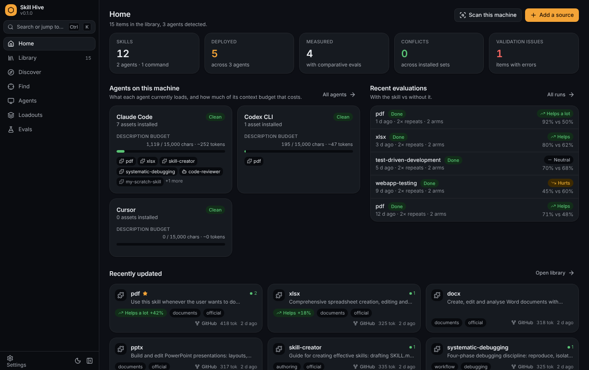

**Contents:** [Install](#install) · [First five minutes](#first-five-minutes) ·
[Screens](#screens) · [How it works](#how-it-works) · [Supported agent tools](#supported-agent-tools) ·
[CLI reference](#cli-reference) · [Configuration and data](#configuration-and-data) ·
[Troubleshooting](#troubleshooting) · [Development](#development) ·
[Status and limitations](#status-and-limitations)

## Install

Installers and CLI binaries for every release are attached to
[the latest GitHub release](https://github.com/crzyc0d3r/skill-hive/releases/latest). The desktop
app is called `Skill Hive`; the CLI binary is called `hive`. Builds are not code-signed yet, so
macOS and Windows show a warning the first time (the steps to get past it are below). In the
asset names, replace `0.2.1` with the version you download; the downloaded file names have a
dot where the space in "Skill Hive" is. Later releases install themselves: see
[Updating](#updating).

### macOS (11.0 or later)

| Mac | Desktop app | CLI |
| --- | --- | --- |
| Apple Silicon (M1 and later) | `Skill.Hive_0.2.1_aarch64.dmg` | `hive-aarch64-apple-darwin.tar.gz` |
| Intel | `Skill.Hive_0.2.1_x64.dmg` | `hive-x86_64-apple-darwin.tar.gz` |

Open the `.dmg` and drag `Skill Hive` into `Applications`. Because the app is unsigned, Gatekeeper
refuses a normal double-click. On macOS 14 and earlier, right-click (or Control-click) the app in
Finder, choose **Open**, and confirm **Open** in the dialog. On macOS 15 and later that shortcut
no longer works: open the app once, dismiss the warning, then go to
**System Settings > Privacy & Security**, scroll to the message about Skill Hive and click
**Open Anyway**. On any version you can instead remove the quarantine flag once from a terminal:

```bash
xattr -dr com.apple.quarantine "/Applications/Skill Hive.app"
```

### Windows (64-bit)

| Installer | CLI |
| --- | --- |
| `Skill.Hive_0.2.1_x64-setup.exe` (NSIS) or `Skill.Hive_0.2.1_x64_en-US.msi` (MSI) | `hive-x86_64-pc-windows-msvc.zip` |

SmartScreen shows "Windows protected your PC" for an unsigned installer. Click **More info**, then
**Run anyway**. The app needs the WebView2 runtime. Windows 11 and up-to-date Windows 10
installations already have it; otherwise the installer downloads it.

### Linux (x86_64)

| Package | File | Install |
| --- | --- | --- |
| Debian, Ubuntu and derivatives | `Skill.Hive_0.2.1_amd64.deb` | `sudo apt install ./Skill.Hive_0.2.1_amd64.deb` (or `sudo dpkg -i` the file, then `sudo apt-get install -f`) |
| Fedora, RHEL, openSUSE | `Skill.Hive-0.2.1-1.x86_64.rpm` | `sudo dnf install ./Skill.Hive-0.2.1-1.x86_64.rpm` |
| Any distribution | `Skill.Hive_0.2.1_amd64.AppImage` | `chmod +x Skill.Hive_0.2.1_amd64.AppImage && ./Skill.Hive_0.2.1_amd64.AppImage` |
| CLI | `hive-x86_64-unknown-linux-gnu.tar.gz` | see below |

The `.deb` depends on `libwebkit2gtk-4.1-0` and the `.rpm` on `webkit2gtk4.1`; the package manager
pulls them in. AppImages need FUSE 2 (`libfuse2` on Debian and Ubuntu); install it if the file
refuses to start. The installed desktop command is `skill-hive`. If the window renders partially
or with wrong colours, see [Linux rendering](#linux-rendering) under Troubleshooting.

### CLI binary

Extract the archive and put the `hive` executable somewhere on your `PATH`:

```bash
tar -xzf hive-x86_64-unknown-linux-gnu.tar.gz      # or the macOS archive for your Mac
install -m 755 hive ~/.local/bin/hive               # or /usr/local/bin
hive --version
```

On macOS a downloaded binary is quarantined too: `xattr -d com.apple.quarantine hive` before the
first run. On Windows, unzip `hive.exe` into a folder that is on `PATH`. The CLI and the desktop
app share the same data under `~/.skill-hive`, so you can mix them freely.

### Updating

Both the app and the CLI update themselves from the GitHub releases.

The desktop app looks for a newer release a few seconds after it opens and shows a notice with
**Install and restart**; **Settings > About > Updates** has the same button, **Check for
updates**, the release notes, and the **Check on startup** switch to turn the automatic check
off. Nothing is downloaded until you accept. The app downloads the build for your platform,
verifies its signature against the key compiled into the app, installs it and relaunches. On
Linux a `.deb` or `.rpm` installation asks for your password once (`pkexec`); the AppImage
replaces itself in place.

The CLI updates on request:

```bash
hive self-update --check    # is there a newer release?
hive self-update            # download it and replace this binary (asks first; --yes skips the prompt)
```

### Build from source

Prerequisites on every platform: a stable Rust toolchain (1.85 or newer), Node 22 and `git`
(also used at run time to clone skill repositories). Per platform:

| OS | Extra prerequisites |
| --- | --- |
| Linux (Debian/Ubuntu) | `sudo apt-get install -y libwebkit2gtk-4.1-dev libgtk-3-dev librsvg2-dev patchelf build-essential pkg-config libxdo-dev libssl-dev` |
| macOS | Xcode Command Line Tools (`xcode-select --install`) |
| Windows | Visual Studio Build Tools with the "Desktop development with C++" workload; the WebView2 runtime (present on Windows 11 and up-to-date Windows 10) |

```bash
git clone https://github.com/crzyc0d3r/skill-hive.git
cd skill-hive
npm ci
npm run app:build                         # desktop installers for this machine
cargo build --release -p hive-cli         # the CLI: target/release/hive
```

`npm run app:build` writes the bundles under `target/release/bundle/`: `deb/`, `rpm/` and
`appimage/` on Linux, `dmg/` and `macos/` on macOS, `msi/` and `nsis/` on Windows. The CLI can
also be installed straight into `~/.cargo/bin` with `cargo install --path crates/hive-cli`.

`npm run app:dev` starts the desktop app with hot reload of the UI. `npm run dev` runs the UI alone
in a browser against an in-memory mock backend, which is what the unit tests and screenshots use.

## First five minutes

Everything below can be done from the app or from the terminal; the CLI command for each step is
shown after it. Nothing is copied or written to an agent directory until you say so.

1. **Collect what is already installed.** Open **Discover > On this machine** (or the
   **Scan this machine** button on Home). Skill Hive walks the skills, agents and commands folders
   of every detected agent tool and lists what it found, grouped by agent, with a status: new, in
   library, modified, managed by Skill Hive, or invalid. Tick the items you want, add tags if you
   like, and click **Import**.
   `hive scan` to look, `hive scan --import` to import everything new and valid.

2. **Add a collection from GitHub.** Open **Discover > Catalog** and click **Preview** on a
   collection, for example Anthropic Skills. Or go to **Discover > Online** and paste
   `owner/repo`, a GitHub tree or blob URL, any git URL, an archive URL or a local path. The
   preview shows every candidate with its status and the repository README; pick the ones you
   want and import.
   `hive catalog`, `hive preview anthropics/skills`, then
   `hive add anthropics/skills --name pdf --name xlsx --tag official`.

3. **Look at the library.** **Library** lists everything with tags, source, size in tokens,
   validation status and measured effectiveness. Open an item to see where it came from, the
   revision it was imported at, its instructions, files, deployments and validation findings.
   `hive list`, `hive search pdf`, `hive show pdf` (`--body` prints the instructions).

4. **Find a skill set for a task.** Open **Find**, describe the job in plain words, choose the
   agent whose budget applies, and click **Find**. You get a ranked list with reasons, a suggested
   set with no medium- or high-severity conflicts that fits the budget, and the conflicts and
   context cost of whatever you select.
   `hive find extract tables from a pdf invoice and build a spreadsheet --target claude-code`

5. **Deploy to an agent.** Click **Deploy** in the set panel, in an item's detail view, or on the
   Agents screen. Choose the agent, the scope (user-wide or one project) and the mode (link or
   copy).
   `hive deploy pdf xlsx --to claude-code`, or `hive find ... --target claude-code --deploy`.

6. **Check the Agents view.** **Agents** shows, for every detected tool, what it loads into its
   prompt, how much of the description budget that costs, the conflicts in the installed set, and
   which files Skill Hive manages. Unmanaged files can be added to the library in one click.
   `hive targets` for all agents, `hive targets claude-code` for one.

7. **Run an evaluation.** Open **Settings > Providers** and click **Detect CLIs** so Claude Code
   or Codex is registered as an executor. Then open **Evals**, pick a skill, click
   **Draft a suite** to generate cases from its description (or write them by hand), save it,
   and click **Run evaluation**. The run executes every case with and without the skill and
   ends in a verdict.
   `hive provider detect`, `hive eval suite pdf --draft --write`,
   `hive eval run pdf --repeats 3 --trigger`, `hive eval report <run-id>`.

## Screens

### Home

The dashboard: counts of skills, deployments, measured skills, conflicts and validation issues,
one card per detected agent with its budget meter and installed skills, the latest evaluation
runs with their verdicts, and recently updated items. From here you can start a scan, add a
source, or jump to any agent or run. The command palette (Ctrl+K, Cmd+K on macOS) searches items
and screens from anywhere.

### Library

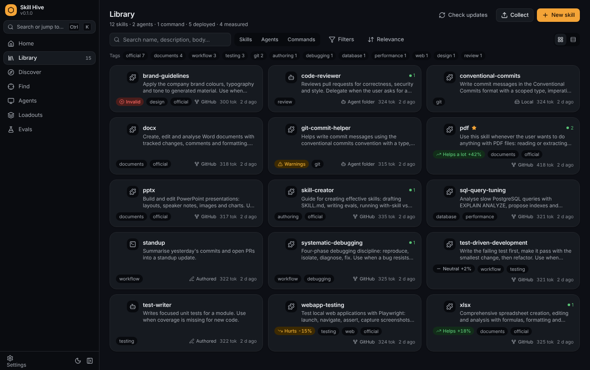

Every item in one grid or list, filtered by kind (skills, subagents, commands), tags, source,
favourites and the agent they are deployed to, with full-text search over name, description and
body. **Check updates** compares each GitHub- or git-sourced item with its source and lets you
update it. **New skill** creates a skill in the library from a name and description. Multi-select
to check a set for conflicts, deploy it, or remove several items at once. With two or more skills
selected, **Merge with AI...** asks a model provider to combine them into one skill and shows the
draft for review before anything is written; the same dialog opens from the **Merge...** button
next to an overlap conflict (duplicate content, description, trigger or tool overlap,
contradictory directive) wherever conflicts are listed.

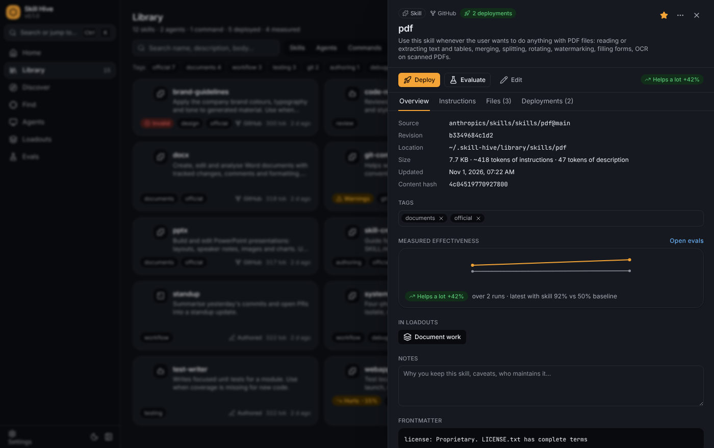

Opening an item shows its source and revision, location, size, content hash, tags, measured
effectiveness over time, the loadouts it belongs to, free-form notes and the frontmatter. The
tabs hold the rendered instructions, the files, the deployments with their state, and validation
findings. **Deploy**, **Evaluate** and **Edit** act on the item; the menu reveals it in the file
manager, updates it from its source or removes it.

### Discover

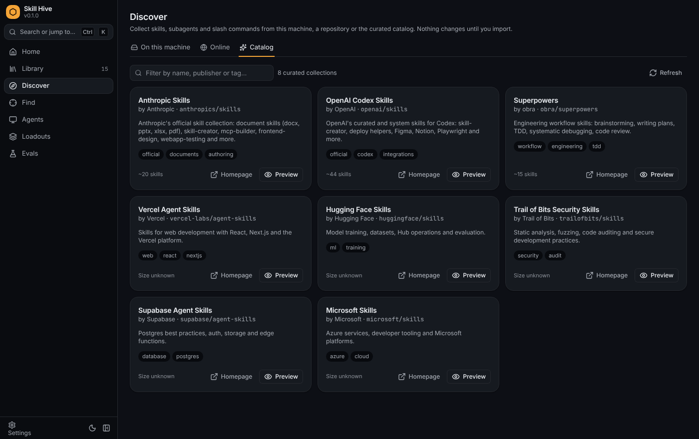

Three tabs. **On this machine** scans the detected agents' folders plus any extra folders from
Settings, or a folder you pick. **Online** previews a repository, URL or local path and searches
GitHub for repositories that publish skills. **Catalog** lists the curated collections from
`crates/hive-core/src/sources/catalog.json` (16 at the time of writing, including Anthropic,
OpenAI, obra's Superpowers, Vercel, Hugging Face, Microsoft, Trail of Bits, Supabase, Cloudflare
and Sentry) with a **Preview** button that opens them in the Online tab. Every path ends in the
same candidate list where you choose what to import, tag it and decide whether to overwrite
existing items.

### Find

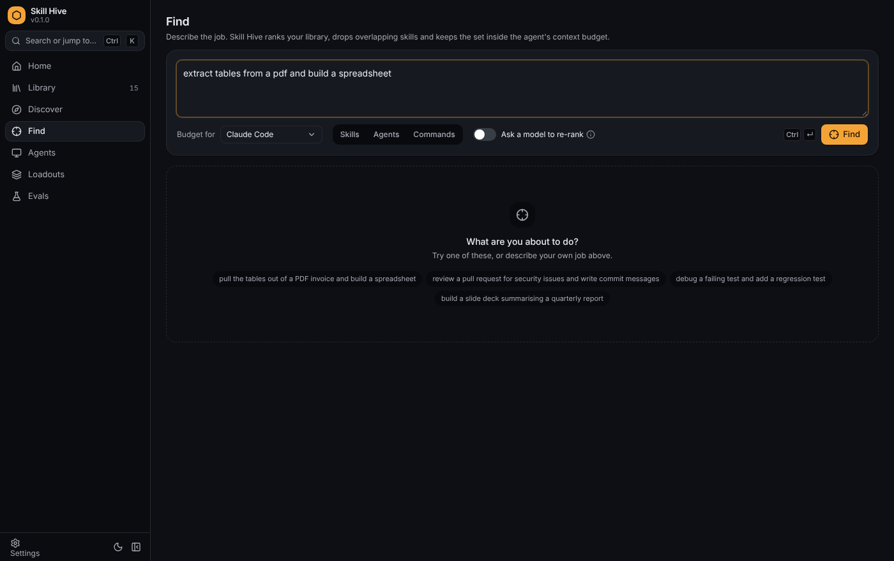

Describe the job, pick the agent whose budget applies, optionally restrict the kinds, and click
**Find**. Each result shows its score, the reasons it matched, its validation and effectiveness
badges, and which other results it conflicts with. Toggle items in and out of the set; the panel
on the right keeps the description budget and the conflict list current and deploys the set.
**Ask a model to re-rank** sends the task and the top candidates to a provider with the
recommender role, which reorders them and explains why.

### Agents

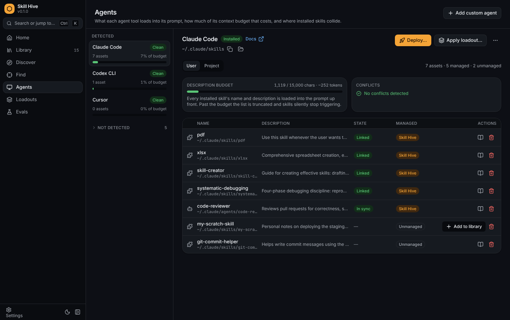

One row per agent tool, detected or not, at user or project scope. For the selected agent you see
its skills folder, the description budget meter with the character and token count, the conflicts
in the installed set, and a table of every installed asset with its state (linked, in sync,
stale, modified, broken, unmanaged). Stale and modified copies can be re-synced from the library;
unmanaged files can be added to the library or deleted. **Deploy...** and **Apply loadout...** act
on this agent, and **Add custom agent** registers a tool that is not built in.

### Instructions

The files each agent loads into every session: `CLAUDE.md`, `AGENTS.md`, `GEMINI.md`, Copilot's
repository instructions and the rules folders of Cursor, Windsurf, Kiro, Cline and Roo Code. Pick
user scope (files under your home directory) or project scope and a registered project. The rail
on the left lists every known location of the detected agents, grouped by the agents that read
it, with the line and token count of each file or a **Missing** badge; a path several agents
share, such as `AGENTS.md`, appears once naming all of them, and a rules folder lists its members
under it with a **New rule...** action that enforces the folder's file suffix. The editor on the
right has Edit and Preview tabs. **Create** writes a missing file from a short starter; **Save**
(Ctrl+S, Cmd+S on macOS) overwrites an existing one and keeps a copy of the previous content under
`~/.skill-hive/backups/instructions`; **Backups** loads any earlier version into the editor so you
can save it back; **Delete** removes the file and keeps a backup. Folders are never deleted, and
only locations Skill Hive knows can be written. Where each agent looks and the exact rules are in
[docs/instructions.md](docs/instructions.md).

### Loadouts

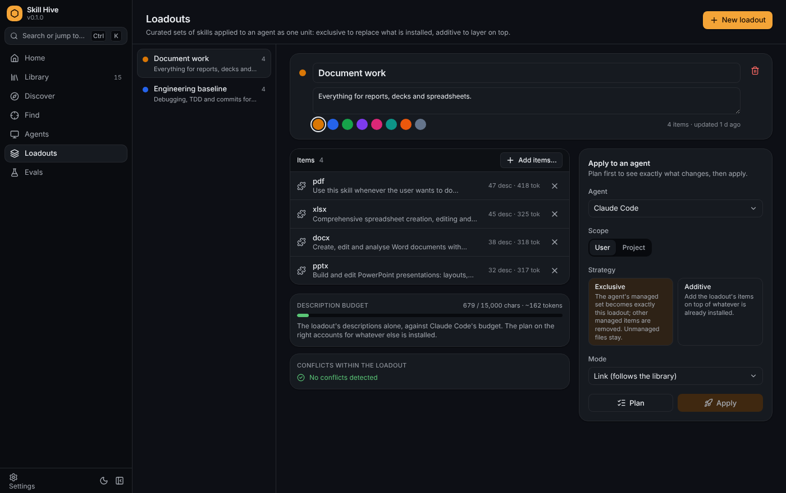

A loadout is a named set of items applied to an agent as one unit, for example "Document work" or
"Engineering baseline". The editor shows the items, the set's own description budget and its
internal conflicts. **Plan** is a dry run that lists what would be added, removed, kept and left
alone (unmanaged), with the resulting conflicts and budget; **Apply** does it. *Exclusive* makes
the agent's managed set exactly the loadout; *additive* layers it on top of what is installed.

### Evals

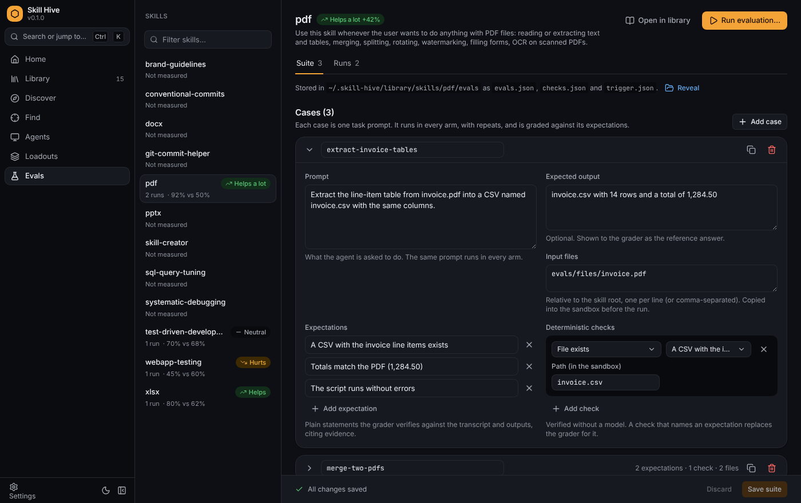

Pick a skill on the left to edit its evaluation suite and see its runs. A suite is a list of
cases, each with a prompt, an optional expected output, input files copied into the sandbox,
plain-language expectations the grader verifies, and deterministic checks that verify an
expectation without a model. Trigger cases ask whether the agent would pick this skill for a
query. The suite is stored inside the skill directory, so it travels with the skill.

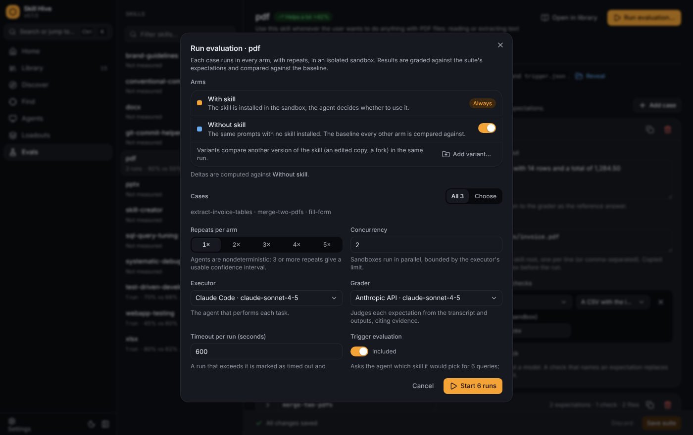

**Run evaluation** chooses the arms (with skill, without skill, optional variants that point at
another version of the skill), which cases to run, repeats per arm, concurrency, the executor and
grader providers, a timeout and whether to include the trigger evaluation.

### Run report

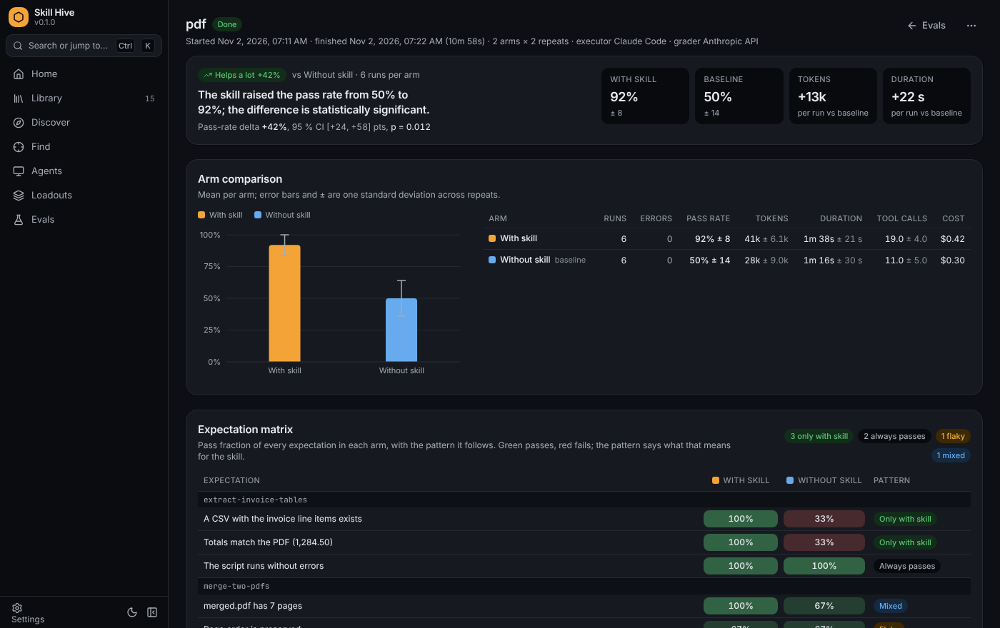

A finished run opens on the verdict: the pass-rate delta against the baseline with a 95 percent
confidence interval and p-value, then per-arm pass rate, tokens, duration, tool calls and cost.
An activity profile follows for executors that stream their events (Claude Code, Codex): per
arm, how many turns the agent took, how many files it read, searched, wrote and how many
commands it ran, how its output tokens split between thinking, text and tool arguments, what
share of its traffic was tool IO, the prompt-cache breakdown, and whether it opened the skill
at all. The expectation matrix shows the pass fraction of every expectation in every arm with a
pattern (only with skill, always passes, flaky, mixed, and so on), followed by the trigger
evaluation, analyst notes and every case result with its graded expectations, output,
transcript and a step-by-step timeline of what the agent thought, said, called and got back.

### Settings

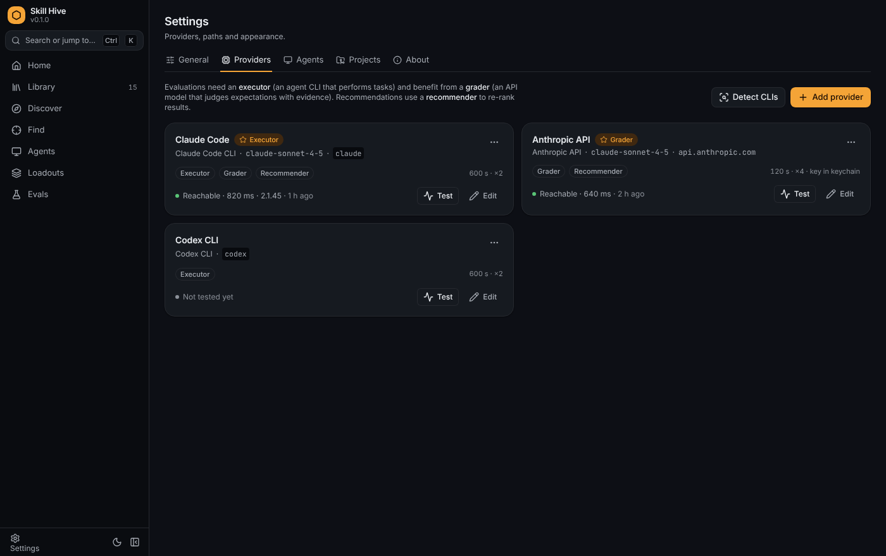

**General**: home directory, extra scan folders, default link mode, default description budget,
overlap threshold and theme. **Providers**: the model providers used as executor, grader and
recommender, with **Detect CLIs**, **Test** probes and default roles. **Agents**: the target table
with each tool's directories, where you override a skills folder or add a custom agent.
**Projects**: folders registered for project-scope deployments. **About**: version and updates
(**Check for updates**, **Install and restart**, the release notes and the **Check on startup**
switch), the same health check as `hive doctor`, re-indexing, the GitHub token and the source
cache.

## How it works

### Library and provenance

Importing copies an item into `~/.skill-hive/library` (`skills/<slug>/`, `agents/<name>.md`,
`commands/<name>.md`) and writes a sidecar under `library/meta/` that records its id, slug,
source, revision and tags. A SQLite database indexes everything with full-text search, and can be
rebuilt from the sidecars with `hive doctor --reindex`. Names are unique per kind because the
install name in an agent directory is the item's name. Content hashes are computed over sorted
relative paths and bytes, so an identical copy anywhere compares equal. Update checks compare the
recorded revision with the source and can replace the item in place.

### Deployment

The library is the source of truth. A **link** deployment is a symlink (a directory junction on
Windows) from the agent's directory into the library, so library edits are visible immediately;
the agent has to follow symlinks, which Claude Code, Codex and Cursor do. A **copy** deployment is
an independent copy that records the hash it was made from; later it is reported as *stale* (the
library moved on) or *modified* (the copy was edited) and can be re-synced. **User scope** writes
to the agent's directory under your home folder; **project scope** writes to the agent's project
directory inside a registered project (for example `<repo>/.claude/skills`). Assets Skill Hive did
not put there are *unmanaged* and are never touched unless you ask.

### Conflict analysis

The analyser runs on installed sets, loadout plans and Find results. It reports, with a severity
of low, medium or high:

| Kind | Meaning |
| --- | --- |
| Name collision | Two assets share a name; only one can be installed and agents cannot tell them apart. |
| Duplicate content | Identical content under different names. |
| Description overlap | Near-duplicate descriptions; the agent will pick between them at random. |
| Trigger overlap | Both claim the same "use when ..." phrases. |
| Tool overlap | Both pre-approve the same tools with different instructions. |
| Contradictory directive | Opposite always/never instructions on the same topic. |
| Budget exceeded | The set's descriptions exceed the agent's budget, so the list gets truncated. |

Description overlap uses a log-TF cosine similarity with IDF weights from the whole library once
it is large enough; the threshold is a setting. The budget defaults to 15 000 characters, the
point at which Claude Code truncates its skill listing; other agents use the same figure until a
better one is known, and a custom target can declare its own.

#### Merging overlapping skills

The usual fix for an overlap is one skill instead of two. **Merge with AI...** (or `hive merge`)
sends the sources to a model provider (the recommender by default, then the grader, then the
executor) with their descriptions, pre-approved tools, licences, bundled file list with excerpts,
the full `SKILL.md` bodies, the conflicts the analyser found between them and any guidance you
typed. The model answers with one name, description and body, notes on how it combined them, a
list of what it left out, and the bundled files the body still refers to. The proposal adds the
merged frontmatter (union of `allowed-tools`, a licence when every licensed source agrees, merged
metadata with a `merged-from` entry), the union of the tags, the files to carry with their final
paths, the eval cases the merged skill would inherit, token counts before and after, warnings and
the same validation as any authored skill. If the merged name is one of the sources' names, that
source is replaced in place and keeps its id, deployments and history; otherwise a new skill is
created. Retiring the sources removes the others from the library and deploys the merged skill
wherever they were deployed; carrying evaluations writes the union of their suites. Nothing is
written until the draft is accepted, and the draft can be edited first. The full contract is in
[docs/merging.md](docs/merging.md).

### The recommender

`Find` ranks the library with SQLite FTS5 BM25 over name, description and body, plus features for
name, tag and trigger-phrase matches, description similarity and measured effectiveness. It then
analyses the top candidates pairwise and composes a suggested set greedily: best first, skipping
items with validation errors, anything that would add a medium- or high-severity conflict with an
item already chosen, anything that would push the set past the budget, and anything scoring under
45 percent of the top result; the set holds at most five items. With a provider in the
recommender role, the task and candidates can be sent to a model to re-rank them.

### Evaluations

A suite lives in `<skill>/evals/` as `evals.json` (compatible with Anthropic's `skill-creator`),
`checks.json` and `trigger.json`. A run executes each case in **arms**: `with_skill` (a snapshot
of the library version), `without_skill` (the baseline) and optional `variant` arms pointing at
another skill directory. Each case runs `repeats` times per arm in a fresh sandbox directory with
the input files copied in and, for skill arms, the skill installed where that agent discovers
project skills. **Checks** (`file_exists`, `file_contains`, `file_matches`, `output_contains`,
`output_matches`, `json_pointer`, `command`) decide an expectation without a model; the **grader**
is a model that must answer strict JSON with cited evidence for every remaining expectation.
The **trigger evaluation** asks a model which skill it would pick for each trigger query and
reports precision and recall of the description. Executors that stream their events also leave
an **activity trace** per case: model turns, tool calls by category (read, search, write,
command, web, subagent), the distinct files read and written, whether the skill was opened,
thinking and text blocks, an estimated split of the output tokens, the share of traffic that was
tool IO, the prompt-cache breakdown, model and tool time, and a timeline. The benchmark gives
per-arm means and standard deviations, the delta against the baseline with a bootstrap
confidence interval and a Welch t-test, a **verdict** (helps a lot, helps, neutral, hurts,
hurts a lot, inconclusive), the expectation matrix, per-arm activity statistics and analyst
notes. The full rules are in [docs/evaluations.md](docs/evaluations.md).

### Providers and secrets

| Provider | Runs tasks with tools | Grades and re-ranks | Notes |
| --- | --- | --- | --- |
| Claude Code CLI | yes | yes | `claude` on PATH, your existing login; found by Detect CLIs |
| Codex CLI | yes | yes | `codex` on PATH |
| Anthropic API | system prompt only | yes | Messages API; key in the keychain or an environment variable |
| OpenAI-compatible | system prompt only | yes | OpenAI, OpenRouter, Ollama, LM Studio, vLLM and others |
| Scripted | simulated | simulated | your own executable, or JSON rules; what the tests use |

API providers have no tools, so they receive the skill body as the system prompt; that measures
instruction quality but not tool use. Each provider has roles (executor, grader, recommender), a
timeout and a concurrency limit. API keys go to the OS keychain (macOS Keychain, Windows
Credential Manager, the Secret Service on Linux); where no keychain answers, they go to
`~/.skill-hive/secrets.json` with mode 0600. A provider can instead name an environment variable
that holds the key. Secrets are never written to the database or the logs.

## Supported agent tools

Built-in targets, from `crates/hive-core/src/targets.rs`. User paths are relative to your home
directory, project paths to a project root. A tool counts as detected when its detect folder
exists under your home directory, or when you have overridden its skills folder in Settings. Only
Claude Code has separate directories for subagents (`.claude/agents`) and commands
(`.claude/commands`) at both scopes; the other tools take skills only. Every built-in target uses
the 15 000 character description budget. The last column lists the standing instruction files
the tool reads (user scope first, then project scope; a trailing slash marks a rules folder),
which the Instructions screen and `hive instructions` edit; the full table with the rules is in
[docs/instructions.md](docs/instructions.md).

| Target id | Tool | User skills | Project skills | Detected by | Instruction files |
| --- | --- | --- | --- | --- | --- |
| `claude-code` | Claude Code | `~/.claude/skills` | `.claude/skills` | `~/.claude` | `~/.claude/CLAUDE.md`; `CLAUDE.md`, `.claude/CLAUDE.md`, `CLAUDE.local.md` |
| `codex` | Codex CLI | `~/.codex/skills` | `.codex/skills` | `~/.codex` | `~/.codex/AGENTS.md`; `AGENTS.md` |
| `cursor` | Cursor | `~/.cursor/skills` | `.cursor/skills` | `~/.cursor` | `.cursor/rules/`, `.cursorrules`, `AGENTS.md` |
| `gemini-cli` | Gemini CLI | `~/.gemini/skills` | `.gemini/skills` | `~/.gemini` | `~/.gemini/GEMINI.md`; `GEMINI.md` |
| `github-copilot` | GitHub Copilot | `~/.copilot/skills` | `.github/skills` | `~/.copilot` | `.github/copilot-instructions.md`, `.github/instructions/`, `AGENTS.md` |
| `windsurf` | Windsurf | `~/.codeium/windsurf/skills` | `.windsurf/skills` | `~/.codeium/windsurf` | `~/.codeium/windsurf/memories/global_rules.md`; `.windsurf/rules/`, `.windsurfrules` |
| `opencode` | OpenCode | `~/.config/opencode/skills` | `.opencode/skills` | `~/.config/opencode` | `~/.config/opencode/AGENTS.md`; `AGENTS.md` |
| `amp` | Amp | `~/.config/amp/skills` | `.agents/skills` | `~/.config/amp` | `~/.config/amp/AGENTS.md`; `AGENTS.md` |
| `goose` | Goose | `~/.config/goose/skills` | `.goose/skills` | `~/.config/goose` | `~/.config/goose/.goosehints`; `.goosehints` |
| `kiro` | Kiro | `~/.kiro/skills` | `.kiro/skills` | `~/.kiro` | `.kiro/steering/` |
| `cline` | Cline | `~/.cline/skills` | `.cline/skills` | `~/.cline` | `~/Documents/Cline/Rules/`; `.clinerules` |
| `roo-code` | Roo Code | `~/.roo/skills` | `.roo/skills` | `~/.roo` | `~/.roo/rules/`; `.roo/rules/`, `.roorules` |
| `antigravity` | Antigravity | `~/.gemini/antigravity/skills` | `.agent/skills` | `~/.gemini/antigravity` | none known |
| `agents-shared` | Shared (`.agents`) | `~/.agents/skills` | `.agents/skills` | `~/.agents` | `AGENTS.md` |
| `openclaw` | OpenClaw | `~/.openclaw/skills` | none | `~/.openclaw` | none known |
| `hermes` | Hermes Agent | `~/.hermes/skills` | none | `~/.hermes` | none known |

These directories are defaults. In **Settings > Agents** you can point any target's user skills
folder somewhere else, reset it, or add a **custom agent** with its own id, category, user and
project skills folders, detect folder, description budget and documentation URL. A custom target
with the same id as a built-in one replaces it. Custom targets always count as detected.

## CLI reference

`hive` does everything the desktop app does. Items are addressed by id, by name, or by
`kind:name` (for example `agent:code-reviewer`). Run `hive <command> --help` for the flags.

| Command | What it does |
| --- | --- |
| `hive scan [PATHS]... [--only] [--import] [--tag T]` | Scan the agent directories and extra folders; `--import` brings in everything new and valid |
| `hive add <SOURCE> [--name N]... [--tag T]... [--overwrite]` | Import from a path, `owner/repo`, GitHub/git URL or archive URL; `--name` picks candidates |
| `hive preview <SOURCE>` | Show what a source contains without importing |
| `hive list [--kind K] [--tag T] [--deployed-to TARGET] [--favorites]` | List library items |
| `hive search <QUERY> [--limit N]` | Full-text search of the library |
| `hive show <ITEM> [--body]` | One item: source, revision, size, validation, deployments, measured effectiveness |
| `hive remove <ITEMS>... [--yes]` | Remove items and all their deployments |
| `hive tag <ITEM> [TAGS]...` | Replace an item's tags |
| `hive updates [ITEMS]... [--apply]` | Check remote sources for newer revisions; `--apply` updates |
| `hive targets [TARGET] [--scope S] [--project PATH] [--all]` | Agent targets, what they have installed, context cost and conflicts |
| `hive deploy <ITEMS>... --to TARGET [--scope S] [--project PATH] [--mode M] [--force]` | Deploy items to an agent; `--force` replaces unmanaged files of the same name |
| `hive undeploy [ID] [--item ITEM]` | Remove one deployment, or every deployment of an item |
| `hive loadout list\|show\|create\|add\|rm\|delete` | Manage loadouts (`create NAME --item ITEM...`, `add LOADOUT ITEMS...`) |
| `hive loadout plan <LOADOUT> --to TARGET [--exclusive] [--scope S] [--project PATH] [--mode M]` | Dry run: adds, removes, keeps, unmanaged, conflicts and budget |
| `hive loadout apply <LOADOUT> --to TARGET [--exclusive] ...` | Apply a loadout (additive unless `--exclusive`) |
| `hive find <TASK>... [--target T] [--kind K] [--limit N] [--llm] [--deploy]` | Rank the library for a task and compose a conflict-free set; `--deploy` installs it |
| `hive conflicts <ITEMS>... [--target T]` | Analyse a set of items for conflicts and budget |
| `hive merge <SKILLS>... [--name N] [--guidance TEXT] [--provider P] [--keep-sources] [--no-evals] [--dry-run]` | Ask a model to combine two or more skills into one and write it; `--name` set to a source's name replaces that source in place, `--dry-run` only prints the proposal |
| `hive catalog [QUERY] [--refresh]` | The curated catalog of collections |
| `hive github-search <QUERY> [--limit N]` | Search GitHub for skill repositories |
| `hive project list\|add <PATH>\|remove <PATH>` | Projects registered for project-scope deployments |
| `hive new <NAME> --description TEXT [--body TEXT] [--tag T]` | Create a new skill in the library |
| `hive config show` / `hive config set <KEY> <VALUE>` | Settings (keys below) |
| `hive doctor [--reindex]` | Health check: database, orphaned and missing directories, broken deployments, git, agent CLIs |
| `hive provider list\|detect\|add\|remove\|probe` | Model providers (`add NAME --kind claude-code\|codex\|anthropic\|openai-compatible\|scripted`) |
| `hive eval suite <ITEM> [--draft] [--write]` | Show a skill's suite, or draft one from its description and save it |
| `hive eval run <ITEM> [--repeats N] [--trigger] [--variant label=path] [--no-baseline] ...` | Run a comparative evaluation and wait; also `--executor`, `--grader`, `--concurrency`, `--timeout`, `--case` |
| `hive eval runs [ITEM] [--limit N]` | List runs |
| `hive eval report <RUN> [--markdown]` | A run's benchmark, with the per-arm activity table when the executor traced its runs (`--markdown` prints the written report) |
| `hive eval history <ITEM>` | Effectiveness per run, against the skill's content hash |
| `hive eval cancel <RUN>` / `hive eval delete <RUN>` | Cancel a running evaluation; delete a run and its workspace |
| `hive instructions list [--project PATH]` | The instruction files (`CLAUDE.md`, `AGENTS.md`, rules folders) of the detected agents, existing or not; user scope without `--project` |
| `hive instructions show <PATH> [--project PATH]` | Print an instruction file, or one of its backups |
| `hive instructions write <PATH> [--from FILE] [--project PATH]` | Write (or create) an instruction file from `--from` or standard input; a backup of the previous content is kept |
| `hive instructions delete <PATH> [--project PATH]` | Delete an instruction file (a backup is kept; folders are never deleted) |
| `hive instructions backups <PATH>` | The backups kept of an instruction file, oldest first |
| `hive self-update [--check] [--yes]` | Replace this `hive` binary with the latest GitHub release; `--check` only reports, `--yes` skips the confirmation |

Global flags on every command:

| Flag | Effect |
| --- | --- |
| `--json` | Print the raw data as JSON instead of tables |
| `--home <DIR>` | Use another Skill Hive home (same as the `HIVE_HOME` environment variable) |
| `-V`, `--version` | Print the version |

Scope values are `user` (default) and `project`; mode values are `link` and `copy`. Kinds are
`skill`, `agent` and `command`.

Exit code 2 means the command ran but part of it failed (a deployment that did not apply, an
evaluation that did not finish with status done). Log output goes to stderr and is controlled by
`RUST_LOG` (default `warn`).

## Configuration and data

Everything lives under one directory, `~/.skill-hive` by default:

```
~/.skill-hive/
  hive.db                SQLite index (WAL, FTS5); rebuildable from the library directory
  library/skills/<slug>/ one directory per skill (deployed by symlink or copy)
  library/agents/*.md    subagent definitions
  library/commands/*.md  slash commands
  library/meta/<id>.json provenance sidecars (id, slug, source, revision, tags)
  cache/git/<key>/       shallow clones of remote sources, refreshed in place
  cache/archives/<key>/  extracted downloads
  backups/instructions/<key>/  copies of instruction files before each overwrite or delete (20 per file)
  workspaces/<skill>/<run-id>/
    skill-snapshot/      the skill exactly as tested
    cases/<case>/<arm>/<n>/work/   one sandbox per execution, with .hive/transcript.jsonl
    benchmark.json, benchmark.md
  logs/skill-hive.log    desktop app log
  secrets.json           only when no OS keychain is available (mode 0600)
```

Settings are stored in the database and shown by `hive config show`:

| Key | Values | Default |
| --- | --- | --- |
| `link-mode` | `link` or `copy` | `link` |
| `budget-chars` | description budget used when a target does not declare one (minimum 1000) | `15000` |
| `overlap` | description overlap threshold, 0.20 (loose) to 0.95 (strict) | `0.6` |
| `executor` | provider id used by default to run evaluation tasks (`-` clears) | none |
| `grader` | provider id used by default to grade (`-` clears) | none |
| `scan-dirs` | extra folders for local scans, comma separated | none |
| `github-token` | personal access token; stored in the secret store, shown only as set / not set | not set |
| `theme` | `system`, `light` or `dark` | `system` |
| `auto-update-check` | `true` or `false`: whether the desktop app looks for a newer release after it starts | `true` |

Environment variables:

| Variable | Effect |
| --- | --- |
| `HIVE_HOME` | Where the database, library, cache, workspaces and logs live. Set it before launching the app or the CLI. |
| `HIVE_TARGET_HOME` | The home directory under which agent directories are resolved. For tests and sandboxes; normally unset. |
| `HIVE_NO_KEYRING` | When set, never use the OS keychain; secrets go to `secrets.json`. CI sets it. |
| `RUST_LOG` | Log filter. The desktop app defaults to `info,hive_core=debug`, the CLI to `warn`. |
| `WEBKIT_DISABLE_DMABUF_RENDERER`, `WEBKIT_DISABLE_COMPOSITING_MODE` | Linux rendering switches, see Troubleshooting. |
| `SKILL_HIVE_HEADLESS` | When set, a fatal startup error is only logged and written to the crash file; no native dialog is shown. The smoke test sets it. |
| `ANTHROPIC_API_KEY`, `OPENAI_API_KEY` (or any name you choose) | Read at run time by a provider configured with `--api-key-env`, or with the "Environment variable" field in the provider dialog. |

Network access is limited to: cloning or downloading the sources you import and check for
updates; GitHub API calls for search, previews and the tarball fallback; the curated catalog,
which is fetched from `crates/hive-core/src/sources/catalog.json` on the `main` branch of this
repository when you open **Discover > Catalog** or run `hive catalog` and the cached copy is
older than 24 hours (the built-in copy is used when the fetch fails); the calls to the
providers you configure during evaluations and model re-ranking; and the update check, which
fetches `latest.json` from the latest GitHub release a few seconds after the desktop app starts
(turn it off with `auto-update-check` or in Settings > About; `hive self-update` checks only
when you run it). The check sends nothing but the request itself; there is no telemetry. A
GitHub token raises the API rate limit and allows private repositories; `repo` read access is
enough.

## Troubleshooting

### The app does not start, or the window stays empty

A failure before the window appears shows a native error dialog and writes the message to
`~/.skill-hive/logs/skill-hive-crash.log`. A failure inside the interface replaces the window
content with the error text. In both cases `~/.skill-hive/logs/skill-hive.log` records how far
startup got: `starting Skill Hive`, `core ready`, `tauri ready`, the `page load` events and
finally `ui: ready v<version>` once the interface has rendered and the backend answered. Open an
issue with that log and the crash file if there is one. On Windows the WebView2 runtime must be
present (the installer downloads it when it is missing); on Linux see the next section.

### "database error: no such table ..."

`~/.skill-hive/hive.db` was written by something other than this version of Skill Hive, for
example the earlier incarnation of the app, which kept a different schema under the same file
name. Since 0.1.3 the app notices this at startup, moves the file aside as
`hive.db.old-<timestamp>` (together with its `-wal` and `-shm` companions) and starts with a
fresh database; the library directory is re-indexed with `hive doctor --reindex` or
**Settings > About > Re-index library**. On an older build, close the app and rename or delete
those files by hand. Nothing from the old program is migrated.

### Linux rendering

The desktop app renders through WebKitGTK. On some GPU, driver and compositor combinations
(NVIDIA on Wayland most often) WebKitGTK's DMA-BUF renderer paints windows partially or with
wrong colours in popovers and scrolling panels. Skill Hive therefore starts with
`WEBKIT_DISABLE_DMABUF_RENDERER=1` unless you set that variable (or
`WEBKIT_DISABLE_COMPOSITING_MODE`) yourself. If a window still looks wrong, launch with
`WEBKIT_DISABLE_COMPOSITING_MODE=1 skill-hive`, and if that fixes it please open an issue with
your distribution, GPU and WebKitGTK version.

### "Skill Hive is damaged", "unidentified developer", "Windows protected your PC"

The builds are not signed. On macOS, use right-click > **Open** (macOS 14 and earlier) or
**System Settings > Privacy & Security > Open Anyway** (macOS 15 and later), or run
`xattr -dr com.apple.quarantine "/Applications/Skill Hive.app"`; a downloaded `hive` binary needs
`xattr -d com.apple.quarantine hive`. On Windows, click **More info** and then **Run anyway** in
the SmartScreen dialog.

### A deployed skill does not trigger

Open **Agents** and look at the description budget meter for that tool. Every installed skill's
name and description is loaded into the agent's prompt up front; past the budget (about 15 000
characters for Claude Code) the list is truncated and the skills at the end stop triggering with
no error. Remove skills you do not need, or apply a smaller loadout exclusively. If the budget is
fine, check the conflict list: a skill whose description overlaps another's is picked at random.
A trigger evaluation (`hive eval run <skill> --trigger`) tells you whether the description alone
makes the agent choose the skill. Finally, a *linked* deployment only works for agents that follow
symlinks; switch that deployment to copy mode if the agent ignores it.

### Deploy reports an unmanaged file, or a loadout plan lists "unmanaged"

A file or directory with the same name already exists in the agent's folder and Skill Hive did
not put it there, so it leaves it alone. Either import it first (**Add to library** on the Agents
screen, or `hive scan --import`) and deploy the library version, or deploy with **Replace
unmanaged copies** (`hive deploy ... --force`) to overwrite it.

### Where the logs are

The desktop app appends to `~/.skill-hive/logs/skill-hive.log` (under `HIVE_HOME` if you set
it). The CLI logs to stderr; `RUST_LOG=debug hive <command>` shows more. Evaluation transcripts
are in the run workspace, under `workspaces/<skill>/<run-id>/cases/`, and are also shown per
case in the run report.

### `hive doctor`

`hive doctor` (or **Settings > About > Health check**) reports the database state, library
directories that are not indexed, indexed items whose files are gone, broken deployments, whether
`git` is on PATH and which agent CLIs were found. `hive doctor --reindex` rebuilds the index from
the library directory and its sidecars. `git` is needed to import from git repositories; GitHub
repositories fall back to a tarball download without it.

### Secrets on a headless Linux machine

When no Secret Service answers, API keys are written to `~/.skill-hive/secrets.json` with mode
0600; `hive doctor` prints which backend is in use (`secrets backend: os-keychain` or `file`).
Set `HIVE_NO_KEYRING=1` to force the file, or configure the provider to read its key from an
environment variable instead.

## Development

```bash
npm ci                                     # once
npm run app:dev                            # desktop app with hot reload
npm run dev                                # UI only, in a browser, against the mock backend
cargo test --workspace                     # Rust tests (core + CLI end to end)
cargo fmt --all -- --check
cargo clippy --workspace --all-targets -- -D warnings
npm run typecheck && npm run lint && npm test && npm run build
npm run bindings && node scripts/gen-bindings-index.mjs   # regenerate TypeScript types from Rust
npm run build && node scripts/screenshots.mjs             # screenshots of every screen (mock data)
npm run build && npm run audit:ui                         # contrast / font / overflow audit
npx tauri build --no-bundle && npm run smoke:desktop      # start the real app, wait for the UI
```

Layout:

```
crates/hive-core/   library, discovery, sources, deployment, conflicts, recommender,
                    providers, evaluations; the Hive facade; ts-rs exported model
crates/hive-cli/    the `hive` binary (clap) with end-to-end tests
src-tauri/          Tauri 2 shell: async commands over the facade, event bridge
src/                React 19 + TypeScript UI (Vite, Tailwind 4, Radix, TanStack Query)
  lib/api/          typed client, generated bindings, mock backend, hooks
  features/         home, library, discover, find, agents, instructions, loadouts, evals, settings
docs/               architecture.md, evaluations.md, merging.md, instructions.md, screenshots/
```

[docs/architecture.md](docs/architecture.md) describes the core modules, the data on disk, the
deployment semantics and the IPC contract.

**UI audit.** `scripts/ui-audit.mjs` loads every route and the main dialogs, sheets and menus at
three window widths in both themes, measures every visible text node against its real background
and fails under WCAG AA contrast, on fallback fonts, on text under 11px and on horizontal
overflow. `--quick` skips the middle viewport (CI uses it); `--out <dir>` chooses where the
screenshots and `report.json` go; `--filter <text>` limits the routes.

**Bindings check.** Rust types are the IPC contract. `cargo test -p hive-core` (or
`npm run bindings`) regenerates one `.ts` file per type into `src/lib/api/bindings/`, and
`node scripts/gen-bindings-index.mjs` rewrites the index. CI fails when the committed bindings
differ from the generated ones, so run both and commit the result after changing a model type.

**Desktop smoke test.** `scripts/smoke-desktop.mjs` starts the built binary against an empty
home directory and fails unless the log reports `ui: ready` within the timeout. It also saves a
screenshot of the desktop, and on Windows it tries to read the page through WebView2's DevTools
protocol (`--require-devtools` makes that mandatory). Build the
binary with `npx tauri build --no-bundle` first: a plain `cargo build` leaves out the
`tauri/custom-protocol` feature and the binary would try to load the dev server instead of the
embedded interface. On a Linux machine without a display wrap the script in `xvfb-run -a`.

**CI.** Every push to `main` and every pull request runs `cargo fmt`, clippy and the Rust tests
on Linux, macOS and Windows, the web checks and the UI audit, a Linux desktop bundle (`deb` and
`AppImage`), and the desktop smoke test on Linux, macOS and Windows.

**Cutting a release.** Bump the version in the three places that carry it: `Cargo.toml`
(`[workspace.package] version`), `package.json` and `src-tauri/tauri.conf.json`, and merge that
to `main`. The **Release** workflow runs on every push to `main`: when the version in those files
has no `v<version>` tag yet, it creates the tag and the GitHub release on that commit with notes
generated by GitHub, then builds the macOS (Apple Silicon and Intel), Windows and Linux
installers and the four CLI archives and attaches them to that release. The same workflow can
also be started by pushing a `v*` tag or from the Actions tab with the tag as input, for example
to retry. The release is public as soon as it is created; assets appear as each build job
finishes, and a failed job can be re-run on its own. Code signing is optional: add the `APPLE_*`
secrets the workflow lists to sign and notarize the macOS app. Windows installers are not signed.
Details are in [docs/releasing.md](docs/releasing.md).

## Status and limitations

- Version 0.2.1 is the current release. Expect rough edges and report them in
  [the issue tracker](https://github.com/crzyc0d3r/skill-hive/issues).
- The core, CLI, sources, deployment, conflict analysis, recommender, loadouts and evaluation
  engine are covered by automated tests that run offline, using temporary homes, local git
  repositories and the scripted provider. The UI is tested against the mock backend.
- The Claude Code, Codex, Anthropic API and OpenAI-compatible providers parse real payload shapes
  and are unit-tested against them, but they have not been exercised against live services from
  the environment this was built in. Treat your first live evaluation as a smoke test.
- API providers cannot use tools, so an evaluation through them measures the instructions, not
  the whole skill.
- Agent directory conventions for the less common tools are best-effort defaults. If a tool
  reads skills from somewhere else, override the folder in Settings and open an issue.
- Builds are unsigned and there is no automatic update; download new versions from the releases
  page.
- Link mode depends on the agent following symlinks (directory junctions on Windows). Use copy
  mode for agents that do not.
- Project scope is only offered for targets that define a project skills directory; OpenClaw and
  Hermes do not.

## License

MIT. See [LICENSE](LICENSE).
